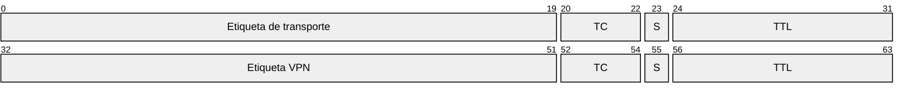

# MPLS-CORP · Redes desde cero, glosario y código explicado

Un router de sucursal envía un ping a otra sede. ¿Cómo consigue entregarlo un proveedor cuyo router central ni siquiera tiene la ruta de esa LAN en su tabla IP?

**Ruta de lectura.** Para una primera explicación lee [los fundamentos](#1-leer-una-red-por-primera-vez), [los protocolos](#2-qué-protocolos-preparan-el-viaje) y [los bytes](#3-anatomía-de-una-trama-byte-por-byte). Continúa con el recorrido específico de la sección 4. Usa el [glosario](#5-glosario-de-consulta) mientras lees. En la [lectura de archivos](#6-lectura-de-los-archivos) cada número corresponde a la línea del original en esta carpeta. La [guía de ejecución](GUIA_EJECUCION_Y_PRUEBAS.md) contiene el procedimiento para reproducir los ejercicios.

## 1. Leer una red por primera vez

Una **sede** es un lugar donde hay equipos de una organización. Una **interfaz** es el punto por el que entra o sale información, como el puerto de un router. Un **enlace** une dos interfaces. Aquí son virtuales, pero el sistema operativo puede enviar, recibir y capturar bytes en cada extremo. Un **router** decide por qué interfaz continuar cuando el destino está en otra red. Una **ruta** combina un conjunto de destinos, una salida y, a menudo, el vecino al que se entregarán los datos.

Imagina que estás en la sede con direcciones `10.10.10.x` y quieres llegar a `10.20.20.x`. Hay dos preguntas distintas. **¿A qué máquina va el mensaje completo?** A la dirección IP de destino. **¿A quién entrego el siguiente tramo?** Al vecino que indica la ruta. Por eso la dirección IP final y la dirección Ethernet del destinatario inmediato suelen identificar equipos distintos. La *puerta de enlace* o *gateway* es el router vecino al que se delega la entrega. El viaje de regreso necesita sus propias rutas.

| Unidad | Cómo reconocerla | Qué delimita |
|---|---|---|
| Bit y byte | Un bit vale 0 o 1. Ocho bits forman un byte u octeto. Dos dígitos hexadecimales expresan un byte, de `00` a `ff`. | Permiten medir y leer los campos que muestra Wireshark. |
| Trama Ethernet, capa 2 (L2) | Empieza por dos direcciones MAC. | Una entrega en un enlace. El router construye otra trama para el enlace siguiente. |
| Paquete IPv4, capa 3 (L3) | Contiene IP de origen y destino. | Una entrega entre redes. Puede viajar dentro de varias tramas sucesivas. |
| Segmento TCP o datagrama UDP, capa 4 | Tiene dos números de puerto. | Comunicación entre programas. Un puerto TCP, como 8080, es un número lógico. `eth1` es una interfaz distinta de ese concepto. |
| Mensaje de aplicación | Por ejemplo, una petición HTTP. | Acción que entiende el programa. Puede ocupar varios segmentos TCP. ICMP Echo, usado por ping, se transporta directamente en IP. |

**Cómo leer una dirección.** IPv4 tiene 32 bits. En `10.10.10.1/24`, los primeros 24 identifican la red y quedan 8 para las direcciones del segmento. El prefijo es `10.10.10.0/24` y la máscara es `255.255.255.0`. En un enlace punto a punto `192.168.1.0/31`, los dos extremos utilizables son `.0` y `.1`. Una ruta `/32` identifica exactamente una dirección. Si dos rutas de la misma tabla coinciden, gana primero la más específica. Una ruta por defecto `0.0.0.0/0` solo gana si no existe una coincidencia más larga. Una *loopback* (`lo`) es una interfaz lógica local. Puede mantener la identidad de un router aunque cambie el enlace físico elegido. [Direcciones /31 en enlaces punto a punto](https://www.rfc-editor.org/rfc/rfc3021.html)

**Tres planos.** Por **gestión** entras desde Cursor mediante SSH y ejecutas comandos en la VM. Por el **plano de control** los routers aprenden qué destinos existen y qué etiquetas usar. Por el **plano de datos** pasa el tráfico del cliente. Docker crea espacios de red separados y Containerlab los une con pares Ethernet virtuales. `eth0` da acceso de gestión y los enlaces dibujados en la topología usan `eth1` en adelante. Un ping por la IP de gestión probaría otra red.

## 2. Qué protocolos preparan el viaje

| Protocolo o mecanismo | Qué pregunta resuelve | Qué intercambia y dónde se ve | Por qué se eligió aquí |
|---|---|---|---|
| Ethernet II y ARP | ¿A qué dirección del enlace envío la trama? | ARP pregunta por una IPv4 local mediante difusión y el dueño contesta con su MAC. Se resuelve la MAC del próximo salto. Ethernet usa esa MAC en los envíos siguientes. | Los pares Ethernet virtuales permiten observar cabeceras reales y usar vecinos dinámicos. Una tabla MAC estática exigiría mantener las direcciones de cada despliegue. |
| IPv4 | ¿A qué destino final va el paquete? | Una cabecera incluye origen, destino, longitud, protocolo y límite de saltos. Es el servicio entregado al cliente. | Los dos proyectos transportan prefijos IPv4. Ofrecer IPv6 requiere direccionamiento y familias de rutas adicionales. |
| OSPFv2 | ¿Cómo llego a la loopback del otro PE por el núcleo? | IP protocolo 89. Los vecinos se descubren con Hello, sincronizan sus bases de estado de enlace y calculan caminos de menor costo. En enlaces punto a punto se evita la elección de router designado. | Las rutas estáticas servirían en una línea pequeña. OSPF descubre cambios y permite explicar costos. IS-IS también sería razonable en un operador, pero aquí añadiría otro esquema de configuración para resolver la misma necesidad. |
| LDP sobre UDP y TCP | ¿Qué etiqueta de transporte espera mi próximo salto para una clase de destinos? | Descubrimiento básico por Hello UDP/646 en los enlaces habilitados. Una sesión TCP/646 intercambia asociaciones entre destino o FEC y etiqueta. Se usa para llegar al PE remoto. | Aprovecha la ruta que ya eligió el IGP. RSVP-TE añade señalización para túneles con restricciones; Segment Routing requiere distribuir identificadores de segmento. Aquí interesa poder correlacionar vecinos, asociaciones y tabla de reenvío. |
| MP-iBGP VPNv4 | ¿Qué LAN está detrás del PE remoto y con qué etiqueta de servicio y política se anuncia? | BGP usa TCP/179 entre las loopbacks de ambos PE. Un anuncio VPNv4 lleva prefijo distinguido por RD, etiqueta VPN, próximo salto y atributos como el RT. | Transporta rutas privadas de clientes con direcciones repetidas y políticas de importación. Redistribuir todas las LAN al OSPF global perdería esa separación y haría crecer las tablas de los P. |
| MPLS en el plano de datos | ¿Qué operación ejecuto al recibir esta etiqueta? | La tabla local indica salida y operación. El borde añade etiquetas (*push*), un tránsito puede sustituir la externa (*swap*) y otro retirarla (*pop*). | El núcleo transporta VPN sin tener que instalar las LAN de cada cliente. A cambio hay que coordinar IGP, distribución de etiquetas y BGP, y reservar espacio para la pila. |
| VRF y rutas estáticas CE–PE | ¿En qué tabla busco y a qué CE entrego esta LAN? | La interfaz de entrada del PE pertenece a una tabla por cliente. Una ruta estática asocia la LAN local con la IP del CE. | Poco estado y fácil inspección con pocas sedes. eBGP en el acceso facilitaría anuncios y retiradas dinámicos, a costa de sesiones y filtros adicionales. |
| ICMP Echo | ¿El destino puede devolver una respuesta IP? | IPv4 protocolo 1. Echo Request tipo 8/código 0 y Echo Reply tipo 0/código 0. Identificador y secuencia relacionan ida y vuelta. | Permite probar alcance y tiempo de ida y vuelta antes de investigar un servicio TCP. Una aplicación puede fallar aunque el ping funcione. |

**Dependencia, paso a paso.** En PE2 existe una ruta hacia la LAN local por su CE. PE2 la exporta a VPNv4 y anuncia la etiqueta con la que acepta tráfico para esa ruta. PE1 recibe el anuncio, comprueba el RT e importa la ruta en la VRF correspondiente. Para enviar al próximo salto BGP (la loopback de PE2), resuelve el camino por OSPF y la etiqueta exterior por LDP. En el paquete de usuario viajan las etiquetas y el paquete IP. Los mensajes OSPF, los anuncios BGP y los mensajes LDP son paquetes de control separados. Un estado BGP `Established` solo confirma la sesión; todavía es necesario comprobar la ruta importada y el reenvío en el kernel.

**Qué tabla mirar.** La RIB contiene rutas aprendidas y su procedencia. La FIB contiene decisiones instaladas para reenviar IP. La LIB almacena asociaciones de etiquetas conocidas por LDP. La LFIB indica qué hacer con una etiqueta entrante. FRR calcula y comunica decisiones; Zebra las integra y solicita su instalación en Linux. Por eso conviene contrastar el resultado de `vtysh` con `ip -f mpls route show`. [OSPFv2](https://www.rfc-editor.org/rfc/rfc2328.html) · [LDP](https://www.rfc-editor.org/rfc/rfc5036.html) · [BGP/MPLS L3VPN](https://www.rfc-editor.org/rfc/rfc4364.html) · [Zebra](https://docs.frrouting.org/en/latest/zebra.html)

## 3. Anatomía de una trama, byte por byte

La tabla usa **desplazamientos desde el primer byte de MAC destino, contando desde cero**. Corresponde a Ethernet II sin VLAN, con dos etiquetas y un paquete IPv4 sin opciones. En la vista de bytes de Wireshark los desplazamientos suelen mostrarse en hexadecimal. Las posiciones siguientes están en decimal.

| Bytes | Campo | Qué significa |
|---|---|---|
| 0–5 | MAC destino, 6 bytes | Interfaz del vecino que recibe esta trama. |
| 6–11 | MAC origen, 6 bytes | Interfaz que transmite en este enlace. |
| 12–13 | EtherType, 2 bytes | `0x8847` indica MPLS unicast. En el acceso, `0x0800` anuncia IPv4 directamente. Una consulta ARP lleva `0x0806`. |
| 14–17 | Primera entrada MPLS, 4 bytes | Etiqueta exterior de transporte, con S=0 porque debajo hay otra. |
| 18–21 | Segunda entrada MPLS, 4 bytes | Etiqueta interior VPN, con S=1 porque debajo empieza la carga. |
| 22–41 | Cabecera IPv4 mínima, 20 bytes | El primer byte suele ser `45`: versión 4 e IHL=5 palabras de cuatro bytes. Con opciones, el campo IHL crece. |
| 42 en adelante | Carga de IPv4 | ICMP si protocolo=1, TCP si=6, UDP si=17 u OSPF si=89. En TCP el comienzo de los datos depende del tamaño de su propia cabecera. |
| Final de Ethernet | Relleno si hace falta y FCS de 4 bytes en Ethernet físico | El FCS detecta alteraciones en la trama. Las capturas en interfaces virtuales suelen omitirlo. Preámbulo, delimitador físico e intervalo entre tramas tampoco se suman a estos offsets. |

**Una etiqueta MPLS por dentro.** De más significativo a menos significativo, cada entrada usa 20 bits de etiqueta, 3 de TC (clase de tráfico), 1 de S (fondo de pila) y 8 de TTL. El valor binario se construye con `(etiqueta << 12) | (TC << 9) | (S << 8) | TTL`. Por ejemplo, 17/TC0/S0/TTL63 da `00 01 10 3f`, y 80/TC0/S1/TTL63 da `00 05 01 3f`. Los números 17 y 80 ilustran la decodificación; FRR puede asignar otros al desplegar. La etiqueta solo tiene significado para quien la recibe en su contexto de reenvío. Un *swap* puede incluso dar el mismo valor numérico si dos equipos lo asignaron independientemente. [Formato MPLS](https://www.rfc-editor.org/rfc/rfc3032.html) · [Nombre y función del campo TC](https://www.rfc-editor.org/rfc/rfc5462.html)

| Dentro de IPv4, desde el inicio de su cabecera | Ancho | Cómo se interpreta |
|---|---|---|
| Byte 0 | 4 + 4 bits | Versión e IHL. |
| Byte 1 | 6 + 2 bits | DSCP para clase de servicio y ECN para señalización de congestión. |
| Bytes 2–3 | 16 bits | Longitud total del paquete IP, incluidas cabecera y carga. Las etiquetas MPLS quedan fuera de este total. |
| Bytes 4–7 | 16 + 3 + 13 bits | Identificación, banderas de fragmentación y posición del fragmento. |
| Bytes 8–11 | 8 + 8 + 16 bits | TTL, protocolo y suma de comprobación de la cabecera. Cuando un salto IP decrementa el TTL debe actualizar la suma. |
| Bytes 12–19 | 32 + 32 bits | Direcciones IPv4 de origen y destino finales. Se mantienen en el recorrido ilustrado; no hay traducción NAT configurada en el acceso del cliente. |
| Tras el byte 19 | Variable | Opciones si IHL > 5, después el mensaje ICMP o segmento TCP. |

**Qué cambia al avanzar.** Con una sola etiqueta, IPv4 empieza en el byte 18. Sin etiquetas, en el 14. En cada enlace enrutado cambian las MAC. Dentro de MPLS se procesa el TTL de la etiqueta superior; la propagación en la entrada y la salida depende del modelo TTL. Por eso el TTL IP observado al final no basta para reconstruir qué P hizo *swap* o *pop*. El valor reservado 3 (*implicit-null*) se comunica en el plano de control: pide al penúltimo salto que retire la etiqueta de transporte. Esa instrucción produce una trama más corta al salir del penúltimo salto. El RD y el RT tampoco ocupan bytes en la trama de datos. [Encapsulación MPLS](https://www.rfc-editor.org/rfc/rfc3032.html) · [Cabecera IPv4](https://www.rfc-editor.org/rfc/rfc791.html)

**MTU y medición.** Cada etiqueta agrega cuatro bytes. Transportar un paquete IP de 1500 bytes con dos etiquetas exige espacio para 1508 bytes de carga Ethernet, más su cabecera de enlace. Un ping pequeño puede funcionar aunque un paquete grande exceda el límite de un enlace. Para comparar tamaños en Wireshark hay que seguir la misma unidad de datos en el mismo sentido y comprobar cuántas etiquetas contiene. El tamaño de una solicitud de aplicación y el tamaño de una trama son magnitudes diferentes.


### Cuatro paquetes de control que puedes reconocer en Wireshark

Imagina que abres una captura antes de hacer ping o registrar el pedido. Los routers pueden estar conversando aunque la aplicación esté en silencio. Hay cuatro conversaciones que conviene distinguir.

| Filtro de visualización | Cómo se encapsula | Qué buscar dentro | Qué concluyes |
|---|---|---|---|
| `arp` | Ethernet → ARP (EtherType 0x0806) | En una petición Ethernet/IPv4 típica, tipo de hardware 1, protocolo 0x0800, longitudes 6 y 4, operación 1, MAC/IP del emisor e IP buscada. En la respuesta, operación 2 y MAC de quien posee la IP. | El equipo resolvió un vecino en ese enlace. Si ya estaba en caché, la petición puede haber ocurrido antes de empezar a capturar. |
| `ospf` | Ethernet → IPv4 protocolo 89 → OSPF | Versión 2, tipo de mensaje, router ID y área. Hello descubre vecinos; Database Description resume la base, Link State Request pide anuncios, Link State Update los entrega y Link State Acknowledgment confirma su recepción. | Dos routers pueden construir la misma vista del núcleo. El estado Full en FRR confirma la sincronización de esa adyacencia. |
| `udp.port == 646 || tcp.port == 646` | Ethernet → IPv4 → UDP o TCP → LDP | Hello descubre candidatos. En TCP se negocia la sesión, se intercambian KeepAlive y mensajes Label Mapping. Busca la FEC para la loopback destino y la etiqueta asociada. | Tener Hellos sin sesión operativa no basta para afirmar que hay un camino etiquetado. |
| `tcp.port == 179` | TCP sobre IP entre los PE → BGP | OPEN negocia capacidades, KEEPALIVE mantiene la sesión y UPDATE lleva anuncios o retiradas. Para VPNv4 busca MP_REACH_NLRI, próximo salto, etiqueta, RD, prefijo y comunidad extendida RT. | El PE ha recibido el anuncio. Comprobar la tabla de la VRF y la FIB permite verificar si además fue importado e instalado. |

Los UPDATE pueden haberse intercambiado antes de abrir Wireshark. En una red estable es normal ver mensajes periódicos y consultar las asociaciones ya aprendidas con FRR. En LDP, **TLV** significa *Type–Length–Value*: cada bloque identifica el tipo de información, su longitud y el valor. En BGP, **MP_REACH_NLRI** es el atributo multiprotocolo para destinos alcanzables; **MP_UNREACH_NLRI** comunica retiradas. [ARP](https://www.rfc-editor.org/rfc/rfc826.html) · [OSPFv2](https://www.rfc-editor.org/rfc/rfc2328.html) · [LDP](https://www.rfc-editor.org/rfc/rfc5036.html) · [Extensiones multiprotocolo de BGP](https://www.rfc-editor.org/rfc/rfc4760.html)

### Esquema de los primeros ocho bytes después de EtherType 0x8847

Cada renglón representa 32 bits, numerados desde el primer bit de la primera etiqueta. En una captura de núcleo con dos etiquetas, al bit 63 le sigue el comienzo de IPv4.



En la fila superior S vale 0 y en la inferior vale 1. Después de PHP la fila inferior pasa a ocupar el primer lugar y mantiene S=1. Los ocho bits TTL de cada entrada son campos separados. La etiqueta superior permite decidir la salida sin buscar el destino IP de la empresa dentro del paquete. [Procesamiento del TTL](https://www.rfc-editor.org/rfc/rfc3443.html)


## 4. Viaje completo de un ping entre las dos sedes

CE1 genera el mensaje en el propio router usando su dirección de loopback `10.10.10.1`. CE2 responde desde `10.20.20.1`. Es una empresa con dos sedes. Las direcciones representan las LAN y aquí los propios CE actúan como extremos de prueba. Los enlaces /31 que empiezan por 192.168 son el acceso CE–PE. Los enlaces 10.0 son el interior del proveedor.

| Qué cruza el enlace | Qué hizo el equipo que acaba de transmitir | Qué hará el receptor |
|---|---|---|
| CE1 eth1 → PE1 eth1 · Ethernet / IPv4 / ICMP | CE1 eligió la ruta a `10.20.20.0/24` por `192.168.1.0`. Usa como MAC destino la de PE1 y como IP destino la de CE2. | PE1 identifica `CUST` por su interfaz de entrada y consulta esa tabla. |
| PE1 eth2 → P eth1 · Ethernet / transporte / VPN / IPv4 / ICMP | PE1 usa la etiqueta VPN de PE2 para la LAN remota. Encima pone la etiqueta LDP que acepta P para la loopback `10.255.255.3/32`. | P consulta su tabla MPLS con la etiqueta exterior. |
| P eth2 → PE2 eth1 · Ethernet / VPN / IPv4 / ICMP | P es el penúltimo salto. Cuando la asociación de PE2 indica implicit-null, P quita la externa y construye una trama dirigida a la MAC de PE2. | PE2 interpreta la etiqueta VPN y efectúa la entrega de servicio. |
| PE2 eth2 → CE2 eth1 · Ethernet / IPv4 / ICMP | PE2 entrega el paquete por la ruta de `CUST` hacia `192.168.2.1`. | CE2 reconoce su propia IP de loopback y crea un mensaje Echo Reply nuevo. |

**Lo que se ve en tu captura.** En el ejemplo que mostraste, la trama 73 de 106 bytes entra en P por `eth1`. Etiqueta 17 arriba y 80 abajo, ambas con TTL 63. La MAC destino pertenece al vecino inmediato, aunque el destino IPv4 siga siendo `10.20.20.1`. La trama 75 de 102 bytes comparte identificador y secuencia de Echo Request. Para confirmar PHP abre sus detalles, comprueba la interfaz de salida `eth2` y busca la única etiqueta interior. Los números de trama solo identifican registros dentro de ese archivo de captura.

**La cuenta a mano.** Una solicitud con 56 bytes de datos de ping lleva 8 bytes de ICMP (tipo 1 byte, código 1, checksum 2, identificador 2, secuencia 2) y 20 bytes de IPv4 sin opciones. Total IP = 84. Al entrar en P se ven 14 + 8 + 84 = **106 bytes**. Al salir se esperan 14 + 4 + 84 = **102 bytes**. En el acceso IP son 14 + 84 = **98 bytes**, con el mismo criterio de captura sin FCS. Esto explica por qué dos registros de distinta longitud pueden representar una única solicitud que cruzó el router. El Echo Reply recorre la dirección contraria y puede llevar otros valores de etiqueta.

**Por qué un solo P.** Con un P se aísla muy bien PHP. Al estar siempre justo antes del PE de salida, el recorrido normal no tiene otro P intermedio que deje una etiqueta de transporte para el siguiente P. Al perderse un enlace del núcleo, esta cadena carece de alternativa. Es la diferencia de diseño que motiva el segundo laboratorio.

### Comprobación guiada desde mpls-node

```bash
sudo docker exec clab-mpls-corp-pe1 vtysh -c 'show ip ospf neighbor' -c 'show ip route 10.255.255.3/32'
sudo docker exec clab-mpls-corp-p vtysh -c 'show mpls ldp neighbor' -c 'show mpls ldp ipv4 binding'
sudo docker exec clab-mpls-corp-pe1 vtysh -c 'show bgp ipv4 vpn' -c 'show ip route vrf CUST'
sudo docker exec clab-mpls-corp-p ip -f mpls route show
sudo docker exec clab-mpls-corp-ce1 ping -c 4 -I 10.10.10.1 10.20.20.1
```

Lee en ese orden: PE1 conoce el camino al otro PE → P tiene vecinos y asociaciones de etiquetas → PE1 recibió la LAN VPN y la importó → el kernel sabe reenviar la etiqueta → el destino responde. En Cursor, captura simultáneamente `p:eth1` y `p:eth2` y filtra por `mpls && icmp.type == 8 && ip.src == 10.10.10.1 && ip.dst == 10.20.20.1`. Compara identificador, secuencia, interfaz y pila. Para observar ARP u OSPF hay que cambiar el filtro. [ICMP](https://www.rfc-editor.org/rfc/rfc792.html) · [Guía de ejecución del laboratorio](GUIA_EJECUCION_Y_PRUEBAS.md)


## 5. Glosario de consulta

| Sigla o término | Nombre completo o significado | Qué hace en esta red |
|---|---|---|
| LAN / WAN | Local / Wide Area Network | La LAN agrupa equipos de una sede. La WAN conecta las sedes mediante el operador. |
| ISP / PoP | Internet Service Provider / Point of Presence | El proveedor presta el servicio privado entre sitios. Un punto de presencia es donde entrega o concentra accesos. El servicio privado puede funcionar sin salida a Internet. |
| CE / PE / P | Customer Edge / Provider Edge / Provider | CE es el router de la sede, PE el borde que discrimina clientes, P el tránsito del proveedor. Son funciones, independientes de marca y modelo. |
| PC / SRV / CUST | Personal Computer / server / customer | Estación, servidor y cliente. En los archivos, `CUST` es un nombre elegido para la VRF, no un protocolo. |
| IP / IPv4 / CIDR | Internet Protocol / versión 4 / Classless Inter-Domain Routing | Una dirección identifica un extremo lógico; la longitud de prefijo agrupa destinos en rutas. |
| MAC / ARP | Media Access Control / Address Resolution Protocol | Dirección de enlace y mecanismo IPv4 para averiguar la dirección del vecino al que se entrega la trama. |
| MTU / FCS / CRC | Maximum Transmission Unit / Frame Check Sequence / Cyclic Redundancy Check | Límite de tamaño, campo de verificación de trama y cálculo usado para obtenerlo. |
| ICMP / RTT | Internet Control Message Protocol / Round-Trip Time | Mensajes de diagnóstico y tiempo desde la solicitud hasta su respuesta. Ping es el nombre de la herramienta. |
| TCP / UDP | Transmission Control Protocol / User Datagram Protocol | TCP ofrece un flujo ordenado con confirmaciones y retransmisión. UDP entrega datagramas sin esa garantía. |
| SYN / ACK / FIN / RST | Synchronize / Acknowledgment / Finish / Reset | Indicadores de TCP para sincronizar secuencias, confirmar recepción, cerrar ordenadamente o restablecer una conexión. |
| IGP / OSPF / SPF | Interior Gateway Protocol / Open Shortest Path First / Shortest Path First | Familia de protocolos internos, protocolo elegido y cálculo del camino de menor costo. El costo es una métrica administrativa. |
| LSA / LSDB / RID | Link-State Advertisement / Link-State Database / Router ID | Descripción de enlaces, base de esas descripciones e identificador estable del router. OSPF usa los tres para construir el mapa. |
| DR / BDR | Designated Router / Backup Designated Router | Coordinan adyacencias en redes OSPF de acceso múltiple. La configuración punto a punto simplifica la relación a dos extremos. |
| MPLS / LSR / LER | Multiprotocol Label Switching / Label Switching Router / Label Edge Router | Reenvío por etiquetas, equipo que las procesa y equipo que adapta el tráfico en el borde del dominio. |
| LDP / FEC / LSP | Label Distribution Protocol / Forwarding Equivalence Class / Label Switched Path | LDP señala etiquetas para destinos tratados igual. El resultado es un camino de reenvío unidireccional; la vuelta usa sus propias asociaciones. |
| PHP / BoS | Penultimate Hop Popping / Bottom of Stack | Retirada de la externa por el penúltimo salto y marca S del último elemento de la pila. |
| TTL / TC / EXP | Time To Live / Traffic Class / nombre histórico Experimental | Límite de saltos y campo de clasificación de tres bits. Algunas vistas de Wireshark muestran EXP en lugar de TC. |
| VPN / RPV / L3VPN | Virtual Private Network / Red Privada Virtual / Layer 3 VPN | Servicio que interconecta redes IP privadas. El aislamiento de rutas y el cifrado son propiedades distintas. |
| VRF | Virtual Routing and Forwarding | Varias tablas de reenvío dentro de un PE. Un mismo destino puede usar salidas distintas según la interfaz de entrada. |
| AS / ASN | Autonomous System / Autonomous System Number | Dominio de administración de rutas y su número. Los PE pertenecen al AS privado 65000. |
| BGP / iBGP / eBGP | Border Gateway Protocol / internal BGP / external BGP | BGP intercambia rutas con atributos. Una sesión dentro del mismo AS es iBGP. Entre AS distintos es eBGP. |
| MP-BGP / VPNv4 | Multiprotocol Extensions for BGP / familia VPN para IPv4 | Extiende BGP para transportar distintas familias de rutas. Aquí los PE intercambian rutas VPNv4 etiquetadas. |
| AFI / SAFI / NLRI | Address Family Identifier / Subsequent Address Family Identifier / Network Layer Reachability Information | Identificadores de familia y subfamilia, e información que anuncia los destinos alcanzables. IPv4 VPN etiquetada usa AFI 1 y SAFI 128. |
| RD / RT | Route Distinguisher / Route Target | RD de 8 bytes distingue prefijos coincidentes en VPNv4. RT es una comunidad extendida que decide qué VRF puede importar una ruta. El número de tabla Linux es otra cosa. |
| RIB / FIB | Routing Information Base / Forwarding Information Base | Rutas del plano de control y decisiones disponibles para el reenvío. |
| LIB / LFIB | Label Information Base / Label Forwarding Information Base | Asociaciones de etiqueta conocidas y acciones instaladas para paquetes etiquetados. |
| NAT / VLAN | Network Address Translation / Virtual LAN | NAT traduce direcciones y una VLAN separa dominios Ethernet. Aquí la separación de rutas del proveedor se implementa con VRF y MPLS. |
| QoS / DSCP / ECN | Quality of Service / Differentiated Services Code Point / Explicit Congestion Notification | Tratamiento diferenciado, marca de seis bits en IP e indicación de congestión. Una cabecera con TC o DSCP visible no demuestra que exista una política de colas. |
| BFD / GTSM | Bidirectional Forwarding Detection / Generalized TTL Security Mechanism | BFD detecta pérdida de comunicación entre motores de reenvío. GTSM comprueba el TTL de determinados paquetes de control según la distancia prevista. |
| FRR / VTY / CLI | FRRouting / Virtual Teletype / Command-Line Interface | Suite de protocolos, interfaz de administración de los procesos y consola de comandos. `vtysh` reúne las consolas de FRR. |
| VM / RAM / ARM64 | Virtual Machine / Random Access Memory / arquitectura ARM de 64 bits | La VM Linux proporciona el kernel a los contenedores del Mac M1. Cada contenedor tiene su propia vista de interfaces y rutas. |
| YAML / JSON | YAML Ain’t Markup Language / JavaScript Object Notation | El YAML describe la topología. El JSON de anotaciones controla su dibujo en Cursor. |
| SSH / VNC | Secure Shell / Virtual Network Computing | Acceso a la terminal remota y tecnología de escritorio remoto. Son herramientas de operación. |
| PCAP / PCAPNG / RX / TX | Packet Capture / PCAP Next Generation / receive / transmit | Archivo de paquetes capturados y contadores en recepción o transmisión desde el punto de vista de una interfaz. |
| RFC / IETF | Request for Comments / Internet Engineering Task Force | Serie de documentos técnicos y organización de estandarización. Los enlaces a RFC permiten comprobar formatos y comportamientos. |
| API / HTTP / HTTPS / TLS | Application Programming Interface / Hypertext Transfer Protocol / HTTP sobre TLS / Transport Layer Security | Contrato de acceso a un servicio, protocolo de solicitudes y respuestas y protección del transporte. HTTP simple permite ver su contenido en captura. |
| URL / SQL / UTF-8 | Uniform Resource Locator / Structured Query Language / Unicode Transformation Format de 8 bits | Dirección de un recurso, lenguaje de una base relacional y codificación de texto en bytes. |
| ID / UUID / CSV / JSONL | Identifier / Universally Unique Identifier / Comma-Separated Values / JSON Lines | Identificador, identificador universal y dos formatos para registrar resultados. Un folio con prefijo de empresa no es automáticamente un UUID. |
| SLA / EF | Service Level Agreement / Expedited Forwarding | Acuerdo de nivel de servicio y clase DiffServ de trato preferente. Sirven para discutir mediciones y posibles extensiones. |

**Ejemplo para recordar RD, RT y etiqueta.** En la tabla de control buscas el *nombre completo* de una ruta con su RD. Para decidir en qué tabla colocarla consultas el RT. Cuando llega una trama desde el núcleo, Linux usa la acción asociada a la etiqueta interior. Son tres decisiones en momentos distintos. [Arquitectura VPN de capa 3](https://www.rfc-editor.org/rfc/rfc4364.html)

### Por qué estos equipos

| Decisión | Ventaja para este proyecto | Alternativa y cuándo tendría sentido |
|---|---|---|
| Router Linux con FRR en P y PE | Permite inspeccionar por separado protocolo, kernel y captura en la misma VM. Una misma imagen desempeña dos papeles según sus procesos e interfaces. | Una imagen de sistema operativo de fabricante sirve para aprender su CLI y funciones particulares. Un router físico permite además medir interfaces, ASIC y colas reales, con mayor costo de equipo. Los tiempos de una VM dependen de la carga del anfitrión. |
| Alpine en CE | Las rutas conectadas y estáticas bastan para una sede con un solo proveedor y una sola salida de datos hacia él. | FRR también en el CE permite eBGP y políticas de prefijos si hay muchos cambios o más de un acceso. |
| Dos PE | Hay un punto de entrada y otro de salida donde colocar cada sede en su tabla. Permiten estudiar cómo se anuncia una ruta remota y cómo se entrega el paquete. | Con un solo PE se puede estudiar segmentación local, pero desaparecería el trayecto VPNv4 entre PE. |
| VRF en una infraestructura compartida | Cada cliente tiene una vista propia y los P pueden limitarse a transportar tráfico entre PE. | Un router y cables dedicados por cliente simplificarían el aislamiento físico, a costa de duplicar la infraestructura. Una VPN IPsec aporta cifrado y requiere distribuir credenciales y gestionar túneles. |
| Enlaces enrutados /31 y loopbacks /32 | Dos direcciones por cable y un identificador estable por router. Un prefijo /32 hacia la loopback permite resolver con precisión el próximo salto BGP. | Un /30 usa cuatro direcciones por enlace. Identificar BGP por la IP del cable ata la sesión a ese enlace concreto. |
| Edgeshark y Wireshark | Permiten seleccionar interfaces de contenedores desde el editor y decodificar el mismo flujo en puntos distintos. | `tcpdump` en el espacio de red del nodo es ligero y produce archivos de captura analizables después. |


## 6. Lectura de los archivos

Empieza por el YAML (cables y equipos), continúa con frr.conf (reglas de cada router) y después con daemons (qué programas leen esas reglas). La sangría YAML expresa pertenencia y el guion introduce un elemento de lista. En FRR, la misma palabra interface abre el puerto del router o habilita LDP según el bloque. Las líneas vacías solo dan separación visual.

**Saltar a un archivo anotado** · [mpls-corp.clab.yml](#mpls-corpclabyml) · [configs/p/frr.conf](#configspfrrconf) · [configs/pe1/frr.conf](#configspe1frrconf) · [configs/pe2/frr.conf](#configspe2frrconf)

### mpls-corp.clab.yml

Fuente: [mpls-corp.clab.yml](mpls-corp.clab.yml). Ubica el número en el margen del editor. Las filas siguen el orden físico del archivo.

| Línea | Instrucción | Lectura |
|---:|---|---|
| 1 | `name: mpls-corp` | Nombre del despliegue. Los contenedores usan el prefijo clab-mpls-corp-. |
| 2 | `topology:` | Comienza la descripción de máquinas y cables virtuales. |
| 3 | `nodes:` | Agrupa los equipos que se crearán. |
| 4 | `pe1: # Provider Edge 1 (Router que conecta al cliente)` | Define pe1. Borde de entrada para el recorrido de ida. |
| 5 | `kind: linux` | Crea un nodo Linux con su propio espacio de red dentro de la VM. |
| 6 | `image: frrouting/frr:latest` | Imagen de FRRouting. Los daemons habilitados determinan si este nodo es PE o P. latest es una etiqueta mutable. |
| 7 | `binds:` | Vincula archivos o carpetas del proyecto con rutas internas del contenedor. |
| 8 | `- ./configs/pe1/daemons:/etc/frr/daemons` | Monta ./configs/pe1/daemons en /etc/frr/daemons. FRR leerá qué procesos iniciar. |
| 9 | `- ./configs/pe1/frr.conf:/etc/frr/frr.conf` | Monta ./configs/pe1/frr.conf en /etc/frr/frr.conf. FRR leerá las instrucciones de enrutamiento de este nodo. |
| 10 | `sysctls:` | Configura parámetros del kernel para el espacio de red del nodo. |
| 11 | `net.ipv4.ip_forward: "1"` | Autoriza a Linux a reenviar paquetes entre interfaces. Una máquina que origina mensajes propios no precisa este permiso para originarlos. |
| 12 | `net.mpls.platform_labels: "1048575"` | Dimensiona la tabla de etiquetas de plataforma de Linux. Es un límite de entradas, no el valor de etiqueta fijado para el cliente. |
| 13 | `exec:` | Ejecuta en este nodo las órdenes de preparación tras crear sus interfaces. |
| 14 | `- sysctl -w net.mpls.conf.lo.input=1` | Permite al kernel aceptar paquetes MPLS recibidos por lo de pe1. El reenvío necesita además una entrada para la etiqueta. |
| 15 | `- sysctl -w net.mpls.conf.eth2.input=1` | Permite al kernel aceptar paquetes MPLS recibidos por eth2 de pe1. El reenvío necesita además una entrada para la etiqueta. |
| 16 | `- sh -ec 'ip link show dev CUST >/dev/null 2>&1 \|\| ip link add CUST type vrf table 100'` | Busca el dispositivo CUST. Redirige salida y errores a /dev/null. Si falta (\|\|), crea una VRF ligada a la tabla Linux 100. -c ejecuta el texto y -e propaga fallos no contemplados. |
| 17 | `- ip link set dev CUST up` | Activa administrativamente el dispositivo de VRF CUST. |
| 18 | `- ip link set dev eth1 master CUST` | Asocia eth1 a la VRF CUST. Los paquetes IP recibidos por ese acceso se consultarán en la tabla del cliente. |
| 19 | `- ip address replace 192.168.1.0/31 dev eth1` | Establece o actualiza 192.168.1.0/31 en pe1:eth1. El prefijo permite determinar qué vecinos están directamente conectados. |
| 20 | `p:   # Provider Core (Router del núcleo del ISP)` | Define p. Router de tránsito del proveedor (P1). |
| 21 | `kind: linux` | Crea un nodo Linux con su propio espacio de red dentro de la VM. |
| 22 | `image: frrouting/frr:latest` | Imagen de FRRouting. Los daemons habilitados determinan si este nodo es PE o P. latest es una etiqueta mutable. |
| 23 | `binds:` | Vincula archivos o carpetas del proyecto con rutas internas del contenedor. |
| 24 | `- ./configs/p/daemons:/etc/frr/daemons` | Monta ./configs/p/daemons en /etc/frr/daemons. FRR leerá qué procesos iniciar. |
| 25 | `- ./configs/p/frr.conf:/etc/frr/frr.conf` | Monta ./configs/p/frr.conf en /etc/frr/frr.conf. FRR leerá las instrucciones de enrutamiento de este nodo. |
| 26 | `sysctls:` | Configura parámetros del kernel para el espacio de red del nodo. |
| 27 | `net.ipv4.ip_forward: "1"` | Autoriza a Linux a reenviar paquetes entre interfaces. Una máquina que origina mensajes propios no precisa este permiso para originarlos. |
| 28 | `net.mpls.platform_labels: "1048575"` | Dimensiona la tabla de etiquetas de plataforma de Linux. Es un límite de entradas, no el valor de etiqueta fijado para el cliente. |
| 29 | `exec:` | Ejecuta en este nodo las órdenes de preparación tras crear sus interfaces. |
| 30 | `- sysctl -w net.mpls.conf.eth1.input=1` | Permite al kernel aceptar paquetes MPLS recibidos por eth1 de p. El reenvío necesita además una entrada para la etiqueta. |
| 31 | `- sysctl -w net.mpls.conf.eth2.input=1` | Permite al kernel aceptar paquetes MPLS recibidos por eth2 de p. El reenvío necesita además una entrada para la etiqueta. |
| 32 | `pe2: # Provider Edge 2` | Define pe2. Borde de salida para el recorrido de ida. |
| 33 | `kind: linux` | Crea un nodo Linux con su propio espacio de red dentro de la VM. |
| 34 | `image: frrouting/frr:latest` | Imagen de FRRouting. Los daemons habilitados determinan si este nodo es PE o P. latest es una etiqueta mutable. |
| 35 | `binds:` | Vincula archivos o carpetas del proyecto con rutas internas del contenedor. |
| 36 | `- ./configs/pe2/daemons:/etc/frr/daemons` | Monta ./configs/pe2/daemons en /etc/frr/daemons. FRR leerá qué procesos iniciar. |
| 37 | `- ./configs/pe2/frr.conf:/etc/frr/frr.conf` | Monta ./configs/pe2/frr.conf en /etc/frr/frr.conf. FRR leerá las instrucciones de enrutamiento de este nodo. |
| 38 | `sysctls:` | Configura parámetros del kernel para el espacio de red del nodo. |
| 39 | `net.ipv4.ip_forward: "1"` | Autoriza a Linux a reenviar paquetes entre interfaces. Una máquina que origina mensajes propios no precisa este permiso para originarlos. |
| 40 | `net.mpls.platform_labels: "1048575"` | Dimensiona la tabla de etiquetas de plataforma de Linux. Es un límite de entradas, no el valor de etiqueta fijado para el cliente. |
| 41 | `exec:` | Ejecuta en este nodo las órdenes de preparación tras crear sus interfaces. |
| 42 | `- sysctl -w net.mpls.conf.lo.input=1` | Permite al kernel aceptar paquetes MPLS recibidos por lo de pe2. El reenvío necesita además una entrada para la etiqueta. |
| 43 | `- sysctl -w net.mpls.conf.eth1.input=1` | Permite al kernel aceptar paquetes MPLS recibidos por eth1 de pe2. El reenvío necesita además una entrada para la etiqueta. |
| 44 | `- sh -ec 'ip link show dev CUST >/dev/null 2>&1 \|\| ip link add CUST type vrf table 100'` | Busca el dispositivo CUST. Redirige salida y errores a /dev/null. Si falta (\|\|), crea una VRF ligada a la tabla Linux 100. -c ejecuta el texto y -e propaga fallos no contemplados. |
| 45 | `- ip link set dev CUST up` | Activa administrativamente el dispositivo de VRF CUST. |
| 46 | `- ip link set dev eth2 master CUST` | Asocia eth2 a la VRF CUST. Los paquetes IP recibidos por ese acceso se consultarán en la tabla del cliente. |
| 47 | `- ip address replace 192.168.2.0/31 dev eth2` | Establece o actualiza 192.168.2.0/31 en pe2:eth2. El prefijo permite determinar qué vecinos están directamente conectados. |
| 48 | `ce1: # Customer Edge 1 (Sucursal A del Cliente)` | Define ce1. Router de la primera sede de A. |
| 49 | `kind: linux` | Crea un nodo Linux con su propio espacio de red dentro de la VM. |
| 50 | `image: alpine:latest` | Linux Alpine ligero. El CE usa comandos ip y rutas estáticas. latest puede variar entre despliegues. |
| 51 | `exec:` | Ejecuta en este nodo las órdenes de preparación tras crear sus interfaces. |
| 52 | `- ip address add 192.168.1.1/31 dev eth1` | Añade 192.168.1.1/31 en ce1:eth1. El prefijo permite determinar qué vecinos están directamente conectados. |
| 53 | `- ip address add 10.10.10.1/24 dev lo` | Añade 10.10.10.1/24 en ce1:lo. Es una dirección local que permanece disponible sin un cable propio. |
| 54 | `- ip route replace 10.20.20.0/24 via 192.168.1.0 dev eth1` | Para 10.20.20.0/24, entrega al vecino 192.168.1.0 por ce1:eth1. Instala la ruta de datos específica, preferida frente a la ruta por defecto de gestión. |
| 55 | `ce2: # Customer Edge 2 (Sucursal B del Cliente)` | Define ce2. Router de la segunda sede de A. |
| 56 | `kind: linux` | Crea un nodo Linux con su propio espacio de red dentro de la VM. |
| 57 | `image: alpine:latest` | Linux Alpine ligero. El CE usa comandos ip y rutas estáticas. latest puede variar entre despliegues. |
| 58 | `exec:` | Ejecuta en este nodo las órdenes de preparación tras crear sus interfaces. |
| 59 | `- ip address add 192.168.2.1/31 dev eth1` | Añade 192.168.2.1/31 en ce2:eth1. El prefijo permite determinar qué vecinos están directamente conectados. |
| 60 | `- ip address add 10.20.20.1/24 dev lo` | Añade 10.20.20.1/24 en ce2:lo. Es una dirección local que permanece disponible sin un cable propio. |
| 61 | `- ip route replace 10.10.10.0/24 via 192.168.2.0 dev eth1` | Para 10.10.10.0/24, entrega al vecino 192.168.2.0 por ce2:eth1. Instala la ruta de datos específica, preferida frente a la ruta por defecto de gestión. |
| 63 | `links:` | Cada elemento de esta lista une dos interfaces mediante un par Ethernet virtual. |
| 64 | `- endpoints: ["ce1:eth1", "pe1:eth1"]` | Conecta ce1:eth1 con pe1:eth1. Es un enlace de acceso o de LAN del cliente; el tráfico de usuario aquí es IPv4 sobre Ethernet. |
| 65 | `- endpoints: ["pe1:eth2", "p:eth1"]` | Conecta pe1:eth2 con p:eth1. Es tránsito del proveedor; circulan control del núcleo y tráfico MPLS. |
| 66 | `- endpoints: ["p:eth2", "pe2:eth1"]` | Conecta p:eth2 con pe2:eth1. Es tránsito del proveedor; circulan control del núcleo y tráfico MPLS. |
| 67 | `- endpoints: ["pe2:eth2", "ce2:eth1"]` | Conecta pe2:eth2 con ce2:eth1. Es un enlace de acceso o de LAN del cliente; el tráfico de usuario aquí es IPv4 sobre Ethernet. |


### configs/p/frr.conf

Fuente: [frr.conf](configs/p/frr.conf). Ubica el número en el margen del editor. Las filas siguen el orden físico del archivo.

| Línea | Instrucción | Lectura |
|---:|---|---|
| 1 | `hostname p` | Asigna el nombre de equipo que aparecerá en su consola. |
| 2 | `!` | Separador visual entre bloques de FRR. |
| 3 | `interface lo` | Abre la configuración de lo para identificar al router independientemente de sus cables. |
| 4 | `ip address 10.255.255.2/32` | Asigna 10.255.255.2/32 a lo. El /32 identifica este equipo para transporte/control. |
| 5 | `ip ospf area 0` | Incluye lo en el área troncal 0 para anunciar su prefijo como dirección del router. |
| 6 | `!` | Separador visual entre bloques de FRR. |
| 7 | `interface eth1` | Abre la configuración de eth1 para direccionamiento y OSPF del núcleo. |
| 8 | `ip address 10.0.12.1/31` | Asigna 10.0.12.1/31 a eth1. El /31 identifica un extremo de un enlace punto a punto. |
| 9 | `ip ospf network point-to-point` | Declara el enlace como punto a punto. OSPF espera un vecino del otro lado y omite la elección de DR/BDR. |
| 10 | `ip ospf area 0` | Incluye eth1 en el área troncal 0 para anunciar su prefijo y establecer vecindad con el otro extremo. |
| 11 | `!` | Separador visual entre bloques de FRR. |
| 12 | `interface eth2` | Abre la configuración de eth2 para direccionamiento y OSPF del núcleo. |
| 13 | `ip address 10.0.23.0/31` | Asigna 10.0.23.0/31 a eth2. El /31 identifica un extremo de un enlace punto a punto. |
| 14 | `ip ospf network point-to-point` | Declara el enlace como punto a punto. OSPF espera un vecino del otro lado y omite la elección de DR/BDR. |
| 15 | `ip ospf area 0` | Incluye eth2 en el área troncal 0 para anunciar su prefijo y establecer vecindad con el otro extremo. |
| 16 | `!` | Separador visual entre bloques de FRR. |
| 17 | `router ospf` | Abre el proceso OSPFv2 que calcula la alcanzabilidad IPv4 del proveedor. |
| 18 | `ospf router-id 10.255.255.2` | Usa 10.255.255.2 como identificador estable en OSPF. Su aspecto es de IPv4, pero su función aquí es identificar el router. |
| 19 | `exit` | Regresa un nivel de configuración. |
| 20 | `!` | Separador visual entre bloques de FRR. |
| 21 | `mpls ldp` | Abre el proceso que distribuye etiquetas de transporte en el núcleo. |
| 22 | `router-id 10.255.255.2` | Usa 10.255.255.2 como identificador estable en LDP. Su aspecto es de IPv4, pero su función aquí es identificar el router. |
| 23 | `address-family ipv4` | Configura LDP para destinos IPv4. |
| 24 | `discovery transport-address 10.255.255.2` | Anuncia 10.255.255.2 como extremo de transporte de la sesión TCP de LDP. OSPF debe proporcionar alcance a esa dirección. |
| 25 | `interface eth1` | Habilita descubrimiento LDP en eth1 para intercambiar etiquetas con el vecino. |
| 26 | `exit` | Regresa un nivel de configuración. |
| 27 | `interface eth2` | Habilita descubrimiento LDP en eth2 para intercambiar etiquetas con el vecino. |
| 28 | `exit` | Regresa un nivel de configuración. |
| 29 | `exit-address-family` | Termina los ajustes de esta familia y vuelve al contexto superior. |
| 30 | `exit` | Regresa un nivel de configuración. |


### configs/pe1/frr.conf

Fuente: [frr.conf](configs/pe1/frr.conf). Ubica el número en el margen del editor. Las filas siguen el orden físico del archivo.

| Línea | Instrucción | Lectura |
|---:|---|---|
| 1 | `hostname pe1` | Asigna el nombre de equipo que aparecerá en su consola. |
| 2 | `!` | Separador visual entre bloques de FRR. |
| 3 | `interface lo` | Abre la configuración de lo para identificar al router independientemente de sus cables. |
| 4 | `ip address 10.255.255.1/32` | Asigna 10.255.255.1/32 a lo. El /32 identifica este equipo para transporte/control. |
| 5 | `ip ospf area 0` | Incluye lo en el área troncal 0 para anunciar su prefijo como dirección del router. |
| 6 | `!` | Separador visual entre bloques de FRR. |
| 7 | `interface eth2` | Abre la configuración de eth2 para direccionamiento y OSPF del núcleo. |
| 8 | `ip address 10.0.12.0/31` | Asigna 10.0.12.0/31 a eth2. El /31 identifica un extremo de un enlace punto a punto. |
| 9 | `ip ospf network point-to-point` | Declara el enlace como punto a punto. OSPF espera un vecino del otro lado y omite la elección de DR/BDR. |
| 10 | `ip ospf area 0` | Incluye eth2 en el área troncal 0 para anunciar su prefijo y establecer vecindad con el otro extremo. |
| 11 | `!` | Separador visual entre bloques de FRR. |
| 12 | `router ospf` | Abre el proceso OSPFv2 que calcula la alcanzabilidad IPv4 del proveedor. |
| 13 | `ospf router-id 10.255.255.1` | Usa 10.255.255.1 como identificador estable en OSPF. Su aspecto es de IPv4, pero su función aquí es identificar el router. |
| 14 | `exit` | Regresa un nivel de configuración. |
| 15 | `!` | Separador visual entre bloques de FRR. |
| 16 | `mpls ldp` | Abre el proceso que distribuye etiquetas de transporte en el núcleo. |
| 17 | `router-id 10.255.255.1` | Usa 10.255.255.1 como identificador estable en LDP. Su aspecto es de IPv4, pero su función aquí es identificar el router. |
| 18 | `address-family ipv4` | Configura LDP para destinos IPv4. |
| 19 | `discovery transport-address 10.255.255.1` | Anuncia 10.255.255.1 como extremo de transporte de la sesión TCP de LDP. OSPF debe proporcionar alcance a esa dirección. |
| 20 | `interface eth2` | Habilita descubrimiento LDP en eth2 para intercambiar etiquetas con el vecino. |
| 21 | `exit` | Regresa un nivel de configuración. |
| 22 | `exit-address-family` | Termina los ajustes de esta familia y vuelve al contexto superior. |
| 23 | `exit` | Regresa un nivel de configuración. |
| 24 | `!` | Separador visual entre bloques de FRR. |
| 25 | `vrf CUST` | Abre la tabla privada CUST en FRR. El dispositivo Linux correspondiente se define en el YAML. |
| 26 | `ip route 10.10.10.0/24 192.168.1.1` | Instala la estática para 10.10.10.0/24 por el CE 192.168.1.1 en la VRF abierta inmediatamente arriba. |
| 27 | `exit-vrf` | Termina el bloque de rutas privadas de esta VRF. |
| 28 | `!` | Separador visual entre bloques de FRR. |
| 29 | `router bgp 65000` | Abre BGP del AS 65000 en el contexto global, donde se mantiene la sesión VPNv4 entre PE. |
| 30 | `bgp router-id 10.255.255.1` | Usa 10.255.255.1 como identificador estable en BGP. Su aspecto es de IPv4, pero su función aquí es identificar el router. |
| 31 | `no bgp default ipv4-unicast` | Requiere activar explícitamente la familia deseada en cada vecino. Este par de PE intercambia VPNv4. |
| 32 | `neighbor 10.255.255.3 remote-as 65000` | Declara a 10.255.255.3 vecino del mismo AS 65000; la sesión es interna (iBGP). |
| 33 | `neighbor 10.255.255.3 update-source lo` | Usa la loopback local como origen TCP al contactar a 10.255.255.3. |
| 34 | `address-family ipv4 vpn` | Abre la familia que transporta rutas VPNv4 etiquetadas entre PE. |
| 35 | `neighbor 10.255.255.3 activate` | Habilita la familia VPNv4 para intercambiar rutas con 10.255.255.3. |
| 36 | `neighbor 10.255.255.3 next-hop-self` | Configura a este PE como próximo salto para los anuncios a 10.255.255.3 a los que se aplica la regla. |
| 37 | `neighbor 10.255.255.3 send-community extended` | Envía comunidades extendidas al vecino 10.255.255.3, incluido el RT que usará al decidir la importación. |
| 38 | `exit-address-family` | Termina los ajustes de esta familia y vuelve al contexto superior. |
| 39 | `exit` | Regresa un nivel de configuración. |
| 40 | `!` | Separador visual entre bloques de FRR. |
| 41 | `router bgp 65000 vrf CUST` | Abre BGP del AS 65000 en la tabla privada CUST para importar/exportar sus rutas. |
| 42 | `bgp router-id 10.255.255.1` | Usa 10.255.255.1 como identificador estable en BGP. Su aspecto es de IPv4, pero su función aquí es identificar el router. |
| 43 | `address-family ipv4 unicast` | Abre las rutas IPv4 con un destino individual de la VRF de cliente. |
| 44 | `redistribute connected` | Incorpora los prefijos conectados de esta VRF a BGP, incluidos los /31 de acceso. La configuración no filtra únicamente LAN. |
| 45 | `redistribute static` | Incorpora a BGP las rutas estáticas de la VRF. Así se puede exportar la LAN configurada por el CE. |
| 46 | `rd vpn export 65000:1` | Antepondrá RD 65000:1 al prefijo al exportarlo a VPNv4. Permite distinguir el mismo prefijo originado en otra VPN. |
| 47 | `rt vpn both 65000:100` | Asigna RT 65000:100 al exportar y acepta esa misma comunidad al importar (both). |
| 48 | `label vpn export auto` | Solicita asignación automática de la etiqueta de servicio que anunciará el PE. La etiqueta concreta se consulta en ejecución. |
| 49 | `export vpn` | Habilita copiar las rutas elegibles de la VRF a VPNv4 con su RD, RT y etiqueta. |
| 50 | `import vpn` | Habilita copiar a esta VRF rutas VPNv4 compatibles con su política de importación. |
| 51 | `exit-address-family` | Termina los ajustes de esta familia y vuelve al contexto superior. |
| 52 | `exit` | Regresa un nivel de configuración. |


### configs/pe2/frr.conf

Fuente: [frr.conf](configs/pe2/frr.conf). Ubica el número en el margen del editor. Las filas siguen el orden físico del archivo.

| Línea | Instrucción | Lectura |
|---:|---|---|
| 1 | `hostname pe2` | Asigna el nombre de equipo que aparecerá en su consola. |
| 2 | `!` | Separador visual entre bloques de FRR. |
| 3 | `interface lo` | Abre la configuración de lo para identificar al router independientemente de sus cables. |
| 4 | `ip address 10.255.255.3/32` | Asigna 10.255.255.3/32 a lo. El /32 identifica este equipo para transporte/control. |
| 5 | `ip ospf area 0` | Incluye lo en el área troncal 0 para anunciar su prefijo como dirección del router. |
| 6 | `!` | Separador visual entre bloques de FRR. |
| 7 | `interface eth1` | Abre la configuración de eth1 para direccionamiento y OSPF del núcleo. |
| 8 | `ip address 10.0.23.1/31` | Asigna 10.0.23.1/31 a eth1. El /31 identifica un extremo de un enlace punto a punto. |
| 9 | `ip ospf network point-to-point` | Declara el enlace como punto a punto. OSPF espera un vecino del otro lado y omite la elección de DR/BDR. |
| 10 | `ip ospf area 0` | Incluye eth1 en el área troncal 0 para anunciar su prefijo y establecer vecindad con el otro extremo. |
| 11 | `!` | Separador visual entre bloques de FRR. |
| 12 | `router ospf` | Abre el proceso OSPFv2 que calcula la alcanzabilidad IPv4 del proveedor. |
| 13 | `ospf router-id 10.255.255.3` | Usa 10.255.255.3 como identificador estable en OSPF. Su aspecto es de IPv4, pero su función aquí es identificar el router. |
| 14 | `exit` | Regresa un nivel de configuración. |
| 15 | `!` | Separador visual entre bloques de FRR. |
| 16 | `mpls ldp` | Abre el proceso que distribuye etiquetas de transporte en el núcleo. |
| 17 | `router-id 10.255.255.3` | Usa 10.255.255.3 como identificador estable en LDP. Su aspecto es de IPv4, pero su función aquí es identificar el router. |
| 18 | `address-family ipv4` | Configura LDP para destinos IPv4. |
| 19 | `discovery transport-address 10.255.255.3` | Anuncia 10.255.255.3 como extremo de transporte de la sesión TCP de LDP. OSPF debe proporcionar alcance a esa dirección. |
| 20 | `interface eth1` | Habilita descubrimiento LDP en eth1 para intercambiar etiquetas con el vecino. |
| 21 | `exit` | Regresa un nivel de configuración. |
| 22 | `exit-address-family` | Termina los ajustes de esta familia y vuelve al contexto superior. |
| 23 | `exit` | Regresa un nivel de configuración. |
| 24 | `!` | Separador visual entre bloques de FRR. |
| 25 | `vrf CUST` | Abre la tabla privada CUST en FRR. El dispositivo Linux correspondiente se define en el YAML. |
| 26 | `ip route 10.20.20.0/24 192.168.2.1` | Instala la estática para 10.20.20.0/24 por el CE 192.168.2.1 en la VRF abierta inmediatamente arriba. |
| 27 | `exit-vrf` | Termina el bloque de rutas privadas de esta VRF. |
| 28 | `!` | Separador visual entre bloques de FRR. |
| 29 | `router bgp 65000` | Abre BGP del AS 65000 en el contexto global, donde se mantiene la sesión VPNv4 entre PE. |
| 30 | `bgp router-id 10.255.255.3` | Usa 10.255.255.3 como identificador estable en BGP. Su aspecto es de IPv4, pero su función aquí es identificar el router. |
| 31 | `no bgp default ipv4-unicast` | Requiere activar explícitamente la familia deseada en cada vecino. Este par de PE intercambia VPNv4. |
| 32 | `neighbor 10.255.255.1 remote-as 65000` | Declara a 10.255.255.1 vecino del mismo AS 65000; la sesión es interna (iBGP). |
| 33 | `neighbor 10.255.255.1 update-source lo` | Usa la loopback local como origen TCP al contactar a 10.255.255.1. |
| 34 | `address-family ipv4 vpn` | Abre la familia que transporta rutas VPNv4 etiquetadas entre PE. |
| 35 | `neighbor 10.255.255.1 activate` | Habilita la familia VPNv4 para intercambiar rutas con 10.255.255.1. |
| 36 | `neighbor 10.255.255.1 next-hop-self` | Configura a este PE como próximo salto para los anuncios a 10.255.255.1 a los que se aplica la regla. |
| 37 | `neighbor 10.255.255.1 send-community extended` | Envía comunidades extendidas al vecino 10.255.255.1, incluido el RT que usará al decidir la importación. |
| 38 | `exit-address-family` | Termina los ajustes de esta familia y vuelve al contexto superior. |
| 39 | `exit` | Regresa un nivel de configuración. |
| 40 | `!` | Separador visual entre bloques de FRR. |
| 41 | `router bgp 65000 vrf CUST` | Abre BGP del AS 65000 en la tabla privada CUST para importar/exportar sus rutas. |
| 42 | `bgp router-id 10.255.255.3` | Usa 10.255.255.3 como identificador estable en BGP. Su aspecto es de IPv4, pero su función aquí es identificar el router. |
| 43 | `address-family ipv4 unicast` | Abre las rutas IPv4 con un destino individual de la VRF de cliente. |
| 44 | `redistribute connected` | Incorpora los prefijos conectados de esta VRF a BGP, incluidos los /31 de acceso. La configuración no filtra únicamente LAN. |
| 45 | `redistribute static` | Incorpora a BGP las rutas estáticas de la VRF. Así se puede exportar la LAN configurada por el CE. |
| 46 | `rd vpn export 65000:1` | Antepondrá RD 65000:1 al prefijo al exportarlo a VPNv4. Permite distinguir el mismo prefijo originado en otra VPN. |
| 47 | `rt vpn both 65000:100` | Asigna RT 65000:100 al exportar y acepta esa misma comunidad al importar (both). |
| 48 | `label vpn export auto` | Solicita asignación automática de la etiqueta de servicio que anunciará el PE. La etiqueta concreta se consulta en ejecución. |
| 49 | `export vpn` | Habilita copiar las rutas elegibles de la VRF a VPNv4 con su RD, RT y etiqueta. |
| 50 | `import vpn` | Habilita copiar a esta VRF rutas VPNv4 compatibles con su política de importación. |
| 51 | `exit-address-family` | Termina los ajustes de esta familia y vuelve al contexto superior. |
| 52 | `exit` | Regresa un nivel de configuración. |


### Cómo leer las plantillas daemons

Un sufijo d suele indicar daemon, un programa de fondo. yes/no selecciona procesos. Las opciones que terminan en _options solo se usan si el programa arranca. Los permisos del encabezado se refieren a los archivos de configuración del contenedor. Las líneas que empiezan por # son comentarios. Las copias idénticas se explican una vez con la correspondencia exacta de archivos.

**Se aplica a** [configs/p/daemons](configs/p/daemons).

### configs/p/daemons

Fuente: [daemons](configs/p/daemons). Ubica el número en el margen del editor. Las filas siguen el orden físico del archivo.

| Línea | Instrucción | Lectura |
|---:|---|---|
| 17 | `bgpd=no` | Mantiene deshabilitado BGP, intercambio de rutas VPNv4. |
| 18 | `ospfd=yes` | Inicia OSPFv2, cálculo de rutas IPv4 internas. |
| 19 | `ospf6d=no` | Mantiene deshabilitado OSPFv3, enrutamiento para IPv6. |
| 20 | `ripd=no` | Mantiene deshabilitado Routing Information Protocol, rutas por vector de distancia. |
| 21 | `ripngd=no` | Mantiene deshabilitado RIP next generation para IPv6. |
| 22 | `isisd=no` | Mantiene deshabilitado Intermediate System to Intermediate System, IGP de estado de enlace. |
| 23 | `pimd=no` | Mantiene deshabilitado Protocol Independent Multicast para distribución a grupos IPv4. |
| 24 | `pim6d=no` | Mantiene deshabilitado PIM para grupos IPv6. |
| 25 | `ldpd=yes` | Inicia LDP, asociaciones de etiquetas de transporte. |
| 26 | `nhrpd=no` | Mantiene deshabilitado Next Hop Resolution Protocol, resolución de próximos saltos en redes superpuestas. |
| 27 | `eigrpd=no` | Mantiene deshabilitado Enhanced Interior Gateway Routing Protocol, IGP por vector de distancia avanzado. |
| 28 | `babeld=no` | Mantiene deshabilitado Babel, IGP por vector de distancia. |
| 29 | `sharpd=no` | Mantiene deshabilitado SHARP, herramienta de pruebas para inyectar rutas. |
| 30 | `pbrd=no` | Mantiene deshabilitado Policy-Based Routing, selección por políticas. |
| 31 | `bfdd=no` | Mantiene deshabilitado Bidirectional Forwarding Detection, detección rápida de fallos. |
| 32 | `fabricd=no` | Mantiene deshabilitado OpenFabric, enrutamiento para redes de tipo fabric. |
| 33 | `vrrpd=no` | Mantiene deshabilitado Virtual Router Redundancy Protocol, gateway virtual redundante. |
| 34 | `pathd=no` | Mantiene deshabilitado gestión de caminos y políticas de ingeniería de tráfico. |
| 41 | `vtysh_enable=yes` | Carga la configuración integrada mediante vtysh durante el arranque. |
| 42 | `zebra_options="  -A 127.0.0.1 -s 90000000"` | Argumentos de zebra (coordinación de rutas, interfaces y comunicación con el kernel). -A limita su consola a 127.0.0.1, loopback IPv4. -s solicita el tamaño del búfer de recepción del socket netlink de Zebra para comunicación con el kernel. Esta línea por sí sola no inicia el proceso. |
| 43 | `bgpd_options="   -A 127.0.0.1"` | Argumentos de bgpd (BGP, intercambio de rutas VPNv4). -A limita su consola a 127.0.0.1, loopback IPv4. Esta línea por sí sola no inicia el proceso. |
| 44 | `ospfd_options="  -A 127.0.0.1"` | Argumentos de ospfd (OSPFv2, cálculo de rutas IPv4 internas). -A limita su consola a 127.0.0.1, loopback IPv4. Esta línea por sí sola no inicia el proceso. |
| 45 | `ospf6d_options=" -A ::1"` | Argumentos de ospf6d (OSPFv3, enrutamiento para IPv6). -A limita su consola a ::1, loopback IPv6. Esta línea por sí sola no inicia el proceso. |
| 46 | `ripd_options="   -A 127.0.0.1"` | Argumentos de ripd (Routing Information Protocol, rutas por vector de distancia). -A limita su consola a 127.0.0.1, loopback IPv4. Esta línea por sí sola no inicia el proceso. |
| 47 | `ripngd_options=" -A ::1"` | Argumentos de ripngd (RIP next generation para IPv6). -A limita su consola a ::1, loopback IPv6. Esta línea por sí sola no inicia el proceso. |
| 48 | `isisd_options="  -A 127.0.0.1"` | Argumentos de isisd (Intermediate System to Intermediate System, IGP de estado de enlace). -A limita su consola a 127.0.0.1, loopback IPv4. Esta línea por sí sola no inicia el proceso. |
| 49 | `pimd_options="   -A 127.0.0.1"` | Argumentos de pimd (Protocol Independent Multicast para distribución a grupos IPv4). -A limita su consola a 127.0.0.1, loopback IPv4. Esta línea por sí sola no inicia el proceso. |
| 50 | `pim6d_options="  -A ::1"` | Argumentos de pim6d (PIM para grupos IPv6). -A limita su consola a ::1, loopback IPv6. Esta línea por sí sola no inicia el proceso. |
| 51 | `ldpd_options="   -A 127.0.0.1"` | Argumentos de ldpd (LDP, asociaciones de etiquetas de transporte). -A limita su consola a 127.0.0.1, loopback IPv4. Esta línea por sí sola no inicia el proceso. |
| 52 | `nhrpd_options="  -A 127.0.0.1"` | Argumentos de nhrpd (Next Hop Resolution Protocol, resolución de próximos saltos en redes superpuestas). -A limita su consola a 127.0.0.1, loopback IPv4. Esta línea por sí sola no inicia el proceso. |
| 53 | `eigrpd_options=" -A 127.0.0.1"` | Argumentos de eigrpd (Enhanced Interior Gateway Routing Protocol, IGP por vector de distancia avanzado). -A limita su consola a 127.0.0.1, loopback IPv4. Esta línea por sí sola no inicia el proceso. |
| 54 | `babeld_options=" -A 127.0.0.1"` | Argumentos de babeld (Babel, IGP por vector de distancia). -A limita su consola a 127.0.0.1, loopback IPv4. Esta línea por sí sola no inicia el proceso. |
| 55 | `sharpd_options=" -A 127.0.0.1"` | Argumentos de sharpd (SHARP, herramienta de pruebas para inyectar rutas). -A limita su consola a 127.0.0.1, loopback IPv4. Esta línea por sí sola no inicia el proceso. |
| 56 | `pbrd_options="   -A 127.0.0.1"` | Argumentos de pbrd (Policy-Based Routing, selección por políticas). -A limita su consola a 127.0.0.1, loopback IPv4. Esta línea por sí sola no inicia el proceso. |
| 57 | `staticd_options="-A 127.0.0.1"` | Argumentos de staticd (administración de rutas estáticas). -A limita su consola a 127.0.0.1, loopback IPv4. Esta línea por sí sola no inicia el proceso. |
| 58 | `bfdd_options="   -A 127.0.0.1"` | Argumentos de bfdd (Bidirectional Forwarding Detection, detección rápida de fallos). -A limita su consola a 127.0.0.1, loopback IPv4. Esta línea por sí sola no inicia el proceso. |
| 59 | `fabricd_options="-A 127.0.0.1"` | Argumentos de fabricd (OpenFabric, enrutamiento para redes de tipo fabric). -A limita su consola a 127.0.0.1, loopback IPv4. Esta línea por sí sola no inicia el proceso. |
| 60 | `vrrpd_options="  -A 127.0.0.1"` | Argumentos de vrrpd (Virtual Router Redundancy Protocol, gateway virtual redundante). -A limita su consola a 127.0.0.1, loopback IPv4. Esta línea por sí sola no inicia el proceso. |
| 61 | `pathd_options="  -A 127.0.0.1"` | Argumentos de pathd (gestión de caminos y políticas de ingeniería de tráfico). -A limita su consola a 127.0.0.1, loopback IPv4. Esta línea por sí sola no inicia el proceso. |


**Se aplica a** [configs/pe1/daemons](configs/pe1/daemons), [configs/pe2/daemons](configs/pe2/daemons).

### configs/pe1/daemons

Fuente: [daemons](configs/pe1/daemons). Ubica el número en el margen del editor. Las filas siguen el orden físico del archivo.

| Línea | Instrucción | Lectura |
|---:|---|---|
| 17 | `bgpd=yes` | Inicia BGP, intercambio de rutas VPNv4. |
| 18 | `ospfd=yes` | Inicia OSPFv2, cálculo de rutas IPv4 internas. |
| 19 | `ospf6d=no` | Mantiene deshabilitado OSPFv3, enrutamiento para IPv6. |
| 20 | `ripd=no` | Mantiene deshabilitado Routing Information Protocol, rutas por vector de distancia. |
| 21 | `ripngd=no` | Mantiene deshabilitado RIP next generation para IPv6. |
| 22 | `isisd=no` | Mantiene deshabilitado Intermediate System to Intermediate System, IGP de estado de enlace. |
| 23 | `pimd=no` | Mantiene deshabilitado Protocol Independent Multicast para distribución a grupos IPv4. |
| 24 | `pim6d=no` | Mantiene deshabilitado PIM para grupos IPv6. |
| 25 | `ldpd=yes` | Inicia LDP, asociaciones de etiquetas de transporte. |
| 26 | `nhrpd=no` | Mantiene deshabilitado Next Hop Resolution Protocol, resolución de próximos saltos en redes superpuestas. |
| 27 | `eigrpd=no` | Mantiene deshabilitado Enhanced Interior Gateway Routing Protocol, IGP por vector de distancia avanzado. |
| 28 | `babeld=no` | Mantiene deshabilitado Babel, IGP por vector de distancia. |
| 29 | `sharpd=no` | Mantiene deshabilitado SHARP, herramienta de pruebas para inyectar rutas. |
| 30 | `pbrd=no` | Mantiene deshabilitado Policy-Based Routing, selección por políticas. |
| 31 | `bfdd=no` | Mantiene deshabilitado Bidirectional Forwarding Detection, detección rápida de fallos. |
| 32 | `fabricd=no` | Mantiene deshabilitado OpenFabric, enrutamiento para redes de tipo fabric. |
| 33 | `vrrpd=no` | Mantiene deshabilitado Virtual Router Redundancy Protocol, gateway virtual redundante. |
| 34 | `pathd=no` | Mantiene deshabilitado gestión de caminos y políticas de ingeniería de tráfico. |
| 41 | `vtysh_enable=yes` | Carga la configuración integrada mediante vtysh durante el arranque. |
| 42 | `zebra_options="  -A 127.0.0.1 -s 90000000"` | Argumentos de zebra (coordinación de rutas, interfaces y comunicación con el kernel). -A limita su consola a 127.0.0.1, loopback IPv4. -s solicita el tamaño del búfer de recepción del socket netlink de Zebra para comunicación con el kernel. Esta línea por sí sola no inicia el proceso. |
| 43 | `bgpd_options="   -A 127.0.0.1"` | Argumentos de bgpd (BGP, intercambio de rutas VPNv4). -A limita su consola a 127.0.0.1, loopback IPv4. Esta línea por sí sola no inicia el proceso. |
| 44 | `ospfd_options="  -A 127.0.0.1"` | Argumentos de ospfd (OSPFv2, cálculo de rutas IPv4 internas). -A limita su consola a 127.0.0.1, loopback IPv4. Esta línea por sí sola no inicia el proceso. |
| 45 | `ospf6d_options=" -A ::1"` | Argumentos de ospf6d (OSPFv3, enrutamiento para IPv6). -A limita su consola a ::1, loopback IPv6. Esta línea por sí sola no inicia el proceso. |
| 46 | `ripd_options="   -A 127.0.0.1"` | Argumentos de ripd (Routing Information Protocol, rutas por vector de distancia). -A limita su consola a 127.0.0.1, loopback IPv4. Esta línea por sí sola no inicia el proceso. |
| 47 | `ripngd_options=" -A ::1"` | Argumentos de ripngd (RIP next generation para IPv6). -A limita su consola a ::1, loopback IPv6. Esta línea por sí sola no inicia el proceso. |
| 48 | `isisd_options="  -A 127.0.0.1"` | Argumentos de isisd (Intermediate System to Intermediate System, IGP de estado de enlace). -A limita su consola a 127.0.0.1, loopback IPv4. Esta línea por sí sola no inicia el proceso. |
| 49 | `pimd_options="   -A 127.0.0.1"` | Argumentos de pimd (Protocol Independent Multicast para distribución a grupos IPv4). -A limita su consola a 127.0.0.1, loopback IPv4. Esta línea por sí sola no inicia el proceso. |
| 50 | `pim6d_options="  -A ::1"` | Argumentos de pim6d (PIM para grupos IPv6). -A limita su consola a ::1, loopback IPv6. Esta línea por sí sola no inicia el proceso. |
| 51 | `ldpd_options="   -A 127.0.0.1"` | Argumentos de ldpd (LDP, asociaciones de etiquetas de transporte). -A limita su consola a 127.0.0.1, loopback IPv4. Esta línea por sí sola no inicia el proceso. |
| 52 | `nhrpd_options="  -A 127.0.0.1"` | Argumentos de nhrpd (Next Hop Resolution Protocol, resolución de próximos saltos en redes superpuestas). -A limita su consola a 127.0.0.1, loopback IPv4. Esta línea por sí sola no inicia el proceso. |
| 53 | `eigrpd_options=" -A 127.0.0.1"` | Argumentos de eigrpd (Enhanced Interior Gateway Routing Protocol, IGP por vector de distancia avanzado). -A limita su consola a 127.0.0.1, loopback IPv4. Esta línea por sí sola no inicia el proceso. |
| 54 | `babeld_options=" -A 127.0.0.1"` | Argumentos de babeld (Babel, IGP por vector de distancia). -A limita su consola a 127.0.0.1, loopback IPv4. Esta línea por sí sola no inicia el proceso. |
| 55 | `sharpd_options=" -A 127.0.0.1"` | Argumentos de sharpd (SHARP, herramienta de pruebas para inyectar rutas). -A limita su consola a 127.0.0.1, loopback IPv4. Esta línea por sí sola no inicia el proceso. |
| 56 | `pbrd_options="   -A 127.0.0.1"` | Argumentos de pbrd (Policy-Based Routing, selección por políticas). -A limita su consola a 127.0.0.1, loopback IPv4. Esta línea por sí sola no inicia el proceso. |
| 57 | `staticd_options="-A 127.0.0.1"` | Argumentos de staticd (administración de rutas estáticas). -A limita su consola a 127.0.0.1, loopback IPv4. Esta línea por sí sola no inicia el proceso. |
| 58 | `bfdd_options="   -A 127.0.0.1"` | Argumentos de bfdd (Bidirectional Forwarding Detection, detección rápida de fallos). -A limita su consola a 127.0.0.1, loopback IPv4. Esta línea por sí sola no inicia el proceso. |
| 59 | `fabricd_options="-A 127.0.0.1"` | Argumentos de fabricd (OpenFabric, enrutamiento para redes de tipo fabric). -A limita su consola a 127.0.0.1, loopback IPv4. Esta línea por sí sola no inicia el proceso. |
| 60 | `vrrpd_options="  -A 127.0.0.1"` | Argumentos de vrrpd (Virtual Router Redundancy Protocol, gateway virtual redundante). -A limita su consola a 127.0.0.1, loopback IPv4. Esta línea por sí sola no inicia el proceso. |
| 61 | `pathd_options="  -A 127.0.0.1"` | Argumentos de pathd (gestión de caminos y políticas de ingeniería de tráfico). -A limita su consola a 127.0.0.1, loopback IPv4. Esta línea por sí sola no inicia el proceso. |


## 7. Archivos de apoyo y comandos de la guía

El JSON conserva el dibujo en Cursor. Mover un nodo o cambiar su latitud modifica su representación visual. Para cambiar el enlace, el direccionamiento o la preferencia de una ruta se editan el YAML o FRR. En JSON, las llaves delimitan objetos, los corchetes listas y la coma separa elementos.

<details>
<summary>Anotaciones visuales · campos y números de línea</summary>

### mpls-corp.clab.yml.annotations.json

Fuente: [mpls-corp.clab.yml.annotations.json](mpls-corp.clab.yml.annotations.json). Ubica el número en el margen del editor. Las filas siguen el orden físico del archivo.

| Línea | Instrucción | Lectura |
|---:|---|---|
| 1 | `{` | Abre un objeto JSON de propiedades. |
| 2 | `"freeTextAnnotations": [],` | Textos libres. La lista está vacía. |
| 3 | `"freeShapeAnnotations": [],` | Formas libres. La lista está vacía. |
| 4 | `"trafficRateAnnotations": [` | Indicadores de tasa de transmisión/recepción. |
| 5 | `{` | Abre un objeto JSON de propiedades. |
| 6 | `"id": "traffic-rate-ce1-eth1",` | Identificador del elemento visual. |
| 7 | `"position": {` | Abre las coordenadas del lienzo. |
| 8 | `"x": 715,` | Posición horizontal. |
| 9 | `"y": 256` | Posición vertical. |
| 10 | `},` | Cierra el objeto actual. La coma anuncia otro elemento. |
| 11 | `"label": "autocreated",` | Etiqueta descriptiva. |
| 12 | `"nodeId": "ce1",` | Nombre del nodo cuyos contadores se leen. |
| 13 | `"interfaceName": "eth1",` | Interfaz a la que corresponde el contador. |
| 14 | `"mode": "text",` | Modo de presentación del indicador. |
| 15 | `"textMetric": "tx",` | Métrica visible; tx cuenta transmisión desde la interfaz. |
| 16 | `"backgroundOpacity": 20,` | Opacidad del fondo. |
| 17 | `"borderWidth": 0,` | Ancho del borde. |
| 18 | `"borderRadius": 4,` | Redondeo de las esquinas. |
| 19 | `"width": 50,` | Ancho del indicador. |
| 20 | `"height": 30` | Alto del indicador. |
| 21 | `},` | Cierra el objeto actual. La coma anuncia otro elemento. |
| 22 | `{` | Abre un objeto JSON de propiedades. |
| 23 | `"id": "traffic-rate-pe1-eth1",` | Identificador del elemento visual. |
| 24 | `"position": {` | Abre las coordenadas del lienzo. |
| 25 | `"x": 715,` | Posición horizontal. |
| 26 | `"y": 334` | Posición vertical. |
| 27 | `},` | Cierra el objeto actual. La coma anuncia otro elemento. |
| 28 | `"label": "autocreated",` | Etiqueta descriptiva. |
| 29 | `"nodeId": "pe1",` | Nombre del nodo cuyos contadores se leen. |
| 30 | `"interfaceName": "eth1",` | Interfaz a la que corresponde el contador. |
| 31 | `"mode": "text",` | Modo de presentación del indicador. |
| 32 | `"textMetric": "tx",` | Métrica visible; tx cuenta transmisión desde la interfaz. |
| 33 | `"backgroundOpacity": 20,` | Opacidad del fondo. |
| 34 | `"borderWidth": 0,` | Ancho del borde. |
| 35 | `"borderRadius": 4,` | Redondeo de las esquinas. |
| 36 | `"width": 50,` | Ancho del indicador. |
| 37 | `"height": 30` | Alto del indicador. |
| 38 | `},` | Cierra el objeto actual. La coma anuncia otro elemento. |
| 39 | `{` | Abre un objeto JSON de propiedades. |
| 40 | `"id": "traffic-rate-pe1-eth2",` | Identificador del elemento visual. |
| 41 | `"position": {` | Abre las coordenadas del lienzo. |
| 42 | `"x": 624,` | Posición horizontal. |
| 43 | `"y": 425` | Posición vertical. |
| 44 | `},` | Cierra el objeto actual. La coma anuncia otro elemento. |
| 45 | `"label": "autocreated",` | Etiqueta descriptiva. |
| 46 | `"nodeId": "pe1",` | Nombre del nodo cuyos contadores se leen. |
| 47 | `"interfaceName": "eth2",` | Interfaz a la que corresponde el contador. |
| 48 | `"mode": "text",` | Modo de presentación del indicador. |
| 49 | `"textMetric": "tx",` | Métrica visible; tx cuenta transmisión desde la interfaz. |
| 50 | `"backgroundOpacity": 20,` | Opacidad del fondo. |
| 51 | `"borderWidth": 0,` | Ancho del borde. |
| 52 | `"borderRadius": 4,` | Redondeo de las esquinas. |
| 53 | `"width": 50,` | Ancho del indicador. |
| 54 | `"height": 30` | Alto del indicador. |
| 55 | `},` | Cierra el objeto actual. La coma anuncia otro elemento. |
| 56 | `{` | Abre un objeto JSON de propiedades. |
| 57 | `"id": "traffic-rate-p-eth1",` | Identificador del elemento visual. |
| 58 | `"position": {` | Abre las coordenadas del lienzo. |
| 59 | `"x": 546,` | Posición horizontal. |
| 60 | `"y": 425` | Posición vertical. |
| 61 | `},` | Cierra el objeto actual. La coma anuncia otro elemento. |
| 62 | `"label": "autocreated",` | Etiqueta descriptiva. |
| 63 | `"nodeId": "p",` | Nombre del nodo cuyos contadores se leen. |
| 64 | `"interfaceName": "eth1",` | Interfaz a la que corresponde el contador. |
| 65 | `"mode": "text",` | Modo de presentación del indicador. |
| 66 | `"textMetric": "tx",` | Métrica visible; tx cuenta transmisión desde la interfaz. |
| 67 | `"backgroundOpacity": 20,` | Opacidad del fondo. |
| 68 | `"borderWidth": 0,` | Ancho del borde. |
| 69 | `"borderRadius": 4,` | Redondeo de las esquinas. |
| 70 | `"width": 50,` | Ancho del indicador. |
| 71 | `"height": 30` | Alto del indicador. |
| 72 | `},` | Cierra el objeto actual. La coma anuncia otro elemento. |
| 73 | `{` | Abre un objeto JSON de propiedades. |
| 74 | `"id": "traffic-rate-p-eth2",` | Identificador del elemento visual. |
| 75 | `"position": {` | Abre las coordenadas del lienzo. |
| 76 | `"x": 364,` | Posición horizontal. |
| 77 | `"y": 425` | Posición vertical. |
| 78 | `},` | Cierra el objeto actual. La coma anuncia otro elemento. |
| 79 | `"label": "autocreated",` | Etiqueta descriptiva. |
| 80 | `"nodeId": "p",` | Nombre del nodo cuyos contadores se leen. |
| 81 | `"interfaceName": "eth2",` | Interfaz a la que corresponde el contador. |
| 82 | `"mode": "text",` | Modo de presentación del indicador. |
| 83 | `"textMetric": "tx",` | Métrica visible; tx cuenta transmisión desde la interfaz. |
| 84 | `"backgroundOpacity": 20,` | Opacidad del fondo. |
| 85 | `"borderWidth": 0,` | Ancho del borde. |
| 86 | `"borderRadius": 4,` | Redondeo de las esquinas. |
| 87 | `"width": 50,` | Ancho del indicador. |
| 88 | `"height": 30` | Alto del indicador. |
| 89 | `},` | Cierra el objeto actual. La coma anuncia otro elemento. |
| 90 | `{` | Abre un objeto JSON de propiedades. |
| 91 | `"id": "traffic-rate-pe2-eth1",` | Identificador del elemento visual. |
| 92 | `"position": {` | Abre las coordenadas del lienzo. |
| 93 | `"x": 286,` | Posición horizontal. |
| 94 | `"y": 425` | Posición vertical. |
| 95 | `},` | Cierra el objeto actual. La coma anuncia otro elemento. |
| 96 | `"label": "autocreated",` | Etiqueta descriptiva. |
| 97 | `"nodeId": "pe2",` | Nombre del nodo cuyos contadores se leen. |
| 98 | `"interfaceName": "eth1",` | Interfaz a la que corresponde el contador. |
| 99 | `"mode": "text",` | Modo de presentación del indicador. |
| 100 | `"textMetric": "tx",` | Métrica visible; tx cuenta transmisión desde la interfaz. |
| 101 | `"backgroundOpacity": 20,` | Opacidad del fondo. |
| 102 | `"borderWidth": 0,` | Ancho del borde. |
| 103 | `"borderRadius": 4,` | Redondeo de las esquinas. |
| 104 | `"width": 50,` | Ancho del indicador. |
| 105 | `"height": 30` | Alto del indicador. |
| 106 | `},` | Cierra el objeto actual. La coma anuncia otro elemento. |
| 107 | `{` | Abre un objeto JSON de propiedades. |
| 108 | `"id": "traffic-rate-pe2-eth2",` | Identificador del elemento visual. |
| 109 | `"position": {` | Abre las coordenadas del lienzo. |
| 110 | `"x": 195,` | Posición horizontal. |
| 111 | `"y": 334` | Posición vertical. |
| 112 | `},` | Cierra el objeto actual. La coma anuncia otro elemento. |
| 113 | `"label": "autocreated",` | Etiqueta descriptiva. |
| 114 | `"nodeId": "pe2",` | Nombre del nodo cuyos contadores se leen. |
| 115 | `"interfaceName": "eth2",` | Interfaz a la que corresponde el contador. |
| 116 | `"mode": "text",` | Modo de presentación del indicador. |
| 117 | `"textMetric": "tx",` | Métrica visible; tx cuenta transmisión desde la interfaz. |
| 118 | `"backgroundOpacity": 20,` | Opacidad del fondo. |
| 119 | `"borderWidth": 0,` | Ancho del borde. |
| 120 | `"borderRadius": 4,` | Redondeo de las esquinas. |
| 121 | `"width": 50,` | Ancho del indicador. |
| 122 | `"height": 30` | Alto del indicador. |
| 123 | `},` | Cierra el objeto actual. La coma anuncia otro elemento. |
| 124 | `{` | Abre un objeto JSON de propiedades. |
| 125 | `"id": "traffic-rate-ce2-eth1",` | Identificador del elemento visual. |
| 126 | `"position": {` | Abre las coordenadas del lienzo. |
| 127 | `"x": 195,` | Posición horizontal. |
| 128 | `"y": 256` | Posición vertical. |
| 129 | `},` | Cierra el objeto actual. La coma anuncia otro elemento. |
| 130 | `"label": "autocreated",` | Etiqueta descriptiva. |
| 131 | `"nodeId": "ce2",` | Nombre del nodo cuyos contadores se leen. |
| 132 | `"interfaceName": "eth1",` | Interfaz a la que corresponde el contador. |
| 133 | `"mode": "text",` | Modo de presentación del indicador. |
| 134 | `"textMetric": "tx",` | Métrica visible; tx cuenta transmisión desde la interfaz. |
| 135 | `"backgroundOpacity": 20,` | Opacidad del fondo. |
| 136 | `"borderWidth": 0,` | Ancho del borde. |
| 137 | `"borderRadius": 4,` | Redondeo de las esquinas. |
| 138 | `"width": 50,` | Ancho del indicador. |
| 139 | `"height": 30` | Alto del indicador. |
| 140 | `}` | Cierra el objeto actual. |
| 141 | `],` | Cierra la lista de anotaciones. |
| 142 | `"scriptButtonAnnotations": [],` | Botones de scripts. La lista está vacía. |
| 143 | `"groupStyleAnnotations": [],` | Estilos de grupos. La lista está vacía. |
| 144 | `"networkNodeAnnotations": [],` | Anotaciones de nodos de red. La lista está vacía. |
| 145 | `"nodeAnnotations": [` | Posiciones y presentación de los routers y terminales. |
| 146 | `{` | Abre un objeto JSON de propiedades. |
| 147 | `"id": "pe1",` | Identificador del elemento visual. |
| 148 | `"position": {` | Abre las coordenadas del lienzo. |
| 149 | `"x": 180,` | Posición horizontal. |
| 150 | `"y": 420` | Posición vertical. |
| 151 | `},` | Cierra el objeto actual. La coma anuncia otro elemento. |
| 152 | `"geoCoordinates": {` | Coordenadas del nodo en la vista geográfica. |
| 153 | `"lat": 50.753947,` | Latitud gráfica. |
| 154 | `"lng": 5.954357` | Longitud gráfica. |
| 155 | `}` | Cierra el objeto actual. |
| 156 | `},` | Cierra el objeto actual. La coma anuncia otro elemento. |
| 157 | `{` | Abre un objeto JSON de propiedades. |
| 158 | `"id": "p",` | Identificador del elemento visual. |
| 159 | `"position": {` | Abre las coordenadas del lienzo. |
| 160 | `"x": 460,` | Posición horizontal. |
| 161 | `"y": 420` | Posición vertical. |
| 162 | `},` | Cierra el objeto actual. La coma anuncia otro elemento. |
| 163 | `"geoCoordinates": {` | Coordenadas del nodo en la vista geográfica. |
| 164 | `"lat": 47.531774,` | Latitud gráfica. |
| 165 | `"lng": 4.763686` | Longitud gráfica. |
| 166 | `}` | Cierra el objeto actual. |
| 167 | `},` | Cierra el objeto actual. La coma anuncia otro elemento. |
| 168 | `{` | Abre un objeto JSON de propiedades. |
| 169 | `"id": "pe2",` | Identificador del elemento visual. |
| 170 | `"position": {` | Abre las coordenadas del lienzo. |
| 171 | `"x": 740,` | Posición horizontal. |
| 172 | `"y": 420` | Posición vertical. |
| 173 | `},` | Cierra el objeto actual. La coma anuncia otro elemento. |
| 174 | `"geoCoordinates": {` | Coordenadas del nodo en la vista geográfica. |
| 175 | `"lat": 46.649312,` | Latitud gráfica. |
| 176 | `"lng": 9.085318` | Longitud gráfica. |
| 177 | `}` | Cierra el objeto actual. |
| 178 | `},` | Cierra el objeto actual. La coma anuncia otro elemento. |
| 179 | `{` | Abre un objeto JSON de propiedades. |
| 180 | `"id": "ce1",` | Identificador del elemento visual. |
| 181 | `"position": {` | Abre las coordenadas del lienzo. |
| 182 | `"x": 180,` | Posición horizontal. |
| 183 | `"y": 160` | Posición vertical. |
| 184 | `},` | Cierra el objeto actual. La coma anuncia otro elemento. |
| 185 | `"geoCoordinates": {` | Coordenadas del nodo en la vista geográfica. |
| 186 | `"lat": 51.951723,` | Latitud gráfica. |
| 187 | `"lng": -1.231544` | Longitud gráfica. |
| 188 | `}` | Cierra el objeto actual. |
| 189 | `},` | Cierra el objeto actual. La coma anuncia otro elemento. |
| 190 | `{` | Abre un objeto JSON de propiedades. |
| 191 | `"id": "ce2",` | Identificador del elemento visual. |
| 192 | `"position": {` | Abre las coordenadas del lienzo. |
| 193 | `"x": 740,` | Posición horizontal. |
| 194 | `"y": 160` | Posición vertical. |
| 195 | `},` | Cierra el objeto actual. La coma anuncia otro elemento. |
| 196 | `"geoCoordinates": {` | Coordenadas del nodo en la vista geográfica. |
| 197 | `"lat": 51.704302,` | Latitud gráfica. |
| 198 | `"lng": 10.051306` | Longitud gráfica. |
| 199 | `}` | Cierra el objeto actual. |
| 200 | `}` | Cierra el objeto actual. |
| 201 | `],` | Cierra la lista de anotaciones. |
| 202 | `"edgeAnnotations": [],` | Aspecto de enlaces. La lista está vacía. |
| 203 | `"aliasEndpointAnnotations": [],` | Alias visuales de extremos. La lista está vacía. |
| 204 | `"viewerSettings": {` | Opciones del visor. |
| 205 | `"nodeStyle": "boxed",` | Forma gráfica del nodo. |
| 206 | `"style": "default",` | Tema general. |
| 207 | `"linkLabelMode": "show-all",` | Visibilidad de etiquetas de enlaces. |
| 208 | `"lastNonTelemetryLinkLabelMode": "show-all",` | Modo de etiquetas recordado fuera de telemetría. |
| 209 | `"nodeBoxSpacing": "default",` | Separación visual de cajas. |
| 210 | `"linkStyle": "straight",` | Trazado de los enlaces. |
| 211 | `"mgmtNetworkBadge": "hover",` | Cuándo mostrar la insignia de gestión. |
| 212 | `"showNodeCpu": true,` | Habilita mostrar el uso de procesador. |
| 213 | `"telemetryNodeSizePx": 40,` | Tamaño del icono de telemetría en píxeles. |
| 214 | `"telemetryInterfaceSizePercent": 100,` | Escala visual de la interfaz en porcentaje. |
| 215 | `"showRateLabels": true,` | Muestra valores de tasa. |
| 216 | `"autoCreateTrafficRateAnnotations": true,` | Crea indicadores de tasa automáticamente. |
| 217 | `"animateTraffic": true,` | Activa la animación de tráfico del visor. |
| 218 | `"gridLineWidth": 0.5,` | Grosor de las líneas de cuadrícula. |
| 219 | `"gridStyle": "dotted",` | Estilo de cuadrícula. |
| 220 | `"gridColor": null,` | Color de líneas; null deja el valor del visor. |
| 221 | `"gridBgColor": null` | Color de fondo; null deja el valor del visor. |
| 222 | `}` | Cierra el objeto actual. |
| 223 | `}` | Cierra el objeto actual. |


</details>


<details>
<summary>Comandos de la guía de ejecución · lectura en orden</summary>

### GUIA_EJECUCION_Y_PRUEBAS.md

Fuente: [GUIA_EJECUCION_Y_PRUEBAS.md](GUIA_EJECUCION_Y_PRUEBAS.md). Ubica el número en el margen del editor. Las filas siguen el orden físico del archivo.

| Línea | Instrucción | Lectura |
|---:|---|---|
| 12 | `orb -m mpls-node` | Abre la shell de la VM Linux del laboratorio. |
| 24 | `curl -fsSL https://get.docker.com -o /tmp/get-docker.sh` | Descarga el instalador, sigue redirecciones y lo guarda en la ruta de -o. && condiciona la siguiente orden al éxito. |
| 25 | `sudo sh /tmp/get-docker.sh` | Ejecuta con privilegios el instalador de Docker en la VM. |
| 26 | `sudo systemctl enable --now docker` | Habilita el servicio al arrancar la VM y lo inicia ahora. |
| 27 | `sudo systemctl is-active docker` | Consulta si Docker está activo. |
| 28 | `sudo docker version` | Comprueba el cliente y la conexión al motor Docker. |
| 29 | `sudo docker ps` | Lista contenedores activos en este motor. |
| 37 | `if ! command -v containerlab >/dev/null; then` | Entra al bloque de instalación solo si falta el ejecutable. |
| 38 | `curl -fsSL https://get.containerlab.dev -o /tmp/install-containerlab.sh &&` | Descarga el instalador, sigue redirecciones y lo guarda en la ruta de -o. && condiciona la siguiente orden al éxito. |
| 39 | `sudo bash /tmp/install-containerlab.sh` | Ejecuta el instalador de Containerlab descargado en la VM. |
| 40 | `fi` | Termina el bloque condicional de instalación. |
| 41 | `containerlab version` | Muestra la versión local de Containerlab. |
| 49 | `sudo modprobe mpls_router` | Carga el soporte del kernel para reenvío por etiquetas. |
| 50 | `sudo modprobe mpls_iptunnel` | Carga el soporte para encapsular paquetes IP con etiquetas MPLS desde una ruta. |
| 51 | `sudo modprobe vrf` | Carga el soporte de dispositivos de VRF en Linux. |
| 52 | `sysctl net.mpls.platform_labels` | Consulta si el kernel expone la tabla de etiquetas y su tamaño actual en ese espacio de red. |
| 58 | `printf '%s\n' mpls_router mpls_iptunnel vrf \| sudo tee /etc/modules-load.d/mpls-corp.conf` | Guarda los módulos en la configuración que Linux lee al arrancar. |
| 66 | `cd "/Users/oliverolvera/Documents/GitHub - Personal/L3VPN-over-MPLS/MPLS-CORP"` | Cambia al directorio que contiene el YAML y sus rutas relativas. |
| 67 | `ls mpls-corp.clab.yml configs/{pe1,p,pe2}/{daemons,frr.conf}` | Comprueba que están presentes los archivos necesarios antes del despliegue. |
| 86 | `sudo containerlab deploy -t mpls-corp.clab.yml` | Despliega nodos, enlaces y órdenes del YAML indicado por -t. |
| 87 | `sudo containerlab inspect -t mpls-corp.clab.yml` | Consulta los nodos desplegados, estado e IP de gestión. |
| 97 | `sudo containerlab graph -t mpls-corp.clab.yml` | Inicia el visor web de la topología. |
| 109 | `sudo docker exec clab-mpls-corp-p vtysh -c 'show daemons' -c 'show ip ospf neighbor'` | Lista los procesos FRR activos y consulta después las vecindades OSPF cuando aparece el segundo -c. |
| 110 | `sudo docker exec clab-mpls-corp-pe1 vtysh -c 'show ip route 10.255.255.3/32'` | Busca el destino en la tabla global. Hacia una loopback indica camino de transporte; la ausencia de un prefijo de LAN en un P es esperada. |
| 111 | `sudo docker exec clab-mpls-corp-pe1 ping -c 4 -I 10.255.255.1 10.255.255.3` | Envía el número indicado de solicitudes Echo. -I fija el origen para probar la LAN o loopback pertinente. |
| 119 | `sudo docker exec clab-mpls-corp-p vtysh -c 'show mpls ldp discovery detail' -c 'show mpls ldp ipv4 interface' -c 'show mpls ldp neighbor'` | Contrasta descubrimiento Hello, interfaces y sesiones TCP de LDP. |
| 120 | `sudo docker exec clab-mpls-corp-pe1 vtysh -c 'show mpls ldp ipv4 binding'` | Consulta las etiquetas locales y remotas por destino. La consulta adicional de vecino, si aparece, muestra el estado de sesión. |
| 121 | `sudo docker exec clab-mpls-corp-pe1 ip route get 10.255.255.3 from 10.255.255.1` | Pregunta al kernel qué siguiente salto, interfaz y origen utilizaría hacia el destino dado. |
| 122 | `sudo docker exec clab-mpls-corp-p ip -f mpls route show` | Muestra acciones de reenvío para etiquetas que están instaladas en Linux. |
| 130 | `sudo docker exec clab-mpls-corp-pe1 ip -d link show CUST` | Muestra detalles del dispositivo de VRF y su asociación con una tabla. |
| 131 | `sudo docker exec clab-mpls-corp-pe1 vtysh -c 'show ip route vrf CUST'` | Consulta la tabla privada indicada, y el prefijo concreto cuando lo hay. Permite distinguir A de B incluso con IP iguales. |
| 132 | `sudo docker exec clab-mpls-corp-pe2 vtysh -c 'show ip route vrf CUST'` | Consulta la tabla privada indicada, y el prefijo concreto cuando lo hay. Permite distinguir A de B incluso con IP iguales. |
| 133 | `sudo docker exec clab-mpls-corp-pe1 ping -I CUST -c 4 10.10.10.1` | Ejecuta la sonda IPv4 dentro de la VRF CUST para probar el acceso PE–CE local. |
| 134 | `sudo docker exec clab-mpls-corp-pe2 ping -I CUST -c 4 10.20.20.1` | Ejecuta la sonda IPv4 dentro de la VRF CUST para probar el acceso PE–CE local. |
| 142 | `sudo docker exec clab-mpls-corp-pe1 vtysh -c 'show bgp ipv4 vpn summary'` | Comprueba la sesión y sus contadores VPNv4. Si aparece otro -c, contrasta el resultado con la ruta instalada en la VRF. |
| 143 | `sudo docker exec clab-mpls-corp-pe1 vtysh -c 'show bgp ipv4 vpn'` | Muestra rutas distinguidas en BGP antes de consultar qué instaló cada VRF. |
| 144 | `sudo docker exec clab-mpls-corp-pe1 vtysh -c 'show ip route vrf CUST 10.20.20.0/24'` | Consulta la tabla privada indicada, y el prefijo concreto cuando lo hay. Permite distinguir A de B incluso con IP iguales. |
| 145 | `sudo docker exec clab-mpls-corp-pe2 vtysh -c 'show ip route vrf CUST 10.10.10.0/24'` | Consulta la tabla privada indicada, y el prefijo concreto cuando lo hay. Permite distinguir A de B incluso con IP iguales. |
| 153 | `sudo docker exec clab-mpls-corp-ce1 ip route` | Enumera las rutas IPv4 del CE para comprobar destino remoto, siguiente salto e interfaz. |
| 154 | `sudo docker exec clab-mpls-corp-ce2 ip route` | Enumera las rutas IPv4 del CE para comprobar destino remoto, siguiente salto e interfaz. |
| 155 | `sudo docker exec clab-mpls-corp-ce1 ping -c 4 -I 10.10.10.1 10.20.20.1` | Envía el número indicado de solicitudes Echo. -I fija el origen para probar la LAN o loopback pertinente. |
| 156 | `sudo docker exec clab-mpls-corp-ce2 ping -c 4 -I 10.20.20.1 10.10.10.1` | Envía el número indicado de solicitudes Echo. -I fija el origen para probar la LAN o loopback pertinente. |
| 202 | `sudo docker exec clab-mpls-corp-p cat /etc/frr/frr.conf` | Muestra el archivo montado para compararlo con la configuración cargada. |
| 203 | `sudo docker exec clab-mpls-corp-p vtysh -c 'show running-config'` | Imprime la configuración realmente cargada en FRR. |
| 204 | `sudo docker logs clab-mpls-corp-p 2>&1 \| tail -n 100` | Muestra las últimas líneas del registro indicado para identificar origen, método o errores. |
| 210 | `prueba=$(mktemp -d /tmp/mpls-prueba-XXXXXX)` | Crea un directorio temporal independiente para la topología de prueba. |
| 211 | `lab=$(basename "$prueba")` | Usa la última parte de la ruta como identificador de laboratorio temporal. |
| 212 | `cp -R configs "$prueba/"` | Copia las configuraciones al directorio de la prueba independiente. |
| 213 | `sed "s/^name: mpls-corp$/name: $lab/" mpls-corp.clab.yml > "$prueba/prueba.clab.yml"` | Cambia el nombre de la copia del YAML para evitar colisión con el despliegue principal. |
| 214 | `sudo containerlab deploy -t "$prueba/prueba.clab.yml"` | Despliega nodos, enlaces y órdenes del YAML indicado por -t. |
| 220 | `sudo docker exec "clab-$lab-p" vtysh -c 'show ip ospf neighbor' -c 'show mpls ldp neighbor'` | Muestra vecinos y estado de sincronización. Full indica adyacencia completa. Una segunda consulta de ruta permite confirmar el camino instalado. |
| 221 | `sudo docker exec "clab-$lab-pe1" vtysh -c 'show bgp ipv4 vpn summary'` | Comprueba la sesión y sus contadores VPNv4. Si aparece otro -c, contrasta el resultado con la ruta instalada en la VRF. |
| 222 | `sudo docker exec "clab-$lab-ce1" ping -c 4 -I 10.10.10.1 10.20.20.1` | Envía el número indicado de solicitudes Echo. -I fija el origen para probar la LAN o loopback pertinente. |
| 223 | `sudo docker exec "clab-$lab-ce2" ping -c 4 -I 10.20.20.1 10.10.10.1` | Envía el número indicado de solicitudes Echo. -I fija el origen para probar la LAN o loopback pertinente. |
| 229 | `sudo containerlab destroy -t "$prueba/prueba.clab.yml" --cleanup` | Desmonta la topología indicada. --cleanup elimina además el directorio de ejecución generado. |
| 240 | `sudo containerlab inspect -t mpls-corp.clab.yml` | Consulta los nodos desplegados, estado e IP de gestión. |
| 243 | `sudo docker exec clab-mpls-corp-p vtysh -c 'show ip ospf neighbor' -c 'show mpls ldp neighbor'` | Muestra vecinos y estado de sincronización. Full indica adyacencia completa. Una segunda consulta de ruta permite confirmar el camino instalado. |
| 246 | `sudo docker exec clab-mpls-corp-pe1 ip route get 10.255.255.3 from 10.255.255.1` | Pregunta al kernel qué siguiente salto, interfaz y origen utilizaría hacia el destino dado. |
| 249 | `sudo docker exec clab-mpls-corp-pe1 vtysh -c 'show bgp ipv4 vpn summary' -c 'show ip route vrf CUST 10.20.20.0/24'` | Comprueba la sesión y sus contadores VPNv4. Si aparece otro -c, contrasta el resultado con la ruta instalada en la VRF. |
| 252 | `sudo docker exec clab-mpls-corp-ce1 ping -c 4 -I 10.10.10.1 10.20.20.1` | Envía el número indicado de solicitudes Echo. -I fija el origen para probar la LAN o loopback pertinente. |


</details>


### Instalación del motor Docker en la VM

[get-docker.sh](get-docker.sh) es un instalador de terceros que se ejecuta en el anfitrión Linux. La topología no lo llama al reenviar paquetes. La cabecera (1–104) explica permisos, alcance, origen y ejemplos. Las líneas 105–213 eligen parámetros; 214–448 reúnen las funciones auxiliares. Desde 449 se detecta la plataforma y se selecciona APT, DNF o YUM según la distribución. La llamada final de la línea 816 ejecuta el procedimiento ya definido. El modo de simulación permite revisar las acciones. La tabla siguiente recorre las instrucciones para leer el archivo, no para ejecutarlas por separado.

<details>
<summary>Referencia de instrucciones del instalador</summary>

### get-docker.sh

Fuente: [get-docker.sh](get-docker.sh). Ubica el número en el margen del editor. Las filas siguen el orden físico del archivo.

| Línea | Instrucción | Lectura |
|---:|---|---|
| 1 | `#!/bin/sh` | Elige /bin/sh como intérprete de este instalador de Docker para Linux. |
| 2 | `set -e` | Termina el script si una orden sin tratamiento falla. |
| 109 | `SCRIPT_COMMIT_SHA="ada7a567e59b3935bd601bb21e422da50e80e376"` | Establece revisión del instalador a partir del valor literal o de la expresión mostrada. |
| 112 | `VERSION="${VERSION#v}"` | Establece versión solicitada sin prefijo v a partir del valor literal o de la expresión mostrada. |
| 117 | `DEFAULT_CHANNEL_VALUE="stable"` | Establece canal por defecto a partir del valor literal o de la expresión mostrada. |
| 118 | `if [ -z "$CHANNEL" ]; then` | Prueba [ -z "$CHANNEL" ]. El cuerpo se ejecuta si la prueba tiene éxito. En [ ], -z comprueba vacío, -n contenido, -r lectura, -e existencia y -lt/-gt comparan enteros. |
| 119 | `CHANNEL=$DEFAULT_CHANNEL_VALUE` | Establece canal de publicación a partir del valor literal o de la expresión mostrada. |
| 120 | `fi` | Cierra la decisión condicional. |
| 122 | `DEFAULT_DOWNLOAD_URL="https://download.docker.com"` | Establece dirección predeterminada de descargas a partir del valor literal o de la expresión mostrada. |
| 123 | `if [ -z "$DOWNLOAD_URL" ]; then` | Prueba [ -z "$DOWNLOAD_URL" ]. El cuerpo se ejecuta si la prueba tiene éxito. En [ ], -z comprueba vacío, -n contenido, -r lectura, -e existencia y -lt/-gt comparan enteros. |
| 124 | `DOWNLOAD_URL=$DEFAULT_DOWNLOAD_URL` | Establece origen de descargas a partir del valor literal o de la expresión mostrada. |
| 125 | `fi` | Cierra la decisión condicional. |
| 127 | `DEFAULT_REPO_FILE="docker-ce.repo"` | Establece nombre de archivo de repositorio predeterminado a partir del valor literal o de la expresión mostrada. |
| 128 | `if [ -z "$REPO_FILE" ]; then` | Prueba [ -z "$REPO_FILE" ]. El cuerpo se ejecuta si la prueba tiene éxito. En [ ], -z comprueba vacío, -n contenido, -r lectura, -e existencia y -lt/-gt comparan enteros. |
| 129 | `REPO_FILE="$DEFAULT_REPO_FILE"` | Establece nombre de archivo de repositorio a partir del valor literal o de la expresión mostrada. |
| 132 | `case "$DOWNLOAD_URL" in` | Selecciona una rama según el valor mostrado. |
| 133 | `*-stage*) REPO_FILE="docker-ce-staging.repo";;` | Coincidencia de case. Selecciona la rama para esta opción, distribución, versión o patrón. |
| 134 | `esac` | Cierra la selección entre alternativas. |
| 135 | `fi` | Cierra la decisión condicional. |
| 137 | `mirror=''` | Establece espejo de descarga a partir del valor literal o de la expresión mostrada. |
| 138 | `DRY_RUN=${DRY_RUN:-}` | Establece opción de simulación a partir del valor literal o de la expresión mostrada. |
| 139 | `REPO_ONLY=${REPO_ONLY:-0}` | Establece opción de configurar solo el repositorio a partir del valor literal o de la expresión mostrada. |
| 140 | `NO_AUTOSTART=${NO_AUTOSTART:-0}` | Establece opción de omitir arranque automático a partir del valor literal o de la expresión mostrada. |
| 141 | `SBX=${SBX:-0}` | Establece opción de instalar el paquete sandbox a partir del valor literal o de la expresión mostrada. |
| 146 | `usage() {` | Define la función usage. El bloque se ejecuta cuando la función es invocada. |
| 147 | `echo` | Separa visualmente los mensajes con una línea. |
| 148 | `echo "USAGE: "` | Escribe el mensaje indicado en la consola. |
| 149 | `echo "    ${0} [--channel <stable\|test>] [--mirror <Aliyun\|AzureChinaCloud>] [--version <VERSION>] [--setup-repo] [--no-autostart] [--dry-run] [--help]"` | Escribe el mensaje indicado en la consola. |
| 150 | `echo` | Separa visualmente los mensajes con una línea. |
| 151 | `}` | Termina la definición de la función. |
| 153 | `while [ $# -gt 0 ]; do` | Repite mientras queden argumentos de la consola. |
| 154 | `case "$1" in` | Selecciona una rama según el valor mostrado. |
| 155 | `--channel)` | Coincidencia de case. Selecciona la rama para esta opción, distribución, versión o patrón. |
| 156 | `CHANNEL="$2"` | Establece canal de publicación a partir del valor literal o de la expresión mostrada. |
| 157 | `shift` | Descarta argumentos ya procesados antes de examinar el siguiente. |
| 158 | `;;` | Termina esta alternativa del selector case. |
| 159 | `--dry-run)` | Coincidencia de case. Selecciona la rama para esta opción, distribución, versión o patrón. |
| 160 | `DRY_RUN=1` | Establece opción de simulación a partir del valor literal o de la expresión mostrada. |
| 161 | `;;` | Termina esta alternativa del selector case. |
| 162 | `--mirror)` | Coincidencia de case. Selecciona la rama para esta opción, distribución, versión o patrón. |
| 163 | `mirror="$2"` | Establece espejo de descarga a partir del valor literal o de la expresión mostrada. |
| 164 | `shift` | Descarta argumentos ya procesados antes de examinar el siguiente. |
| 165 | `;;` | Termina esta alternativa del selector case. |
| 166 | `--version)` | Coincidencia de case. Selecciona la rama para esta opción, distribución, versión o patrón. |
| 167 | `VERSION="${2#v}"` | Establece versión solicitada sin prefijo v a partir del valor literal o de la expresión mostrada. |
| 168 | `shift` | Descarta argumentos ya procesados antes de examinar el siguiente. |
| 169 | `;;` | Termina esta alternativa del selector case. |
| 170 | `--setup-repo)` | Coincidencia de case. Selecciona la rama para esta opción, distribución, versión o patrón. |
| 171 | `REPO_ONLY=1` | Establece opción de configurar solo el repositorio a partir del valor literal o de la expresión mostrada. |
| 172 | `shift` | Descarta argumentos ya procesados antes de examinar el siguiente. |
| 173 | `;;` | Termina esta alternativa del selector case. |
| 174 | `--no-autostart)` | Coincidencia de case. Selecciona la rama para esta opción, distribución, versión o patrón. |
| 175 | `NO_AUTOSTART=1` | Establece opción de omitir arranque automático a partir del valor literal o de la expresión mostrada. |
| 176 | `;;` | Termina esta alternativa del selector case. |
| 177 | `--help)` | Coincidencia de case. Selecciona la rama para esta opción, distribución, versión o patrón. |
| 178 | `usage` | Muestra la sintaxis de la línea de órdenes. |
| 179 | `exit 0` | Sale del instalador con éxito. |
| 180 | `;;` | Termina esta alternativa del selector case. |
| 181 | `--*)` | Coincidencia de case. Selecciona la rama para esta opción, distribución, versión o patrón. |
| 182 | `echo "Illegal option $1"` | Escribe el mensaje indicado en la consola. |
| 183 | `usage` | Muestra la sintaxis de la línea de órdenes. |
| 184 | `exit 1` | Sale del instalador con resultado de fallo. |
| 185 | `;;` | Termina esta alternativa del selector case. |
| 186 | `esac` | Cierra la selección entre alternativas. |
| 187 | `shift $(( $# > 0 ? 1 : 0 ))` | Descarta argumentos ya procesados antes de examinar el siguiente. |
| 188 | `done` | Termina la iteración del bucle. |
| 190 | `case "$mirror" in` | Selecciona una rama según el valor mostrado. |
| 191 | `Aliyun)` | Coincidencia de case. Selecciona la rama para esta opción, distribución, versión o patrón. |
| 192 | `DOWNLOAD_URL="https://mirrors.aliyun.com/docker-ce"` | Establece origen de descargas a partir del valor literal o de la expresión mostrada. |
| 193 | `;;` | Termina esta alternativa del selector case. |
| 194 | `AzureChinaCloud)` | Coincidencia de case. Selecciona la rama para esta opción, distribución, versión o patrón. |
| 195 | `DOWNLOAD_URL="https://mirror.azure.cn/docker-ce"` | Establece origen de descargas a partir del valor literal o de la expresión mostrada. |
| 196 | `;;` | Termina esta alternativa del selector case. |
| 197 | `"")` | Coincidencia de case. Selecciona la rama para esta opción, distribución, versión o patrón. |
| 198 | `;;` | Termina esta alternativa del selector case. |
| 199 | `*)` | Coincidencia de case. Selecciona la rama para esta opción, distribución, versión o patrón. |
| 200 | `>&2 echo "unknown mirror '$mirror': use either 'Aliyun', or 'AzureChinaCloud'."` | Escribe el mensaje indicado en la salida de errores. |
| 201 | `exit 1` | Sale del instalador con resultado de fallo. |
| 202 | `;;` | Termina esta alternativa del selector case. |
| 203 | `esac` | Cierra la selección entre alternativas. |
| 205 | `case "$CHANNEL" in` | Selecciona una rama según el valor mostrado. |
| 206 | `stable\|test)` | Coincidencia de case. Selecciona la rama para esta opción, distribución, versión o patrón. |
| 207 | `;;` | Termina esta alternativa del selector case. |
| 208 | `*)` | Coincidencia de case. Selecciona la rama para esta opción, distribución, versión o patrón. |
| 209 | `>&2 echo "unknown CHANNEL '$CHANNEL': use either stable or test."` | Escribe el mensaje indicado en la salida de errores. |
| 210 | `exit 1` | Sale del instalador con resultado de fallo. |
| 211 | `;;` | Termina esta alternativa del selector case. |
| 212 | `esac` | Cierra la selección entre alternativas. |
| 214 | `command_exists() {` | Define la función command_exists. El bloque se ejecuta cuando la función es invocada. |
| 215 | `command -v "$@" > /dev/null 2>&1` | Comprueba si existe el ejecutable solicitado sin imprimir su ruta ni errores. |
| 216 | `}` | Termina la definición de la función. |
| 230 | `version_gte() {` | Define la función version_gte. El bloque se ejecuta cuando la función es invocada. |
| 231 | `if [ -z "$VERSION" ]; then` | Prueba [ -z "$VERSION" ]. El cuerpo se ejecuta si la prueba tiene éxito. En [ ], -z comprueba vacío, -n contenido, -r lectura, -e existencia y -lt/-gt comparan enteros. |
| 232 | `return 0` | Sale de la función con éxito. |
| 233 | `fi` | Cierra la decisión condicional. |
| 234 | `version_compare "$VERSION" "$1"` | Compara la versión solicitada con el mínimo exigido por esta rama. |
| 235 | `}` | Termina la definición de la función. |
| 249 | `version_compare() (` | Define la función version_compare. El bloque se ejecuta cuando la función es invocada. |
| 250 | `set +x` | Desactiva la traza en este contexto. |
| 252 | `yy_a="$(echo "$1" \| cut -d'.' -f1)"` | Establece primera componente de la versión A a partir del valor literal o de la expresión mostrada. |
| 253 | `yy_b="$(echo "$2" \| cut -d'.' -f1)"` | Establece primera componente de la versión B a partir del valor literal o de la expresión mostrada. |
| 254 | `if [ "$yy_a" -lt "$yy_b" ]; then` | Prueba [ "$yy_a" -lt "$yy_b" ]. El cuerpo se ejecuta si la prueba tiene éxito. En [ ], -z comprueba vacío, -n contenido, -r lectura, -e existencia y -lt/-gt comparan enteros. |
| 255 | `return 1` | Sale de la función con resultado de fallo. |
| 256 | `fi` | Cierra la decisión condicional. |
| 257 | `if [ "$yy_a" -gt "$yy_b" ]; then` | Prueba [ "$yy_a" -gt "$yy_b" ]. El cuerpo se ejecuta si la prueba tiene éxito. En [ ], -z comprueba vacío, -n contenido, -r lectura, -e existencia y -lt/-gt comparan enteros. |
| 258 | `return 0` | Sale de la función con éxito. |
| 259 | `fi` | Cierra la decisión condicional. |
| 260 | `mm_a="$(echo "$1" \| cut -d'.' -f2)"` | Establece segunda componente de la versión A a partir del valor literal o de la expresión mostrada. |
| 261 | `mm_b="$(echo "$2" \| cut -d'.' -f2)"` | Establece segunda componente de la versión B a partir del valor literal o de la expresión mostrada. |
| 264 | `mm_a="${mm_a#0}"` | Establece segunda componente de la versión A a partir del valor literal o de la expresión mostrada. |
| 265 | `mm_b="${mm_b#0}"` | Establece segunda componente de la versión B a partir del valor literal o de la expresión mostrada. |
| 267 | `if [ "${mm_a:-0}" -lt "${mm_b:-0}" ]; then` | Prueba [ "${mm_a:-0}" -lt "${mm_b:-0}" ]. El cuerpo se ejecuta si la prueba tiene éxito. En [ ], -z comprueba vacío, -n contenido, -r lectura, -e existencia y -lt/-gt comparan enteros. |
| 268 | `return 1` | Sale de la función con resultado de fallo. |
| 269 | `fi` | Cierra la decisión condicional. |
| 271 | `return 0` | Sale de la función con éxito. |
| 272 | `)` | Termina un grupo que se ejecuta en un subshell. |
| 274 | `is_dry_run() {` | Define la función is_dry_run. El bloque se ejecuta cuando la función es invocada. |
| 275 | `if [ -z "$DRY_RUN" ]; then` | Prueba [ -z "$DRY_RUN" ]. El cuerpo se ejecuta si la prueba tiene éxito. En [ ], -z comprueba vacío, -n contenido, -r lectura, -e existencia y -lt/-gt comparan enteros. |
| 276 | `return 1` | Sale de la función con resultado de fallo. |
| 277 | `else` | Ejecuta esta rama si no se cumplió la condición anterior. |
| 278 | `return 0` | Sale de la función con éxito. |
| 279 | `fi` | Cierra la decisión condicional. |
| 280 | `}` | Termina la definición de la función. |
| 282 | `is_wsl() {` | Define la función is_wsl. El bloque se ejecuta cuando la función es invocada. |
| 283 | `case "$(uname -r)" in` | Selecciona una rama según el valor mostrado. |
| 284 | `*microsoft* ) true ;; # WSL 2` | Coincidencia de case. Selecciona la rama para esta opción, distribución, versión o patrón. |
| 285 | `*Microsoft* ) true ;; # WSL 1` | Coincidencia de case. Selecciona la rama para esta opción, distribución, versión o patrón. |
| 286 | `* ) false;;` | Coincidencia de case. Selecciona la rama para esta opción, distribución, versión o patrón. |
| 287 | `esac` | Cierra la selección entre alternativas. |
| 288 | `}` | Termina la definición de la función. |
| 290 | `is_darwin() {` | Define la función is_darwin. El bloque se ejecuta cuando la función es invocada. |
| 291 | `case "$(uname -s)" in` | Selecciona una rama según el valor mostrado. |
| 292 | `*darwin* ) true ;;` | Coincidencia de case. Selecciona la rama para esta opción, distribución, versión o patrón. |
| 293 | `*Darwin* ) true ;;` | Coincidencia de case. Selecciona la rama para esta opción, distribución, versión o patrón. |
| 294 | `* ) false;;` | Coincidencia de case. Selecciona la rama para esta opción, distribución, versión o patrón. |
| 295 | `esac` | Cierra la selección entre alternativas. |
| 296 | `}` | Termina la definición de la función. |
| 298 | `deprecation_notice() {` | Define la función deprecation_notice. El bloque se ejecuta cuando la función es invocada. |
| 299 | `distro=$1` | Establece nombre de distribución para el aviso a partir del valor literal o de la expresión mostrada. |
| 300 | `distro_version=$2` | Establece versión para el aviso a partir del valor literal o de la expresión mostrada. |
| 301 | `echo` | Separa visualmente los mensajes con una línea. |
| 302 | `printf "\033[91;1mDEPRECATION WARNING\033[0m\n"` | Escribe el mensaje indicado en la consola. |
| 303 | `printf "    This Linux distribution (\033[1m%s %s\033[0m) reached end-of-life and is no longer supported by this script.\n" "$distro" "$distro_version"` | Escribe el mensaje indicado en la consola. |
| 304 | `echo   "    No updates or security fixes will be released for this distribution, and users are recommended"` | Escribe el mensaje indicado en la consola. |
| 305 | `echo   "    to upgrade to a currently maintained version of $distro."` | Escribe el mensaje indicado en la consola. |
| 306 | `echo` | Separa visualmente los mensajes con una línea. |
| 307 | `printf   "Press \033[1mCtrl+C\033[0m now to abort this script, or wait for the installation to continue."` | Escribe el mensaje indicado en la consola. |
| 308 | `echo` | Separa visualmente los mensajes con una línea. |
| 309 | `sleep 10` | Da tiempo para cancelar antes de continuar con cambios en la máquina. |
| 310 | `}` | Termina la definición de la función. |
| 312 | `get_distribution() {` | Define la función get_distribution. El bloque se ejecuta cuando la función es invocada. |
| 313 | `lsb_dist=""` | Establece distribución Linux detectada a partir del valor literal o de la expresión mostrada. |
| 315 | `if [ -r /etc/os-release ]; then` | Prueba [ -r /etc/os-release ]. El cuerpo se ejecuta si la prueba tiene éxito. En [ ], -z comprueba vacío, -n contenido, -r lectura, -e existencia y -lt/-gt comparan enteros. |
| 316 | `lsb_dist="$(. /etc/os-release && echo "$ID")"` | Establece distribución Linux detectada a partir del valor literal o de la expresión mostrada. |
| 317 | `fi` | Cierra la decisión condicional. |
| 320 | `if [ "$lsb_dist" = "fedora-asahi-remix" ]; then` | Prueba [ "$lsb_dist" = "fedora-asahi-remix" ]. El cuerpo se ejecuta si la prueba tiene éxito. En [ ], -z comprueba vacío, -n contenido, -r lectura, -e existencia y -lt/-gt comparan enteros. |
| 321 | `lsb_dist="fedora"` | Establece distribución Linux detectada a partir del valor literal o de la expresión mostrada. |
| 322 | `fi` | Cierra la decisión condicional. |
| 326 | `echo "$lsb_dist"` | Escribe el mensaje indicado en la consola. |
| 327 | `}` | Termina la definición de la función. |
| 329 | `start_docker_daemon() {` | Define la función start_docker_daemon. El bloque se ejecuta cuando la función es invocada. |
| 331 | `if command_exists systemctl; then` | Prueba command_exists systemctl. El cuerpo se ejecuta si la prueba tiene éxito. En [ ], -z comprueba vacío, -n contenido, -r lectura, -e existencia y -lt/-gt comparan enteros. |
| 332 | `is_dry_run \|\| >&2 echo "Using systemd to manage Docker service"` | Escribe el mensaje indicado en la salida de errores. |
| 333 | `if (` | Prueba (. El cuerpo se ejecuta si la prueba tiene éxito. En [ ], -z comprueba vacío, -n contenido, -r lectura, -e existencia y -lt/-gt comparan enteros. |
| 334 | `is_dry_run \|\| set -x` | Comprueba el modo de simulación antes de imprimir el aviso o activar la traza. |
| 335 | `$sh_c "systemctl enable --now docker.service 2>/dev/null"` | Habilita Docker al arrancar y lo inicia mediante systemd. |
| 336 | `); then` | Evalúa el resultado del grupo anterior para elegir el mensaje de éxito o fallo. |
| 337 | `is_dry_run \|\| echo "INFO: Docker daemon enabled and started" >&2` | Escribe el mensaje indicado en la salida de errores. |
| 338 | `else` | Ejecuta esta rama si no se cumplió la condición anterior. |
| 339 | `is_dry_run \|\| echo "WARNING: unable to enable the docker service" >&2` | Escribe el mensaje indicado en la salida de errores. |
| 340 | `fi` | Cierra la decisión condicional. |
| 341 | `else` | Ejecuta esta rama si no se cumplió la condición anterior. |
| 343 | `if ! is_dry_run; then` | Prueba ! is_dry_run. Invierte el resultado por !. El cuerpo se ejecuta si la prueba tiene éxito. En [ ], -z comprueba vacío, -n contenido, -r lectura, -e existencia y -lt/-gt comparan enteros. |
| 344 | `>&2 echo "Note: Running in a container environment without service management"` | Escribe el mensaje indicado en la salida de errores. |
| 345 | `>&2 echo "Docker daemon cannot be started automatically in this environment"` | Escribe el mensaje indicado en la salida de errores. |
| 346 | `>&2 echo "The Docker packages have been installed successfully"` | Escribe el mensaje indicado en la salida de errores. |
| 347 | `fi` | Cierra la decisión condicional. |
| 348 | `fi` | Cierra la decisión condicional. |
| 349 | `>&2 echo` | Texto del aviso multilínea del instalador que se envía a la terminal. |
| 350 | `}` | Termina la definición de la función. |
| 352 | `echo_docker_as_nonroot() {` | Escribe el mensaje indicado en la consola. |
| 353 | `if is_dry_run; then` | Prueba is_dry_run. El cuerpo se ejecuta si la prueba tiene éxito. En [ ], -z comprueba vacío, -n contenido, -r lectura, -e existencia y -lt/-gt comparan enteros. |
| 354 | `return` | Sale de la función devolviendo el estado de la última orden. |
| 355 | `fi` | Cierra la decisión condicional. |
| 356 | `if command_exists docker && [ -e /var/run/docker.sock ]; then` | Prueba command_exists docker && [ -e /var/run/docker.sock ]. El cuerpo se ejecuta si la prueba tiene éxito. En [ ], -z comprueba vacío, -n contenido, -r lectura, -e existencia y -lt/-gt comparan enteros. |
| 357 | `(` | Abre un subshell para delimitar variables, órdenes o trazas. |
| 358 | `set -x` | Activa la traza de las órdenes ejecutadas. |
| 359 | `$sh_c 'docker version'` | Consulta las versiones de cliente y servicio Docker. |
| 360 | `) \|\| true` | Cierra el grupo y permite continuar aunque la consulta de versión falle. |
| 361 | `fi` | Cierra la decisión condicional. |
| 364 | `echo` | Separa visualmente los mensajes con una línea. |
| 365 | `echo "================================================================================"` | Escribe el mensaje indicado en la consola. |
| 366 | `echo` | Separa visualmente los mensajes con una línea. |
| 367 | `if version_gte "20.10"; then` | Prueba version_gte "20.10". El cuerpo se ejecuta si la prueba tiene éxito. En [ ], -z comprueba vacío, -n contenido, -r lectura, -e existencia y -lt/-gt comparan enteros. |
| 368 | `echo "To run Docker as a non-privileged user, consider setting up the"` | Escribe el mensaje indicado en la consola. |
| 369 | `echo "Docker daemon in rootless mode for your user:"` | Escribe el mensaje indicado en la consola. |
| 370 | `echo` | Separa visualmente los mensajes con una línea. |
| 371 | `echo "    dockerd-rootless-setuptool.sh install"` | Escribe el mensaje indicado en la consola. |
| 372 | `echo` | Separa visualmente los mensajes con una línea. |
| 373 | `echo "Visit https://docs.docker.com/go/rootless/ to learn about rootless mode."` | Escribe el mensaje indicado en la consola. |
| 374 | `echo` | Separa visualmente los mensajes con una línea. |
| 375 | `fi` | Cierra la decisión condicional. |
| 376 | `echo` | Separa visualmente los mensajes con una línea. |
| 377 | `echo "To run the Docker daemon as a fully privileged service, but granting non-root"` | Escribe el mensaje indicado en la consola. |
| 378 | `echo "users access, refer to https://docs.docker.com/go/daemon-access/"` | Escribe el mensaje indicado en la consola. |
| 379 | `echo` | Separa visualmente los mensajes con una línea. |
| 380 | `echo "WARNING: Access to the remote API on a privileged Docker daemon is equivalent"` | Escribe el mensaje indicado en la consola. |
| 381 | `echo "         to root access on the host. Refer to the 'Docker daemon attack surface'"` | Escribe el mensaje indicado en la consola. |
| 382 | `echo "         documentation for details: https://docs.docker.com/go/attack-surface/"` | Escribe el mensaje indicado en la consola. |
| 383 | `echo` | Separa visualmente los mensajes con una línea. |
| 384 | `echo "================================================================================"` | Escribe el mensaje indicado en la consola. |
| 385 | `echo` | Separa visualmente los mensajes con una línea. |
| 386 | `}` | Termina la definición de la función. |
| 389 | `check_forked() {` | Define la función check_forked. El bloque se ejecuta cuando la función es invocada. |
| 392 | `if command_exists lsb_release; then` | Prueba command_exists lsb_release. El cuerpo se ejecuta si la prueba tiene éxito. En [ ], -z comprueba vacío, -n contenido, -r lectura, -e existencia y -lt/-gt comparan enteros. |
| 394 | `set +e` | Permite inspeccionar un fallo sin abortar inmediatamente. |
| 395 | `lsb_release -a -u > /dev/null 2>&1` | Consulta la distribución de origen y guarda el resultado a través de su código de salida. |
| 396 | `lsb_release_exit_code=$?` | Establece resultado del intento de reconocer una distribución derivada a partir del valor literal o de la expresión mostrada. |
| 397 | `set -e` | Termina el script si una orden sin tratamiento falla. |
| 400 | `if [ "$lsb_release_exit_code" = "0" ]; then` | Prueba [ "$lsb_release_exit_code" = "0" ]. El cuerpo se ejecuta si la prueba tiene éxito. En [ ], -z comprueba vacío, -n contenido, -r lectura, -e existencia y -lt/-gt comparan enteros. |
| 402 | `cat <<-EOF` | Escribe en consola el texto de las líneas siguientes hasta el delimitador EOF. |
| 403 | `You're using '$lsb_dist' version '$dist_version'.` | Texto del aviso multilínea del instalador que se envía a la terminal. |
| 404 | `EOF` | Fin del mensaje multilínea dirigido a la terminal. |
| 407 | `lsb_dist=$(lsb_release -a -u 2>&1 \| tr '[:upper:]' '[:lower:]' \| grep -E 'id' \| cut -d ':' -f 2 \| tr -d '[:space:]')` | Establece distribución Linux detectada a partir del valor literal o de la expresión mostrada. |
| 408 | `dist_version=$(lsb_release -a -u 2>&1 \| tr '[:upper:]' '[:lower:]' \| grep -E 'codename' \| cut -d ':' -f 2 \| tr -d '[:space:]')` | Establece versión o nombre de edición del sistema a partir del valor literal o de la expresión mostrada. |
| 411 | `cat <<-EOF` | Escribe en consola el texto de las líneas siguientes hasta el delimitador EOF. |
| 412 | `Upstream release is '$lsb_dist' version '$dist_version'.` | Texto del aviso multilínea del instalador que se envía a la terminal. |
| 413 | `EOF` | Fin del mensaje multilínea dirigido a la terminal. |
| 414 | `else` | Ejecuta esta rama si no se cumplió la condición anterior. |
| 415 | `if [ -r /etc/debian_version ] && [ "$lsb_dist" != "ubuntu" ] && [ "$lsb_dist" != "raspbian" ]; then` | Prueba [ -r /etc/debian_version ] && [ "$lsb_dist" != "ubuntu" ] && [ "$lsb_dist" != "raspbian" ]. El cuerpo se ejecuta si la prueba tiene éxito. En [ ], -z comprueba vacío, -n contenido, -r lectura, -e existencia y -lt/-gt comparan enteros. |
| 416 | `if [ "$lsb_dist" = "osmc" ]; then` | Prueba [ "$lsb_dist" = "osmc" ]. El cuerpo se ejecuta si la prueba tiene éxito. En [ ], -z comprueba vacío, -n contenido, -r lectura, -e existencia y -lt/-gt comparan enteros. |
| 418 | `lsb_dist=raspbian` | Establece distribución Linux detectada a partir del valor literal o de la expresión mostrada. |
| 419 | `else` | Ejecuta esta rama si no se cumplió la condición anterior. |
| 421 | `lsb_dist=debian` | Establece distribución Linux detectada a partir del valor literal o de la expresión mostrada. |
| 422 | `fi` | Cierra la decisión condicional. |
| 423 | `dist_version="$(sed 's/\/.*//' /etc/debian_version \| sed 's/\..*//')"` | Establece versión o nombre de edición del sistema a partir del valor literal o de la expresión mostrada. |
| 424 | `case "$dist_version" in` | Selecciona una rama según el valor mostrado. |
| 425 | `13\|14\|forky)` | Coincidencia de case. Selecciona la rama para esta opción, distribución, versión o patrón. |
| 426 | `dist_version="trixie"` | Establece versión o nombre de edición del sistema a partir del valor literal o de la expresión mostrada. |
| 427 | `;;` | Termina esta alternativa del selector case. |
| 428 | `12)` | Coincidencia de case. Selecciona la rama para esta opción, distribución, versión o patrón. |
| 429 | `dist_version="bookworm"` | Establece versión o nombre de edición del sistema a partir del valor literal o de la expresión mostrada. |
| 430 | `;;` | Termina esta alternativa del selector case. |
| 431 | `11)` | Coincidencia de case. Selecciona la rama para esta opción, distribución, versión o patrón. |
| 432 | `dist_version="bullseye"` | Establece versión o nombre de edición del sistema a partir del valor literal o de la expresión mostrada. |
| 433 | `;;` | Termina esta alternativa del selector case. |
| 434 | `10)` | Coincidencia de case. Selecciona la rama para esta opción, distribución, versión o patrón. |
| 435 | `dist_version="buster"` | Establece versión o nombre de edición del sistema a partir del valor literal o de la expresión mostrada. |
| 436 | `;;` | Termina esta alternativa del selector case. |
| 437 | `9)` | Coincidencia de case. Selecciona la rama para esta opción, distribución, versión o patrón. |
| 438 | `dist_version="stretch"` | Establece versión o nombre de edición del sistema a partir del valor literal o de la expresión mostrada. |
| 439 | `;;` | Termina esta alternativa del selector case. |
| 440 | `8)` | Coincidencia de case. Selecciona la rama para esta opción, distribución, versión o patrón. |
| 441 | `dist_version="jessie"` | Establece versión o nombre de edición del sistema a partir del valor literal o de la expresión mostrada. |
| 442 | `;;` | Termina esta alternativa del selector case. |
| 443 | `esac` | Cierra la selección entre alternativas. |
| 444 | `fi` | Cierra la decisión condicional. |
| 445 | `fi` | Cierra la decisión condicional. |
| 446 | `fi` | Cierra la decisión condicional. |
| 447 | `}` | Termina la definición de la función. |
| 449 | `do_install() {` | Define la función do_install. El bloque se ejecuta cuando la función es invocada. |
| 450 | `echo "# Executing docker install script, commit: $SCRIPT_COMMIT_SHA"` | Escribe el mensaje indicado en la consola. |
| 452 | `if [ "$REPO_ONLY" != "1" ] && command_exists docker; then` | Prueba [ "$REPO_ONLY" != "1" ] && command_exists docker. El cuerpo se ejecuta si la prueba tiene éxito. En [ ], -z comprueba vacío, -n contenido, -r lectura, -e existencia y -lt/-gt comparan enteros. |
| 453 | `cat >&2 <<-'EOF'` | Escribe en consola el texto de las líneas siguientes hasta el delimitador EOF. |
| 454 | `Warning: the "docker" command appears to already exist on this system.` | Texto del aviso multilínea del instalador que se envía a la terminal. |
| 456 | `If you already have Docker installed, this script can cause trouble, which is` | Texto del aviso multilínea del instalador que se envía a la terminal. |
| 457 | `why we're displaying this warning and provide the opportunity to cancel the` | Texto del aviso multilínea del instalador que se envía a la terminal. |
| 458 | `installation.` | Texto del aviso multilínea del instalador que se envía a la terminal. |
| 460 | `If you installed the current Docker package using this script and are using it` | Texto del aviso multilínea del instalador que se envía a la terminal. |
| 461 | `again to update Docker, you can ignore this message, but be aware that the` | Texto del aviso multilínea del instalador que se envía a la terminal. |
| 462 | `script resets any custom changes in the deb and rpm repo configuration` | Texto del aviso multilínea del instalador que se envía a la terminal. |
| 463 | `files to match the parameters passed to the script.` | Texto del aviso multilínea del instalador que se envía a la terminal. |
| 465 | `You may press Ctrl+C now to abort this script.` | Texto del aviso multilínea del instalador que se envía a la terminal. |
| 466 | `EOF` | Fin del mensaje multilínea dirigido a la terminal. |
| 467 | `( set -x; sleep 20 )` | Da tiempo para cancelar antes de continuar con cambios en la máquina. |
| 468 | `fi` | Cierra la decisión condicional. |
| 470 | `user="$(id -un 2>/dev/null \|\| true)"` | Establece usuario actual a partir del valor literal o de la expresión mostrada. |
| 472 | `sh_c='sh -c'` | Establece forma de ejecutar órdenes privilegiadas o simularlas a partir del valor literal o de la expresión mostrada. |
| 473 | `if [ "$user" != 'root' ]; then` | Prueba [ "$user" != 'root' ]. El cuerpo se ejecuta si la prueba tiene éxito. En [ ], -z comprueba vacío, -n contenido, -r lectura, -e existencia y -lt/-gt comparan enteros. |
| 474 | `if command_exists sudo; then` | Prueba command_exists sudo. El cuerpo se ejecuta si la prueba tiene éxito. En [ ], -z comprueba vacío, -n contenido, -r lectura, -e existencia y -lt/-gt comparan enteros. |
| 475 | `sh_c='sudo -E sh -c'` | Establece forma de ejecutar órdenes privilegiadas o simularlas a partir del valor literal o de la expresión mostrada. |
| 476 | `elif command_exists su; then` | Prueba command_exists su. El cuerpo se ejecuta si la prueba tiene éxito. En [ ], -z comprueba vacío, -n contenido, -r lectura, -e existencia y -lt/-gt comparan enteros. |
| 477 | `sh_c='su -c'` | Establece forma de ejecutar órdenes privilegiadas o simularlas a partir del valor literal o de la expresión mostrada. |
| 478 | `else` | Ejecuta esta rama si no se cumplió la condición anterior. |
| 479 | `cat >&2 <<-'EOF'` | Escribe en consola el texto de las líneas siguientes hasta el delimitador EOF. |
| 480 | `Error: this installer needs the ability to run commands as root.` | Texto del aviso multilínea del instalador que se envía a la terminal. |
| 481 | `We are unable to find either "sudo" or "su" available to make this happen.` | Texto del aviso multilínea del instalador que se envía a la terminal. |
| 482 | `EOF` | Fin del mensaje multilínea dirigido a la terminal. |
| 483 | `exit 1` | Sale del instalador con resultado de fallo. |
| 484 | `fi` | Cierra la decisión condicional. |
| 485 | `fi` | Cierra la decisión condicional. |
| 487 | `if is_dry_run; then` | Prueba is_dry_run. El cuerpo se ejecuta si la prueba tiene éxito. En [ ], -z comprueba vacío, -n contenido, -r lectura, -e existencia y -lt/-gt comparan enteros. |
| 488 | `sh_c="echo"` | Establece forma de ejecutar órdenes privilegiadas o simularlas a partir del valor literal o de la expresión mostrada. |
| 489 | `fi` | Cierra la decisión condicional. |
| 492 | `lsb_dist=$( get_distribution )` | Establece distribución Linux detectada a partir del valor literal o de la expresión mostrada. |
| 493 | `lsb_dist="$(echo "$lsb_dist" \| tr '[:upper:]' '[:lower:]')"` | Establece distribución Linux detectada a partir del valor literal o de la expresión mostrada. |
| 495 | `if is_wsl; then` | Prueba is_wsl. El cuerpo se ejecuta si la prueba tiene éxito. En [ ], -z comprueba vacío, -n contenido, -r lectura, -e existencia y -lt/-gt comparan enteros. |
| 496 | `echo` | Separa visualmente los mensajes con una línea. |
| 497 | `echo "WSL DETECTED: We recommend using Docker Desktop for Windows."` | Escribe el mensaje indicado en la consola. |
| 498 | `echo "Please get Docker Desktop from https://www.docker.com/products/docker-desktop/"` | Escribe el mensaje indicado en la consola. |
| 499 | `echo` | Separa visualmente los mensajes con una línea. |
| 500 | `cat >&2 <<-'EOF'` | Escribe en consola el texto de las líneas siguientes hasta el delimitador EOF. |
| 502 | `You may press Ctrl+C now to abort this script.` | Texto del aviso multilínea del instalador que se envía a la terminal. |
| 503 | `EOF` | Fin del mensaje multilínea dirigido a la terminal. |
| 504 | `( set -x; sleep 20 )` | Da tiempo para cancelar antes de continuar con cambios en la máquina. |
| 505 | `fi` | Cierra la decisión condicional. |
| 507 | `case "$lsb_dist" in` | Selecciona una rama según el valor mostrado. |
| 509 | `ubuntu)` | Coincidencia de case. Selecciona la rama para esta opción, distribución, versión o patrón. |
| 510 | `if [ -r /etc/os-release ]; then` | Prueba [ -r /etc/os-release ]. El cuerpo se ejecuta si la prueba tiene éxito. En [ ], -z comprueba vacío, -n contenido, -r lectura, -e existencia y -lt/-gt comparan enteros. |
| 511 | `dist_version="$(. /etc/os-release && echo "$VERSION_CODENAME")"` | Establece versión o nombre de edición del sistema a partir del valor literal o de la expresión mostrada. |
| 512 | `fi` | Cierra la decisión condicional. |
| 513 | `if [ -z "$dist_version" ] && command_exists lsb_release; then` | Prueba [ -z "$dist_version" ] && command_exists lsb_release. El cuerpo se ejecuta si la prueba tiene éxito. En [ ], -z comprueba vacío, -n contenido, -r lectura, -e existencia y -lt/-gt comparan enteros. |
| 514 | `dist_version="$(lsb_release --codename \| cut -f2)"` | Establece versión o nombre de edición del sistema a partir del valor literal o de la expresión mostrada. |
| 515 | `fi` | Cierra la decisión condicional. |
| 516 | `if [ -z "$dist_version" ] && [ -r /etc/lsb-release ]; then` | Prueba [ -z "$dist_version" ] && [ -r /etc/lsb-release ]. El cuerpo se ejecuta si la prueba tiene éxito. En [ ], -z comprueba vacío, -n contenido, -r lectura, -e existencia y -lt/-gt comparan enteros. |
| 517 | `dist_version="$(. /etc/lsb-release && echo "$DISTRIB_CODENAME")"` | Establece versión o nombre de edición del sistema a partir del valor literal o de la expresión mostrada. |
| 518 | `fi` | Cierra la decisión condicional. |
| 519 | `;;` | Termina esta alternativa del selector case. |
| 521 | `debian\|raspbian)` | Coincidencia de case. Selecciona la rama para esta opción, distribución, versión o patrón. |
| 522 | `dist_version="$(sed 's/\/.*//' /etc/debian_version \| sed 's/\..*//')"` | Establece versión o nombre de edición del sistema a partir del valor literal o de la expresión mostrada. |
| 523 | `case "$dist_version" in` | Selecciona una rama según el valor mostrado. |
| 524 | `13)` | Coincidencia de case. Selecciona la rama para esta opción, distribución, versión o patrón. |
| 525 | `dist_version="trixie"` | Establece versión o nombre de edición del sistema a partir del valor literal o de la expresión mostrada. |
| 526 | `;;` | Termina esta alternativa del selector case. |
| 527 | `12)` | Coincidencia de case. Selecciona la rama para esta opción, distribución, versión o patrón. |
| 528 | `dist_version="bookworm"` | Establece versión o nombre de edición del sistema a partir del valor literal o de la expresión mostrada. |
| 529 | `;;` | Termina esta alternativa del selector case. |
| 530 | `11)` | Coincidencia de case. Selecciona la rama para esta opción, distribución, versión o patrón. |
| 531 | `dist_version="bullseye"` | Establece versión o nombre de edición del sistema a partir del valor literal o de la expresión mostrada. |
| 532 | `;;` | Termina esta alternativa del selector case. |
| 533 | `10)` | Coincidencia de case. Selecciona la rama para esta opción, distribución, versión o patrón. |
| 534 | `dist_version="buster"` | Establece versión o nombre de edición del sistema a partir del valor literal o de la expresión mostrada. |
| 535 | `;;` | Termina esta alternativa del selector case. |
| 536 | `9)` | Coincidencia de case. Selecciona la rama para esta opción, distribución, versión o patrón. |
| 537 | `dist_version="stretch"` | Establece versión o nombre de edición del sistema a partir del valor literal o de la expresión mostrada. |
| 538 | `;;` | Termina esta alternativa del selector case. |
| 539 | `8)` | Coincidencia de case. Selecciona la rama para esta opción, distribución, versión o patrón. |
| 540 | `dist_version="jessie"` | Establece versión o nombre de edición del sistema a partir del valor literal o de la expresión mostrada. |
| 541 | `;;` | Termina esta alternativa del selector case. |
| 542 | `esac` | Cierra la selección entre alternativas. |
| 543 | `;;` | Termina esta alternativa del selector case. |
| 545 | `centos\|rhel\|rocky)` | Coincidencia de case. Selecciona la rama para esta opción, distribución, versión o patrón. |
| 546 | `if [ -z "$dist_version" ] && [ -r /etc/os-release ]; then` | Prueba [ -z "$dist_version" ] && [ -r /etc/os-release ]. El cuerpo se ejecuta si la prueba tiene éxito. En [ ], -z comprueba vacío, -n contenido, -r lectura, -e existencia y -lt/-gt comparan enteros. |
| 547 | `dist_version="$(. /etc/os-release && echo "$VERSION_ID")"` | Establece versión o nombre de edición del sistema a partir del valor literal o de la expresión mostrada. |
| 548 | `fi` | Cierra la decisión condicional. |
| 549 | `;;` | Termina esta alternativa del selector case. |
| 551 | `*)` | Coincidencia de case. Selecciona la rama para esta opción, distribución, versión o patrón. |
| 552 | `if command_exists lsb_release; then` | Prueba command_exists lsb_release. El cuerpo se ejecuta si la prueba tiene éxito. En [ ], -z comprueba vacío, -n contenido, -r lectura, -e existencia y -lt/-gt comparan enteros. |
| 553 | `dist_version="$(lsb_release --release \| cut -f2)"` | Establece versión o nombre de edición del sistema a partir del valor literal o de la expresión mostrada. |
| 554 | `fi` | Cierra la decisión condicional. |
| 555 | `if [ -z "$dist_version" ] && [ -r /etc/os-release ]; then` | Prueba [ -z "$dist_version" ] && [ -r /etc/os-release ]. El cuerpo se ejecuta si la prueba tiene éxito. En [ ], -z comprueba vacío, -n contenido, -r lectura, -e existencia y -lt/-gt comparan enteros. |
| 556 | `dist_version="$(. /etc/os-release && echo "$VERSION_ID")"` | Establece versión o nombre de edición del sistema a partir del valor literal o de la expresión mostrada. |
| 557 | `fi` | Cierra la decisión condicional. |
| 558 | `;;` | Termina esta alternativa del selector case. |
| 560 | `esac` | Cierra la selección entre alternativas. |
| 563 | `check_forked` | Resuelve la distribución de origen si se detectó una derivada. |
| 567 | `case "$lsb_dist.$dist_version" in` | Selecciona una rama según el valor mostrado. |
| 568 | `centos.8\|centos.7\|rhel.7)` | Coincidencia de case. Selecciona la rama para esta opción, distribución, versión o patrón. |
| 569 | `deprecation_notice "$lsb_dist" "$dist_version"` | Invoca el aviso de fin de soporte para la distribución y versión actuales. |
| 570 | `;;` | Termina esta alternativa del selector case. |
| 571 | `debian.bullseye\|debian.buster\|debian.stretch\|debian.jessie)` | Coincidencia de case. Selecciona la rama para esta opción, distribución, versión o patrón. |
| 572 | `deprecation_notice "$lsb_dist" "$dist_version"` | Invoca el aviso de fin de soporte para la distribución y versión actuales. |
| 573 | `;;` | Termina esta alternativa del selector case. |
| 574 | `raspbian.buster\|raspbian.stretch\|raspbian.jessie)` | Coincidencia de case. Selecciona la rama para esta opción, distribución, versión o patrón. |
| 575 | `deprecation_notice "$lsb_dist" "$dist_version"` | Invoca el aviso de fin de soporte para la distribución y versión actuales. |
| 576 | `;;` | Termina esta alternativa del selector case. |
| 577 | `ubuntu.focal\|ubuntu.bionic\|ubuntu.xenial\|ubuntu.trusty)` | Coincidencia de case. Selecciona la rama para esta opción, distribución, versión o patrón. |
| 578 | `deprecation_notice "$lsb_dist" "$dist_version"` | Invoca el aviso de fin de soporte para la distribución y versión actuales. |
| 579 | `;;` | Termina esta alternativa del selector case. |
| 580 | `ubuntu.questing\|ubuntu.oracular\|ubuntu.mantic\|ubuntu.lunar\|ubuntu.kinetic\|ubuntu.impish\|ubuntu.hirsute\|ubuntu.groovy\|ubuntu.eoan\|ubuntu.disco\|ubuntu.cosmic)` | Coincidencia de case. Selecciona la rama para esta opción, distribución, versión o patrón. |
| 581 | `deprecation_notice "$lsb_dist" "$dist_version"` | Invoca el aviso de fin de soporte para la distribución y versión actuales. |
| 582 | `;;` | Termina esta alternativa del selector case. |
| 583 | `fedora.*)` | Coincidencia de case. Selecciona la rama para esta opción, distribución, versión o patrón. |
| 584 | `if [ "$dist_version" -lt 43 ]; then` | Prueba [ "$dist_version" -lt 43 ]. El cuerpo se ejecuta si la prueba tiene éxito. En [ ], -z comprueba vacío, -n contenido, -r lectura, -e existencia y -lt/-gt comparan enteros. |
| 585 | `deprecation_notice "$lsb_dist" "$dist_version"` | Invoca el aviso de fin de soporte para la distribución y versión actuales. |
| 586 | `fi` | Cierra la decisión condicional. |
| 587 | `;;` | Termina esta alternativa del selector case. |
| 588 | `esac` | Cierra la selección entre alternativas. |
| 591 | `case "$lsb_dist" in` | Selecciona una rama según el valor mostrado. |
| 592 | `ubuntu\|debian\|raspbian)` | Coincidencia de case. Selecciona la rama para esta opción, distribución, versión o patrón. |
| 593 | `pre_reqs="ca-certificates curl"` | Establece paquetes necesarios antes de registrar el repositorio a partir del valor literal o de la expresión mostrada. |
| 594 | `apt_repo_lsb_dist="$lsb_dist"` | Establece nombre de distribución usado en el repositorio APT a partir del valor literal o de la expresión mostrada. |
| 596 | `if [ "$lsb_dist" = "raspbian" ] && [ "$dist_version" = "trixie" ]; then` | Prueba [ "$lsb_dist" = "raspbian" ] && [ "$dist_version" = "trixie" ]. El cuerpo se ejecuta si la prueba tiene éxito. En [ ], -z comprueba vacío, -n contenido, -r lectura, -e existencia y -lt/-gt comparan enteros. |
| 597 | `apt_repo_lsb_dist="debian"` | Establece nombre de distribución usado en el repositorio APT a partir del valor literal o de la expresión mostrada. |
| 598 | `fi` | Cierra la decisión condicional. |
| 599 | `apt_repo="deb [arch=$(dpkg --print-architecture) signed-by=/etc/apt/keyrings/docker.asc] $DOWNLOAD_URL/linux/$apt_repo_lsb_dist $dist_version $CHANNEL"` | Establece entrada de APT con arquitectura y clave de verificación a partir del valor literal o de la expresión mostrada. |
| 600 | `(` | Abre un subshell para delimitar variables, órdenes o trazas. |
| 601 | `if ! is_dry_run; then` | Prueba ! is_dry_run. Invierte el resultado por !. El cuerpo se ejecuta si la prueba tiene éxito. En [ ], -z comprueba vacío, -n contenido, -r lectura, -e existencia y -lt/-gt comparan enteros. |
| 602 | `set -x` | Activa la traza de las órdenes ejecutadas. |
| 603 | `fi` | Cierra la decisión condicional. |
| 604 | `$sh_c 'apt-get -qq update >/dev/null'` | Actualiza los índices del gestor de paquetes. |
| 605 | `$sh_c "DEBIAN_FRONTEND=noninteractive apt-get -y -qq install $pre_reqs >/dev/null"` | Instala el conjunto de paquetes indicado usando el gestor de la distribución. |
| 606 | `$sh_c 'install -m 0755 -d /etc/apt/keyrings'` | Crea la carpeta de claves con el modo indicado. |
| 607 | `$sh_c "curl -fsSL \"$DOWNLOAD_URL/linux/$apt_repo_lsb_dist/gpg\" -o /etc/apt/keyrings/docker.asc"` | Descarga la clave pública del repositorio para verificar sus paquetes. |
| 608 | `$sh_c "chmod a+r /etc/apt/keyrings/docker.asc"` | Permite que APT lea la clave pública. |
| 609 | `$sh_c "echo \"$apt_repo\" > /etc/apt/sources.list.d/docker.list"` | Guarda el origen de paquetes que APT debe consultar. |
| 610 | `$sh_c 'apt-get -qq update >/dev/null'` | Actualiza los índices del gestor de paquetes. |
| 611 | `)` | Termina un grupo que se ejecuta en un subshell. |
| 613 | `if [ "$REPO_ONLY" = "1" ]; then` | Prueba [ "$REPO_ONLY" = "1" ]. El cuerpo se ejecuta si la prueba tiene éxito. En [ ], -z comprueba vacío, -n contenido, -r lectura, -e existencia y -lt/-gt comparan enteros. |
| 614 | `exit 0` | Sale del instalador con éxito. |
| 615 | `fi` | Cierra la decisión condicional. |
| 617 | `pkg_version=""` | Establece versión concreta del paquete de Docker Engine a partir del valor literal o de la expresión mostrada. |
| 618 | `cli_pkg_version=""` | Establece versión concreta del cliente de Docker a partir del valor literal o de la expresión mostrada. |
| 619 | `if [ -n "$VERSION" ]; then` | Prueba [ -n "$VERSION" ]. El cuerpo se ejecuta si la prueba tiene éxito. En [ ], -z comprueba vacío, -n contenido, -r lectura, -e existencia y -lt/-gt comparan enteros. |
| 620 | `if is_dry_run; then` | Prueba is_dry_run. El cuerpo se ejecuta si la prueba tiene éxito. En [ ], -z comprueba vacío, -n contenido, -r lectura, -e existencia y -lt/-gt comparan enteros. |
| 621 | `echo "# WARNING: VERSION pinning is not supported in DRY_RUN"` | Escribe el mensaje indicado en la consola. |
| 622 | `else` | Ejecuta esta rama si no se cumplió la condición anterior. |
| 624 | `pkg_pattern="$(echo "$VERSION" \| sed 's/-ce-/~ce~.*/g' \| sed 's/-/.*/g')"` | Establece patrón de búsqueda de versión a partir del valor literal o de la expresión mostrada. |
| 625 | `search_command="apt-cache madison docker-ce \| grep '$pkg_pattern' \| head -1 \| awk '{\$1=\$1};1' \| cut -d' ' -f 3"` | Establece consulta a los metadatos para localizar la versión solicitada a partir del valor literal o de la expresión mostrada. |
| 626 | `echo "INFO: Searching repository for VERSION '$VERSION'"` | Escribe el mensaje indicado en la consola. |
| 627 | `echo "INFO: $search_command"` | Escribe el mensaje indicado en la consola. |
| 628 | `pkg_version="$($sh_c "$search_command")"` | Establece versión concreta del paquete de Docker Engine a partir del valor literal o de la expresión mostrada. |
| 629 | `if [ -z "$pkg_version" ]; then` | Prueba [ -z "$pkg_version" ]. El cuerpo se ejecuta si la prueba tiene éxito. En [ ], -z comprueba vacío, -n contenido, -r lectura, -e existencia y -lt/-gt comparan enteros. |
| 630 | `echo` | Separa visualmente los mensajes con una línea. |
| 631 | `echo "ERROR: '$VERSION' not found amongst apt-cache madison results"` | Escribe el mensaje indicado en la consola. |
| 632 | `echo` | Separa visualmente los mensajes con una línea. |
| 633 | `exit 1` | Sale del instalador con resultado de fallo. |
| 634 | `fi` | Cierra la decisión condicional. |
| 635 | `pkg_version="=$pkg_version"` | Establece versión concreta del paquete de Docker Engine a partir del valor literal o de la expresión mostrada. |
| 637 | `if version_gte "18.09"; then` | Prueba version_gte "18.09". El cuerpo se ejecuta si la prueba tiene éxito. En [ ], -z comprueba vacío, -n contenido, -r lectura, -e existencia y -lt/-gt comparan enteros. |
| 638 | `search_command="apt-cache madison docker-ce-cli \| grep '$pkg_pattern' \| head -1 \| awk '{\$1=\$1};1' \| cut -d' ' -f 3"` | Establece consulta a los metadatos para localizar la versión solicitada a partir del valor literal o de la expresión mostrada. |
| 639 | `echo "INFO: $search_command"` | Escribe el mensaje indicado en la consola. |
| 640 | `cli_pkg_version="$($sh_c "$search_command")"` | Establece versión concreta del cliente de Docker a partir del valor literal o de la expresión mostrada. |
| 641 | `if [ -n "$cli_pkg_version" ]; then` | Prueba [ -n "$cli_pkg_version" ]. El cuerpo se ejecuta si la prueba tiene éxito. En [ ], -z comprueba vacío, -n contenido, -r lectura, -e existencia y -lt/-gt comparan enteros. |
| 642 | `cli_pkg_version="=$cli_pkg_version"` | Establece versión concreta del cliente de Docker a partir del valor literal o de la expresión mostrada. |
| 643 | `fi` | Cierra la decisión condicional. |
| 644 | `fi` | Cierra la decisión condicional. |
| 645 | `fi` | Cierra la decisión condicional. |
| 646 | `fi` | Cierra la decisión condicional. |
| 647 | `(` | Abre un subshell para delimitar variables, órdenes o trazas. |
| 648 | `pkgs="docker-ce${pkg_version}"` | Establece lista de paquetes que se instalarán a partir del valor literal o de la expresión mostrada. |
| 649 | `if version_gte "18.09"; then` | Prueba version_gte "18.09". El cuerpo se ejecuta si la prueba tiene éxito. En [ ], -z comprueba vacío, -n contenido, -r lectura, -e existencia y -lt/-gt comparan enteros. |
| 651 | `pkgs="$pkgs docker-ce-cli${cli_pkg_version} containerd.io"` | Establece lista de paquetes que se instalarán a partir del valor literal o de la expresión mostrada. |
| 652 | `fi` | Cierra la decisión condicional. |
| 653 | `if version_gte "20.10"; then` | Prueba version_gte "20.10". El cuerpo se ejecuta si la prueba tiene éxito. En [ ], -z comprueba vacío, -n contenido, -r lectura, -e existencia y -lt/-gt comparan enteros. |
| 654 | `pkgs="$pkgs docker-compose-plugin docker-ce-rootless-extras$pkg_version"` | Establece lista de paquetes que se instalarán a partir del valor literal o de la expresión mostrada. |
| 655 | `fi` | Cierra la decisión condicional. |
| 656 | `if version_gte "23.0"; then` | Prueba version_gte "23.0". El cuerpo se ejecuta si la prueba tiene éxito. En [ ], -z comprueba vacío, -n contenido, -r lectura, -e existencia y -lt/-gt comparan enteros. |
| 657 | `pkgs="$pkgs docker-buildx-plugin"` | Establece lista de paquetes que se instalarán a partir del valor literal o de la expresión mostrada. |
| 658 | `fi` | Cierra la decisión condicional. |
| 659 | `if version_gte "28.2"; then` | Prueba version_gte "28.2". El cuerpo se ejecuta si la prueba tiene éxito. En [ ], -z comprueba vacío, -n contenido, -r lectura, -e existencia y -lt/-gt comparan enteros. |
| 660 | `pkgs="$pkgs docker-model-plugin"` | Establece lista de paquetes que se instalarán a partir del valor literal o de la expresión mostrada. |
| 661 | `fi` | Cierra la decisión condicional. |
| 662 | `if [ "$SBX" = "1" ]; then` | Prueba [ "$SBX" = "1" ]. El cuerpo se ejecuta si la prueba tiene éxito. En [ ], -z comprueba vacío, -n contenido, -r lectura, -e existencia y -lt/-gt comparan enteros. |
| 663 | `pkgs="$pkgs docker-sbx"` | Establece lista de paquetes que se instalarán a partir del valor literal o de la expresión mostrada. |
| 664 | `fi` | Cierra la decisión condicional. |
| 665 | `if ! is_dry_run; then` | Prueba ! is_dry_run. Invierte el resultado por !. El cuerpo se ejecuta si la prueba tiene éxito. En [ ], -z comprueba vacío, -n contenido, -r lectura, -e existencia y -lt/-gt comparan enteros. |
| 666 | `set -x` | Activa la traza de las órdenes ejecutadas. |
| 667 | `fi` | Cierra la decisión condicional. |
| 668 | `apt_flags="-y -qq"` | Establece opciones para APT a partir del valor literal o de la expresión mostrada. |
| 669 | `if [ -n "$pkg_version" ]; then` | Prueba [ -n "$pkg_version" ]. El cuerpo se ejecuta si la prueba tiene éxito. En [ ], -z comprueba vacío, -n contenido, -r lectura, -e existencia y -lt/-gt comparan enteros. |
| 670 | `apt_flags="$apt_flags --allow-downgrades"` | Establece opciones para APT a partir del valor literal o de la expresión mostrada. |
| 671 | `fi` | Cierra la decisión condicional. |
| 672 | `$sh_c "DEBIAN_FRONTEND=noninteractive apt-get $apt_flags install $pkgs >/dev/null"` | Instala el conjunto de paquetes indicado usando el gestor de la distribución. |
| 673 | `)` | Termina un grupo que se ejecuta en un subshell. |
| 674 | `if [ "$NO_AUTOSTART" != "1" ]; then` | Prueba [ "$NO_AUTOSTART" != "1" ]. El cuerpo se ejecuta si la prueba tiene éxito. En [ ], -z comprueba vacío, -n contenido, -r lectura, -e existencia y -lt/-gt comparan enteros. |
| 675 | `start_docker_daemon` | Solicita el arranque del servicio una vez instalado. |
| 676 | `fi` | Cierra la decisión condicional. |
| 677 | `echo_docker_as_nonroot` | Escribe el mensaje indicado en la consola. |
| 678 | `exit 0` | Sale del instalador con éxito. |
| 679 | `;;` | Termina esta alternativa del selector case. |
| 680 | `centos\|fedora\|rhel\|rocky)` | Coincidencia de case. Selecciona la rama para esta opción, distribución, versión o patrón. |
| 681 | `repo_file_url="$DOWNLOAD_URL/linux/$lsb_dist/$REPO_FILE"` | Establece URL del archivo de repositorio a partir del valor literal o de la expresión mostrada. |
| 682 | `(` | Abre un subshell para delimitar variables, órdenes o trazas. |
| 683 | `if ! is_dry_run; then` | Prueba ! is_dry_run. Invierte el resultado por !. El cuerpo se ejecuta si la prueba tiene éxito. En [ ], -z comprueba vacío, -n contenido, -r lectura, -e existencia y -lt/-gt comparan enteros. |
| 684 | `set -x` | Activa la traza de las órdenes ejecutadas. |
| 685 | `fi` | Cierra la decisión condicional. |
| 686 | `if command_exists dnf5; then` | Prueba command_exists dnf5. El cuerpo se ejecuta si la prueba tiene éxito. En [ ], -z comprueba vacío, -n contenido, -r lectura, -e existencia y -lt/-gt comparan enteros. |
| 687 | `$sh_c "dnf -y -q --setopt=install_weak_deps=False install dnf-plugins-core"` | Instala el conjunto de paquetes indicado usando el gestor de la distribución. |
| 688 | `$sh_c "dnf5 config-manager addrepo --overwrite --save-filename=docker-ce.repo --from-repofile='$repo_file_url'"` | Registra el archivo de repositorio indicado. |
| 690 | `if [ "$CHANNEL" != "stable" ]; then` | Prueba [ "$CHANNEL" != "stable" ]. El cuerpo se ejecuta si la prueba tiene éxito. En [ ], -z comprueba vacío, -n contenido, -r lectura, -e existencia y -lt/-gt comparan enteros. |
| 691 | `$sh_c "dnf5 config-manager setopt \"docker-ce-*.enabled=0\""` | Selecciona el canal del repositorio con el administrador de paquetes. |
| 692 | `$sh_c "dnf5 config-manager setopt \"docker-ce-$CHANNEL.enabled=1\""` | Selecciona el canal del repositorio con el administrador de paquetes. |
| 693 | `fi` | Cierra la decisión condicional. |
| 694 | `$sh_c "dnf makecache"` | Actualiza la caché de metadatos de paquetes. |
| 695 | `elif command_exists dnf; then` | Prueba command_exists dnf. El cuerpo se ejecuta si la prueba tiene éxito. En [ ], -z comprueba vacío, -n contenido, -r lectura, -e existencia y -lt/-gt comparan enteros. |
| 696 | `$sh_c "dnf -y -q --setopt=install_weak_deps=False install dnf-plugins-core"` | Instala el conjunto de paquetes indicado usando el gestor de la distribución. |
| 697 | `$sh_c "rm -f /etc/yum.repos.d/docker-ce.repo  /etc/yum.repos.d/docker-ce-staging.repo"` | Retira archivos anteriores de repositorio antes de registrar el origen elegido. |
| 698 | `$sh_c "dnf config-manager --add-repo $repo_file_url"` | Añade el origen de paquetes elegido. |
| 700 | `if [ "$CHANNEL" != "stable" ]; then` | Prueba [ "$CHANNEL" != "stable" ]. El cuerpo se ejecuta si la prueba tiene éxito. En [ ], -z comprueba vacío, -n contenido, -r lectura, -e existencia y -lt/-gt comparan enteros. |
| 701 | `$sh_c "dnf config-manager --set-disabled \"docker-ce-*\""` | Selecciona el canal del repositorio con el administrador de paquetes. |
| 702 | `$sh_c "dnf config-manager --set-enabled \"docker-ce-$CHANNEL\""` | Selecciona el canal del repositorio con el administrador de paquetes. |
| 703 | `fi` | Cierra la decisión condicional. |
| 704 | `$sh_c "dnf makecache"` | Actualiza la caché de metadatos de paquetes. |
| 705 | `else` | Ejecuta esta rama si no se cumplió la condición anterior. |
| 706 | `$sh_c "yum -y -q install yum-utils"` | Instala el conjunto de paquetes indicado usando el gestor de la distribución. |
| 707 | `$sh_c "rm -f /etc/yum.repos.d/docker-ce.repo  /etc/yum.repos.d/docker-ce-staging.repo"` | Retira archivos anteriores de repositorio antes de registrar el origen elegido. |
| 708 | `$sh_c "yum-config-manager --add-repo $repo_file_url"` | Añade el origen de paquetes elegido. |
| 710 | `if [ "$CHANNEL" != "stable" ]; then` | Prueba [ "$CHANNEL" != "stable" ]. El cuerpo se ejecuta si la prueba tiene éxito. En [ ], -z comprueba vacío, -n contenido, -r lectura, -e existencia y -lt/-gt comparan enteros. |
| 711 | `$sh_c "yum-config-manager --disable \"docker-ce-*\""` | Selecciona el canal del repositorio con el administrador de paquetes. |
| 712 | `$sh_c "yum-config-manager --enable \"docker-ce-$CHANNEL\""` | Selecciona el canal del repositorio con el administrador de paquetes. |
| 713 | `fi` | Cierra la decisión condicional. |
| 714 | `$sh_c "yum makecache"` | Actualiza la caché de metadatos de paquetes. |
| 715 | `fi` | Cierra la decisión condicional. |
| 716 | `)` | Termina un grupo que se ejecuta en un subshell. |
| 718 | `if [ "$REPO_ONLY" = "1" ]; then` | Prueba [ "$REPO_ONLY" = "1" ]. El cuerpo se ejecuta si la prueba tiene éxito. En [ ], -z comprueba vacío, -n contenido, -r lectura, -e existencia y -lt/-gt comparan enteros. |
| 719 | `exit 0` | Sale del instalador con éxito. |
| 720 | `fi` | Cierra la decisión condicional. |
| 722 | `pkg_version=""` | Establece versión concreta del paquete de Docker Engine a partir del valor literal o de la expresión mostrada. |
| 723 | `cli_pkg_version=""` | Establece versión concreta del cliente de Docker a partir del valor literal o de la expresión mostrada. |
| 724 | `if command_exists dnf; then` | Prueba command_exists dnf. El cuerpo se ejecuta si la prueba tiene éxito. En [ ], -z comprueba vacío, -n contenido, -r lectura, -e existencia y -lt/-gt comparan enteros. |
| 725 | `pkg_manager="dnf"` | Establece gestor de paquetes a partir del valor literal o de la expresión mostrada. |
| 726 | `pkg_manager_flags="-y -q --best"` | Establece opciones del gestor de paquetes a partir del valor literal o de la expresión mostrada. |
| 727 | `else` | Ejecuta esta rama si no se cumplió la condición anterior. |
| 728 | `pkg_manager="yum"` | Establece gestor de paquetes a partir del valor literal o de la expresión mostrada. |
| 729 | `pkg_manager_flags="-y -q"` | Establece opciones del gestor de paquetes a partir del valor literal o de la expresión mostrada. |
| 730 | `fi` | Cierra la decisión condicional. |
| 731 | `if [ -n "$VERSION" ]; then` | Prueba [ -n "$VERSION" ]. El cuerpo se ejecuta si la prueba tiene éxito. En [ ], -z comprueba vacío, -n contenido, -r lectura, -e existencia y -lt/-gt comparan enteros. |
| 732 | `if is_dry_run; then` | Prueba is_dry_run. El cuerpo se ejecuta si la prueba tiene éxito. En [ ], -z comprueba vacío, -n contenido, -r lectura, -e existencia y -lt/-gt comparan enteros. |
| 733 | `echo "# WARNING: VERSION pinning is not supported in DRY_RUN"` | Escribe el mensaje indicado en la consola. |
| 734 | `else` | Ejecuta esta rama si no se cumplió la condición anterior. |
| 735 | `if [ "$lsb_dist" = "fedora" ]; then` | Prueba [ "$lsb_dist" = "fedora" ]. El cuerpo se ejecuta si la prueba tiene éxito. En [ ], -z comprueba vacío, -n contenido, -r lectura, -e existencia y -lt/-gt comparan enteros. |
| 736 | `pkg_suffix="fc$dist_version"` | Establece sufijo de distribución en la búsqueda del paquete a partir del valor literal o de la expresión mostrada. |
| 737 | `else` | Ejecuta esta rama si no se cumplió la condición anterior. |
| 738 | `pkg_suffix="el"` | Establece sufijo de distribución en la búsqueda del paquete a partir del valor literal o de la expresión mostrada. |
| 739 | `fi` | Cierra la decisión condicional. |
| 740 | `pkg_pattern="$(echo "$VERSION" \| sed 's/-ce-/\\\\.ce.*/g' \| sed 's/-/.*/g').*$pkg_suffix"` | Establece patrón de búsqueda de versión a partir del valor literal o de la expresión mostrada. |
| 741 | `search_command="$pkg_manager list --showduplicates docker-ce \| grep '$pkg_pattern' \| tail -1 \| awk '{print \$2}'"` | Establece consulta a los metadatos para localizar la versión solicitada a partir del valor literal o de la expresión mostrada. |
| 742 | `echo "INFO: Searching repository for VERSION '$VERSION'"` | Escribe el mensaje indicado en la consola. |
| 743 | `echo "INFO: $search_command"` | Escribe el mensaje indicado en la consola. |
| 744 | `pkg_version="$($sh_c "$search_command")"` | Establece versión concreta del paquete de Docker Engine a partir del valor literal o de la expresión mostrada. |
| 745 | `if [ -z "$pkg_version" ]; then` | Prueba [ -z "$pkg_version" ]. El cuerpo se ejecuta si la prueba tiene éxito. En [ ], -z comprueba vacío, -n contenido, -r lectura, -e existencia y -lt/-gt comparan enteros. |
| 746 | `echo` | Separa visualmente los mensajes con una línea. |
| 747 | `echo "ERROR: '$VERSION' not found amongst $pkg_manager list results"` | Escribe el mensaje indicado en la consola. |
| 748 | `echo` | Separa visualmente los mensajes con una línea. |
| 749 | `exit 1` | Sale del instalador con resultado de fallo. |
| 750 | `fi` | Cierra la decisión condicional. |
| 752 | `pkg_version="-$(echo "$pkg_version" \| cut -d':' -f 2)"` | Establece versión concreta del paquete de Docker Engine a partir del valor literal o de la expresión mostrada. |
| 754 | `if version_gte "18.09"; then` | Prueba version_gte "18.09". El cuerpo se ejecuta si la prueba tiene éxito. En [ ], -z comprueba vacío, -n contenido, -r lectura, -e existencia y -lt/-gt comparan enteros. |
| 756 | `search_command="$pkg_manager list --showduplicates docker-ce-cli \| grep '$pkg_pattern' \| tail -1 \| awk '{print \$2}'"` | Establece consulta a los metadatos para localizar la versión solicitada a partir del valor literal o de la expresión mostrada. |
| 757 | `cli_pkg_version="$($sh_c "$search_command" \| cut -d':' -f 2)"` | Establece versión concreta del cliente de Docker a partir del valor literal o de la expresión mostrada. |
| 758 | `fi` | Cierra la decisión condicional. |
| 759 | `fi` | Cierra la decisión condicional. |
| 760 | `fi` | Cierra la decisión condicional. |
| 761 | `(` | Abre un subshell para delimitar variables, órdenes o trazas. |
| 762 | `pkgs="docker-ce$pkg_version"` | Establece lista de paquetes que se instalarán a partir del valor literal o de la expresión mostrada. |
| 763 | `if version_gte "18.09"; then` | Prueba version_gte "18.09". El cuerpo se ejecuta si la prueba tiene éxito. En [ ], -z comprueba vacío, -n contenido, -r lectura, -e existencia y -lt/-gt comparan enteros. |
| 765 | `if [ -n "$cli_pkg_version" ]; then` | Prueba [ -n "$cli_pkg_version" ]. El cuerpo se ejecuta si la prueba tiene éxito. En [ ], -z comprueba vacío, -n contenido, -r lectura, -e existencia y -lt/-gt comparan enteros. |
| 766 | `pkgs="$pkgs docker-ce-cli-$cli_pkg_version containerd.io"` | Establece lista de paquetes que se instalarán a partir del valor literal o de la expresión mostrada. |
| 767 | `else` | Ejecuta esta rama si no se cumplió la condición anterior. |
| 768 | `pkgs="$pkgs docker-ce-cli containerd.io"` | Establece lista de paquetes que se instalarán a partir del valor literal o de la expresión mostrada. |
| 769 | `fi` | Cierra la decisión condicional. |
| 770 | `fi` | Cierra la decisión condicional. |
| 771 | `if version_gte "20.10"; then` | Prueba version_gte "20.10". El cuerpo se ejecuta si la prueba tiene éxito. En [ ], -z comprueba vacío, -n contenido, -r lectura, -e existencia y -lt/-gt comparan enteros. |
| 772 | `pkgs="$pkgs docker-compose-plugin docker-ce-rootless-extras$pkg_version"` | Establece lista de paquetes que se instalarán a partir del valor literal o de la expresión mostrada. |
| 773 | `fi` | Cierra la decisión condicional. |
| 774 | `if version_gte "23.0"; then` | Prueba version_gte "23.0". El cuerpo se ejecuta si la prueba tiene éxito. En [ ], -z comprueba vacío, -n contenido, -r lectura, -e existencia y -lt/-gt comparan enteros. |
| 775 | `pkgs="$pkgs docker-buildx-plugin docker-model-plugin"` | Establece lista de paquetes que se instalarán a partir del valor literal o de la expresión mostrada. |
| 776 | `fi` | Cierra la decisión condicional. |
| 777 | `if [ "$SBX" = "1" ]; then` | Prueba [ "$SBX" = "1" ]. El cuerpo se ejecuta si la prueba tiene éxito. En [ ], -z comprueba vacío, -n contenido, -r lectura, -e existencia y -lt/-gt comparan enteros. |
| 778 | `pkgs="$pkgs docker-sbx"` | Establece lista de paquetes que se instalarán a partir del valor literal o de la expresión mostrada. |
| 779 | `fi` | Cierra la decisión condicional. |
| 780 | `if ! is_dry_run; then` | Prueba ! is_dry_run. Invierte el resultado por !. El cuerpo se ejecuta si la prueba tiene éxito. En [ ], -z comprueba vacío, -n contenido, -r lectura, -e existencia y -lt/-gt comparan enteros. |
| 781 | `set -x` | Activa la traza de las órdenes ejecutadas. |
| 782 | `fi` | Cierra la decisión condicional. |
| 783 | `$sh_c "$pkg_manager $pkg_manager_flags install $pkgs"` | Instala el conjunto de paquetes indicado usando el gestor de la distribución. |
| 784 | `)` | Termina un grupo que se ejecuta en un subshell. |
| 785 | `if [ "$NO_AUTOSTART" != "1" ]; then` | Prueba [ "$NO_AUTOSTART" != "1" ]. El cuerpo se ejecuta si la prueba tiene éxito. En [ ], -z comprueba vacío, -n contenido, -r lectura, -e existencia y -lt/-gt comparan enteros. |
| 786 | `start_docker_daemon` | Solicita el arranque del servicio una vez instalado. |
| 787 | `fi` | Cierra la decisión condicional. |
| 788 | `echo_docker_as_nonroot` | Escribe el mensaje indicado en la consola. |
| 789 | `exit 0` | Sale del instalador con éxito. |
| 790 | `;;` | Termina esta alternativa del selector case. |
| 791 | `sles)` | Coincidencia de case. Selecciona la rama para esta opción, distribución, versión o patrón. |
| 792 | `echo "Effective v27.5, please consult SLES distro statement for s390x support."` | Escribe el mensaje indicado en la consola. |
| 793 | `exit 1` | Sale del instalador con resultado de fallo. |
| 794 | `;;` | Termina esta alternativa del selector case. |
| 795 | `*)` | Coincidencia de case. Selecciona la rama para esta opción, distribución, versión o patrón. |
| 796 | `if [ -z "$lsb_dist" ]; then` | Prueba [ -z "$lsb_dist" ]. El cuerpo se ejecuta si la prueba tiene éxito. En [ ], -z comprueba vacío, -n contenido, -r lectura, -e existencia y -lt/-gt comparan enteros. |
| 797 | `if is_darwin; then` | Prueba is_darwin. El cuerpo se ejecuta si la prueba tiene éxito. En [ ], -z comprueba vacío, -n contenido, -r lectura, -e existencia y -lt/-gt comparan enteros. |
| 798 | `echo` | Separa visualmente los mensajes con una línea. |
| 799 | `echo "ERROR: Unsupported operating system 'macOS'"` | Escribe el mensaje indicado en la consola. |
| 800 | `echo "Please get Docker Desktop from https://www.docker.com/products/docker-desktop"` | Escribe el mensaje indicado en la consola. |
| 801 | `echo` | Separa visualmente los mensajes con una línea. |
| 802 | `exit 1` | Sale del instalador con resultado de fallo. |
| 803 | `fi` | Cierra la decisión condicional. |
| 804 | `fi` | Cierra la decisión condicional. |
| 805 | `echo` | Separa visualmente los mensajes con una línea. |
| 806 | `echo "ERROR: Unsupported distribution '$lsb_dist'"` | Escribe el mensaje indicado en la consola. |
| 807 | `echo` | Separa visualmente los mensajes con una línea. |
| 808 | `exit 1` | Sale del instalador con resultado de fallo. |
| 809 | `;;` | Termina esta alternativa del selector case. |
| 810 | `esac` | Cierra la selección entre alternativas. |
| 811 | `exit 1` | Sale del instalador con resultado de fallo. |
| 812 | `}` | Termina la definición de la función. |
| 816 | `do_install` | Llama al procedimiento de instalación definido arriba. |


</details>


**Otros archivos.** [README.md](README.md) sitúa el escenario y enumera las direcciones. Cuando existe, el directorio clab-mpls-corp reúne estado e inventarios generados por Containerlab. Las claves y certificados de gestión se usan como credenciales; para estudiar el reenvío se consultan las configuraciones e interfaces.

**Pregunta para comprobar la comprensión.** Si la sesión entre PE está establecida y el cliente falla, ¿qué comprobarías después? Primero la ruta exacta en la VRF de ingreso y la asociación al PE remoto, después la acción MPLS en el núcleo y finalmente la ruta de retorno. El identificador y la secuencia del Echo permiten saber si se capturó la solicitud, su respuesta o dos observaciones de la misma solicitud.
