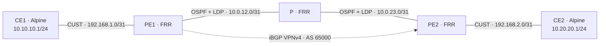

# MPLS-CORP

Laboratorio sencillo de una VPN de capa 3 sobre MPLS. Un cliente tiene dos sedes. El ISP las une con dos PE y un solo P. El cliente envía IP. En el núcleo el mismo paquete viaja con dos etiquetas, y P retira la de transporte antes de entregarlo al PE de salida.

Sirve como referencia repetible. La red empresarial, con dos clientes y un segundo P, está en [MPLS-EMPRESARIAL](../MPLS-EMPRESARIAL/README.md). Los comandos, las pruebas y los resultados esperados están en [GUIA_EJECUCION_Y_PRUEBAS.md](GUIA_EJECUCION_Y_PRUEBAS.md).

## Qué demuestra

El ping sale de la LAN de CE1 (`10.10.10.1`) y llega a la LAN de CE2 (`10.20.20.1`). Esas direcciones están en la loopback de cada CE: no hay PCs detrás.

| Tramo | Qué lleva el paquete |
| --- | --- |
| CE1 → PE1 | IP |
| PE1 → P | Etiqueta de transporte y, debajo, la etiqueta VPN |
| P → PE2 | Solo la etiqueta VPN. P hizo penultimate hop popping |
| PE2 → CE2 | IP |

P no tiene la ruta de las LAN. Solo sabe llegar a la loopback del PE remoto y cambiar o quitar la etiqueta externa.

## Topología



La línea punteada no es un cable. La sesión BGP viaja por P porque OSPF publica las loopbacks.

| Nodo | Imagen | Interfaces de datos | Rol |
| --- | --- | --- | --- |
| `ce1` | `alpine:latest` | `eth1` hacia PE1 | CE de la sede A |
| `pe1` | `frrouting/frr:latest` | `eth1` hacia CE1, `eth2` hacia P | PE, impone la pila |
| `p` | `frrouting/frr:latest` | `eth1` hacia PE1, `eth2` hacia PE2 | P, hace PHP |
| `pe2` | `frrouting/frr:latest` | `eth1` hacia P, `eth2` hacia CE2 | PE, retira la VPN |
| `ce2` | `alpine:latest` | `eth1` hacia PE2 | CE de la sede B |

`eth0` es la gestión de Containerlab (`172.20.20.0/24`). No entra en OSPF, LDP ni en la VRF.

## Direccionamiento

| Función | Asignación |
| --- | --- |
| Loopback del ISP | PE1 `10.255.255.1/32`, P `10.255.255.2/32`, PE2 `10.255.255.3/32` |
| Núcleo PE1–P | PE1 `eth2` `10.0.12.0/31`, P `eth1` `10.0.12.1/31` |
| Núcleo P–PE2 | P `eth2` `10.0.23.0/31`, PE2 `eth1` `10.0.23.1/31` |
| Acceso sede A, VRF `CUST` | PE1 `eth1` `192.168.1.0/31`, CE1 `eth1` `192.168.1.1/31` |
| Acceso sede B, VRF `CUST` | PE2 `eth2` `192.168.2.0/31`, CE2 `eth1` `192.168.2.1/31` |
| LAN sede A | CE1 `lo` `10.10.10.1/24` |
| LAN sede B | CE2 `lo` `10.20.20.1/24` |

Hay una sola VRF, tabla Linux 100, RD `65000:1` y RT `65000:100` en los dos PE. Cada PE anuncia la LAN local con una estática dentro de `CUST` y la importa desde el otro PE por MP-BGP. LDP etiqueta solo las loopbacks del ISP.

## Archivos

| Archivo | Qué aporta al despliegue |
| --- | --- |
| [`mpls-corp.clab.yml`](mpls-corp.clab.yml) | Nodos, enlaces, sysctl MPLS, la VRF `CUST` y las IP de los CE |
| [`configs/pe1/frr.conf`](configs/pe1/frr.conf) | OSPF, LDP, estática de `10.10.10.0/24` y BGP VPNv4 |
| [`configs/p/frr.conf`](configs/p/frr.conf) | OSPF y LDP. Sin BGP |
| [`configs/pe2/frr.conf`](configs/pe2/frr.conf) | OSPF, LDP, estática de `10.20.20.0/24` y BGP VPNv4 |
| `configs/*/daemons` | `ospfd` y `ldpd` en los tres routers; `bgpd` solo en los PE |
| [GUIA_EJECUCION_Y_PRUEBAS.md](GUIA_EJECUCION_Y_PRUEBAS.md) | Instalación, despliegue, pruebas por capa y demostración |

El nombre que construye Containerlab es `clab-mpls-corp-<nodo>`.

## Cómo ejecutarlo

Desde la VM, en esta carpeta:

```bash
cd "/Users/oliverolvera/Documents/GitHub - Personal/L3VPN-over-MPLS/MPLS-CORP"
sudo containerlab deploy -t mpls-corp.clab.yml
```

La guía recorre después cinco comprobaciones: vecinos OSPF en estado `Full`, sesiones LDP operativas, VRF local, ruta VPNv4 importada y ping en los dos sentidos. El resultado que cierra el laboratorio es el ping de CE1 y la captura en P: dos etiquetas en `eth1` y una en `eth2`.

```bash
sudo docker exec clab-mpls-corp-ce1 ping -c 4 -I 10.10.10.1 10.20.20.1
```

Para apagarlo:

```bash
sudo containerlab destroy -t mpls-corp.clab.yml --cleanup
```

## Qué deja fuera

Un cliente, un P y ninguna PC real. No hay camino alterno, ni una segunda VRF, ni una aplicación. Eso es el contenido de [MPLS-EMPRESARIAL](../MPLS-EMPRESARIAL/README.md).
