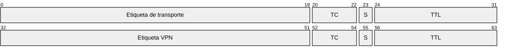

# MPLS-EMPRESARIAL · Redes desde cero, glosario y código explicado

Una PC de sucursal crea un pedido en su centro de datos. Otra empresa usa exactamente las mismas IP. ¿Cómo consigue el proveedor que cada pedido llegue a su propio servidor y qué cambia si cae un enlace?

**Ruta de lectura.** Para una primera explicación lee [los fundamentos](#1-leer-una-red-por-primera-vez), [los protocolos](#2-qué-protocolos-preparan-el-viaje) y [los bytes](#3-anatomía-de-una-trama-byte-por-byte). Continúa con el recorrido específico de la sección 4. Usa el [glosario](#5-glosario-de-consulta) mientras lees. En la [lectura de archivos](#6-lectura-de-los-archivos) cada número corresponde a la línea del original en esta carpeta. La [guía de ejecución](GUIA_EJECUCION_Y_PRUEBAS.md) contiene el procedimiento para reproducir los ejercicios.

## 1. Leer una red por primera vez

Una **sede** es un lugar donde hay equipos de una organización. Una **interfaz** es el punto por el que entra o sale información, como el puerto de un router. Un **enlace** une dos interfaces. Aquí son virtuales, pero el sistema operativo puede enviar, recibir y capturar bytes en cada extremo. Un **router** decide por qué interfaz continuar cuando el destino está en otra red. Una **ruta** combina un conjunto de destinos, una salida y, a menudo, el vecino al que se entregarán los datos.

Imagina que estás en la sede con direcciones `10.10.10.x` y quieres llegar a `10.20.20.x`. Hay dos preguntas distintas. **¿A qué máquina va el mensaje completo?** A la dirección IP de destino. **¿A quién entrego el siguiente tramo?** Al vecino que indica la ruta. Por eso la dirección IP final y la dirección Ethernet del destinatario inmediato suelen identificar equipos distintos. La *puerta de enlace* o *gateway* es el router vecino al que se delega la entrega. El viaje de regreso necesita sus propias rutas.

| Unidad | Cómo reconocerla | Qué delimita |
|---|---|---|
| Bit y byte | Un bit vale 0 o 1. Ocho bits forman un byte u octeto. Dos dígitos hexadecimales expresan un byte, de `00` a `ff`. | Permiten medir y leer los campos que muestra Wireshark. |
| Trama Ethernet, capa 2 (L2) | Empieza por dos direcciones MAC. | Una entrega en un enlace. El router construye otra trama para el enlace siguiente. |
| Paquete IPv4, capa 3 (L3) | Contiene IP de origen y destino. | Una entrega entre redes. Puede viajar dentro de varias tramas sucesivas. |
| Segmento TCP o datagrama UDP, capa 4 | Tiene dos números de puerto. | Comunicación entre programas. Un puerto TCP, como 8080, es un número lógico. `eth1` es una interfaz distinta de ese concepto. |
| Mensaje de aplicación | Por ejemplo, una petición HTTP. | Acción que entiende el programa. Puede ocupar varios segmentos TCP. ICMP Echo, usado por ping, se transporta directamente en IP. |

**Cómo leer una dirección.** IPv4 tiene 32 bits. En `10.10.10.1/24`, los primeros 24 identifican la red y quedan 8 para las direcciones del segmento. El prefijo es `10.10.10.0/24` y la máscara es `255.255.255.0`. En un enlace punto a punto `192.168.1.0/31`, los dos extremos utilizables son `.0` y `.1`. Una ruta `/32` identifica exactamente una dirección. Si dos rutas de la misma tabla coinciden, gana primero la más específica. Una ruta por defecto `0.0.0.0/0` solo gana si no existe una coincidencia más larga. Una *loopback* (`lo`) es una interfaz lógica local. Puede mantener la identidad de un router aunque cambie el enlace físico elegido. [Direcciones /31 en enlaces punto a punto](https://www.rfc-editor.org/rfc/rfc3021.html)

**Tres planos.** Por **gestión** entras desde Cursor mediante SSH y ejecutas comandos en la VM. Por el **plano de control** los routers aprenden qué destinos existen y qué etiquetas usar. Por el **plano de datos** pasa el tráfico del cliente. Docker crea espacios de red separados y Containerlab los une con pares Ethernet virtuales. `eth0` da acceso de gestión y los enlaces dibujados en la topología usan `eth1` en adelante. Un ping por la IP de gestión probaría otra red.

## 2. Qué protocolos preparan el viaje

| Protocolo o mecanismo | Qué pregunta resuelve | Qué intercambia y dónde se ve | Por qué se eligió aquí |
|---|---|---|---|
| Ethernet II y ARP | ¿A qué dirección del enlace envío la trama? | ARP pregunta por una IPv4 local mediante difusión y el dueño contesta con su MAC. Se resuelve la MAC del próximo salto. Ethernet usa esa MAC en los envíos siguientes. | Los pares Ethernet virtuales permiten observar cabeceras reales y usar vecinos dinámicos. Una tabla MAC estática exigiría mantener las direcciones de cada despliegue. |
| IPv4 | ¿A qué destino final va el paquete? | Una cabecera incluye origen, destino, longitud, protocolo y límite de saltos. Es el servicio entregado al cliente. | Los dos proyectos transportan prefijos IPv4. Ofrecer IPv6 requiere direccionamiento y familias de rutas adicionales. |
| OSPFv2 | ¿Cómo llego a la loopback del otro PE por el núcleo? | IP protocolo 89. Los vecinos se descubren con Hello, sincronizan sus bases de estado de enlace y calculan caminos de menor costo. En enlaces punto a punto se evita la elección de router designado. | Las rutas estáticas servirían en una línea pequeña. OSPF descubre cambios y permite explicar costos. IS-IS también sería razonable en un operador, pero aquí añadiría otro esquema de configuración para resolver la misma necesidad. |
| LDP sobre UDP y TCP | ¿Qué etiqueta de transporte espera mi próximo salto para una clase de destinos? | Descubrimiento básico por Hello UDP/646 en los enlaces habilitados. Una sesión TCP/646 intercambia asociaciones entre destino o FEC y etiqueta. Se usa para llegar al PE remoto. | Aprovecha la ruta que ya eligió el IGP. RSVP-TE añade señalización para túneles con restricciones; Segment Routing requiere distribuir identificadores de segmento. Aquí interesa poder correlacionar vecinos, asociaciones y tabla de reenvío. |
| MP-iBGP VPNv4 | ¿Qué LAN está detrás del PE remoto y con qué etiqueta de servicio y política se anuncia? | BGP usa TCP/179 entre las loopbacks de ambos PE. Un anuncio VPNv4 lleva prefijo distinguido por RD, etiqueta VPN, próximo salto y atributos como el RT. | Transporta rutas privadas de clientes con direcciones repetidas y políticas de importación. Redistribuir todas las LAN al OSPF global perdería esa separación y haría crecer las tablas de los P. |
| MPLS en el plano de datos | ¿Qué operación ejecuto al recibir esta etiqueta? | La tabla local indica salida y operación. El borde añade etiquetas (*push*), un tránsito puede sustituir la externa (*swap*) y otro retirarla (*pop*). | El núcleo transporta VPN sin tener que instalar las LAN de cada cliente. A cambio hay que coordinar IGP, distribución de etiquetas y BGP, y reservar espacio para la pila. |
| VRF y rutas estáticas CE–PE | ¿En qué tabla busco y a qué CE entrego esta LAN? | La interfaz de entrada del PE pertenece a una tabla por cliente. Una ruta estática asocia la LAN local con la IP del CE. | Poco estado y fácil inspección con pocas sedes. eBGP en el acceso facilitaría anuncios y retiradas dinámicos, a costa de sesiones y filtros adicionales. |
| ICMP Echo | ¿El destino puede devolver una respuesta IP? | IPv4 protocolo 1. Echo Request tipo 8/código 0 y Echo Reply tipo 0/código 0. Identificador y secuencia relacionan ida y vuelta. | Permite probar alcance y tiempo de ida y vuelta antes de investigar un servicio TCP. Una aplicación puede fallar aunque el ping funcione. |

**Dependencia, paso a paso.** En PE2 existe una ruta hacia la LAN local por su CE. PE2 la exporta a VPNv4 y anuncia la etiqueta con la que acepta tráfico para esa ruta. PE1 recibe el anuncio, comprueba el RT e importa la ruta en la VRF correspondiente. Para enviar al próximo salto BGP (la loopback de PE2), resuelve el camino por OSPF y la etiqueta exterior por LDP. En el paquete de usuario viajan las etiquetas y el paquete IP. Los mensajes OSPF, los anuncios BGP y los mensajes LDP son paquetes de control separados. Un estado BGP `Established` solo confirma la sesión; todavía es necesario comprobar la ruta importada y el reenvío en el kernel.

**Qué tabla mirar.** La RIB contiene rutas aprendidas y su procedencia. La FIB contiene decisiones instaladas para reenviar IP. La LIB almacena asociaciones de etiquetas conocidas por LDP. La LFIB indica qué hacer con una etiqueta entrante. FRR calcula y comunica decisiones; Zebra las integra y solicita su instalación en Linux. Por eso conviene contrastar el resultado de `vtysh` con `ip -f mpls route show`. [OSPFv2](https://www.rfc-editor.org/rfc/rfc2328.html) · [LDP](https://www.rfc-editor.org/rfc/rfc5036.html) · [BGP/MPLS L3VPN](https://www.rfc-editor.org/rfc/rfc4364.html) · [Zebra](https://docs.frrouting.org/en/latest/zebra.html)

## 3. Anatomía de una trama, byte por byte

La tabla usa **desplazamientos desde el primer byte de MAC destino, contando desde cero**. Corresponde a Ethernet II sin VLAN, con dos etiquetas y un paquete IPv4 sin opciones. En la vista de bytes de Wireshark los desplazamientos suelen mostrarse en hexadecimal. Las posiciones siguientes están en decimal.

| Bytes | Campo | Qué significa |
|---|---|---|
| 0–5 | MAC destino, 6 bytes | Interfaz del vecino que recibe esta trama. |
| 6–11 | MAC origen, 6 bytes | Interfaz que transmite en este enlace. |
| 12–13 | EtherType, 2 bytes | `0x8847` indica MPLS unicast. En el acceso, `0x0800` anuncia IPv4 directamente. Una consulta ARP lleva `0x0806`. |
| 14–17 | Primera entrada MPLS, 4 bytes | Etiqueta exterior de transporte, con S=0 porque debajo hay otra. |
| 18–21 | Segunda entrada MPLS, 4 bytes | Etiqueta interior VPN, con S=1 porque debajo empieza la carga. |
| 22–41 | Cabecera IPv4 mínima, 20 bytes | El primer byte suele ser `45`: versión 4 e IHL=5 palabras de cuatro bytes. Con opciones, el campo IHL crece. |
| 42 en adelante | Carga de IPv4 | ICMP si protocolo=1, TCP si=6, UDP si=17 u OSPF si=89. En TCP el comienzo de los datos depende del tamaño de su propia cabecera. |
| Final de Ethernet | Relleno si hace falta y FCS de 4 bytes en Ethernet físico | El FCS detecta alteraciones en la trama. Las capturas en interfaces virtuales suelen omitirlo. Preámbulo, delimitador físico e intervalo entre tramas tampoco se suman a estos offsets. |

**Una etiqueta MPLS por dentro.** De más significativo a menos significativo, cada entrada usa 20 bits de etiqueta, 3 de TC (clase de tráfico), 1 de S (fondo de pila) y 8 de TTL. El valor binario se construye con `(etiqueta << 12) | (TC << 9) | (S << 8) | TTL`. Por ejemplo, 17/TC0/S0/TTL63 da `00 01 10 3f`, y 80/TC0/S1/TTL63 da `00 05 01 3f`. Los números 17 y 80 ilustran la decodificación; FRR puede asignar otros al desplegar. La etiqueta solo tiene significado para quien la recibe en su contexto de reenvío. Un *swap* puede incluso dar el mismo valor numérico si dos equipos lo asignaron independientemente. [Formato MPLS](https://www.rfc-editor.org/rfc/rfc3032.html) · [Nombre y función del campo TC](https://www.rfc-editor.org/rfc/rfc5462.html)

| Dentro de IPv4, desde el inicio de su cabecera | Ancho | Cómo se interpreta |
|---|---|---|
| Byte 0 | 4 + 4 bits | Versión e IHL. |
| Byte 1 | 6 + 2 bits | DSCP para clase de servicio y ECN para señalización de congestión. |
| Bytes 2–3 | 16 bits | Longitud total del paquete IP, incluidas cabecera y carga. Las etiquetas MPLS quedan fuera de este total. |
| Bytes 4–7 | 16 + 3 + 13 bits | Identificación, banderas de fragmentación y posición del fragmento. |
| Bytes 8–11 | 8 + 8 + 16 bits | TTL, protocolo y suma de comprobación de la cabecera. Cuando un salto IP decrementa el TTL debe actualizar la suma. |
| Bytes 12–19 | 32 + 32 bits | Direcciones IPv4 de origen y destino finales. Se mantienen en el recorrido ilustrado; no hay traducción NAT configurada en el acceso del cliente. |
| Tras el byte 19 | Variable | Opciones si IHL > 5, después el mensaje ICMP o segmento TCP. |

**Qué cambia al avanzar.** Con una sola etiqueta, IPv4 empieza en el byte 18. Sin etiquetas, en el 14. En cada enlace enrutado cambian las MAC. Dentro de MPLS se procesa el TTL de la etiqueta superior; la propagación en la entrada y la salida depende del modelo TTL. Por eso el TTL IP observado al final no basta para reconstruir qué P hizo *swap* o *pop*. El valor reservado 3 (*implicit-null*) se comunica en el plano de control: pide al penúltimo salto que retire la etiqueta de transporte. Esa instrucción produce una trama más corta al salir del penúltimo salto. El RD y el RT tampoco ocupan bytes en la trama de datos. [Encapsulación MPLS](https://www.rfc-editor.org/rfc/rfc3032.html) · [Cabecera IPv4](https://www.rfc-editor.org/rfc/rfc791.html)

**MTU y medición.** Cada etiqueta agrega cuatro bytes. Transportar un paquete IP de 1500 bytes con dos etiquetas exige espacio para 1508 bytes de carga Ethernet, más su cabecera de enlace. Un ping pequeño puede funcionar aunque un paquete grande exceda el límite de un enlace. Para comparar tamaños en Wireshark hay que seguir la misma unidad de datos en el mismo sentido y comprobar cuántas etiquetas contiene. El tamaño de una solicitud de aplicación y el tamaño de una trama son magnitudes diferentes.


### Cuatro paquetes de control que puedes reconocer en Wireshark

Imagina que abres una captura antes de hacer ping o registrar el pedido. Los routers pueden estar conversando aunque la aplicación esté en silencio. Hay cuatro conversaciones que conviene distinguir.

| Filtro de visualización | Cómo se encapsula | Qué buscar dentro | Qué concluyes |
|---|---|---|---|
| `arp` | Ethernet → ARP (EtherType 0x0806) | En una petición Ethernet/IPv4 típica, tipo de hardware 1, protocolo 0x0800, longitudes 6 y 4, operación 1, MAC/IP del emisor e IP buscada. En la respuesta, operación 2 y MAC de quien posee la IP. | El equipo resolvió un vecino en ese enlace. Si ya estaba en caché, la petición puede haber ocurrido antes de empezar a capturar. |
| `ospf` | Ethernet → IPv4 protocolo 89 → OSPF | Versión 2, tipo de mensaje, router ID y área. Hello descubre vecinos; Database Description resume la base, Link State Request pide anuncios, Link State Update los entrega y Link State Acknowledgment confirma su recepción. | Dos routers pueden construir la misma vista del núcleo. El estado Full en FRR confirma la sincronización de esa adyacencia. |
| `udp.port == 646 || tcp.port == 646` | Ethernet → IPv4 → UDP o TCP → LDP | Hello descubre candidatos. En TCP se negocia la sesión, se intercambian KeepAlive y mensajes Label Mapping. Busca la FEC para la loopback destino y la etiqueta asociada. | Tener Hellos sin sesión operativa no basta para afirmar que hay un camino etiquetado. |
| `tcp.port == 179` | TCP sobre IP entre los PE → BGP | OPEN negocia capacidades, KEEPALIVE mantiene la sesión y UPDATE lleva anuncios o retiradas. Para VPNv4 busca MP_REACH_NLRI, próximo salto, etiqueta, RD, prefijo y comunidad extendida RT. | El PE ha recibido el anuncio. Comprobar la tabla de la VRF y la FIB permite verificar si además fue importado e instalado. |

Los UPDATE pueden haberse intercambiado antes de abrir Wireshark. En una red estable es normal ver mensajes periódicos y consultar las asociaciones ya aprendidas con FRR. En LDP, **TLV** significa *Type–Length–Value*: cada bloque identifica el tipo de información, su longitud y el valor. En BGP, **MP_REACH_NLRI** es el atributo multiprotocolo para destinos alcanzables; **MP_UNREACH_NLRI** comunica retiradas. [ARP](https://www.rfc-editor.org/rfc/rfc826.html) · [OSPFv2](https://www.rfc-editor.org/rfc/rfc2328.html) · [LDP](https://www.rfc-editor.org/rfc/rfc5036.html) · [Extensiones multiprotocolo de BGP](https://www.rfc-editor.org/rfc/rfc4760.html)

### Esquema de los primeros ocho bytes después de EtherType 0x8847

Cada renglón representa 32 bits, numerados desde el primer bit de la primera etiqueta. En una captura de núcleo con dos etiquetas, al bit 63 le sigue el comienzo de IPv4.



En la fila superior S vale 0 y en la inferior vale 1. Después de PHP la fila inferior pasa a ocupar el primer lugar y mantiene S=1. Los ocho bits TTL de cada entrada son campos separados. La etiqueta superior permite decidir la salida sin buscar el destino IP de la empresa dentro del paquete. [Procesamiento del TTL](https://www.rfc-editor.org/rfc/rfc3443.html)


## 4. Seguir un pedido desde la PC hasta la base de datos

Hay doce máquinas lógicas: dos PCs, dos servidores, cuatro CE, dos PE y dos P. Cada empresa tiene su propia sucursal y centro de datos. Ambas PCs tienen `10.10.10.10` y ambos servidores `10.20.20.10`. Cada uno vive en un segmento y espacio de red distinto. En PE1, `eth1` selecciona `CUST` para A y `eth4` selecciona `CUST_B` para B. En PE2 vuelven a separarse por `eth2` y `eth4`, respectivamente.

| Enlace de A, sentido de ida | Encapsulación | Qué ocurre |
|---|---|---|
| pc-a eth1 → ce1 eth2 | Ethernet / IPv4 / TCP | La IP remota queda fuera de la LAN. La PC usa la ruta por `10.10.10.1` y entrega a la MAC del CE. El primer segmento SYN solicita abrir la conexión TCP a 8080. |
| ce1 eth1 → pe1 eth1 | Ethernet / IPv4 / TCP | CE1 reenvía por `192.168.1.0`. Cambian MAC y TTL IP. PE1 reconoce A por la interfaz que recibió la trama. |
| pe1 eth2 → p eth1 | Ethernet / transporte / VPN A / IPv4 / TCP | La tabla 100 tiene la LAN remota. PE1 usa la etiqueta VPN anunciada por PE2 y la de transporte anunciada por P1 para llegar a ese PE. |
| p eth3 → p2 eth1 | Ethernet / transporte / VPN A / IPv4 / TCP | P1 hace swap de la etiqueta exterior según su LFIB. La etiqueta interior conserva su función y valor para PE2. |
| p2 eth2 → pe2 eth3 | Ethernet / VPN A / IPv4 / TCP | P2 hace PHP cuando PE2 indica implicit-null. Queda una etiqueta. |
| pe2 eth2 → ce2 eth1 | Ethernet / IPv4 / TCP | PE2 procesa la etiqueta VPN y entrega en A hacia `192.168.2.1`. |
| ce2 eth2 → srv-a eth1 | Ethernet / IPv4 / TCP | CE2 encuentra la LAN conectada. El servidor reconoce su IP y el puerto del programa. Para B, se sustituyen los dos CE, la tabla y los enlaces de acceso. |

**Del SYN al folio.** TCP establece la conexión mediante SYN, SYN+ACK y ACK. Después llegan los bytes de `POST /pedidos`, las cabeceras HTTP y el JSON. El servidor valida la clave y los datos, escribe en su SQLite y responde con un código y un folio. Un ACK de TCP confirma bytes recibidos. Un HTTP 201 se emite después de confirmar la operación nueva en la base. Un HTTP 200 puede ser una consulta correcta o el reconocimiento de una clave ya usada. Un HTTP 404 también prueba que un servidor contestó, aunque ese folio o recurso no exista. [TCP](https://www.rfc-editor.org/rfc/rfc9293.html) · [Semántica HTTP](https://www.rfc-editor.org/rfc/rfc9110.html)

**Los bytes de TCP.** Desde el inicio del segmento, los bytes 0–1 y 2–3 son los puertos origen y destino. El cliente elige un puerto efímero y el destino es 8080. Los bytes 4–7 y 8–11 son números de secuencia y confirmación. En 12–13 están el tamaño de cabecera y banderas, en 14–15 la ventana, en 16–17 el checksum y en 18–19 el puntero urgente. Puede haber opciones antes de los datos. Un SYN sin datos con IPv4 y TCP de 20 bytes cada uno ocuparía 14+8+20+20 = 62 bytes en el núcleo antes del FCS; las opciones TCP habituales alteran ese resultado y en Ethernet físico las tramas pequeñas pueden requerir relleno. Para seguir el mismo SYN usa puertos, sentido y número de secuencia crudo, y contrasta el instante. Las dos empresas pueden incluso coincidir en la misma tupla IP/puertos: comprueba también interfaz, VRF o etiqueta interior y la respuesta de la aplicación.

**Cómo se aísla B.** PE2 anuncia la misma LAN `10.20.20.0/24` en VPNv4 con RD `65000:1` para A y `65000:202` para B. PE1 importa en A por RT `65000:100` y en B por RT `65000:200`. El prefijo adicional `10.202.20.10/32` existe solo en B. Desde B llega a CE-B2 y este reenvía a `10.20.20.10` para entregar el paquete a la loopback de srv-b. Desde A, la PC y el CE envían la prueba hacia el PE, pero su tabla CUST carece de una ruta de cliente apropiada al /32. Verifica la tabla y que por gestión no exista un camino alternativo para la prueba. La identidad de empresa la define el servidor. La red decide a cuál servidor se llegó.

**Por qué dos P y cinco enlaces internos.** Los costos OSPF son 10 en PE1–P1, P1–P2 y P2–PE2, 60 en PE1–P2, y 90 en P1–PE2. El camino normal suma 30. Al perder P1–P2, PE1–P2–PE2 suma 70 y vence al camino PE1–P1–PE2 de 100. Al perder P2–PE2 gana este último. Son sumas de enlaces; para interpretar la métrica mostrada hacia un /32 revisa también cómo OSPF anuncia la loopback y la ruta instalada. Más routers permiten mostrar swap antes de PHP y demostrar recuperación con el mismo pedido. La pérdida de un PE o del único acceso de una sucursal sí puede dejarla incomunicada.

**Un detalle del núcleo empresarial.** Los Hello LDP pueden ir por el cable directo y la sesión TCP entre loopbacks seguir el camino que OSPF prefiera. Entre PE1 y P2, el enlace directo cuesta 60 y el camino por P1 cuesta 20. Los cuatro routers llevan `ttl-security disable` en LDP IPv4 para admitir esa diferencia de saltos. Se relaja una comprobación de distancia del protocolo de control. En un diseño operativo se evalúa ajustar el límite por vecino según la topología. Esto es independiente del TTL de las etiquetas de los pedidos. [LDP en FRR](https://docs.frrouting.org/en/latest/ldpd.html)

### Una prueba que separa alcance, aislamiento y aplicación

```bash
sudo docker exec clab-mpls-empresa-pc-a ip route get 10.20.20.10
sudo docker exec clab-mpls-empresa-pe1 vtysh -c 'show bgp ipv4 vpn' -c 'show ip route vrf CUST' -c 'show ip route vrf CUST_B'
sudo docker exec clab-mpls-empresa-pc-a python3 /opt/pedidos/cliente.py alta --clave ejemplo-1 --articulo cable --cantidad 2
sudo docker exec clab-mpls-empresa-pc-b python3 /opt/pedidos/cliente.py alta --clave ejemplo-1 --articulo cable --cantidad 2
sudo docker exec -e DESTINO=10.202.20.10 clab-mpls-empresa-pc-b python3 /opt/pedidos/cliente.py salud
sudo docker exec -e DESTINO=10.202.20.10 clab-mpls-empresa-pc-a python3 /opt/pedidos/cliente.py salud
```

La ruta debe indicar `eth1` en la PC. Para una clave nueva en cada base, A y B deben emitir su propio 201 y un folio con el prefijo correcto. Repetir una solicitud con la misma clave contra la misma empresa devuelve 200 y el folio anterior. El servidor deduplica por clave y no compara los campos del pedido anterior. SQLite guarda en `/tmp/pedidos.sqlite` dentro del contenedor: sobrevive a otras peticiones y al reinicio del mismo contenedor, pero la topología no monta un volumen para conservarlo después de destruirlo. El servidor escucha por defecto en todas sus IPv4; las rutas de las PCs y el origen fijado por el cliente son esenciales para seguir el camino de datos.

Para ver el camino, filtra `mpls && tcp.dstport == 8080 && tcp.flags.syn == 1 && tcp.flags.ack == 0` en los enlaces de núcleo. Para ver el contenido usa `tcp.port == 8080` y **Follow TCP Stream** sobre un enlace de acceso. Si deseas ver el pedido, selecciona un segmento con datos o el flujo completo. El SYN por sí solo no contiene el JSON de este cliente. La aplicación usa HTTP sin TLS. Los protocolos de futuras fases del plan, como eBGP de acceso, BFD y colas QoS, quedan como alternativas de diseño. [Guía de ejecución](GUIA_EJECUCION_Y_PRUEBAS.md) · [Plan de ampliación](PLAN_MPLS_EMPRESARIAL.md)


## 5. Glosario de consulta

| Sigla o término | Nombre completo o significado | Qué hace en esta red |
|---|---|---|
| LAN / WAN | Local / Wide Area Network | La LAN agrupa equipos de una sede. La WAN conecta las sedes mediante el operador. |
| ISP / PoP | Internet Service Provider / Point of Presence | El proveedor presta el servicio privado entre sitios. Un punto de presencia es donde entrega o concentra accesos. El servicio privado puede funcionar sin salida a Internet. |
| CE / PE / P | Customer Edge / Provider Edge / Provider | CE es el router de la sede, PE el borde que discrimina clientes, P el tránsito del proveedor. Son funciones, independientes de marca y modelo. |
| PC / SRV / CUST | Personal Computer / server / customer | Estación, servidor y cliente. En los archivos, `CUST` es un nombre elegido para la VRF, no un protocolo. |
| IP / IPv4 / CIDR | Internet Protocol / versión 4 / Classless Inter-Domain Routing | Una dirección identifica un extremo lógico; la longitud de prefijo agrupa destinos en rutas. |
| MAC / ARP | Media Access Control / Address Resolution Protocol | Dirección de enlace y mecanismo IPv4 para averiguar la dirección del vecino al que se entrega la trama. |
| MTU / FCS / CRC | Maximum Transmission Unit / Frame Check Sequence / Cyclic Redundancy Check | Límite de tamaño, campo de verificación de trama y cálculo usado para obtenerlo. |
| ICMP / RTT | Internet Control Message Protocol / Round-Trip Time | Mensajes de diagnóstico y tiempo desde la solicitud hasta su respuesta. Ping es el nombre de la herramienta. |
| TCP / UDP | Transmission Control Protocol / User Datagram Protocol | TCP ofrece un flujo ordenado con confirmaciones y retransmisión. UDP entrega datagramas sin esa garantía. |
| SYN / ACK / FIN / RST | Synchronize / Acknowledgment / Finish / Reset | Indicadores de TCP para sincronizar secuencias, confirmar recepción, cerrar ordenadamente o restablecer una conexión. |
| IGP / OSPF / SPF | Interior Gateway Protocol / Open Shortest Path First / Shortest Path First | Familia de protocolos internos, protocolo elegido y cálculo del camino de menor costo. El costo es una métrica administrativa. |
| LSA / LSDB / RID | Link-State Advertisement / Link-State Database / Router ID | Descripción de enlaces, base de esas descripciones e identificador estable del router. OSPF usa los tres para construir el mapa. |
| DR / BDR | Designated Router / Backup Designated Router | Coordinan adyacencias en redes OSPF de acceso múltiple. La configuración punto a punto simplifica la relación a dos extremos. |
| MPLS / LSR / LER | Multiprotocol Label Switching / Label Switching Router / Label Edge Router | Reenvío por etiquetas, equipo que las procesa y equipo que adapta el tráfico en el borde del dominio. |
| LDP / FEC / LSP | Label Distribution Protocol / Forwarding Equivalence Class / Label Switched Path | LDP señala etiquetas para destinos tratados igual. El resultado es un camino de reenvío unidireccional; la vuelta usa sus propias asociaciones. |
| PHP / BoS | Penultimate Hop Popping / Bottom of Stack | Retirada de la externa por el penúltimo salto y marca S del último elemento de la pila. |
| TTL / TC / EXP | Time To Live / Traffic Class / nombre histórico Experimental | Límite de saltos y campo de clasificación de tres bits. Algunas vistas de Wireshark muestran EXP en lugar de TC. |
| VPN / RPV / L3VPN | Virtual Private Network / Red Privada Virtual / Layer 3 VPN | Servicio que interconecta redes IP privadas. El aislamiento de rutas y el cifrado son propiedades distintas. |
| VRF | Virtual Routing and Forwarding | Varias tablas de reenvío dentro de un PE. Un mismo destino puede usar salidas distintas según la interfaz de entrada. |
| AS / ASN | Autonomous System / Autonomous System Number | Dominio de administración de rutas y su número. Los PE pertenecen al AS privado 65000. |
| BGP / iBGP / eBGP | Border Gateway Protocol / internal BGP / external BGP | BGP intercambia rutas con atributos. Una sesión dentro del mismo AS es iBGP. Entre AS distintos es eBGP. |
| MP-BGP / VPNv4 | Multiprotocol Extensions for BGP / familia VPN para IPv4 | Extiende BGP para transportar distintas familias de rutas. Aquí los PE intercambian rutas VPNv4 etiquetadas. |
| AFI / SAFI / NLRI | Address Family Identifier / Subsequent Address Family Identifier / Network Layer Reachability Information | Identificadores de familia y subfamilia, e información que anuncia los destinos alcanzables. IPv4 VPN etiquetada usa AFI 1 y SAFI 128. |
| RD / RT | Route Distinguisher / Route Target | RD de 8 bytes distingue prefijos coincidentes en VPNv4. RT es una comunidad extendida que decide qué VRF puede importar una ruta. El número de tabla Linux es otra cosa. |
| RIB / FIB | Routing Information Base / Forwarding Information Base | Rutas del plano de control y decisiones disponibles para el reenvío. |
| LIB / LFIB | Label Information Base / Label Forwarding Information Base | Asociaciones de etiqueta conocidas y acciones instaladas para paquetes etiquetados. |
| NAT / VLAN | Network Address Translation / Virtual LAN | NAT traduce direcciones y una VLAN separa dominios Ethernet. Aquí la separación de rutas del proveedor se implementa con VRF y MPLS. |
| QoS / DSCP / ECN | Quality of Service / Differentiated Services Code Point / Explicit Congestion Notification | Tratamiento diferenciado, marca de seis bits en IP e indicación de congestión. Una cabecera con TC o DSCP visible no demuestra que exista una política de colas. |
| BFD / GTSM | Bidirectional Forwarding Detection / Generalized TTL Security Mechanism | BFD detecta pérdida de comunicación entre motores de reenvío. GTSM comprueba el TTL de determinados paquetes de control según la distancia prevista. |
| FRR / VTY / CLI | FRRouting / Virtual Teletype / Command-Line Interface | Suite de protocolos, interfaz de administración de los procesos y consola de comandos. `vtysh` reúne las consolas de FRR. |
| VM / RAM / ARM64 | Virtual Machine / Random Access Memory / arquitectura ARM de 64 bits | La VM Linux proporciona el kernel a los contenedores del Mac M1. Cada contenedor tiene su propia vista de interfaces y rutas. |
| YAML / JSON | YAML Ain’t Markup Language / JavaScript Object Notation | El YAML describe la topología. El JSON de anotaciones controla su dibujo en Cursor. |
| SSH / VNC | Secure Shell / Virtual Network Computing | Acceso a la terminal remota y tecnología de escritorio remoto. Son herramientas de operación. |
| PCAP / PCAPNG / RX / TX | Packet Capture / PCAP Next Generation / receive / transmit | Archivo de paquetes capturados y contadores en recepción o transmisión desde el punto de vista de una interfaz. |
| RFC / IETF | Request for Comments / Internet Engineering Task Force | Serie de documentos técnicos y organización de estandarización. Los enlaces a RFC permiten comprobar formatos y comportamientos. |
| API / HTTP / HTTPS / TLS | Application Programming Interface / Hypertext Transfer Protocol / HTTP sobre TLS / Transport Layer Security | Contrato de acceso a un servicio, protocolo de solicitudes y respuestas y protección del transporte. HTTP simple permite ver su contenido en captura. |
| URL / SQL / UTF-8 | Uniform Resource Locator / Structured Query Language / Unicode Transformation Format de 8 bits | Dirección de un recurso, lenguaje de una base relacional y codificación de texto en bytes. |
| ID / UUID / CSV / JSONL | Identifier / Universally Unique Identifier / Comma-Separated Values / JSON Lines | Identificador, identificador universal y dos formatos para registrar resultados. Un folio con prefijo de empresa no es automáticamente un UUID. |
| SLA / EF | Service Level Agreement / Expedited Forwarding | Acuerdo de nivel de servicio y clase DiffServ de trato preferente. Sirven para discutir mediciones y posibles extensiones. |

**Ejemplo para recordar RD, RT y etiqueta.** En la tabla de control buscas el *nombre completo* de una ruta con su RD. Para decidir en qué tabla colocarla consultas el RT. Cuando llega una trama desde el núcleo, Linux usa la acción asociada a la etiqueta interior. Son tres decisiones en momentos distintos. [Arquitectura VPN de capa 3](https://www.rfc-editor.org/rfc/rfc4364.html)

### Por qué estos equipos

| Decisión | Ventaja para este proyecto | Alternativa y cuándo tendría sentido |
|---|---|---|
| Router Linux con FRR en P y PE | Permite inspeccionar por separado protocolo, kernel y captura en la misma VM. Una misma imagen desempeña dos papeles según sus procesos e interfaces. | Una imagen de sistema operativo de fabricante sirve para aprender su CLI y funciones particulares. Un router físico permite además medir interfaces, ASIC y colas reales, con mayor costo de equipo. Los tiempos de una VM dependen de la carga del anfitrión. |
| Alpine en CE | Las rutas conectadas y estáticas bastan para una sede con un solo proveedor y una sola salida de datos hacia él. | FRR también en el CE permite eBGP y políticas de prefijos si hay muchos cambios o más de un acceso. |
| Dos PE | Hay un punto de entrada y otro de salida donde colocar cada sede en su tabla. Permiten estudiar cómo se anuncia una ruta remota y cómo se entrega el paquete. | Con un solo PE se puede estudiar segmentación local, pero desaparecería el trayecto VPNv4 entre PE. |
| VRF en una infraestructura compartida | Cada cliente tiene una vista propia y los P pueden limitarse a transportar tráfico entre PE. | Un router y cables dedicados por cliente simplificarían el aislamiento físico, a costa de duplicar la infraestructura. Una VPN IPsec aporta cifrado y requiere distribuir credenciales y gestionar túneles. |
| Enlaces enrutados /31 y loopbacks /32 | Dos direcciones por cable y un identificador estable por router. Un prefijo /32 hacia la loopback permite resolver con precisión el próximo salto BGP. | Un /30 usa cuatro direcciones por enlace. Identificar BGP por la IP del cable ata la sesión a ese enlace concreto. |
| Edgeshark y Wireshark | Permiten seleccionar interfaces de contenedores desde el editor y decodificar el mismo flujo en puntos distintos. | `tcpdump` en el espacio de red del nodo es ligero y produce archivos de captura analizables después. |


## 6. Lectura de los archivos

Empieza por el YAML (cables y equipos), continúa con frr.conf (reglas de cada router) y después con daemons (qué programas leen esas reglas). La sangría YAML expresa pertenencia y el guion introduce un elemento de lista. En FRR, la misma palabra interface abre el puerto del router o habilita LDP según el bloque. Las líneas vacías solo dan separación visual.

**Saltar a un archivo anotado** · [mpls-empresa.clab.yml](#mpls-empresaclabyml) · [configs/p/frr.conf](#configspfrrconf) · [configs/p2/frr.conf](#configsp2frrconf) · [configs/pe1/frr.conf](#configspe1frrconf) · [configs/pe2/frr.conf](#configspe2frrconf) · [apps/pedidos/cliente.py](#appspedidosclientepy) · [apps/pedidos/server.py](#appspedidosserverpy)

### mpls-empresa.clab.yml

Fuente: [mpls-empresa.clab.yml](mpls-empresa.clab.yml). Ubica el número en el margen del editor. Las filas siguen el orden físico del archivo.

| Línea | Instrucción | Lectura |
|---:|---|---|
| 1 | `name: mpls-empresa` | Nombre del despliegue. Los contenedores usan el prefijo clab-mpls-empresa-. |
| 2 | `mgmt:` | Define el canal administrativo del laboratorio. |
| 3 | `network: mpls-empresa-mgmt` | Asigna un nombre propio a la red Docker de gestión. |
| 4 | `ipv4-subnet: 172.20.21.0/24` | Reserva este prefijo para acceder a los contenedores por eth0. |
| 5 | `topology:` | Comienza la descripción de máquinas y cables virtuales. |
| 6 | `nodes:` | Agrupa los equipos que se crearán. |
| 7 | `pe1:` | Define pe1. Borde de entrada para el recorrido de ida. |
| 8 | `kind: linux` | Crea un nodo Linux con su propio espacio de red dentro de la VM. |
| 9 | `image: frrouting/frr:latest` | Imagen de FRRouting. Los daemons habilitados determinan si este nodo es PE o P. latest es una etiqueta mutable. |
| 10 | `entrypoint: /bin/sleep` | Sustituye el ejecutable inicial de la imagen por sleep. Permite preparar la red antes de arrancar FRR o ejecutar la aplicación. |
| 11 | `cmd: infinity` | Pasa infinity a sleep para mantener vivo el contenedor y poder ejecutar procesos dentro. |
| 12 | `binds:` | Vincula archivos o carpetas del proyecto con rutas internas del contenedor. |
| 13 | `- ./configs/pe1/daemons:/etc/frr/daemons` | Monta ./configs/pe1/daemons en /etc/frr/daemons. FRR leerá qué procesos iniciar. |
| 14 | `- ./configs/pe1/frr.conf:/etc/frr/frr.conf` | Monta ./configs/pe1/frr.conf en /etc/frr/frr.conf. FRR leerá las instrucciones de enrutamiento de este nodo. |
| 15 | `sysctls:` | Configura parámetros del kernel para el espacio de red del nodo. |
| 16 | `net.ipv4.ip_forward: "1"` | Autoriza a Linux a reenviar paquetes entre interfaces. Una máquina que origina mensajes propios no precisa este permiso para originarlos. |
| 17 | `net.ipv4.conf.all.rp_filter: "0"` | Configura en cero el filtrado por camino inverso en el ajuste global del nodo. Evita descartes debidos a comprobaciones de ruta inversa en esta topología. |
| 18 | `net.ipv4.conf.default.rp_filter: "0"` | Configura en cero el filtrado por camino inverso como valor inicial para interfaces nuevas. Evita descartes debidos a comprobaciones de ruta inversa en esta topología. |
| 19 | `net.mpls.platform_labels: "1048575"` | Dimensiona la tabla de etiquetas de plataforma de Linux. Es un límite de entradas, no el valor de etiqueta fijado para el cliente. |
| 20 | `exec:` | Ejecuta en este nodo las órdenes de preparación tras crear sus interfaces. |
| 21 | `- sysctl -w net.ipv4.conf.all.rp_filter=0` | Configura en cero el filtrado por camino inverso en el ajuste global del nodo. Evita descartes debidos a comprobaciones de ruta inversa en esta topología. |
| 22 | `- sysctl -w net.ipv4.conf.lo.rp_filter=0` | Configura en cero el filtrado por camino inverso en lo. Evita descartes debidos a comprobaciones de ruta inversa en esta topología. |
| 23 | `- sysctl -w net.ipv4.conf.eth1.rp_filter=0` | Configura en cero el filtrado por camino inverso en eth1. Evita descartes debidos a comprobaciones de ruta inversa en esta topología. |
| 24 | `- sysctl -w net.ipv4.conf.eth2.rp_filter=0` | Configura en cero el filtrado por camino inverso en eth2. Evita descartes debidos a comprobaciones de ruta inversa en esta topología. |
| 25 | `- sysctl -w net.ipv4.conf.eth3.rp_filter=0` | Configura en cero el filtrado por camino inverso en eth3. Evita descartes debidos a comprobaciones de ruta inversa en esta topología. |
| 26 | `- sysctl -w net.ipv4.conf.eth4.rp_filter=0` | Configura en cero el filtrado por camino inverso en eth4. Evita descartes debidos a comprobaciones de ruta inversa en esta topología. |
| 27 | `- sysctl -w net.mpls.conf.lo.input=1` | Permite al kernel aceptar paquetes MPLS recibidos por lo de pe1. El reenvío necesita además una entrada para la etiqueta. |
| 28 | `- sysctl -w net.mpls.conf.eth2.input=1` | Permite al kernel aceptar paquetes MPLS recibidos por eth2 de pe1. El reenvío necesita además una entrada para la etiqueta. |
| 29 | `- sysctl -w net.mpls.conf.eth3.input=1` | Permite al kernel aceptar paquetes MPLS recibidos por eth3 de pe1. El reenvío necesita además una entrada para la etiqueta. |
| 30 | `- sh -ec 'ip link show dev CUST >/dev/null 2>&1 \|\| ip link add CUST type vrf table 100'` | Busca el dispositivo CUST. Redirige salida y errores a /dev/null. Si falta (\|\|), crea una VRF ligada a la tabla Linux 100. -c ejecuta el texto y -e propaga fallos no contemplados. |
| 31 | `- sh -ec 'ip link show dev CUST_B >/dev/null 2>&1 \|\| ip link add CUST_B type vrf table 200'` | Busca el dispositivo CUST_B. Redirige salida y errores a /dev/null. Si falta (\|\|), crea una VRF ligada a la tabla Linux 200. -c ejecuta el texto y -e propaga fallos no contemplados. |
| 32 | `- ip link set dev CUST up` | Activa administrativamente el dispositivo de VRF CUST. |
| 33 | `- ip link set dev CUST_B up` | Activa administrativamente el dispositivo de VRF CUST_B. |
| 34 | `- ip link set dev eth1 master CUST` | Asocia eth1 a la VRF CUST. Los paquetes IP recibidos por ese acceso se consultarán en la tabla del cliente. |
| 35 | `- ip link set dev eth4 master CUST_B` | Asocia eth4 a la VRF CUST_B. Los paquetes IP recibidos por ese acceso se consultarán en la tabla del cliente. |
| 36 | `- ip address replace 192.168.1.0/31 dev eth1` | Establece o actualiza 192.168.1.0/31 en pe1:eth1. El prefijo permite determinar qué vecinos están directamente conectados. |
| 37 | `- ip address replace 192.168.11.0/31 dev eth4` | Establece o actualiza 192.168.11.0/31 en pe1:eth4. El prefijo permite determinar qué vecinos están directamente conectados. |
| 38 | `- /usr/lib/frr/frrinit.sh start` | Arranca FRR una vez listas las interfaces, las VRF aplicables y los sysctl. Lee daemons y frr.conf. |
| 39 | `pe2:` | Define pe2. Borde de salida para el recorrido de ida. |
| 40 | `kind: linux` | Crea un nodo Linux con su propio espacio de red dentro de la VM. |
| 41 | `image: frrouting/frr:latest` | Imagen de FRRouting. Los daemons habilitados determinan si este nodo es PE o P. latest es una etiqueta mutable. |
| 42 | `entrypoint: /bin/sleep` | Sustituye el ejecutable inicial de la imagen por sleep. Permite preparar la red antes de arrancar FRR o ejecutar la aplicación. |
| 43 | `cmd: infinity` | Pasa infinity a sleep para mantener vivo el contenedor y poder ejecutar procesos dentro. |
| 44 | `binds:` | Vincula archivos o carpetas del proyecto con rutas internas del contenedor. |
| 45 | `- ./configs/pe2/daemons:/etc/frr/daemons` | Monta ./configs/pe2/daemons en /etc/frr/daemons. FRR leerá qué procesos iniciar. |
| 46 | `- ./configs/pe2/frr.conf:/etc/frr/frr.conf` | Monta ./configs/pe2/frr.conf en /etc/frr/frr.conf. FRR leerá las instrucciones de enrutamiento de este nodo. |
| 47 | `sysctls:` | Configura parámetros del kernel para el espacio de red del nodo. |
| 48 | `net.ipv4.ip_forward: "1"` | Autoriza a Linux a reenviar paquetes entre interfaces. Una máquina que origina mensajes propios no precisa este permiso para originarlos. |
| 49 | `net.ipv4.conf.all.rp_filter: "0"` | Configura en cero el filtrado por camino inverso en el ajuste global del nodo. Evita descartes debidos a comprobaciones de ruta inversa en esta topología. |
| 50 | `net.ipv4.conf.default.rp_filter: "0"` | Configura en cero el filtrado por camino inverso como valor inicial para interfaces nuevas. Evita descartes debidos a comprobaciones de ruta inversa en esta topología. |
| 51 | `net.mpls.platform_labels: "1048575"` | Dimensiona la tabla de etiquetas de plataforma de Linux. Es un límite de entradas, no el valor de etiqueta fijado para el cliente. |
| 52 | `exec:` | Ejecuta en este nodo las órdenes de preparación tras crear sus interfaces. |
| 53 | `- sysctl -w net.ipv4.conf.all.rp_filter=0` | Configura en cero el filtrado por camino inverso en el ajuste global del nodo. Evita descartes debidos a comprobaciones de ruta inversa en esta topología. |
| 54 | `- sysctl -w net.ipv4.conf.lo.rp_filter=0` | Configura en cero el filtrado por camino inverso en lo. Evita descartes debidos a comprobaciones de ruta inversa en esta topología. |
| 55 | `- sysctl -w net.ipv4.conf.eth1.rp_filter=0` | Configura en cero el filtrado por camino inverso en eth1. Evita descartes debidos a comprobaciones de ruta inversa en esta topología. |
| 56 | `- sysctl -w net.ipv4.conf.eth2.rp_filter=0` | Configura en cero el filtrado por camino inverso en eth2. Evita descartes debidos a comprobaciones de ruta inversa en esta topología. |
| 57 | `- sysctl -w net.ipv4.conf.eth3.rp_filter=0` | Configura en cero el filtrado por camino inverso en eth3. Evita descartes debidos a comprobaciones de ruta inversa en esta topología. |
| 58 | `- sysctl -w net.ipv4.conf.eth4.rp_filter=0` | Configura en cero el filtrado por camino inverso en eth4. Evita descartes debidos a comprobaciones de ruta inversa en esta topología. |
| 59 | `- sysctl -w net.mpls.conf.lo.input=1` | Permite al kernel aceptar paquetes MPLS recibidos por lo de pe2. El reenvío necesita además una entrada para la etiqueta. |
| 60 | `- sysctl -w net.mpls.conf.eth1.input=1` | Permite al kernel aceptar paquetes MPLS recibidos por eth1 de pe2. El reenvío necesita además una entrada para la etiqueta. |
| 61 | `- sysctl -w net.mpls.conf.eth3.input=1` | Permite al kernel aceptar paquetes MPLS recibidos por eth3 de pe2. El reenvío necesita además una entrada para la etiqueta. |
| 62 | `- sh -ec 'ip link show dev CUST >/dev/null 2>&1 \|\| ip link add CUST type vrf table 100'` | Busca el dispositivo CUST. Redirige salida y errores a /dev/null. Si falta (\|\|), crea una VRF ligada a la tabla Linux 100. -c ejecuta el texto y -e propaga fallos no contemplados. |
| 63 | `- sh -ec 'ip link show dev CUST_B >/dev/null 2>&1 \|\| ip link add CUST_B type vrf table 200'` | Busca el dispositivo CUST_B. Redirige salida y errores a /dev/null. Si falta (\|\|), crea una VRF ligada a la tabla Linux 200. -c ejecuta el texto y -e propaga fallos no contemplados. |
| 64 | `- ip link set dev CUST up` | Activa administrativamente el dispositivo de VRF CUST. |
| 65 | `- ip link set dev CUST_B up` | Activa administrativamente el dispositivo de VRF CUST_B. |
| 66 | `- ip link set dev eth2 master CUST` | Asocia eth2 a la VRF CUST. Los paquetes IP recibidos por ese acceso se consultarán en la tabla del cliente. |
| 67 | `- ip link set dev eth4 master CUST_B` | Asocia eth4 a la VRF CUST_B. Los paquetes IP recibidos por ese acceso se consultarán en la tabla del cliente. |
| 68 | `- ip address replace 192.168.2.0/31 dev eth2` | Establece o actualiza 192.168.2.0/31 en pe2:eth2. El prefijo permite determinar qué vecinos están directamente conectados. |
| 69 | `- ip address replace 192.168.12.0/31 dev eth4` | Establece o actualiza 192.168.12.0/31 en pe2:eth4. El prefijo permite determinar qué vecinos están directamente conectados. |
| 70 | `- /usr/lib/frr/frrinit.sh start` | Arranca FRR una vez listas las interfaces, las VRF aplicables y los sysctl. Lee daemons y frr.conf. |
| 71 | `p:` | Define p. Router de tránsito del proveedor (P1). |
| 72 | `kind: linux` | Crea un nodo Linux con su propio espacio de red dentro de la VM. |
| 73 | `image: frrouting/frr:latest` | Imagen de FRRouting. Los daemons habilitados determinan si este nodo es PE o P. latest es una etiqueta mutable. |
| 74 | `entrypoint: /bin/sleep` | Sustituye el ejecutable inicial de la imagen por sleep. Permite preparar la red antes de arrancar FRR o ejecutar la aplicación. |
| 75 | `cmd: infinity` | Pasa infinity a sleep para mantener vivo el contenedor y poder ejecutar procesos dentro. |
| 76 | `binds:` | Vincula archivos o carpetas del proyecto con rutas internas del contenedor. |
| 77 | `- ./configs/p/daemons:/etc/frr/daemons` | Monta ./configs/p/daemons en /etc/frr/daemons. FRR leerá qué procesos iniciar. |
| 78 | `- ./configs/p/frr.conf:/etc/frr/frr.conf` | Monta ./configs/p/frr.conf en /etc/frr/frr.conf. FRR leerá las instrucciones de enrutamiento de este nodo. |
| 79 | `sysctls:` | Configura parámetros del kernel para el espacio de red del nodo. |
| 80 | `net.ipv4.ip_forward: "1"` | Autoriza a Linux a reenviar paquetes entre interfaces. Una máquina que origina mensajes propios no precisa este permiso para originarlos. |
| 81 | `net.ipv4.conf.all.rp_filter: "0"` | Configura en cero el filtrado por camino inverso en el ajuste global del nodo. Evita descartes debidos a comprobaciones de ruta inversa en esta topología. |
| 82 | `net.ipv4.conf.default.rp_filter: "0"` | Configura en cero el filtrado por camino inverso como valor inicial para interfaces nuevas. Evita descartes debidos a comprobaciones de ruta inversa en esta topología. |
| 83 | `net.mpls.platform_labels: "1048575"` | Dimensiona la tabla de etiquetas de plataforma de Linux. Es un límite de entradas, no el valor de etiqueta fijado para el cliente. |
| 84 | `exec:` | Ejecuta en este nodo las órdenes de preparación tras crear sus interfaces. |
| 85 | `- sysctl -w net.ipv4.conf.all.rp_filter=0` | Configura en cero el filtrado por camino inverso en el ajuste global del nodo. Evita descartes debidos a comprobaciones de ruta inversa en esta topología. |
| 86 | `- sysctl -w net.ipv4.conf.lo.rp_filter=0` | Configura en cero el filtrado por camino inverso en lo. Evita descartes debidos a comprobaciones de ruta inversa en esta topología. |
| 87 | `- sysctl -w net.ipv4.conf.eth1.rp_filter=0` | Configura en cero el filtrado por camino inverso en eth1. Evita descartes debidos a comprobaciones de ruta inversa en esta topología. |
| 88 | `- sysctl -w net.ipv4.conf.eth2.rp_filter=0` | Configura en cero el filtrado por camino inverso en eth2. Evita descartes debidos a comprobaciones de ruta inversa en esta topología. |
| 89 | `- sysctl -w net.ipv4.conf.eth3.rp_filter=0` | Configura en cero el filtrado por camino inverso en eth3. Evita descartes debidos a comprobaciones de ruta inversa en esta topología. |
| 90 | `- sysctl -w net.mpls.conf.lo.input=1` | Permite al kernel aceptar paquetes MPLS recibidos por lo de p. El reenvío necesita además una entrada para la etiqueta. |
| 91 | `- sysctl -w net.mpls.conf.eth1.input=1` | Permite al kernel aceptar paquetes MPLS recibidos por eth1 de p. El reenvío necesita además una entrada para la etiqueta. |
| 92 | `- sysctl -w net.mpls.conf.eth2.input=1` | Permite al kernel aceptar paquetes MPLS recibidos por eth2 de p. El reenvío necesita además una entrada para la etiqueta. |
| 93 | `- sysctl -w net.mpls.conf.eth3.input=1` | Permite al kernel aceptar paquetes MPLS recibidos por eth3 de p. El reenvío necesita además una entrada para la etiqueta. |
| 94 | `- /usr/lib/frr/frrinit.sh start` | Arranca FRR una vez listas las interfaces, las VRF aplicables y los sysctl. Lee daemons y frr.conf. |
| 95 | `p2:` | Define p2. Segundo router de tránsito, penúltimo salto en la ruta normal de ida. |
| 96 | `kind: linux` | Crea un nodo Linux con su propio espacio de red dentro de la VM. |
| 97 | `image: frrouting/frr:latest` | Imagen de FRRouting. Los daemons habilitados determinan si este nodo es PE o P. latest es una etiqueta mutable. |
| 98 | `entrypoint: /bin/sleep` | Sustituye el ejecutable inicial de la imagen por sleep. Permite preparar la red antes de arrancar FRR o ejecutar la aplicación. |
| 99 | `cmd: infinity` | Pasa infinity a sleep para mantener vivo el contenedor y poder ejecutar procesos dentro. |
| 100 | `binds:` | Vincula archivos o carpetas del proyecto con rutas internas del contenedor. |
| 101 | `- ./configs/p2/daemons:/etc/frr/daemons` | Monta ./configs/p2/daemons en /etc/frr/daemons. FRR leerá qué procesos iniciar. |
| 102 | `- ./configs/p2/frr.conf:/etc/frr/frr.conf` | Monta ./configs/p2/frr.conf en /etc/frr/frr.conf. FRR leerá las instrucciones de enrutamiento de este nodo. |
| 103 | `sysctls:` | Configura parámetros del kernel para el espacio de red del nodo. |
| 104 | `net.ipv4.ip_forward: "1"` | Autoriza a Linux a reenviar paquetes entre interfaces. Una máquina que origina mensajes propios no precisa este permiso para originarlos. |
| 105 | `net.ipv4.conf.all.rp_filter: "0"` | Configura en cero el filtrado por camino inverso en el ajuste global del nodo. Evita descartes debidos a comprobaciones de ruta inversa en esta topología. |
| 106 | `net.ipv4.conf.default.rp_filter: "0"` | Configura en cero el filtrado por camino inverso como valor inicial para interfaces nuevas. Evita descartes debidos a comprobaciones de ruta inversa en esta topología. |
| 107 | `net.mpls.platform_labels: "1048575"` | Dimensiona la tabla de etiquetas de plataforma de Linux. Es un límite de entradas, no el valor de etiqueta fijado para el cliente. |
| 108 | `exec:` | Ejecuta en este nodo las órdenes de preparación tras crear sus interfaces. |
| 109 | `- sysctl -w net.ipv4.conf.all.rp_filter=0` | Configura en cero el filtrado por camino inverso en el ajuste global del nodo. Evita descartes debidos a comprobaciones de ruta inversa en esta topología. |
| 110 | `- sysctl -w net.ipv4.conf.lo.rp_filter=0` | Configura en cero el filtrado por camino inverso en lo. Evita descartes debidos a comprobaciones de ruta inversa en esta topología. |
| 111 | `- sysctl -w net.ipv4.conf.eth1.rp_filter=0` | Configura en cero el filtrado por camino inverso en eth1. Evita descartes debidos a comprobaciones de ruta inversa en esta topología. |
| 112 | `- sysctl -w net.ipv4.conf.eth2.rp_filter=0` | Configura en cero el filtrado por camino inverso en eth2. Evita descartes debidos a comprobaciones de ruta inversa en esta topología. |
| 113 | `- sysctl -w net.ipv4.conf.eth3.rp_filter=0` | Configura en cero el filtrado por camino inverso en eth3. Evita descartes debidos a comprobaciones de ruta inversa en esta topología. |
| 114 | `- sysctl -w net.mpls.conf.lo.input=1` | Permite al kernel aceptar paquetes MPLS recibidos por lo de p2. El reenvío necesita además una entrada para la etiqueta. |
| 115 | `- sysctl -w net.mpls.conf.eth1.input=1` | Permite al kernel aceptar paquetes MPLS recibidos por eth1 de p2. El reenvío necesita además una entrada para la etiqueta. |
| 116 | `- sysctl -w net.mpls.conf.eth2.input=1` | Permite al kernel aceptar paquetes MPLS recibidos por eth2 de p2. El reenvío necesita además una entrada para la etiqueta. |
| 117 | `- sysctl -w net.mpls.conf.eth3.input=1` | Permite al kernel aceptar paquetes MPLS recibidos por eth3 de p2. El reenvío necesita además una entrada para la etiqueta. |
| 118 | `- /usr/lib/frr/frrinit.sh start` | Arranca FRR una vez listas las interfaces, las VRF aplicables y los sysctl. Lee daemons y frr.conf. |
| 119 | `ce1:` | Define ce1. Router de la primera sede de A. |
| 120 | `kind: linux` | Crea un nodo Linux con su propio espacio de red dentro de la VM. |
| 121 | `image: alpine:latest` | Linux Alpine ligero. El CE usa comandos ip y rutas estáticas. latest puede variar entre despliegues. |
| 122 | `sysctls:` | Configura parámetros del kernel para el espacio de red del nodo. |
| 123 | `net.ipv4.ip_forward: "1"` | Autoriza a Linux a reenviar paquetes entre interfaces. Una máquina que origina mensajes propios no precisa este permiso para originarlos. |
| 124 | `net.ipv4.conf.all.rp_filter: "0"` | Configura en cero el filtrado por camino inverso en el ajuste global del nodo. Evita descartes debidos a comprobaciones de ruta inversa en esta topología. |
| 125 | `net.ipv4.conf.default.rp_filter: "0"` | Configura en cero el filtrado por camino inverso como valor inicial para interfaces nuevas. Evita descartes debidos a comprobaciones de ruta inversa en esta topología. |
| 126 | `exec:` | Ejecuta en este nodo las órdenes de preparación tras crear sus interfaces. |
| 127 | `- sysctl -w net.ipv4.conf.eth1.rp_filter=0` | Configura en cero el filtrado por camino inverso en eth1. Evita descartes debidos a comprobaciones de ruta inversa en esta topología. |
| 128 | `- sysctl -w net.ipv4.conf.eth2.rp_filter=0` | Configura en cero el filtrado por camino inverso en eth2. Evita descartes debidos a comprobaciones de ruta inversa en esta topología. |
| 129 | `- ip address replace 192.168.1.1/31 dev eth1` | Establece o actualiza 192.168.1.1/31 en ce1:eth1. El prefijo permite determinar qué vecinos están directamente conectados. |
| 130 | `- ip address replace 10.10.10.1/24 dev eth2` | Establece o actualiza 10.10.10.1/24 en ce1:eth2. El prefijo permite determinar qué vecinos están directamente conectados. |
| 131 | `- ip route replace 10.20.20.0/24 via 192.168.1.0 dev eth1` | Para 10.20.20.0/24, entrega al vecino 192.168.1.0 por ce1:eth1. Instala la ruta de datos específica, preferida frente a la ruta por defecto de gestión. |
| 132 | `- ip route replace 10.202.20.10/32 via 192.168.1.0 dev eth1` | Para 10.202.20.10/32, entrega al vecino 192.168.1.0 por ce1:eth1. La prueba del prefijo exclusivo seguirá este camino aunque la VRF remota pueda descartar la solicitud. |
| 133 | `ce2:` | Define ce2. Router de la segunda sede de A. |
| 134 | `kind: linux` | Crea un nodo Linux con su propio espacio de red dentro de la VM. |
| 135 | `image: alpine:latest` | Linux Alpine ligero. El CE usa comandos ip y rutas estáticas. latest puede variar entre despliegues. |
| 136 | `sysctls:` | Configura parámetros del kernel para el espacio de red del nodo. |
| 137 | `net.ipv4.ip_forward: "1"` | Autoriza a Linux a reenviar paquetes entre interfaces. Una máquina que origina mensajes propios no precisa este permiso para originarlos. |
| 138 | `net.ipv4.conf.all.rp_filter: "0"` | Configura en cero el filtrado por camino inverso en el ajuste global del nodo. Evita descartes debidos a comprobaciones de ruta inversa en esta topología. |
| 139 | `net.ipv4.conf.default.rp_filter: "0"` | Configura en cero el filtrado por camino inverso como valor inicial para interfaces nuevas. Evita descartes debidos a comprobaciones de ruta inversa en esta topología. |
| 140 | `exec:` | Ejecuta en este nodo las órdenes de preparación tras crear sus interfaces. |
| 141 | `- sysctl -w net.ipv4.conf.eth1.rp_filter=0` | Configura en cero el filtrado por camino inverso en eth1. Evita descartes debidos a comprobaciones de ruta inversa en esta topología. |
| 142 | `- sysctl -w net.ipv4.conf.eth2.rp_filter=0` | Configura en cero el filtrado por camino inverso en eth2. Evita descartes debidos a comprobaciones de ruta inversa en esta topología. |
| 143 | `- ip address replace 192.168.2.1/31 dev eth1` | Establece o actualiza 192.168.2.1/31 en ce2:eth1. El prefijo permite determinar qué vecinos están directamente conectados. |
| 144 | `- ip address replace 10.20.20.1/24 dev eth2` | Establece o actualiza 10.20.20.1/24 en ce2:eth2. El prefijo permite determinar qué vecinos están directamente conectados. |
| 145 | `- ip route replace 10.10.10.0/24 via 192.168.2.0 dev eth1` | Para 10.10.10.0/24, entrega al vecino 192.168.2.0 por ce2:eth1. Instala la ruta de datos específica, preferida frente a la ruta por defecto de gestión. |
| 146 | `ce-b1:` | Define ce-b1. Router de sucursal de B. |
| 147 | `kind: linux` | Crea un nodo Linux con su propio espacio de red dentro de la VM. |
| 148 | `image: alpine:latest` | Linux Alpine ligero. El CE usa comandos ip y rutas estáticas. latest puede variar entre despliegues. |
| 149 | `sysctls:` | Configura parámetros del kernel para el espacio de red del nodo. |
| 150 | `net.ipv4.ip_forward: "1"` | Autoriza a Linux a reenviar paquetes entre interfaces. Una máquina que origina mensajes propios no precisa este permiso para originarlos. |
| 151 | `net.ipv4.conf.all.rp_filter: "0"` | Configura en cero el filtrado por camino inverso en el ajuste global del nodo. Evita descartes debidos a comprobaciones de ruta inversa en esta topología. |
| 152 | `net.ipv4.conf.default.rp_filter: "0"` | Configura en cero el filtrado por camino inverso como valor inicial para interfaces nuevas. Evita descartes debidos a comprobaciones de ruta inversa en esta topología. |
| 153 | `exec:` | Ejecuta en este nodo las órdenes de preparación tras crear sus interfaces. |
| 154 | `- sysctl -w net.ipv4.conf.eth1.rp_filter=0` | Configura en cero el filtrado por camino inverso en eth1. Evita descartes debidos a comprobaciones de ruta inversa en esta topología. |
| 155 | `- sysctl -w net.ipv4.conf.eth2.rp_filter=0` | Configura en cero el filtrado por camino inverso en eth2. Evita descartes debidos a comprobaciones de ruta inversa en esta topología. |
| 156 | `- ip address replace 192.168.11.1/31 dev eth1` | Establece o actualiza 192.168.11.1/31 en ce-b1:eth1. El prefijo permite determinar qué vecinos están directamente conectados. |
| 157 | `- ip address replace 10.10.10.1/24 dev eth2` | Establece o actualiza 10.10.10.1/24 en ce-b1:eth2. El prefijo permite determinar qué vecinos están directamente conectados. |
| 158 | `- ip route replace 10.20.20.0/24 via 192.168.11.0 dev eth1` | Para 10.20.20.0/24, entrega al vecino 192.168.11.0 por ce-b1:eth1. Instala la ruta de datos específica, preferida frente a la ruta por defecto de gestión. |
| 159 | `- ip route replace 10.202.20.10/32 via 192.168.11.0 dev eth1` | Para 10.202.20.10/32, entrega al vecino 192.168.11.0 por ce-b1:eth1. La prueba del prefijo exclusivo seguirá este camino aunque la VRF remota pueda descartar la solicitud. |
| 160 | `ce-b2:` | Define ce-b2. Router del centro de datos de B. |
| 161 | `kind: linux` | Crea un nodo Linux con su propio espacio de red dentro de la VM. |
| 162 | `image: alpine:latest` | Linux Alpine ligero. El CE usa comandos ip y rutas estáticas. latest puede variar entre despliegues. |
| 163 | `sysctls:` | Configura parámetros del kernel para el espacio de red del nodo. |
| 164 | `net.ipv4.ip_forward: "1"` | Autoriza a Linux a reenviar paquetes entre interfaces. Una máquina que origina mensajes propios no precisa este permiso para originarlos. |
| 165 | `net.ipv4.conf.all.rp_filter: "0"` | Configura en cero el filtrado por camino inverso en el ajuste global del nodo. Evita descartes debidos a comprobaciones de ruta inversa en esta topología. |
| 166 | `net.ipv4.conf.default.rp_filter: "0"` | Configura en cero el filtrado por camino inverso como valor inicial para interfaces nuevas. Evita descartes debidos a comprobaciones de ruta inversa en esta topología. |
| 167 | `exec:` | Ejecuta en este nodo las órdenes de preparación tras crear sus interfaces. |
| 168 | `- sysctl -w net.ipv4.conf.eth1.rp_filter=0` | Configura en cero el filtrado por camino inverso en eth1. Evita descartes debidos a comprobaciones de ruta inversa en esta topología. |
| 169 | `- sysctl -w net.ipv4.conf.eth2.rp_filter=0` | Configura en cero el filtrado por camino inverso en eth2. Evita descartes debidos a comprobaciones de ruta inversa en esta topología. |
| 170 | `- ip address replace 192.168.12.1/31 dev eth1` | Establece o actualiza 192.168.12.1/31 en ce-b2:eth1. El prefijo permite determinar qué vecinos están directamente conectados. |
| 171 | `- ip address replace 10.20.20.1/24 dev eth2` | Establece o actualiza 10.20.20.1/24 en ce-b2:eth2. El prefijo permite determinar qué vecinos están directamente conectados. |
| 172 | `- ip route replace 10.10.10.0/24 via 192.168.12.0 dev eth1` | Para 10.10.10.0/24, entrega al vecino 192.168.12.0 por ce-b2:eth1. Instala la ruta de datos específica, preferida frente a la ruta por defecto de gestión. |
| 173 | `- ip route replace 10.202.20.10/32 via 10.20.20.10 dev eth2` | Para 10.202.20.10/32, entrega al vecino 10.20.20.10 por ce-b2:eth2. La prueba del prefijo exclusivo seguirá este camino aunque la VRF remota pueda descartar la solicitud. |
| 174 | `pc-a:` | Define pc-a. Estación que origina operaciones de A. |
| 175 | `kind: linux` | Crea un nodo Linux con su propio espacio de red dentro de la VM. |
| 176 | `image: python:3.12-alpine` | Alpine con Python 3.12. Incluye la biblioteca estándar para ejecutar el cliente o la API. |
| 177 | `entrypoint: /bin/sleep` | Sustituye el ejecutable inicial de la imagen por sleep. Permite preparar la red antes de arrancar FRR o ejecutar la aplicación. |
| 178 | `cmd: infinity` | Pasa infinity a sleep para mantener vivo el contenedor y poder ejecutar procesos dentro. |
| 179 | `binds:` | Vincula archivos o carpetas del proyecto con rutas internas del contenedor. |
| 180 | `- ./apps/pedidos:/opt/pedidos:ro` | Monta ./apps/pedidos en /opt/pedidos. El sufijo ro monta el código en solo lectura; la base se escribe en otra ruta. |
| 181 | `exec:` | Ejecuta en este nodo las órdenes de preparación tras crear sus interfaces. |
| 182 | `- ip address replace 10.10.10.10/24 dev eth1` | Establece o actualiza 10.10.10.10/24 en pc-a:eth1. El prefijo permite determinar qué vecinos están directamente conectados. |
| 183 | `- ip route replace 10.20.20.0/24 via 10.10.10.1 dev eth1` | Para 10.20.20.0/24, entrega al vecino 10.10.10.1 por pc-a:eth1. Instala la ruta de datos específica, preferida frente a la ruta por defecto de gestión. |
| 184 | `- ip route replace 10.202.20.10/32 via 10.10.10.1 dev eth1` | Para 10.202.20.10/32, entrega al vecino 10.10.10.1 por pc-a:eth1. La prueba del prefijo exclusivo seguirá este camino aunque la VRF remota pueda descartar la solicitud. |
| 185 | `srv-a:` | Define srv-a. Servicio de pedidos de A. |
| 186 | `kind: linux` | Crea un nodo Linux con su propio espacio de red dentro de la VM. |
| 187 | `image: python:3.12-alpine` | Alpine con Python 3.12. Incluye la biblioteca estándar para ejecutar el cliente o la API. |
| 188 | `entrypoint: /bin/sleep` | Sustituye el ejecutable inicial de la imagen por sleep. Permite preparar la red antes de arrancar FRR o ejecutar la aplicación. |
| 189 | `cmd: infinity` | Pasa infinity a sleep para mantener vivo el contenedor y poder ejecutar procesos dentro. |
| 190 | `env:` | Introduce variables de entorno para los procesos del servidor. |
| 191 | `EMPRESA: A` | Este servidor identificará sus respuestas y folios como empresa A. |
| 192 | `binds:` | Vincula archivos o carpetas del proyecto con rutas internas del contenedor. |
| 193 | `- ./apps/pedidos:/opt/pedidos:ro` | Monta ./apps/pedidos en /opt/pedidos. El sufijo ro monta el código en solo lectura; la base se escribe en otra ruta. |
| 194 | `exec:` | Ejecuta en este nodo las órdenes de preparación tras crear sus interfaces. |
| 195 | `- ip address replace 10.20.20.10/24 dev eth1` | Establece o actualiza 10.20.20.10/24 en srv-a:eth1. El prefijo permite determinar qué vecinos están directamente conectados. |
| 196 | `- ip route replace 10.10.10.0/24 via 10.20.20.1 dev eth1` | Para 10.10.10.0/24, entrega al vecino 10.20.20.1 por srv-a:eth1. Instala la ruta de datos específica, preferida frente a la ruta por defecto de gestión. |
| 197 | `- sh -c 'nohup python3 /opt/pedidos/server.py >/tmp/pedidos.log 2>&1 &'` | Lanza la API en segundo plano (&), conserva el proceso al terminar esta shell y reúne salida y errores en /tmp/pedidos.log. |
| 198 | `pc-b:` | Define pc-b. Estación que origina operaciones de B. |
| 199 | `kind: linux` | Crea un nodo Linux con su propio espacio de red dentro de la VM. |
| 200 | `image: python:3.12-alpine` | Alpine con Python 3.12. Incluye la biblioteca estándar para ejecutar el cliente o la API. |
| 201 | `entrypoint: /bin/sleep` | Sustituye el ejecutable inicial de la imagen por sleep. Permite preparar la red antes de arrancar FRR o ejecutar la aplicación. |
| 202 | `cmd: infinity` | Pasa infinity a sleep para mantener vivo el contenedor y poder ejecutar procesos dentro. |
| 203 | `binds:` | Vincula archivos o carpetas del proyecto con rutas internas del contenedor. |
| 204 | `- ./apps/pedidos:/opt/pedidos:ro` | Monta ./apps/pedidos en /opt/pedidos. El sufijo ro monta el código en solo lectura; la base se escribe en otra ruta. |
| 205 | `exec:` | Ejecuta en este nodo las órdenes de preparación tras crear sus interfaces. |
| 206 | `- ip address replace 10.10.10.10/24 dev eth1` | Establece o actualiza 10.10.10.10/24 en pc-b:eth1. El prefijo permite determinar qué vecinos están directamente conectados. |
| 207 | `- ip route replace 10.20.20.0/24 via 10.10.10.1 dev eth1` | Para 10.20.20.0/24, entrega al vecino 10.10.10.1 por pc-b:eth1. Instala la ruta de datos específica, preferida frente a la ruta por defecto de gestión. |
| 208 | `- ip route replace 10.202.20.10/32 via 10.10.10.1 dev eth1` | Para 10.202.20.10/32, entrega al vecino 10.10.10.1 por pc-b:eth1. La prueba del prefijo exclusivo seguirá este camino aunque la VRF remota pueda descartar la solicitud. |
| 209 | `srv-b:` | Define srv-b. Servicio de pedidos de B y propietario del /32 exclusivo. |
| 210 | `kind: linux` | Crea un nodo Linux con su propio espacio de red dentro de la VM. |
| 211 | `image: python:3.12-alpine` | Alpine con Python 3.12. Incluye la biblioteca estándar para ejecutar el cliente o la API. |
| 212 | `entrypoint: /bin/sleep` | Sustituye el ejecutable inicial de la imagen por sleep. Permite preparar la red antes de arrancar FRR o ejecutar la aplicación. |
| 213 | `cmd: infinity` | Pasa infinity a sleep para mantener vivo el contenedor y poder ejecutar procesos dentro. |
| 214 | `env:` | Introduce variables de entorno para los procesos del servidor. |
| 215 | `EMPRESA: B` | Este servidor identificará sus respuestas y folios como empresa B. |
| 216 | `binds:` | Vincula archivos o carpetas del proyecto con rutas internas del contenedor. |
| 217 | `- ./apps/pedidos:/opt/pedidos:ro` | Monta ./apps/pedidos en /opt/pedidos. El sufijo ro monta el código en solo lectura; la base se escribe en otra ruta. |
| 218 | `exec:` | Ejecuta en este nodo las órdenes de preparación tras crear sus interfaces. |
| 219 | `- ip address replace 10.20.20.10/24 dev eth1` | Establece o actualiza 10.20.20.10/24 en srv-b:eth1. El prefijo permite determinar qué vecinos están directamente conectados. |
| 220 | `- ip address replace 10.202.20.10/32 dev lo` | Establece o actualiza 10.202.20.10/32 en srv-b:lo. Es una dirección local que permanece disponible sin un cable propio. |
| 221 | `- ip route replace 10.10.10.0/24 via 10.20.20.1 dev eth1` | Para 10.10.10.0/24, entrega al vecino 10.20.20.1 por srv-b:eth1. Instala la ruta de datos específica, preferida frente a la ruta por defecto de gestión. |
| 222 | `- sh -c 'nohup python3 /opt/pedidos/server.py >/tmp/pedidos.log 2>&1 &'` | Lanza la API en segundo plano (&), conserva el proceso al terminar esta shell y reúne salida y errores en /tmp/pedidos.log. |
| 224 | `links:` | Cada elemento de esta lista une dos interfaces mediante un par Ethernet virtual. |
| 225 | `- endpoints: ["pc-a:eth1", "ce1:eth2"]` | Conecta pc-a:eth1 con ce1:eth2. Es un enlace de acceso o de LAN del cliente; el tráfico de usuario aquí es IPv4 sobre Ethernet. |
| 226 | `- endpoints: ["ce1:eth1", "pe1:eth1"]` | Conecta ce1:eth1 con pe1:eth1. Es un enlace de acceso o de LAN del cliente; el tráfico de usuario aquí es IPv4 sobre Ethernet. |
| 227 | `- endpoints: ["pe1:eth2", "p:eth1"]` | Conecta pe1:eth2 con p:eth1. Es tránsito del proveedor; circulan control del núcleo y tráfico MPLS. |
| 228 | `- endpoints: ["pe1:eth3", "p2:eth3"]` | Conecta pe1:eth3 con p2:eth3. Es tránsito del proveedor; circulan control del núcleo y tráfico MPLS. |
| 229 | `- endpoints: ["p:eth3", "p2:eth1"]` | Conecta p:eth3 con p2:eth1. Es tránsito del proveedor; circulan control del núcleo y tráfico MPLS. |
| 230 | `- endpoints: ["p:eth2", "pe2:eth1"]` | Conecta p:eth2 con pe2:eth1. Es tránsito del proveedor; circulan control del núcleo y tráfico MPLS. |
| 231 | `- endpoints: ["p2:eth2", "pe2:eth3"]` | Conecta p2:eth2 con pe2:eth3. Es tránsito del proveedor; circulan control del núcleo y tráfico MPLS. |
| 232 | `- endpoints: ["pe2:eth2", "ce2:eth1"]` | Conecta pe2:eth2 con ce2:eth1. Es un enlace de acceso o de LAN del cliente; el tráfico de usuario aquí es IPv4 sobre Ethernet. |
| 233 | `- endpoints: ["ce2:eth2", "srv-a:eth1"]` | Conecta ce2:eth2 con srv-a:eth1. Es un enlace de acceso o de LAN del cliente; el tráfico de usuario aquí es IPv4 sobre Ethernet. |
| 234 | `- endpoints: ["pc-b:eth1", "ce-b1:eth2"]` | Conecta pc-b:eth1 con ce-b1:eth2. Es un enlace de acceso o de LAN del cliente; el tráfico de usuario aquí es IPv4 sobre Ethernet. |
| 235 | `- endpoints: ["ce-b1:eth1", "pe1:eth4"]` | Conecta ce-b1:eth1 con pe1:eth4. Es un enlace de acceso o de LAN del cliente; el tráfico de usuario aquí es IPv4 sobre Ethernet. |
| 236 | `- endpoints: ["pe2:eth4", "ce-b2:eth1"]` | Conecta pe2:eth4 con ce-b2:eth1. Es un enlace de acceso o de LAN del cliente; el tráfico de usuario aquí es IPv4 sobre Ethernet. |
| 237 | `- endpoints: ["ce-b2:eth2", "srv-b:eth1"]` | Conecta ce-b2:eth2 con srv-b:eth1. Es un enlace de acceso o de LAN del cliente; el tráfico de usuario aquí es IPv4 sobre Ethernet. |


### configs/p/frr.conf

Fuente: [frr.conf](configs/p/frr.conf). Ubica el número en el margen del editor. Las filas siguen el orden físico del archivo.

| Línea | Instrucción | Lectura |
|---:|---|---|
| 1 | `hostname p` | Asigna el nombre de equipo que aparecerá en su consola. |
| 2 | `!` | Separador visual entre bloques de FRR. |
| 3 | `interface lo` | Abre la configuración de lo para identificar al router independientemente de sus cables. |
| 4 | `ip address 10.255.255.2/32` | Asigna 10.255.255.2/32 a lo. El /32 identifica este equipo para transporte/control. |
| 5 | `ip ospf cost 1` | Fija el costo OSPF de lo en 1. El cálculo SPF suma costos, no mide milisegundos. |
| 6 | `ip ospf area 0` | Incluye lo en el área troncal 0 para anunciar su prefijo como dirección del router. |
| 7 | `!` | Separador visual entre bloques de FRR. |
| 8 | `interface eth1` | Abre la configuración de eth1 para direccionamiento y OSPF del núcleo. |
| 9 | `ip address 10.0.12.1/31` | Asigna 10.0.12.1/31 a eth1. El /31 identifica un extremo de un enlace punto a punto. |
| 10 | `ip ospf network point-to-point` | Declara el enlace como punto a punto. OSPF espera un vecino del otro lado y omite la elección de DR/BDR. |
| 11 | `ip ospf cost 10` | Fija el costo OSPF de eth1 en 10. El cálculo SPF suma costos, no mide milisegundos. |
| 12 | `ip ospf area 0` | Incluye eth1 en el área troncal 0 para anunciar su prefijo y establecer vecindad con el otro extremo. |
| 13 | `!` | Separador visual entre bloques de FRR. |
| 14 | `interface eth2` | Abre la configuración de eth2 para direccionamiento y OSPF del núcleo. |
| 15 | `ip address 10.0.23.0/31` | Asigna 10.0.23.0/31 a eth2. El /31 identifica un extremo de un enlace punto a punto. |
| 16 | `ip ospf network point-to-point` | Declara el enlace como punto a punto. OSPF espera un vecino del otro lado y omite la elección de DR/BDR. |
| 17 | `ip ospf cost 90` | Fija el costo OSPF de eth2 en 90. El cálculo SPF suma costos, no mide milisegundos. |
| 18 | `ip ospf area 0` | Incluye eth2 en el área troncal 0 para anunciar su prefijo y establecer vecindad con el otro extremo. |
| 19 | `!` | Separador visual entre bloques de FRR. |
| 20 | `interface eth3` | Abre la configuración de eth3 para direccionamiento y OSPF del núcleo. |
| 21 | `ip address 10.0.24.0/31` | Asigna 10.0.24.0/31 a eth3. El /31 identifica un extremo de un enlace punto a punto. |
| 22 | `ip ospf network point-to-point` | Declara el enlace como punto a punto. OSPF espera un vecino del otro lado y omite la elección de DR/BDR. |
| 23 | `ip ospf cost 10` | Fija el costo OSPF de eth3 en 10. El cálculo SPF suma costos, no mide milisegundos. |
| 24 | `ip ospf area 0` | Incluye eth3 en el área troncal 0 para anunciar su prefijo y establecer vecindad con el otro extremo. |
| 25 | `!` | Separador visual entre bloques de FRR. |
| 26 | `router ospf` | Abre el proceso OSPFv2 que calcula la alcanzabilidad IPv4 del proveedor. |
| 27 | `ospf router-id 10.255.255.2` | Usa 10.255.255.2 como identificador estable en OSPF. Su aspecto es de IPv4, pero su función aquí es identificar el router. |
| 28 | `exit` | Regresa un nivel de configuración. |
| 29 | `!` | Separador visual entre bloques de FRR. |
| 30 | `mpls ldp` | Abre el proceso que distribuye etiquetas de transporte en el núcleo. |
| 31 | `router-id 10.255.255.2` | Usa 10.255.255.2 como identificador estable en LDP. Su aspecto es de IPv4, pero su función aquí es identificar el router. |
| 32 | `address-family ipv4` | Configura LDP para destinos IPv4. |
| 33 | `discovery transport-address 10.255.255.2` | Anuncia 10.255.255.2 como extremo de transporte de la sesión TCP de LDP. OSPF debe proporcionar alcance a esa dirección. |
| 34 | `ttl-security disable` | Desactiva GTSM en la familia IPv4 de LDP de este equipo. Admite sesiones entre loopbacks cuyo mejor camino atraviesa un router adicional. |
| 35 | `interface eth1` | Habilita descubrimiento LDP en eth1 para intercambiar etiquetas con el vecino. |
| 36 | `exit` | Regresa un nivel de configuración. |
| 37 | `interface eth2` | Habilita descubrimiento LDP en eth2 para intercambiar etiquetas con el vecino. |
| 38 | `exit` | Regresa un nivel de configuración. |
| 39 | `interface eth3` | Habilita descubrimiento LDP en eth3 para intercambiar etiquetas con el vecino. |
| 40 | `exit` | Regresa un nivel de configuración. |
| 41 | `exit-address-family` | Termina los ajustes de esta familia y vuelve al contexto superior. |
| 42 | `exit` | Regresa un nivel de configuración. |


### configs/p2/frr.conf

Fuente: [frr.conf](configs/p2/frr.conf). Ubica el número en el margen del editor. Las filas siguen el orden físico del archivo.

| Línea | Instrucción | Lectura |
|---:|---|---|
| 1 | `hostname p2` | Asigna el nombre de equipo que aparecerá en su consola. |
| 2 | `!` | Separador visual entre bloques de FRR. |
| 3 | `interface lo` | Abre la configuración de lo para identificar al router independientemente de sus cables. |
| 4 | `ip address 10.255.255.4/32` | Asigna 10.255.255.4/32 a lo. El /32 identifica este equipo para transporte/control. |
| 5 | `ip ospf cost 1` | Fija el costo OSPF de lo en 1. El cálculo SPF suma costos, no mide milisegundos. |
| 6 | `ip ospf area 0` | Incluye lo en el área troncal 0 para anunciar su prefijo como dirección del router. |
| 7 | `!` | Separador visual entre bloques de FRR. |
| 8 | `interface eth1` | Abre la configuración de eth1 para direccionamiento y OSPF del núcleo. |
| 9 | `ip address 10.0.24.1/31` | Asigna 10.0.24.1/31 a eth1. El /31 identifica un extremo de un enlace punto a punto. |
| 10 | `ip ospf network point-to-point` | Declara el enlace como punto a punto. OSPF espera un vecino del otro lado y omite la elección de DR/BDR. |
| 11 | `ip ospf cost 10` | Fija el costo OSPF de eth1 en 10. El cálculo SPF suma costos, no mide milisegundos. |
| 12 | `ip ospf area 0` | Incluye eth1 en el área troncal 0 para anunciar su prefijo y establecer vecindad con el otro extremo. |
| 13 | `!` | Separador visual entre bloques de FRR. |
| 14 | `interface eth2` | Abre la configuración de eth2 para direccionamiento y OSPF del núcleo. |
| 15 | `ip address 10.0.43.0/31` | Asigna 10.0.43.0/31 a eth2. El /31 identifica un extremo de un enlace punto a punto. |
| 16 | `ip ospf network point-to-point` | Declara el enlace como punto a punto. OSPF espera un vecino del otro lado y omite la elección de DR/BDR. |
| 17 | `ip ospf cost 10` | Fija el costo OSPF de eth2 en 10. El cálculo SPF suma costos, no mide milisegundos. |
| 18 | `ip ospf area 0` | Incluye eth2 en el área troncal 0 para anunciar su prefijo y establecer vecindad con el otro extremo. |
| 19 | `!` | Separador visual entre bloques de FRR. |
| 20 | `interface eth3` | Abre la configuración de eth3 para direccionamiento y OSPF del núcleo. |
| 21 | `ip address 10.0.14.1/31` | Asigna 10.0.14.1/31 a eth3. El /31 identifica un extremo de un enlace punto a punto. |
| 22 | `ip ospf network point-to-point` | Declara el enlace como punto a punto. OSPF espera un vecino del otro lado y omite la elección de DR/BDR. |
| 23 | `ip ospf cost 60` | Fija el costo OSPF de eth3 en 60. El cálculo SPF suma costos, no mide milisegundos. |
| 24 | `ip ospf area 0` | Incluye eth3 en el área troncal 0 para anunciar su prefijo y establecer vecindad con el otro extremo. |
| 25 | `!` | Separador visual entre bloques de FRR. |
| 26 | `router ospf` | Abre el proceso OSPFv2 que calcula la alcanzabilidad IPv4 del proveedor. |
| 27 | `ospf router-id 10.255.255.4` | Usa 10.255.255.4 como identificador estable en OSPF. Su aspecto es de IPv4, pero su función aquí es identificar el router. |
| 28 | `exit` | Regresa un nivel de configuración. |
| 29 | `!` | Separador visual entre bloques de FRR. |
| 30 | `mpls ldp` | Abre el proceso que distribuye etiquetas de transporte en el núcleo. |
| 31 | `router-id 10.255.255.4` | Usa 10.255.255.4 como identificador estable en LDP. Su aspecto es de IPv4, pero su función aquí es identificar el router. |
| 32 | `address-family ipv4` | Configura LDP para destinos IPv4. |
| 33 | `discovery transport-address 10.255.255.4` | Anuncia 10.255.255.4 como extremo de transporte de la sesión TCP de LDP. OSPF debe proporcionar alcance a esa dirección. |
| 34 | `ttl-security disable` | Desactiva GTSM en la familia IPv4 de LDP de este equipo. Admite sesiones entre loopbacks cuyo mejor camino atraviesa un router adicional. |
| 35 | `interface eth1` | Habilita descubrimiento LDP en eth1 para intercambiar etiquetas con el vecino. |
| 36 | `exit` | Regresa un nivel de configuración. |
| 37 | `interface eth2` | Habilita descubrimiento LDP en eth2 para intercambiar etiquetas con el vecino. |
| 38 | `exit` | Regresa un nivel de configuración. |
| 39 | `interface eth3` | Habilita descubrimiento LDP en eth3 para intercambiar etiquetas con el vecino. |
| 40 | `exit` | Regresa un nivel de configuración. |
| 41 | `exit-address-family` | Termina los ajustes de esta familia y vuelve al contexto superior. |
| 42 | `exit` | Regresa un nivel de configuración. |


### configs/pe1/frr.conf

Fuente: [frr.conf](configs/pe1/frr.conf). Ubica el número en el margen del editor. Las filas siguen el orden físico del archivo.

| Línea | Instrucción | Lectura |
|---:|---|---|
| 1 | `hostname pe1` | Asigna el nombre de equipo que aparecerá en su consola. |
| 2 | `!` | Separador visual entre bloques de FRR. |
| 3 | `interface lo` | Abre la configuración de lo para identificar al router independientemente de sus cables. |
| 4 | `ip address 10.255.255.1/32` | Asigna 10.255.255.1/32 a lo. El /32 identifica este equipo para transporte/control. |
| 5 | `ip ospf cost 1` | Fija el costo OSPF de lo en 1. El cálculo SPF suma costos, no mide milisegundos. |
| 6 | `ip ospf area 0` | Incluye lo en el área troncal 0 para anunciar su prefijo como dirección del router. |
| 7 | `!` | Separador visual entre bloques de FRR. |
| 8 | `interface eth2` | Abre la configuración de eth2 para direccionamiento y OSPF del núcleo. |
| 9 | `ip address 10.0.12.0/31` | Asigna 10.0.12.0/31 a eth2. El /31 identifica un extremo de un enlace punto a punto. |
| 10 | `ip ospf network point-to-point` | Declara el enlace como punto a punto. OSPF espera un vecino del otro lado y omite la elección de DR/BDR. |
| 11 | `ip ospf cost 10` | Fija el costo OSPF de eth2 en 10. El cálculo SPF suma costos, no mide milisegundos. |
| 12 | `ip ospf area 0` | Incluye eth2 en el área troncal 0 para anunciar su prefijo y establecer vecindad con el otro extremo. |
| 13 | `!` | Separador visual entre bloques de FRR. |
| 14 | `interface eth3` | Abre la configuración de eth3 para direccionamiento y OSPF del núcleo. |
| 15 | `ip address 10.0.14.0/31` | Asigna 10.0.14.0/31 a eth3. El /31 identifica un extremo de un enlace punto a punto. |
| 16 | `ip ospf network point-to-point` | Declara el enlace como punto a punto. OSPF espera un vecino del otro lado y omite la elección de DR/BDR. |
| 17 | `ip ospf cost 60` | Fija el costo OSPF de eth3 en 60. El cálculo SPF suma costos, no mide milisegundos. |
| 18 | `ip ospf area 0` | Incluye eth3 en el área troncal 0 para anunciar su prefijo y establecer vecindad con el otro extremo. |
| 19 | `!` | Separador visual entre bloques de FRR. |
| 20 | `router ospf` | Abre el proceso OSPFv2 que calcula la alcanzabilidad IPv4 del proveedor. |
| 21 | `ospf router-id 10.255.255.1` | Usa 10.255.255.1 como identificador estable en OSPF. Su aspecto es de IPv4, pero su función aquí es identificar el router. |
| 22 | `exit` | Regresa un nivel de configuración. |
| 23 | `!` | Separador visual entre bloques de FRR. |
| 24 | `mpls ldp` | Abre el proceso que distribuye etiquetas de transporte en el núcleo. |
| 25 | `router-id 10.255.255.1` | Usa 10.255.255.1 como identificador estable en LDP. Su aspecto es de IPv4, pero su función aquí es identificar el router. |
| 26 | `address-family ipv4` | Configura LDP para destinos IPv4. |
| 27 | `discovery transport-address 10.255.255.1` | Anuncia 10.255.255.1 como extremo de transporte de la sesión TCP de LDP. OSPF debe proporcionar alcance a esa dirección. |
| 28 | `ttl-security disable` | Desactiva GTSM en la familia IPv4 de LDP de este equipo. Admite sesiones entre loopbacks cuyo mejor camino atraviesa un router adicional. |
| 29 | `interface eth2` | Habilita descubrimiento LDP en eth2 para intercambiar etiquetas con el vecino. |
| 30 | `exit` | Regresa un nivel de configuración. |
| 31 | `interface eth3` | Habilita descubrimiento LDP en eth3 para intercambiar etiquetas con el vecino. |
| 32 | `exit` | Regresa un nivel de configuración. |
| 33 | `exit-address-family` | Termina los ajustes de esta familia y vuelve al contexto superior. |
| 34 | `exit` | Regresa un nivel de configuración. |
| 35 | `!` | Separador visual entre bloques de FRR. |
| 36 | `vrf CUST` | Abre la tabla privada CUST en FRR. El dispositivo Linux correspondiente se define en el YAML. |
| 37 | `ip route 10.10.10.0/24 192.168.1.1` | Instala la estática para 10.10.10.0/24 por el CE 192.168.1.1 en la VRF abierta inmediatamente arriba. |
| 38 | `exit-vrf` | Termina el bloque de rutas privadas de esta VRF. |
| 39 | `!` | Separador visual entre bloques de FRR. |
| 40 | `vrf CUST_B` | Abre la tabla privada CUST_B en FRR. El dispositivo Linux correspondiente se define en el YAML. |
| 41 | `ip route 10.10.10.0/24 192.168.11.1` | Instala la estática para 10.10.10.0/24 por el CE 192.168.11.1 en la VRF abierta inmediatamente arriba. |
| 42 | `exit-vrf` | Termina el bloque de rutas privadas de esta VRF. |
| 43 | `!` | Separador visual entre bloques de FRR. |
| 44 | `router bgp 65000` | Abre BGP del AS 65000 en el contexto global, donde se mantiene la sesión VPNv4 entre PE. |
| 45 | `bgp router-id 10.255.255.1` | Usa 10.255.255.1 como identificador estable en BGP. Su aspecto es de IPv4, pero su función aquí es identificar el router. |
| 46 | `no bgp default ipv4-unicast` | Requiere activar explícitamente la familia deseada en cada vecino. Este par de PE intercambia VPNv4. |
| 47 | `neighbor 10.255.255.3 remote-as 65000` | Declara a 10.255.255.3 vecino del mismo AS 65000; la sesión es interna (iBGP). |
| 48 | `neighbor 10.255.255.3 update-source lo` | Usa la loopback local como origen TCP al contactar a 10.255.255.3. |
| 49 | `address-family ipv4 vpn` | Abre la familia que transporta rutas VPNv4 etiquetadas entre PE. |
| 50 | `neighbor 10.255.255.3 activate` | Habilita la familia VPNv4 para intercambiar rutas con 10.255.255.3. |
| 51 | `neighbor 10.255.255.3 next-hop-self` | Configura a este PE como próximo salto para los anuncios a 10.255.255.3 a los que se aplica la regla. |
| 52 | `neighbor 10.255.255.3 send-community extended` | Envía comunidades extendidas al vecino 10.255.255.3, incluido el RT que usará al decidir la importación. |
| 53 | `exit-address-family` | Termina los ajustes de esta familia y vuelve al contexto superior. |
| 54 | `exit` | Regresa un nivel de configuración. |
| 55 | `!` | Separador visual entre bloques de FRR. |
| 56 | `router bgp 65000 vrf CUST` | Abre BGP del AS 65000 en la tabla privada CUST para importar/exportar sus rutas. |
| 57 | `bgp router-id 10.255.255.1` | Usa 10.255.255.1 como identificador estable en BGP. Su aspecto es de IPv4, pero su función aquí es identificar el router. |
| 58 | `address-family ipv4 unicast` | Abre las rutas IPv4 con un destino individual de la VRF de cliente. |
| 59 | `redistribute connected` | Incorpora los prefijos conectados de esta VRF a BGP, incluidos los /31 de acceso. La configuración no filtra únicamente LAN. |
| 60 | `redistribute static` | Incorpora a BGP las rutas estáticas de la VRF. Así se puede exportar la LAN configurada por el CE. |
| 61 | `rd vpn export 65000:1` | Antepondrá RD 65000:1 al prefijo al exportarlo a VPNv4. Permite distinguir el mismo prefijo originado en otra VPN. |
| 62 | `rt vpn both 65000:100` | Asigna RT 65000:100 al exportar y acepta esa misma comunidad al importar (both). |
| 63 | `label vpn export auto` | Solicita asignación automática de la etiqueta de servicio que anunciará el PE. La etiqueta concreta se consulta en ejecución. |
| 64 | `export vpn` | Habilita copiar las rutas elegibles de la VRF a VPNv4 con su RD, RT y etiqueta. |
| 65 | `import vpn` | Habilita copiar a esta VRF rutas VPNv4 compatibles con su política de importación. |
| 66 | `exit-address-family` | Termina los ajustes de esta familia y vuelve al contexto superior. |
| 67 | `exit` | Regresa un nivel de configuración. |
| 68 | `!` | Separador visual entre bloques de FRR. |
| 69 | `router bgp 65000 vrf CUST_B` | Abre BGP del AS 65000 en la tabla privada CUST_B para importar/exportar sus rutas. |
| 70 | `bgp router-id 10.255.255.1` | Usa 10.255.255.1 como identificador estable en BGP. Su aspecto es de IPv4, pero su función aquí es identificar el router. |
| 71 | `address-family ipv4 unicast` | Abre las rutas IPv4 con un destino individual de la VRF de cliente. |
| 72 | `redistribute connected` | Incorpora los prefijos conectados de esta VRF a BGP, incluidos los /31 de acceso. La configuración no filtra únicamente LAN. |
| 73 | `redistribute static` | Incorpora a BGP las rutas estáticas de la VRF. Así se puede exportar la LAN configurada por el CE. |
| 74 | `rd vpn export 65000:201` | Antepondrá RD 65000:201 al prefijo al exportarlo a VPNv4. Permite distinguir el mismo prefijo originado en otra VPN. |
| 75 | `rt vpn both 65000:200` | Asigna RT 65000:200 al exportar y acepta esa misma comunidad al importar (both). |
| 76 | `label vpn export auto` | Solicita asignación automática de la etiqueta de servicio que anunciará el PE. La etiqueta concreta se consulta en ejecución. |
| 77 | `export vpn` | Habilita copiar las rutas elegibles de la VRF a VPNv4 con su RD, RT y etiqueta. |
| 78 | `import vpn` | Habilita copiar a esta VRF rutas VPNv4 compatibles con su política de importación. |
| 79 | `exit-address-family` | Termina los ajustes de esta familia y vuelve al contexto superior. |
| 80 | `exit` | Regresa un nivel de configuración. |


### configs/pe2/frr.conf

Fuente: [frr.conf](configs/pe2/frr.conf). Ubica el número en el margen del editor. Las filas siguen el orden físico del archivo.

| Línea | Instrucción | Lectura |
|---:|---|---|
| 1 | `hostname pe2` | Asigna el nombre de equipo que aparecerá en su consola. |
| 2 | `!` | Separador visual entre bloques de FRR. |
| 3 | `interface lo` | Abre la configuración de lo para identificar al router independientemente de sus cables. |
| 4 | `ip address 10.255.255.3/32` | Asigna 10.255.255.3/32 a lo. El /32 identifica este equipo para transporte/control. |
| 5 | `ip ospf cost 1` | Fija el costo OSPF de lo en 1. El cálculo SPF suma costos, no mide milisegundos. |
| 6 | `ip ospf area 0` | Incluye lo en el área troncal 0 para anunciar su prefijo como dirección del router. |
| 7 | `!` | Separador visual entre bloques de FRR. |
| 8 | `interface eth1` | Abre la configuración de eth1 para direccionamiento y OSPF del núcleo. |
| 9 | `ip address 10.0.23.1/31` | Asigna 10.0.23.1/31 a eth1. El /31 identifica un extremo de un enlace punto a punto. |
| 10 | `ip ospf network point-to-point` | Declara el enlace como punto a punto. OSPF espera un vecino del otro lado y omite la elección de DR/BDR. |
| 11 | `ip ospf cost 90` | Fija el costo OSPF de eth1 en 90. El cálculo SPF suma costos, no mide milisegundos. |
| 12 | `ip ospf area 0` | Incluye eth1 en el área troncal 0 para anunciar su prefijo y establecer vecindad con el otro extremo. |
| 13 | `!` | Separador visual entre bloques de FRR. |
| 14 | `interface eth3` | Abre la configuración de eth3 para direccionamiento y OSPF del núcleo. |
| 15 | `ip address 10.0.43.1/31` | Asigna 10.0.43.1/31 a eth3. El /31 identifica un extremo de un enlace punto a punto. |
| 16 | `ip ospf network point-to-point` | Declara el enlace como punto a punto. OSPF espera un vecino del otro lado y omite la elección de DR/BDR. |
| 17 | `ip ospf cost 10` | Fija el costo OSPF de eth3 en 10. El cálculo SPF suma costos, no mide milisegundos. |
| 18 | `ip ospf area 0` | Incluye eth3 en el área troncal 0 para anunciar su prefijo y establecer vecindad con el otro extremo. |
| 19 | `!` | Separador visual entre bloques de FRR. |
| 20 | `router ospf` | Abre el proceso OSPFv2 que calcula la alcanzabilidad IPv4 del proveedor. |
| 21 | `ospf router-id 10.255.255.3` | Usa 10.255.255.3 como identificador estable en OSPF. Su aspecto es de IPv4, pero su función aquí es identificar el router. |
| 22 | `exit` | Regresa un nivel de configuración. |
| 23 | `!` | Separador visual entre bloques de FRR. |
| 24 | `mpls ldp` | Abre el proceso que distribuye etiquetas de transporte en el núcleo. |
| 25 | `router-id 10.255.255.3` | Usa 10.255.255.3 como identificador estable en LDP. Su aspecto es de IPv4, pero su función aquí es identificar el router. |
| 26 | `address-family ipv4` | Configura LDP para destinos IPv4. |
| 27 | `discovery transport-address 10.255.255.3` | Anuncia 10.255.255.3 como extremo de transporte de la sesión TCP de LDP. OSPF debe proporcionar alcance a esa dirección. |
| 28 | `ttl-security disable` | Desactiva GTSM en la familia IPv4 de LDP de este equipo. Admite sesiones entre loopbacks cuyo mejor camino atraviesa un router adicional. |
| 29 | `interface eth1` | Habilita descubrimiento LDP en eth1 para intercambiar etiquetas con el vecino. |
| 30 | `exit` | Regresa un nivel de configuración. |
| 31 | `interface eth3` | Habilita descubrimiento LDP en eth3 para intercambiar etiquetas con el vecino. |
| 32 | `exit` | Regresa un nivel de configuración. |
| 33 | `exit-address-family` | Termina los ajustes de esta familia y vuelve al contexto superior. |
| 34 | `exit` | Regresa un nivel de configuración. |
| 35 | `!` | Separador visual entre bloques de FRR. |
| 36 | `vrf CUST` | Abre la tabla privada CUST en FRR. El dispositivo Linux correspondiente se define en el YAML. |
| 37 | `ip route 10.20.20.0/24 192.168.2.1` | Instala la estática para 10.20.20.0/24 por el CE 192.168.2.1 en la VRF abierta inmediatamente arriba. |
| 38 | `exit-vrf` | Termina el bloque de rutas privadas de esta VRF. |
| 39 | `!` | Separador visual entre bloques de FRR. |
| 40 | `vrf CUST_B` | Abre la tabla privada CUST_B en FRR. El dispositivo Linux correspondiente se define en el YAML. |
| 41 | `ip route 10.20.20.0/24 192.168.12.1` | Instala la estática para 10.20.20.0/24 por el CE 192.168.12.1 en la VRF abierta inmediatamente arriba. |
| 42 | `ip route 10.202.20.10/32 192.168.12.1` | Instala la estática para 10.202.20.10/32 por el CE 192.168.12.1 en la VRF abierta inmediatamente arriba. |
| 43 | `exit-vrf` | Termina el bloque de rutas privadas de esta VRF. |
| 44 | `!` | Separador visual entre bloques de FRR. |
| 45 | `router bgp 65000` | Abre BGP del AS 65000 en el contexto global, donde se mantiene la sesión VPNv4 entre PE. |
| 46 | `bgp router-id 10.255.255.3` | Usa 10.255.255.3 como identificador estable en BGP. Su aspecto es de IPv4, pero su función aquí es identificar el router. |
| 47 | `no bgp default ipv4-unicast` | Requiere activar explícitamente la familia deseada en cada vecino. Este par de PE intercambia VPNv4. |
| 48 | `neighbor 10.255.255.1 remote-as 65000` | Declara a 10.255.255.1 vecino del mismo AS 65000; la sesión es interna (iBGP). |
| 49 | `neighbor 10.255.255.1 update-source lo` | Usa la loopback local como origen TCP al contactar a 10.255.255.1. |
| 50 | `address-family ipv4 vpn` | Abre la familia que transporta rutas VPNv4 etiquetadas entre PE. |
| 51 | `neighbor 10.255.255.1 activate` | Habilita la familia VPNv4 para intercambiar rutas con 10.255.255.1. |
| 52 | `neighbor 10.255.255.1 next-hop-self` | Configura a este PE como próximo salto para los anuncios a 10.255.255.1 a los que se aplica la regla. |
| 53 | `neighbor 10.255.255.1 send-community extended` | Envía comunidades extendidas al vecino 10.255.255.1, incluido el RT que usará al decidir la importación. |
| 54 | `exit-address-family` | Termina los ajustes de esta familia y vuelve al contexto superior. |
| 55 | `exit` | Regresa un nivel de configuración. |
| 56 | `!` | Separador visual entre bloques de FRR. |
| 57 | `router bgp 65000 vrf CUST` | Abre BGP del AS 65000 en la tabla privada CUST para importar/exportar sus rutas. |
| 58 | `bgp router-id 10.255.255.3` | Usa 10.255.255.3 como identificador estable en BGP. Su aspecto es de IPv4, pero su función aquí es identificar el router. |
| 59 | `address-family ipv4 unicast` | Abre las rutas IPv4 con un destino individual de la VRF de cliente. |
| 60 | `redistribute connected` | Incorpora los prefijos conectados de esta VRF a BGP, incluidos los /31 de acceso. La configuración no filtra únicamente LAN. |
| 61 | `redistribute static` | Incorpora a BGP las rutas estáticas de la VRF. Así se puede exportar la LAN configurada por el CE. |
| 62 | `rd vpn export 65000:1` | Antepondrá RD 65000:1 al prefijo al exportarlo a VPNv4. Permite distinguir el mismo prefijo originado en otra VPN. |
| 63 | `rt vpn both 65000:100` | Asigna RT 65000:100 al exportar y acepta esa misma comunidad al importar (both). |
| 64 | `label vpn export auto` | Solicita asignación automática de la etiqueta de servicio que anunciará el PE. La etiqueta concreta se consulta en ejecución. |
| 65 | `export vpn` | Habilita copiar las rutas elegibles de la VRF a VPNv4 con su RD, RT y etiqueta. |
| 66 | `import vpn` | Habilita copiar a esta VRF rutas VPNv4 compatibles con su política de importación. |
| 67 | `exit-address-family` | Termina los ajustes de esta familia y vuelve al contexto superior. |
| 68 | `exit` | Regresa un nivel de configuración. |
| 69 | `!` | Separador visual entre bloques de FRR. |
| 70 | `router bgp 65000 vrf CUST_B` | Abre BGP del AS 65000 en la tabla privada CUST_B para importar/exportar sus rutas. |
| 71 | `bgp router-id 10.255.255.3` | Usa 10.255.255.3 como identificador estable en BGP. Su aspecto es de IPv4, pero su función aquí es identificar el router. |
| 72 | `address-family ipv4 unicast` | Abre las rutas IPv4 con un destino individual de la VRF de cliente. |
| 73 | `redistribute connected` | Incorpora los prefijos conectados de esta VRF a BGP, incluidos los /31 de acceso. La configuración no filtra únicamente LAN. |
| 74 | `redistribute static` | Incorpora a BGP las rutas estáticas de la VRF. Así se puede exportar la LAN configurada por el CE. |
| 75 | `rd vpn export 65000:202` | Antepondrá RD 65000:202 al prefijo al exportarlo a VPNv4. Permite distinguir el mismo prefijo originado en otra VPN. |
| 76 | `rt vpn both 65000:200` | Asigna RT 65000:200 al exportar y acepta esa misma comunidad al importar (both). |
| 77 | `label vpn export auto` | Solicita asignación automática de la etiqueta de servicio que anunciará el PE. La etiqueta concreta se consulta en ejecución. |
| 78 | `export vpn` | Habilita copiar las rutas elegibles de la VRF a VPNv4 con su RD, RT y etiqueta. |
| 79 | `import vpn` | Habilita copiar a esta VRF rutas VPNv4 compatibles con su política de importación. |
| 80 | `exit-address-family` | Termina los ajustes de esta familia y vuelve al contexto superior. |
| 81 | `exit` | Regresa un nivel de configuración. |


### Cómo leer las plantillas daemons

Un sufijo d suele indicar daemon, un programa de fondo. yes/no selecciona procesos. Las opciones que terminan en _options solo se usan si el programa arranca. Los permisos del encabezado se refieren a los archivos de configuración del contenedor. Las líneas que empiezan por # son comentarios. Las copias idénticas se explican una vez con la correspondencia exacta de archivos.

**Se aplica a** [configs/p/daemons](configs/p/daemons), [configs/p2/daemons](configs/p2/daemons).

### configs/p/daemons

Fuente: [daemons](configs/p/daemons). Ubica el número en el margen del editor. Las filas siguen el orden físico del archivo.

| Línea | Instrucción | Lectura |
|---:|---|---|
| 17 | `bgpd=no` | Mantiene deshabilitado BGP, intercambio de rutas VPNv4. |
| 18 | `ospfd=yes` | Inicia OSPFv2, cálculo de rutas IPv4 internas. |
| 19 | `ospf6d=no` | Mantiene deshabilitado OSPFv3, enrutamiento para IPv6. |
| 20 | `ripd=no` | Mantiene deshabilitado Routing Information Protocol, rutas por vector de distancia. |
| 21 | `ripngd=no` | Mantiene deshabilitado RIP next generation para IPv6. |
| 22 | `isisd=no` | Mantiene deshabilitado Intermediate System to Intermediate System, IGP de estado de enlace. |
| 23 | `pimd=no` | Mantiene deshabilitado Protocol Independent Multicast para distribución a grupos IPv4. |
| 24 | `pim6d=no` | Mantiene deshabilitado PIM para grupos IPv6. |
| 25 | `ldpd=yes` | Inicia LDP, asociaciones de etiquetas de transporte. |
| 26 | `nhrpd=no` | Mantiene deshabilitado Next Hop Resolution Protocol, resolución de próximos saltos en redes superpuestas. |
| 27 | `eigrpd=no` | Mantiene deshabilitado Enhanced Interior Gateway Routing Protocol, IGP por vector de distancia avanzado. |
| 28 | `babeld=no` | Mantiene deshabilitado Babel, IGP por vector de distancia. |
| 29 | `sharpd=no` | Mantiene deshabilitado SHARP, herramienta de pruebas para inyectar rutas. |
| 30 | `pbrd=no` | Mantiene deshabilitado Policy-Based Routing, selección por políticas. |
| 31 | `bfdd=no` | Mantiene deshabilitado Bidirectional Forwarding Detection, detección rápida de fallos. |
| 32 | `fabricd=no` | Mantiene deshabilitado OpenFabric, enrutamiento para redes de tipo fabric. |
| 33 | `vrrpd=no` | Mantiene deshabilitado Virtual Router Redundancy Protocol, gateway virtual redundante. |
| 34 | `pathd=no` | Mantiene deshabilitado gestión de caminos y políticas de ingeniería de tráfico. |
| 41 | `vtysh_enable=yes` | Carga la configuración integrada mediante vtysh durante el arranque. |
| 42 | `zebra_options="  -A 127.0.0.1 -s 90000000"` | Argumentos de zebra (coordinación de rutas, interfaces y comunicación con el kernel). -A limita su consola a 127.0.0.1, loopback IPv4. -s solicita el tamaño del búfer de recepción del socket netlink de Zebra para comunicación con el kernel. Esta línea por sí sola no inicia el proceso. |
| 43 | `bgpd_options="   -A 127.0.0.1"` | Argumentos de bgpd (BGP, intercambio de rutas VPNv4). -A limita su consola a 127.0.0.1, loopback IPv4. Esta línea por sí sola no inicia el proceso. |
| 44 | `ospfd_options="  -A 127.0.0.1"` | Argumentos de ospfd (OSPFv2, cálculo de rutas IPv4 internas). -A limita su consola a 127.0.0.1, loopback IPv4. Esta línea por sí sola no inicia el proceso. |
| 45 | `ospf6d_options=" -A ::1"` | Argumentos de ospf6d (OSPFv3, enrutamiento para IPv6). -A limita su consola a ::1, loopback IPv6. Esta línea por sí sola no inicia el proceso. |
| 46 | `ripd_options="   -A 127.0.0.1"` | Argumentos de ripd (Routing Information Protocol, rutas por vector de distancia). -A limita su consola a 127.0.0.1, loopback IPv4. Esta línea por sí sola no inicia el proceso. |
| 47 | `ripngd_options=" -A ::1"` | Argumentos de ripngd (RIP next generation para IPv6). -A limita su consola a ::1, loopback IPv6. Esta línea por sí sola no inicia el proceso. |
| 48 | `isisd_options="  -A 127.0.0.1"` | Argumentos de isisd (Intermediate System to Intermediate System, IGP de estado de enlace). -A limita su consola a 127.0.0.1, loopback IPv4. Esta línea por sí sola no inicia el proceso. |
| 49 | `pimd_options="   -A 127.0.0.1"` | Argumentos de pimd (Protocol Independent Multicast para distribución a grupos IPv4). -A limita su consola a 127.0.0.1, loopback IPv4. Esta línea por sí sola no inicia el proceso. |
| 50 | `pim6d_options="  -A ::1"` | Argumentos de pim6d (PIM para grupos IPv6). -A limita su consola a ::1, loopback IPv6. Esta línea por sí sola no inicia el proceso. |
| 51 | `ldpd_options="   -A 127.0.0.1"` | Argumentos de ldpd (LDP, asociaciones de etiquetas de transporte). -A limita su consola a 127.0.0.1, loopback IPv4. Esta línea por sí sola no inicia el proceso. |
| 52 | `nhrpd_options="  -A 127.0.0.1"` | Argumentos de nhrpd (Next Hop Resolution Protocol, resolución de próximos saltos en redes superpuestas). -A limita su consola a 127.0.0.1, loopback IPv4. Esta línea por sí sola no inicia el proceso. |
| 53 | `eigrpd_options=" -A 127.0.0.1"` | Argumentos de eigrpd (Enhanced Interior Gateway Routing Protocol, IGP por vector de distancia avanzado). -A limita su consola a 127.0.0.1, loopback IPv4. Esta línea por sí sola no inicia el proceso. |
| 54 | `babeld_options=" -A 127.0.0.1"` | Argumentos de babeld (Babel, IGP por vector de distancia). -A limita su consola a 127.0.0.1, loopback IPv4. Esta línea por sí sola no inicia el proceso. |
| 55 | `sharpd_options=" -A 127.0.0.1"` | Argumentos de sharpd (SHARP, herramienta de pruebas para inyectar rutas). -A limita su consola a 127.0.0.1, loopback IPv4. Esta línea por sí sola no inicia el proceso. |
| 56 | `pbrd_options="   -A 127.0.0.1"` | Argumentos de pbrd (Policy-Based Routing, selección por políticas). -A limita su consola a 127.0.0.1, loopback IPv4. Esta línea por sí sola no inicia el proceso. |
| 57 | `staticd_options="-A 127.0.0.1"` | Argumentos de staticd (administración de rutas estáticas). -A limita su consola a 127.0.0.1, loopback IPv4. Esta línea por sí sola no inicia el proceso. |
| 58 | `bfdd_options="   -A 127.0.0.1"` | Argumentos de bfdd (Bidirectional Forwarding Detection, detección rápida de fallos). -A limita su consola a 127.0.0.1, loopback IPv4. Esta línea por sí sola no inicia el proceso. |
| 59 | `fabricd_options="-A 127.0.0.1"` | Argumentos de fabricd (OpenFabric, enrutamiento para redes de tipo fabric). -A limita su consola a 127.0.0.1, loopback IPv4. Esta línea por sí sola no inicia el proceso. |
| 60 | `vrrpd_options="  -A 127.0.0.1"` | Argumentos de vrrpd (Virtual Router Redundancy Protocol, gateway virtual redundante). -A limita su consola a 127.0.0.1, loopback IPv4. Esta línea por sí sola no inicia el proceso. |
| 61 | `pathd_options="  -A 127.0.0.1"` | Argumentos de pathd (gestión de caminos y políticas de ingeniería de tráfico). -A limita su consola a 127.0.0.1, loopback IPv4. Esta línea por sí sola no inicia el proceso. |
| 79 | `watchfrr_options="-T 120"` | Amplía a 120 segundos el timeout del supervisor para los comandos de arranque/reinicio. Da margen a FRR en una VM con poca memoria. |


**Se aplica a** [configs/pe1/daemons](configs/pe1/daemons), [configs/pe2/daemons](configs/pe2/daemons).

### configs/pe1/daemons

Fuente: [daemons](configs/pe1/daemons). Ubica el número en el margen del editor. Las filas siguen el orden físico del archivo.

| Línea | Instrucción | Lectura |
|---:|---|---|
| 17 | `bgpd=yes` | Inicia BGP, intercambio de rutas VPNv4. |
| 18 | `ospfd=yes` | Inicia OSPFv2, cálculo de rutas IPv4 internas. |
| 19 | `ospf6d=no` | Mantiene deshabilitado OSPFv3, enrutamiento para IPv6. |
| 20 | `ripd=no` | Mantiene deshabilitado Routing Information Protocol, rutas por vector de distancia. |
| 21 | `ripngd=no` | Mantiene deshabilitado RIP next generation para IPv6. |
| 22 | `isisd=no` | Mantiene deshabilitado Intermediate System to Intermediate System, IGP de estado de enlace. |
| 23 | `pimd=no` | Mantiene deshabilitado Protocol Independent Multicast para distribución a grupos IPv4. |
| 24 | `pim6d=no` | Mantiene deshabilitado PIM para grupos IPv6. |
| 25 | `ldpd=yes` | Inicia LDP, asociaciones de etiquetas de transporte. |
| 26 | `nhrpd=no` | Mantiene deshabilitado Next Hop Resolution Protocol, resolución de próximos saltos en redes superpuestas. |
| 27 | `eigrpd=no` | Mantiene deshabilitado Enhanced Interior Gateway Routing Protocol, IGP por vector de distancia avanzado. |
| 28 | `babeld=no` | Mantiene deshabilitado Babel, IGP por vector de distancia. |
| 29 | `sharpd=no` | Mantiene deshabilitado SHARP, herramienta de pruebas para inyectar rutas. |
| 30 | `pbrd=no` | Mantiene deshabilitado Policy-Based Routing, selección por políticas. |
| 31 | `bfdd=no` | Mantiene deshabilitado Bidirectional Forwarding Detection, detección rápida de fallos. |
| 32 | `fabricd=no` | Mantiene deshabilitado OpenFabric, enrutamiento para redes de tipo fabric. |
| 33 | `vrrpd=no` | Mantiene deshabilitado Virtual Router Redundancy Protocol, gateway virtual redundante. |
| 34 | `pathd=no` | Mantiene deshabilitado gestión de caminos y políticas de ingeniería de tráfico. |
| 41 | `vtysh_enable=yes` | Carga la configuración integrada mediante vtysh durante el arranque. |
| 42 | `zebra_options="  -A 127.0.0.1 -s 90000000"` | Argumentos de zebra (coordinación de rutas, interfaces y comunicación con el kernel). -A limita su consola a 127.0.0.1, loopback IPv4. -s solicita el tamaño del búfer de recepción del socket netlink de Zebra para comunicación con el kernel. Esta línea por sí sola no inicia el proceso. |
| 43 | `bgpd_options="   -A 127.0.0.1"` | Argumentos de bgpd (BGP, intercambio de rutas VPNv4). -A limita su consola a 127.0.0.1, loopback IPv4. Esta línea por sí sola no inicia el proceso. |
| 44 | `ospfd_options="  -A 127.0.0.1"` | Argumentos de ospfd (OSPFv2, cálculo de rutas IPv4 internas). -A limita su consola a 127.0.0.1, loopback IPv4. Esta línea por sí sola no inicia el proceso. |
| 45 | `ospf6d_options=" -A ::1"` | Argumentos de ospf6d (OSPFv3, enrutamiento para IPv6). -A limita su consola a ::1, loopback IPv6. Esta línea por sí sola no inicia el proceso. |
| 46 | `ripd_options="   -A 127.0.0.1"` | Argumentos de ripd (Routing Information Protocol, rutas por vector de distancia). -A limita su consola a 127.0.0.1, loopback IPv4. Esta línea por sí sola no inicia el proceso. |
| 47 | `ripngd_options=" -A ::1"` | Argumentos de ripngd (RIP next generation para IPv6). -A limita su consola a ::1, loopback IPv6. Esta línea por sí sola no inicia el proceso. |
| 48 | `isisd_options="  -A 127.0.0.1"` | Argumentos de isisd (Intermediate System to Intermediate System, IGP de estado de enlace). -A limita su consola a 127.0.0.1, loopback IPv4. Esta línea por sí sola no inicia el proceso. |
| 49 | `pimd_options="   -A 127.0.0.1"` | Argumentos de pimd (Protocol Independent Multicast para distribución a grupos IPv4). -A limita su consola a 127.0.0.1, loopback IPv4. Esta línea por sí sola no inicia el proceso. |
| 50 | `pim6d_options="  -A ::1"` | Argumentos de pim6d (PIM para grupos IPv6). -A limita su consola a ::1, loopback IPv6. Esta línea por sí sola no inicia el proceso. |
| 51 | `ldpd_options="   -A 127.0.0.1"` | Argumentos de ldpd (LDP, asociaciones de etiquetas de transporte). -A limita su consola a 127.0.0.1, loopback IPv4. Esta línea por sí sola no inicia el proceso. |
| 52 | `nhrpd_options="  -A 127.0.0.1"` | Argumentos de nhrpd (Next Hop Resolution Protocol, resolución de próximos saltos en redes superpuestas). -A limita su consola a 127.0.0.1, loopback IPv4. Esta línea por sí sola no inicia el proceso. |
| 53 | `eigrpd_options=" -A 127.0.0.1"` | Argumentos de eigrpd (Enhanced Interior Gateway Routing Protocol, IGP por vector de distancia avanzado). -A limita su consola a 127.0.0.1, loopback IPv4. Esta línea por sí sola no inicia el proceso. |
| 54 | `babeld_options=" -A 127.0.0.1"` | Argumentos de babeld (Babel, IGP por vector de distancia). -A limita su consola a 127.0.0.1, loopback IPv4. Esta línea por sí sola no inicia el proceso. |
| 55 | `sharpd_options=" -A 127.0.0.1"` | Argumentos de sharpd (SHARP, herramienta de pruebas para inyectar rutas). -A limita su consola a 127.0.0.1, loopback IPv4. Esta línea por sí sola no inicia el proceso. |
| 56 | `pbrd_options="   -A 127.0.0.1"` | Argumentos de pbrd (Policy-Based Routing, selección por políticas). -A limita su consola a 127.0.0.1, loopback IPv4. Esta línea por sí sola no inicia el proceso. |
| 57 | `staticd_options="-A 127.0.0.1"` | Argumentos de staticd (administración de rutas estáticas). -A limita su consola a 127.0.0.1, loopback IPv4. Esta línea por sí sola no inicia el proceso. |
| 58 | `bfdd_options="   -A 127.0.0.1"` | Argumentos de bfdd (Bidirectional Forwarding Detection, detección rápida de fallos). -A limita su consola a 127.0.0.1, loopback IPv4. Esta línea por sí sola no inicia el proceso. |
| 59 | `fabricd_options="-A 127.0.0.1"` | Argumentos de fabricd (OpenFabric, enrutamiento para redes de tipo fabric). -A limita su consola a 127.0.0.1, loopback IPv4. Esta línea por sí sola no inicia el proceso. |
| 60 | `vrrpd_options="  -A 127.0.0.1"` | Argumentos de vrrpd (Virtual Router Redundancy Protocol, gateway virtual redundante). -A limita su consola a 127.0.0.1, loopback IPv4. Esta línea por sí sola no inicia el proceso. |
| 61 | `pathd_options="  -A 127.0.0.1"` | Argumentos de pathd (gestión de caminos y políticas de ingeniería de tráfico). -A limita su consola a 127.0.0.1, loopback IPv4. Esta línea por sí sola no inicia el proceso. |
| 79 | `watchfrr_options="-T 120"` | Amplía a 120 segundos el timeout del supervisor para los comandos de arranque/reinicio. Da margen a FRR en una VM con poca memoria. |


### apps/pedidos/cliente.py

Fuente: [cliente.py](apps/pedidos/cliente.py). Ubica el número en el margen del editor. Las filas siguen el orden físico del archivo.

| Línea | Instrucción | Lectura |
|---:|---|---|
| 1 | `#!/usr/bin/env python3` | Localiza Python 3 mediante el entorno. |
| 2 | `"""Cliente HTTP que sale por la IP de la sucursal.` | Documenta el propósito del cliente y los destinos de ambas empresas. |
| 4 | `ORIGEN y DESTINO se leen del entorno para poder apuntar la misma` | Documenta el propósito del cliente y los destinos de ambas empresas. |
| 5 | `imagen a la LAN de A, a la de B o al prefijo exclusivo 10.202.20.10.` | Documenta el propósito del cliente y los destinos de ambas empresas. |
| 6 | `"""` | Documenta el propósito del cliente y los destinos de ambas empresas. |
| 8 | `from __future__ import annotations` | Aplaza la evaluación de las anotaciones de tipos. |
| 10 | `import argparse` | Importa el analizador de órdenes de terminal. |
| 11 | `import http.client` | Proporciona la conexión base para hablar HTTP sobre TCP. |
| 12 | `import json` | Codifica el pedido como JSON. |
| 13 | `import os` | Permite leer parámetros del entorno. |
| 14 | `import socket` | Crea la conexión TCP con origen explícito. |
| 15 | `import urllib.error` | Importa los tipos de error de red y HTTP. |
| 16 | `import urllib.request` | Importa las clases para construir y enviar solicitudes web. |
| 18 | `ORIGEN = os.environ.get("ORIGEN", "10.10.10.10")` | Fija la dirección local de origen predeterminada de la sucursal. |
| 19 | `DESTINO = os.environ.get("DESTINO", "10.20.20.10")` | Lee la IP remota. Puede sustituirse por el /32 exclusivo de B. |
| 20 | `PUERTO = int(os.environ.get("PUERTO", "8080"))` | Lee y convierte el puerto destino, por defecto 8080. |
| 23 | `class ConexionOrigen(http.client.HTTPConnection):` | Define una conexión HTTP con control del origen local. |
| 24 | `"""Fija la dirección de origen para no salir por la gestión."""` | Documenta la intención de salir con la identidad de datos de la PC. |
| 26 | `def connect(self) -> None:` | Sustituye el método que abre el socket. |
| 27 | `self.sock = socket.create_connection(` | Crea un socket conectado y lo guarda para que HTTP lo use. |
| 28 | `(self.host, self.port),` | Forma el extremo remoto con IP y puerto. |
| 29 | `timeout=self.timeout,` | Aplica el tiempo límite de la operación de conexión. |
| 30 | `source_address=(ORIGEN, 0),` | Vincula el socket a ORIGEN. El puerto local 0 pide al kernel un puerto efímero. La ruta del kernel sigue determinando la interfaz. |
| 31 | `)` | Cierra la llamada de creación de socket. |
| 34 | `class ManejadorOrigen(urllib.request.HTTPHandler):` | Define un manejador HTTP para urllib. |
| 35 | `def http_open(self, req: urllib.request.Request):` | Es el método que urllib invoca para abrir una URL HTTP. |
| 36 | `return self.do_open(ConexionOrigen, req)` | Usa la clase de conexión anterior para esta solicitud. |
| 39 | `def llamar(ruta: str, datos: dict \| None = None, clave: str \| None = None, timeout: float = 4) -> int:` | Declara la operación HTTP común. Los datos y la clave son opcionales; el timeout predeterminado es de cuatro segundos. |
| 40 | `url = f"http://{DESTINO}:{PUERTO}{ruta}"` | Une esquema HTTP, IP, puerto y ruta en una URL. |
| 41 | `cuerpo = None if datos is None else json.dumps(datos).encode()` | Si hay datos, convierte el diccionario a JSON y luego a bytes. |
| 42 | `metodo = "GET" if datos is None else "POST"` | Selecciona GET para lectura o POST cuando existe un cuerpo. |
| 43 | `solicitud = urllib.request.Request(url, data=cuerpo, method=metodo)` | Construye el objeto de solicitud con destino, bytes y método. |
| 44 | `if datos is not None:` | Comprueba si se enviará un cuerpo. |
| 45 | `solicitud.add_header("Content-Type", "application/json")` | Identifica el cuerpo ante el servidor como JSON. |
| 46 | `if clave:` | Comprueba si el llamador proporcionó clave. |
| 47 | `solicitud.add_header("Idempotency-Key", clave)` | Transmite la clave en la cabecera HTTP de idempotencia. |
| 48 | `abridor = urllib.request.build_opener(ManejadorOrigen)` | Construye un abridor con el manejador que fija el origen. |
| 49 | `try:` | Inicia manejo de excepciones. |
| 50 | `with abridor.open(solicitud, timeout=timeout) as respuesta:` | Abre la petición con timeout y cierra la respuesta al salir del contexto. |
| 51 | `print(respuesta.status)` | Imprime el código recibido. |
| 52 | `print(respuesta.read().decode())` | Lee el cuerpo, decodifica el texto y lo muestra. |
| 53 | `return respuesta.status` | Devuelve el código a quien llamó a la función. |
| 54 | `except urllib.error.HTTPError as error:` | Captura una respuesta HTTP de error, por ejemplo 404. |
| 55 | `print(error.code)` | Muestra el código que sí devolvió un servidor. |
| 56 | `print(error.read().decode())` | Muestra su explicación JSON si la recibió. |
| 57 | `return error.code` | Devuelve el código HTTP del error. |
| 58 | `except urllib.error.URLError as error:` | Captura errores representados por URLError, como un fallo al abrir conexión. |
| 59 | `print(f"sin respuesta: {error.reason}")` | Muestra el motivo de la falta de respuesta. |
| 60 | `return 0` | Devuelve 0 como valor interno; no es un estado HTTP. |
| 63 | `def main() -> None:` | Define la interfaz de terminal. |
| 64 | `analizador = argparse.ArgumentParser(description="Cliente de pedidos de la sucursal")` | Prepara el analizador con una descripción para la ayuda. |
| 65 | `subcomandos = analizador.add_subparsers(dest="accion", required=True)` | Exige un subcomando que se guarda en accion. |
| 66 | `subcomandos.add_parser("salud")` | Registra la consulta de salud. |
| 67 | `subcomandos.add_parser("sonda")` | Registra sonda, otro nombre para la misma lectura. |
| 68 | `alta = subcomandos.add_parser("alta")` | Crea el subcomando para registrar un pedido. |
| 69 | `alta.add_argument("--clave", required=True)` | Exige clave de operación para el alta. |
| 70 | `alta.add_argument("--articulo", required=True)` | Exige nombre del artículo. |
| 71 | `alta.add_argument("--cantidad", type=int, required=True)` | Exige cantidad y valida que el argumento de consola sea entero. |
| 72 | `consulta = subcomandos.add_parser("consultar")` | Crea el subcomando de consulta por folio. |
| 73 | `consulta.add_argument("folio")` | Añade el folio como argumento posicional. |
| 74 | `args = analizador.parse_args()` | Lee y valida los argumentos que escribió el usuario. |
| 76 | `if args.accion in ("salud", "sonda"):` | Agrupa salud y sonda en la misma rama. |
| 77 | `llamar("/salud")` | Envía GET /salud. |
| 78 | `elif args.accion == "alta":` | Detecta la orden alta. |
| 79 | `llamar(` | Inicia la invocación que enviará el pedido. |
| 80 | `"/pedidos",` | Selecciona la ruta HTTP de altas. |
| 81 | `{"articulo": args.articulo, "cantidad": args.cantidad},` | Forma el diccionario con el artículo y la cantidad. |
| 82 | `args.clave,` | Entrega la clave que viajará en la cabecera. |
| 83 | `)` | Cierra la invocación de alta. |
| 84 | `else:` | Corresponde al subcomando restante, consultar. |
| 85 | `llamar(f"/pedidos/{args.folio}")` | Consulta el folio mediante GET. main no convierte el resultado de llamar en código de salida del proceso; lee la salida para distinguir los resultados. |
| 88 | `if __name__ == "__main__":` | Ejecuta el punto de entrada solo si se invocó como programa. |
| 89 | `main()` | Analiza la orden y realiza la petición correspondiente. |


### apps/pedidos/server.py

Fuente: [server.py](apps/pedidos/server.py). Ubica el número en el margen del editor. Las filas siguen el orden físico del archivo.

| Línea | Instrucción | Lectura |
|---:|---|---|
| 1 | `#!/usr/bin/env python3` | Selecciona el intérprete Python 3 del entorno si el archivo se ejecuta directamente. |
| 2 | `"""API de pedidos de una empresa.` | Cadena de documentación del módulo. Explica que la identidad de empresa y el almacenamiento dependen del servidor de destino. |
| 4 | `La identidad sale de la variable de entorno EMPRESA. Cada contenedor` | Cadena de documentación del módulo. Explica que la identidad de empresa y el almacenamiento dependen del servidor de destino. |
| 5 | `tiene su propia base SQLite, así que un folio de A no existe en B` | Cadena de documentación del módulo. Explica que la identidad de empresa y el almacenamiento dependen del servidor de destino. |
| 6 | `aunque la URL y las direcciones LAN coincidan.` | Cadena de documentación del módulo. Explica que la identidad de empresa y el almacenamiento dependen del servidor de destino. |
| 7 | `"""` | Cadena de documentación del módulo. Explica que la identidad de empresa y el almacenamiento dependen del servidor de destino. |
| 9 | `from __future__ import annotations` | Aplaza la evaluación de anotaciones de tipos. |
| 11 | `import json` | Importa el codificador y decodificador JSON para los cuerpos HTTP. |
| 12 | `import os` | Permite consultar variables de entorno suministradas al contenedor. |
| 13 | `import sqlite3` | Importa el motor de acceso a SQLite incluido en Python. |
| 14 | `import threading` | Proporciona el candado que coordina peticiones simultáneas. |
| 15 | `from http.server import BaseHTTPRequestHandler, ThreadingHTTPServer` | Importa el servidor HTTP con hilos y el manejador base de solicitudes. |
| 17 | `EMPRESA = os.environ.get("EMPRESA", "A")` | Lee el identificador de empresa. Si no se especifica, el valor es A. |
| 18 | `DB_PATH = os.environ.get("PEDIDOS_DB", "/tmp/pedidos.sqlite")` | Determina el archivo de base de datos. Por defecto queda en el sistema de archivos del contenedor. |
| 19 | `HOST = os.environ.get("PEDIDOS_HOST", "0.0.0.0")` | Define las direcciones locales de escucha. 0.0.0.0 representa todas las IPv4 locales, incluida gestión. |
| 20 | `PORT = int(os.environ.get("PEDIDOS_PORT", "8080"))` | Convierte el puerto del entorno a entero; el valor predeterminado es 8080. |
| 22 | `_candado = threading.Lock()` | Crea un candado compartido por los hilos de este proceso. |
| 25 | `def conectar() -> sqlite3.Connection:` | Declara la función que prepara la conexión y el esquema. |
| 26 | `conexion = sqlite3.connect(DB_PATH, check_same_thread=False)` | Abre el archivo SQLite. Permite usar la conexión desde otros hilos; el código coordina ese acceso con el candado. |
| 27 | `conexion.row_factory = sqlite3.Row` | Devuelve filas con acceso por nombre de columna. |
| 28 | `conexion.execute(` | Entrega a SQLite la sentencia multilínea siguiente. |
| 29 | `"""` | Delimita la cadena que contiene el SQL. |
| 30 | `CREATE TABLE IF NOT EXISTS pedidos (` | Crea la tabla si aún no existe para poder iniciar más de una vez. |
| 31 | `id INTEGER PRIMARY KEY AUTOINCREMENT,` | Identificador entero único que aumenta con cada alta. |
| 32 | `clave TEXT NOT NULL UNIQUE,` | Clave de solicitud obligatoria y única. Impide que dos filas conserven la misma clave. |
| 33 | `articulo TEXT NOT NULL,` | Texto obligatorio para el nombre del artículo. |
| 34 | `cantidad INTEGER NOT NULL,` | Cantidad entera obligatoria. El manejador comprueba además que sea al menos uno. |
| 35 | `folio TEXT NOT NULL UNIQUE` | El folio es obligatorio y único dentro de esta base. |
| 36 | `)` | Termina la lista de columnas. |
| 37 | `"""` | Delimita la cadena que contiene el SQL. |
| 38 | `)` | Cierra la llamada que envía la definición de tabla a SQLite. |
| 39 | `conexion.commit()` | Confirma la transacción pendiente. |
| 40 | `return conexion` | Devuelve la conexión preparada. |
| 43 | `CONN = conectar()` | Inicializa una conexión compartida al cargar el módulo. |
| 46 | `class Manejador(BaseHTTPRequestHandler):` | Define los métodos que atenderán cada solicitud HTTP. |
| 47 | `protocol_version = "HTTP/1.1"` | Elige HTTP/1.1 para las respuestas. |
| 49 | `def log_message(self, formato: str, *args) -> None:` | Personaliza el registro que utiliza el manejador base. |
| 50 | `estado = args[1] if len(args) > 1 else ""` | Extrae el estado de los argumentos si está disponible. |
| 51 | `print(` | Escribe origen TCP, método, ruta y estado. flush=True permite ver el mensaje inmediatamente en el log. |
| 52 | `f"origen={self.client_address[0]} {self.command} {self.path} {estado}",` | Escribe origen TCP, método, ruta y estado. flush=True permite ver el mensaje inmediatamente en el log. |
| 53 | `flush=True,` | Escribe origen TCP, método, ruta y estado. flush=True permite ver el mensaje inmediatamente en el log. |
| 54 | `)` | Escribe origen TCP, método, ruta y estado. flush=True permite ver el mensaje inmediatamente en el log. |
| 56 | `def _enviar(self, estado: int, carga: dict) -> None:` | Declara el método de respuesta común a GET y POST. |
| 57 | `cuerpo = json.dumps(carga, ensure_ascii=False).encode()` | Convierte el diccionario a JSON y después a bytes UTF-8. |
| 58 | `self.send_response(estado)` | Escribe la línea de estado HTTP y prepara las cabeceras. |
| 59 | `self.send_header("Content-Type", "application/json; charset=utf-8")` | Indica que el cuerpo es JSON con texto UTF-8. |
| 60 | `self.send_header("Content-Length", str(len(cuerpo)))` | Expresa en bytes la longitud del cuerpo para delimitar la respuesta. |
| 61 | `self.end_headers()` | Termina las cabeceras antes del cuerpo. |
| 62 | `self.wfile.write(cuerpo)` | Escribe el cuerpo en el flujo de salida de la conexión. |
| 64 | `def do_GET(self) -> None:  # noqa: N802` | Método elegido por el servidor cuando llega GET. noqa solo indica al analizador de estilo que el nombre viene del framework. |
| 65 | `ruta = self.path.split("?", 1)[0]` | Descarta la parte posterior al signo de interrogación para comparar la ruta. |
| 66 | `if ruta == "/salud":` | Reconoce la operación de salud. |
| 67 | `self._enviar(200, {"empresa": EMPRESA, "estado": "ok"})` | Responde 200 con identidad local y estado ok. |
| 68 | `return` | Termina el manejo de esta petición después de contestar; evita una segunda respuesta. |
| 69 | `prefijo = "/pedidos/"` | Define el prefijo de URL para consultar pedidos. |
| 70 | `if ruta.startswith(prefijo) and len(ruta) > len(prefijo):` | Exige un identificador además del prefijo. |
| 71 | `folio = ruta[len(prefijo) :]` | Extrae el folio del resto de la ruta. |
| 72 | `with _candado:` | Toma el candado hasta terminar el bloque, para que los hilos no mezclen operaciones sobre la conexión compartida. |
| 73 | `fila = CONN.execute(` | Prepara una búsqueda de la fila solicitada. |
| 74 | `"SELECT folio, clave, articulo, cantidad FROM pedidos WHERE folio = ?",` | Selecciona solo las columnas que se devolverán y parametriza el folio con ?. |
| 75 | `(folio,),` | Entrega el valor del folio como tupla de un elemento. |
| 76 | `).fetchone()` | Toma como máximo una fila. |
| 77 | `if fila is None:` | Comprueba si el pedido está ausente en esta base. |
| 78 | `self._enviar(404, {"empresa": EMPRESA, "error": "folio desconocido"})` | Devuelve HTTP 404 para un folio desconocido. |
| 79 | `return` | Termina el manejo de esta petición después de contestar; evita una segunda respuesta. |
| 80 | `self._enviar(` | Inicia la respuesta para un folio encontrado. |
| 81 | `200,` | Código HTTP de consulta correcta. |
| 82 | `{` | Delimita el diccionario de resultados que se convertirá en JSON. |
| 83 | `"empresa": EMPRESA,` | Incluye la empresa configurada en el servidor que contestó. |
| 84 | `"folio": fila["folio"],` | Devuelve el folio persistido. |
| 85 | `"solicitud": fila["clave"],` | Publica la clave de idempotencia bajo el nombre solicitud. |
| 86 | `"articulo": fila["articulo"],` | Recupera el nombre guardado del artículo. |
| 87 | `"cantidad": fila["cantidad"],` | Recupera la cantidad guardada. |
| 88 | `},` | Delimita el diccionario de resultados que se convertirá en JSON. |
| 89 | `)` | Cierra el envío de la respuesta de consulta. |
| 90 | `return` | Termina el manejo de esta petición después de contestar; evita una segunda respuesta. |
| 91 | `self._enviar(404, {"empresa": EMPRESA, "error": "ruta desconocida"})` | Devuelve 404 si ninguna ruta GET coincidió. |
| 93 | `def do_POST(self) -> None:  # noqa: N802` | Método que procesa solicitudes POST. |
| 94 | `if self.path.split("?", 1)[0] != "/pedidos":` | Admite la ruta /pedidos para altas y omite parámetros de consulta al compararla. |
| 95 | `self._enviar(404, {"empresa": EMPRESA, "error": "ruta desconocida"})` | Devuelve 404 si POST apuntó a otra ruta. |
| 96 | `return` | Termina el manejo de esta petición después de contestar; evita una segunda respuesta. |
| 97 | `clave = self.headers.get("Idempotency-Key", "").strip()` | Lee y recorta la clave que identifica la operación ante reintentos. |
| 98 | `if not clave:` | Detecta la ausencia de clave útil. |
| 99 | `self._enviar(400, {"empresa": EMPRESA, "error": "falta Idempotency-Key"})` | Comunica al cliente el error con HTTP 400. |
| 100 | `return` | Termina el manejo de esta petición después de contestar; evita una segunda respuesta. |
| 101 | `longitud = int(self.headers.get("Content-Length", "0") or "0")` | Interpreta Content-Length como entero. La conversión ocurre antes del bloque try. |
| 102 | `try:` | Comienza el tratamiento de errores del cuerpo. |
| 103 | `datos = json.loads(self.rfile.read(longitud) or b"{}")` | Lee exactamente la longitud declarada y analiza JSON; si está vacío usa un objeto vacío. |
| 104 | `articulo = str(datos["articulo"])` | Obtiene articulo y convierte su valor a texto. |
| 105 | `cantidad = int(datos["cantidad"])` | Obtiene cantidad y la convierte a un entero. |
| 106 | `except (json.JSONDecodeError, KeyError, TypeError, ValueError):` | Captura errores de sintaxis JSON, campos ausentes o conversiones inválidas. |
| 107 | `self._enviar(400, {"empresa": EMPRESA, "error": "cuerpo invalido"})` | Informa cuerpo inválido con HTTP 400. |
| 108 | `return` | Termina el manejo de esta petición después de contestar; evita una segunda respuesta. |
| 109 | `if cantidad < 1:` | Comprueba que la cantidad convertida sea positiva. |
| 110 | `self._enviar(400, {"empresa": EMPRESA, "error": "cantidad invalida"})` | Devuelve HTTP 400 para cantidad menor que uno. |
| 111 | `return` | Termina el manejo de esta petición después de contestar; evita una segunda respuesta. |
| 112 | `with _candado:` | Toma el candado hasta terminar el bloque, para que los hilos no mezclen operaciones sobre la conexión compartida. |
| 113 | `existente = CONN.execute(` | Abre la consulta de deduplicación. |
| 114 | `"SELECT folio FROM pedidos WHERE clave = ?",` | Busca el folio por clave de solicitud mediante parámetro SQL. |
| 115 | `(clave,),` | Vincula la clave recibida a ese parámetro. |
| 116 | `).fetchone()` | Recupera la primera coincidencia o None. |
| 117 | `if existente is not None:` | Separa un reintento de una alta nueva. |
| 118 | `folio = existente["folio"]` | Conserva el folio del pedido anterior, incluso si se reenvía otro cuerpo con la misma clave. |
| 119 | `estado = 200` | Para la clave existente se responderá HTTP 200. |
| 120 | `else:` | Abre el caso de clave nueva. |
| 121 | `cursor = CONN.execute(` | Ejecuta la inserción y conserva el cursor para leer el ID asignado. |
| 122 | `"INSERT INTO pedidos (clave, articulo, cantidad, folio) VALUES (?, ?, ?, ?)",` | Inserta cuatro columnas usando parámetros SQL. |
| 123 | `(clave, articulo, cantidad, f"tmp-{clave}"),` | Pasa los valores y un folio temporal distinto por clave. |
| 124 | `)` | Cierra la llamada INSERT. |
| 125 | `folio = f"{EMPRESA}-{cursor.lastrowid:04d}"` | Forma el folio con empresa, guion e ID con al menos cuatro dígitos. |
| 126 | `CONN.execute(` | Prepara la actualización del folio temporal. |
| 127 | `"UPDATE pedidos SET folio = ? WHERE id = ?",` | Reemplaza el folio de la fila seleccionada por su ID. |
| 128 | `(folio, cursor.lastrowid),` | Entrega como parámetros el nuevo folio y el ID recién creado. |
| 129 | `)` | Completa la ejecución de UPDATE. |
| 130 | `CONN.commit()` | Confirma INSERT y UPDATE antes de informar el alta exitosa. |
| 131 | `estado = 201` | Para la nueva fila se responderá HTTP 201. |
| 132 | `self._enviar(` | Empieza el envío tras soltar el candado. |
| 133 | `estado,` | Usa el estado calculado según alta nueva o repetida. |
| 134 | `{"empresa": EMPRESA, "folio": folio, "solicitud": clave},` | Devuelve la identidad empresarial, el folio y la clave. |
| 135 | `)` | Cierra el envío de la respuesta. |
| 138 | `def main() -> None:` | Declara el punto de arranque del servicio. |
| 139 | `servidor = ThreadingHTTPServer((HOST, PORT), Manejador)` | Abre un servidor en la IP y puerto configurados que usa un hilo por conexión atendida. |
| 140 | `print(f"escuchando {HOST}:{PORT} empresa={EMPRESA}", flush=True)` | Anota en el log qué instancia quedó escuchando. |
| 141 | `servidor.serve_forever()` | Entra en el bucle de atención de solicitudes. |
| 144 | `if __name__ == "__main__":` | Comprueba si Python lanzó este archivo como programa principal. |
| 145 | `main()` | Inicia el servidor. |


## 7. Archivos de apoyo y comandos de la guía

El JSON conserva el dibujo en Cursor. Mover un nodo o cambiar su latitud modifica su representación visual. Para cambiar el enlace, el direccionamiento o la preferencia de una ruta se editan el YAML o FRR. En JSON, las llaves delimitan objetos, los corchetes listas y la coma separa elementos.

<details>
<summary>Anotaciones visuales · campos y números de línea</summary>

### mpls-empresa.clab.yml.annotations.json

Fuente: [mpls-empresa.clab.yml.annotations.json](mpls-empresa.clab.yml.annotations.json). Ubica el número en el margen del editor. Las filas siguen el orden físico del archivo.

| Línea | Instrucción | Lectura |
|---:|---|---|
| 1 | `{` | Abre un objeto JSON de propiedades. |
| 2 | `"freeTextAnnotations": [],` | Textos libres. La lista está vacía. |
| 3 | `"freeShapeAnnotations": [],` | Formas libres. La lista está vacía. |
| 4 | `"trafficRateAnnotations": [],` | Indicadores de tasa de transmisión/recepción. La lista está vacía. |
| 5 | `"scriptButtonAnnotations": [],` | Botones de scripts. La lista está vacía. |
| 6 | `"groupStyleAnnotations": [],` | Estilos de grupos. La lista está vacía. |
| 7 | `"networkNodeAnnotations": [],` | Anotaciones de nodos de red. La lista está vacía. |
| 8 | `"nodeAnnotations": [` | Posiciones y presentación de los routers y terminales. |
| 9 | `{` | Abre un objeto JSON de propiedades. |
| 10 | `"id": "pe1",` | Identificador del elemento visual. |
| 11 | `"position": {` | Abre las coordenadas del lienzo. |
| 12 | `"x": 500,` | Posición horizontal. |
| 13 | `"y": 120` | Posición vertical. |
| 14 | `}` | Cierra el objeto actual. |
| 15 | `},` | Cierra el objeto actual. La coma anuncia otro elemento. |
| 16 | `{` | Abre un objeto JSON de propiedades. |
| 17 | `"id": "pe2",` | Identificador del elemento visual. |
| 18 | `"position": {` | Abre las coordenadas del lienzo. |
| 19 | `"x": 500,` | Posición horizontal. |
| 20 | `"y": 480` | Posición vertical. |
| 21 | `}` | Cierra el objeto actual. |
| 22 | `},` | Cierra el objeto actual. La coma anuncia otro elemento. |
| 23 | `{` | Abre un objeto JSON de propiedades. |
| 24 | `"id": "p",` | Identificador del elemento visual. |
| 25 | `"position": {` | Abre las coordenadas del lienzo. |
| 26 | `"x": 720,` | Posición horizontal. |
| 27 | `"y": 300` | Posición vertical. |
| 28 | `}` | Cierra el objeto actual. |
| 29 | `},` | Cierra el objeto actual. La coma anuncia otro elemento. |
| 30 | `{` | Abre un objeto JSON de propiedades. |
| 31 | `"id": "p2",` | Identificador del elemento visual. |
| 32 | `"position": {` | Abre las coordenadas del lienzo. |
| 33 | `"x": 280,` | Posición horizontal. |
| 34 | `"y": 300` | Posición vertical. |
| 35 | `}` | Cierra el objeto actual. |
| 36 | `},` | Cierra el objeto actual. La coma anuncia otro elemento. |
| 37 | `{` | Abre un objeto JSON de propiedades. |
| 38 | `"id": "ce1",` | Identificador del elemento visual. |
| 39 | `"position": {` | Abre las coordenadas del lienzo. |
| 40 | `"x": 280,` | Posición horizontal. |
| 41 | `"y": 120` | Posición vertical. |
| 42 | `}` | Cierra el objeto actual. |
| 43 | `},` | Cierra el objeto actual. La coma anuncia otro elemento. |
| 44 | `{` | Abre un objeto JSON de propiedades. |
| 45 | `"id": "ce2",` | Identificador del elemento visual. |
| 46 | `"position": {` | Abre las coordenadas del lienzo. |
| 47 | `"x": 720,` | Posición horizontal. |
| 48 | `"y": 480` | Posición vertical. |
| 49 | `}` | Cierra el objeto actual. |
| 50 | `},` | Cierra el objeto actual. La coma anuncia otro elemento. |
| 51 | `{` | Abre un objeto JSON de propiedades. |
| 52 | `"id": "ce-b1",` | Identificador del elemento visual. |
| 53 | `"position": {` | Abre las coordenadas del lienzo. |
| 54 | `"x": 720,` | Posición horizontal. |
| 55 | `"y": 120` | Posición vertical. |
| 56 | `}` | Cierra el objeto actual. |
| 57 | `},` | Cierra el objeto actual. La coma anuncia otro elemento. |
| 58 | `{` | Abre un objeto JSON de propiedades. |
| 59 | `"id": "ce-b2",` | Identificador del elemento visual. |
| 60 | `"position": {` | Abre las coordenadas del lienzo. |
| 61 | `"x": 280,` | Posición horizontal. |
| 62 | `"y": 480` | Posición vertical. |
| 63 | `}` | Cierra el objeto actual. |
| 64 | `},` | Cierra el objeto actual. La coma anuncia otro elemento. |
| 65 | `{` | Abre un objeto JSON de propiedades. |
| 66 | `"id": "pc-a",` | Identificador del elemento visual. |
| 67 | `"position": {` | Abre las coordenadas del lienzo. |
| 68 | `"x": 60,` | Posición horizontal. |
| 69 | `"y": 120` | Posición vertical. |
| 70 | `}` | Cierra el objeto actual. |
| 71 | `},` | Cierra el objeto actual. La coma anuncia otro elemento. |
| 72 | `{` | Abre un objeto JSON de propiedades. |
| 73 | `"id": "srv-a",` | Identificador del elemento visual. |
| 74 | `"position": {` | Abre las coordenadas del lienzo. |
| 75 | `"x": 960,` | Posición horizontal. |
| 76 | `"y": 480` | Posición vertical. |
| 77 | `}` | Cierra el objeto actual. |
| 78 | `},` | Cierra el objeto actual. La coma anuncia otro elemento. |
| 79 | `{` | Abre un objeto JSON de propiedades. |
| 80 | `"id": "pc-b",` | Identificador del elemento visual. |
| 81 | `"position": {` | Abre las coordenadas del lienzo. |
| 82 | `"x": 940,` | Posición horizontal. |
| 83 | `"y": 120` | Posición vertical. |
| 84 | `}` | Cierra el objeto actual. |
| 85 | `},` | Cierra el objeto actual. La coma anuncia otro elemento. |
| 86 | `{` | Abre un objeto JSON de propiedades. |
| 87 | `"id": "srv-b",` | Identificador del elemento visual. |
| 88 | `"position": {` | Abre las coordenadas del lienzo. |
| 89 | `"x": 60,` | Posición horizontal. |
| 90 | `"y": 480` | Posición vertical. |
| 91 | `}` | Cierra el objeto actual. |
| 92 | `}` | Cierra el objeto actual. |
| 93 | `],` | Cierra la lista de anotaciones. |
| 94 | `"edgeAnnotations": [],` | Aspecto de enlaces. La lista está vacía. |
| 95 | `"aliasEndpointAnnotations": [],` | Alias visuales de extremos. La lista está vacía. |
| 96 | `"viewerSettings": {` | Opciones del visor. |
| 97 | `"nodeStyle": "boxed"` | Forma gráfica del nodo. |
| 98 | `}` | Cierra el objeto actual. |
| 99 | `}` | Cierra el objeto actual. |


</details>


<details>
<summary>Comandos de la guía de ejecución · lectura en orden</summary>

### GUIA_EJECUCION_Y_PRUEBAS.md

Fuente: [GUIA_EJECUCION_Y_PRUEBAS.md](GUIA_EJECUCION_Y_PRUEBAS.md). Ubica el número en el margen del editor. Las filas siguen el orden físico del archivo.

| Línea | Instrucción | Lectura |
|---:|---|---|
| 10 | `cd "/Users/oliverolvera/Documents/GitHub - Personal/L3VPN-over-MPLS/MPLS-EMPRESARIAL"` | Cambia al directorio que contiene el YAML y sus rutas relativas. |
| 11 | `ls mpls-empresa.clab.yml configs/{pe1,pe2,p,p2}/{daemons,frr.conf} apps/pedidos/{server.py,cliente.py}` | Comprueba que están presentes los archivos necesarios antes del despliegue. |
| 45 | `sudo containerlab deploy -t mpls-empresa.clab.yml` | Despliega nodos, enlaces y órdenes del YAML indicado por -t. |
| 46 | `sudo containerlab inspect -t mpls-empresa.clab.yml` | Consulta los nodos desplegados, estado e IP de gestión. |
| 54 | `sudo containerlab graph -t mpls-empresa.clab.yml` | Inicia el visor web de la topología. |
| 66 | `sudo docker exec clab-mpls-empresa-p vtysh -c 'show daemons' -c 'show ip ospf neighbor'` | Lista los procesos FRR activos y consulta después las vecindades OSPF cuando aparece el segundo -c. |
| 67 | `sudo docker exec clab-mpls-empresa-p2 vtysh -c 'show ip ospf neighbor'` | Muestra vecinos y estado de sincronización. Full indica adyacencia completa. Una segunda consulta de ruta permite confirmar el camino instalado. |
| 68 | `sudo docker exec clab-mpls-empresa-pe1 vtysh -c 'show ip route 10.255.255.3/32'` | Busca el destino en la tabla global. Hacia una loopback indica camino de transporte; la ausencia de un prefijo de LAN en un P es esperada. |
| 69 | `sudo docker exec clab-mpls-empresa-pe1 ping -c 4 -I 10.255.255.1 10.255.255.3` | Envía el número indicado de solicitudes Echo. -I fija el origen para probar la LAN o loopback pertinente. |
| 77 | `sudo docker exec clab-mpls-empresa-p vtysh -c 'show ip route 10.255.255.3/32'` | Busca el destino en la tabla global. Hacia una loopback indica camino de transporte; la ausencia de un prefijo de LAN en un P es esperada. |
| 85 | `sudo docker exec clab-mpls-empresa-p vtysh -c 'show mpls ldp neighbor'` | Lista sesiones del protocolo de etiquetas y extremos de transporte. |
| 86 | `sudo docker exec clab-mpls-empresa-p2 vtysh -c 'show mpls ldp neighbor'` | Lista sesiones del protocolo de etiquetas y extremos de transporte. |
| 87 | `sudo docker exec clab-mpls-empresa-pe1 vtysh -c 'show mpls ldp ipv4 binding' -c 'show mpls ldp neighbor'` | Consulta las etiquetas locales y remotas por destino. La consulta adicional de vecino, si aparece, muestra el estado de sesión. |
| 88 | `sudo docker exec clab-mpls-empresa-pe1 ip route get 10.255.255.3 from 10.255.255.1` | Pregunta al kernel qué siguiente salto, interfaz y origen utilizaría hacia el destino dado. |
| 98 | `sudo docker exec clab-mpls-empresa-pe1 vtysh -c 'show ip route vrf CUST'` | Consulta la tabla privada indicada, y el prefijo concreto cuando lo hay. Permite distinguir A de B incluso con IP iguales. |
| 99 | `sudo docker exec clab-mpls-empresa-pe1 vtysh -c 'show ip route vrf CUST_B'` | Consulta la tabla privada indicada, y el prefijo concreto cuando lo hay. Permite distinguir A de B incluso con IP iguales. |
| 100 | `sudo docker exec clab-mpls-empresa-pe2 vtysh -c 'show ip route vrf CUST'` | Consulta la tabla privada indicada, y el prefijo concreto cuando lo hay. Permite distinguir A de B incluso con IP iguales. |
| 101 | `sudo docker exec clab-mpls-empresa-pe2 vtysh -c 'show ip route vrf CUST_B'` | Consulta la tabla privada indicada, y el prefijo concreto cuando lo hay. Permite distinguir A de B incluso con IP iguales. |
| 116 | `sudo docker exec clab-mpls-empresa-pe1 vtysh -c 'show bgp ipv4 vpn summary'` | Comprueba la sesión y sus contadores VPNv4. Si aparece otro -c, contrasta el resultado con la ruta instalada en la VRF. |
| 117 | `sudo docker exec clab-mpls-empresa-pe1 vtysh -c 'show bgp ipv4 vpn'` | Muestra rutas distinguidas en BGP antes de consultar qué instaló cada VRF. |
| 125 | `sudo docker exec clab-mpls-empresa-p vtysh -c 'show ip route 10.10.10.0/24' -c 'show ip route 10.20.20.0/24'` | Busca el destino en la tabla global. Hacia una loopback indica camino de transporte; la ausencia de un prefijo de LAN en un P es esperada. |
| 133 | `sudo docker exec clab-mpls-empresa-pc-a ip route get 10.20.20.10` | Pregunta al kernel qué siguiente salto, interfaz y origen utilizaría hacia el destino dado. |
| 134 | `sudo docker exec clab-mpls-empresa-srv-a tail -n 5 /tmp/pedidos.log` | Muestra las últimas líneas del registro indicado para identificar origen, método o errores. |
| 135 | `sudo docker exec clab-mpls-empresa-pc-a python3 /opt/pedidos/cliente.py salud` | Realiza GET /salud desde esta PC y muestra estado HTTP e identidad de la empresa. |
| 147 | `sudo docker exec clab-mpls-empresa-pc-a python3 /opt/pedidos/cliente.py alta \` | Ejecuta el cliente dentro de la PC. El argumento alta envía POST y la barra final continúa en la línea siguiente. |
| 148 | `--clave demo-A-001 --articulo "cable de red" --cantidad 2` | Suministra la identidad de la operación, el texto del artículo y el número de unidades. |
| 149 | `sudo docker exec clab-mpls-empresa-pc-a python3 /opt/pedidos/cliente.py alta \` | Ejecuta el cliente dentro de la PC. El argumento alta envía POST y la barra final continúa en la línea siguiente. |
| 150 | `--clave demo-A-001 --articulo "cable de red" --cantidad 2` | Suministra la identidad de la operación, el texto del artículo y el número de unidades. |
| 151 | `sudo docker exec clab-mpls-empresa-pc-b python3 /opt/pedidos/cliente.py alta \` | Ejecuta el cliente dentro de la PC. El argumento alta envía POST y la barra final continúa en la línea siguiente. |
| 152 | `--clave demo-B-001 --articulo "cable de red" --cantidad 2` | Suministra la identidad de la operación, el texto del artículo y el número de unidades. |
| 153 | `sudo docker exec clab-mpls-empresa-pc-b python3 /opt/pedidos/cliente.py consultar A-0001` | Solicita al servidor el folio indicado; un 404 puede ser la respuesta correcta al buscar en otra empresa. |
| 154 | `sudo docker exec clab-mpls-empresa-srv-a tail -n 20 /tmp/pedidos.log` | Muestra las últimas líneas del registro indicado para identificar origen, método o errores. |
| 155 | `sudo docker exec clab-mpls-empresa-srv-b tail -n 20 /tmp/pedidos.log` | Muestra las últimas líneas del registro indicado para identificar origen, método o errores. |
| 172 | `sudo docker exec clab-mpls-empresa-pc-a ip route get 10.202.20.10` | Pregunta al kernel qué siguiente salto, interfaz y origen utilizaría hacia el destino dado. |
| 173 | `sudo docker exec -e DESTINO=10.202.20.10 clab-mpls-empresa-pc-a python3 /opt/pedidos/cliente.py sonda` | Consulta salud en la dirección exclusiva pasada con -e DESTINO; compara los resultados desde ambas VRF. |
| 174 | `sudo docker exec clab-mpls-empresa-pe1 vtysh -c 'show ip route vrf CUST 10.202.20.10/32'` | Consulta la tabla privada indicada, y el prefijo concreto cuando lo hay. Permite distinguir A de B incluso con IP iguales. |
| 175 | `sudo docker exec -e DESTINO=10.202.20.10 clab-mpls-empresa-pc-b python3 /opt/pedidos/cliente.py sonda` | Consulta salud en la dirección exclusiva pasada con -e DESTINO; compara los resultados desde ambas VRF. |
| 176 | `sudo docker exec clab-mpls-empresa-pe1 vtysh -c 'show ip route vrf CUST_B 10.202.20.10/32'` | Consulta la tabla privada indicada, y el prefijo concreto cuando lo hay. Permite distinguir A de B incluso con IP iguales. |
| 217 | `sudo docker exec clab-mpls-empresa-p ip link set eth3 down` | Cambia el estado administrativo de la interfaz indicada. down simula el corte; up restaura ese extremo. |
| 218 | `sudo docker exec clab-mpls-empresa-p2 ip link set eth1 down` | Cambia el estado administrativo de la interfaz indicada. down simula el corte; up restaura ese extremo. |
| 219 | `sleep 5` | Espera el número indicado de segundos. Confirma convergencia observando los vecinos y la ruta. |
| 220 | `sudo docker exec clab-mpls-empresa-pe1 vtysh -c 'show ip route 10.255.255.3/32'` | Busca el destino en la tabla global. Hacia una loopback indica camino de transporte; la ausencia de un prefijo de LAN en un P es esperada. |
| 221 | `sudo docker exec clab-mpls-empresa-pc-a python3 /opt/pedidos/cliente.py salud` | Realiza GET /salud desde esta PC y muestra estado HTTP e identidad de la empresa. |
| 222 | `sudo docker exec clab-mpls-empresa-pc-b python3 /opt/pedidos/cliente.py salud` | Realiza GET /salud desde esta PC y muestra estado HTTP e identidad de la empresa. |
| 230 | `sudo docker exec clab-mpls-empresa-p ip link set eth3 up` | Cambia el estado administrativo de la interfaz indicada. down simula el corte; up restaura ese extremo. |
| 231 | `sudo docker exec clab-mpls-empresa-p2 ip link set eth1 up` | Cambia el estado administrativo de la interfaz indicada. down simula el corte; up restaura ese extremo. |
| 232 | `sleep 15` | Espera el número indicado de segundos. Confirma convergencia observando los vecinos y la ruta. |
| 233 | `sudo docker exec clab-mpls-empresa-pe1 vtysh -c 'show ip ospf neighbor' -c 'show ip route 10.255.255.3/32'` | Muestra vecinos y estado de sincronización. Full indica adyacencia completa. Una segunda consulta de ruta permite confirmar el camino instalado. |
| 264 | `sudo docker exec clab-mpls-empresa-pe1 vtysh -c 'show running-config'` | Imprime la configuración realmente cargada en FRR. |
| 265 | `sudo docker logs clab-mpls-empresa-pe1 2>&1 \| tail -n 80` | Muestra las últimas líneas del registro indicado para identificar origen, método o errores. |
| 271 | `sudo containerlab deploy -t mpls-empresa.clab.yml --reconfigure` | Vuelve a crear el despliegue a partir de la definición indicada; cambia el estado en ejecución. |
| 277 | `sudo containerlab destroy -t mpls-empresa.clab.yml --cleanup` | Desmonta la topología indicada. --cleanup elimina además el directorio de ejecución generado. |
| 286 | `sudo containerlab inspect -t mpls-empresa.clab.yml` | Consulta los nodos desplegados, estado e IP de gestión. |
| 289 | `sudo docker exec clab-mpls-empresa-pe1 vtysh -c 'show ip route 10.255.255.3/32'` | Busca el destino en la tabla global. Hacia una loopback indica camino de transporte; la ausencia de un prefijo de LAN en un P es esperada. |
| 292 | `sudo docker exec clab-mpls-empresa-pc-a python3 /opt/pedidos/cliente.py alta \` | Ejecuta el cliente dentro de la PC. El argumento alta envía POST y la barra final continúa en la línea siguiente. |
| 293 | `--clave demo-A-010 --articulo "pedido en vivo" --cantidad 1` | Suministra la identidad de la operación, el texto del artículo y el número de unidades. |
| 294 | `sudo docker exec clab-mpls-empresa-pc-b python3 /opt/pedidos/cliente.py alta \` | Ejecuta el cliente dentro de la PC. El argumento alta envía POST y la barra final continúa en la línea siguiente. |
| 295 | `--clave demo-B-010 --articulo "pedido en vivo" --cantidad 1` | Suministra la identidad de la operación, el texto del artículo y el número de unidades. |
| 298 | `sudo docker exec -e DESTINO=10.202.20.10 clab-mpls-empresa-pc-a python3 /opt/pedidos/cliente.py sonda` | Consulta salud en la dirección exclusiva pasada con -e DESTINO; compara los resultados desde ambas VRF. |
| 299 | `sudo docker exec -e DESTINO=10.202.20.10 clab-mpls-empresa-pc-b python3 /opt/pedidos/cliente.py sonda` | Consulta salud en la dirección exclusiva pasada con -e DESTINO; compara los resultados desde ambas VRF. |
| 302 | `sudo docker exec clab-mpls-empresa-p ip link set eth3 down` | Cambia el estado administrativo de la interfaz indicada. down simula el corte; up restaura ese extremo. |
| 303 | `sudo docker exec clab-mpls-empresa-p2 ip link set eth1 down` | Cambia el estado administrativo de la interfaz indicada. down simula el corte; up restaura ese extremo. |
| 304 | `sleep 5` | Espera el número indicado de segundos. Confirma convergencia observando los vecinos y la ruta. |
| 305 | `sudo docker exec clab-mpls-empresa-pe1 vtysh -c 'show ip route 10.255.255.3/32'` | Busca el destino en la tabla global. Hacia una loopback indica camino de transporte; la ausencia de un prefijo de LAN en un P es esperada. |
| 306 | `sudo docker exec clab-mpls-empresa-pc-a python3 /opt/pedidos/cliente.py salud` | Realiza GET /salud desde esta PC y muestra estado HTTP e identidad de la empresa. |


</details>


**Otros archivos.** [README.md](README.md) sitúa el escenario y enumera las direcciones. [PLAN_MPLS_EMPRESARIAL.md](PLAN_MPLS_EMPRESARIAL.md) incluye alternativas futuras. Los .pyc son cachés que Python genera a partir de los .py.

**Pregunta para comprobar la comprensión.** Si la sesión entre PE está establecida y el cliente falla, ¿qué comprobarías después? Primero la ruta exacta en la VRF de ingreso y la asociación al PE remoto, después la acción MPLS en el núcleo y finalmente la ruta de retorno. Una respuesta HTTP con identidad equivocada orientaría el diagnóstico hacia la VRF o el servidor alcanzado; un 404 de la empresa correcta puede ser un folio inexistente.
