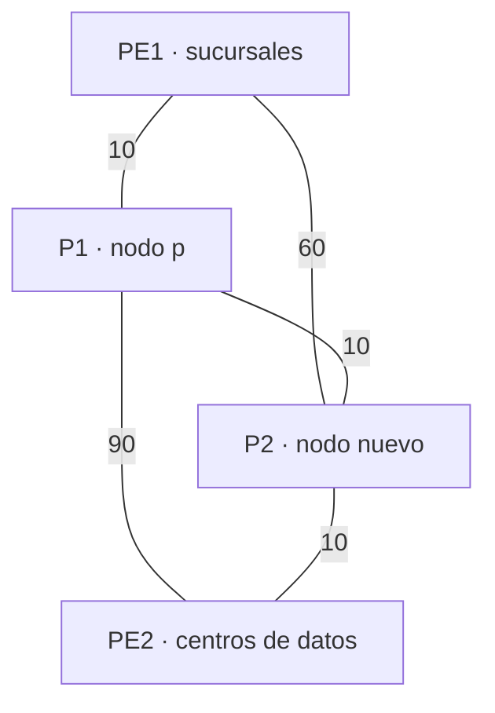

# Plan de evolución de la L3VPN MPLS empresarial

Este archivo es el diseño. La topología que ya se puede desplegar cubre las fases 1 a 3 y vive en esta misma carpeta: [`mpls-empresa.clab.yml`](mpls-empresa.clab.yml), `configs/` y `apps/pedidos/`. La ejecución y los resultados esperados están en [GUIA_EJECUCION_Y_PRUEBAS.md](GUIA_EJECUCION_Y_PRUEBAS.md). Las fases 4 (eBGP) y 5 (BFD o QoS) siguen siendo el trabajo siguiente: no están en el YAML.

## La demostración que se quiere construir

Una cajera en una sucursal registra un pedido en el centro de datos. Una segunda empresa usa la misma dirección IP para su propia aplicación. Ambas comparten el backbone del operador. Durante la exposición, el profesor elige un enlace de tránsito para simular su caída. El equipo predice la ruta de respaldo, mide el efecto sobre las operaciones y comprueba quién recibió cada pedido.

La propuesta representa **un ISP con dos puntos de presencia**, dos empresas y dos sedes por empresa. El profesor puede evaluarla desde dos perspectivas: qué experimentó el usuario y qué evidencia tiene el operador para explicarlo. La oferta pública de RPV de Telmex da un contexto comercial pertinente al hablar de interconexión de sucursales, priorización de aplicaciones y acuerdos de nivel de servicio. Los costos, clases, temporizadores y objetivos que siguen son decisiones del laboratorio. [RPV empresarial de Telmex](https://telmex.com/web/empresas/rpv-red-privada-virtual)

## 1. Punto de partida y alcance

| Elemento | Implementación actual | Cambio propuesto |
|---|---|---|
| Extremos | `ce1` y `ce2` Alpine generan el tráfico. Las IP `10.10.10.1/24` y `10.20.20.1/24` están en `lo`. | Conectar PCs y servidores independientes. Convertir esas dos IP en puertas de enlace de LAN. |
| Acceso | Enlaces CE–PE /31 y rutas estáticas de ida y regreso. | Conservar las estáticas en la primera fase. Migrar posteriormente a eBGP por VRF y filtrar anuncios. |
| Proveedor | `pe1 – p – pe2`. OSPF área 0, LDP y MP-iBGP VPNv4 en AS 65000. | Añadir un segundo P y tres enlaces. Diseñar un camino principal con dos P en serie y alternativas con costos conocidos. |
| VPN | Una VRF `CUST`, tabla Linux 100, RT `65000:100` y RD `65000:1` en ambos PE. | Agregar una segunda VRF con prefijos superpuestos y un RT propio. |
| Evidencia | Respuestas ICMP y captura MPLS desde Cursor/Wireshark. | Comprobantes de aplicación, prefijos por VRF, capturas correlacionadas, mediciones de interrupción y pruebas de carga. |

Usar la [guía del laboratorio base](../MPLS-CORP/GUIA_EJECUCION_Y_PRUEBAS.md) para registrar la línea base. La variante ya tiene nombre propio, [`mpls-empresa.clab.yml`](mpls-empresa.clab.yml), y configuraciones independientes. Así es posible ensayar un cambio y regresar al diseño de cinco nodos. La gestión de esta variante es `172.20.21.0/24`, distinta de `172.20.20.0/24` en MPLS-CORP. En el M1 conviene ejecutar uno a la vez.

## 2. Topología objetivo y direccionamiento

### Acceso de las dos empresas

Cada empresa tendrá una PC de sucursal y un servidor en su centro de datos. Un contenedor Linux con su propia interfaz, IP, tabla de rutas y cliente HTTP cumple el papel de PC. Para una sola estación conectada al CE basta un enlace directo. Al agregar teléfonos, impresoras o más estaciones tendría sentido intercalar un switch o puente por LAN.

| Empresa y sede | Terminal de datos | Gateway LAN en el CE | CE → PE | Direcciones del enlace, PE / CE |
|---|---|---|---|---|
| A, sucursal | `pc-a` · `10.10.10.10/24` | `ce1:eth2` · `10.10.10.1` | `ce1:eth1 → pe1:eth1` | `192.168.1.0/31` / `.1` |
| A, centro de datos | `srv-a` · `10.20.20.10/24` | `ce2:eth2` · `10.20.20.1` | `ce2:eth1 → pe2:eth2` | `192.168.2.0/31` / `.1` |
| B, sucursal | `pc-b` · `10.10.10.10/24` | `ce-b1:eth2` · `10.10.10.1` | `ce-b1:eth1 → pe1:eth4` | `192.168.11.0/31` / `.1` |
| B, centro de datos | `srv-b` · `10.20.20.10/24` | `ce-b2:eth2` · `10.20.20.1` | `ce-b2:eth1 → pe2:eth4` | `192.168.12.0/31` / `.1` |

Las IP coinciden de manera deliberada en las LAN de A y B. Son cuatro segmentos de capa 2 independientes. En las terminales se reserva `eth1` para datos y `eth0` para gestión. Las aplicaciones y sondas usan direcciones de datos. No se requiere NAT para llegar de la sucursal a su propio centro de datos.

### Núcleo del proveedor

El nodo actual `p` funciona como P1. Las líneas representan enlaces bidireccionales. El número es el costo OSPF propuesto, configurado en ambos extremos.



| Enlace de núcleo | Direcciones en el orden mostrado | Costo | Origen |
|---|---|---:|---|
| `pe1:eth2 ↔ p:eth1` | `10.0.12.0/31 ↔ 10.0.12.1/31` | 10 | Existente |
| `p:eth2 ↔ pe2:eth1` | `10.0.23.0/31 ↔ 10.0.23.1/31` | 90 | Existente |
| `p:eth3 ↔ p2:eth1` | `10.0.24.0/31 ↔ 10.0.24.1/31` | 10 | Nuevo |
| `p2:eth2 ↔ pe2:eth3` | `10.0.43.0/31 ↔ 10.0.43.1/31` | 10 | Nuevo |
| `pe1:eth3 ↔ p2:eth3` | `10.0.14.0/31 ↔ 10.0.14.1/31` | 60 | Nuevo |

Las loopbacks del operador son `10.255.255.1/32` (PE1), `.2` (P1), `.3` (PE2) y `.4` (P2). La sesión MP-BGP continúa entre las loopbacks de los PE. Los P solo necesitan las rutas de infraestructura y las etiquetas de transporte. El recorrido completo previsto para un pedido de A en condiciones normales es **PC-A → CE1 → PE1 → P1 → P2 → PE2 → CE2 → SRV-A**. [Arquitectura BGP/MPLS L3VPN, RFC 4364](https://datatracker.ietf.org/doc/html/rfc4364)

## 3. Implementación por fases

### Fase 0 · Conservar una referencia que se pueda repetir

1. Registrar el commit de referencia, la versión de Containerlab, la salida de `show version` de FRR y los identificadores de las imágenes que ya funcionan en ARM64. La topología actual utiliza etiquetas `latest`. Para la variante, fijar las versiones o digests probados y descargar las imágenes antes de la presentación.
2. Guardar una captura corta de la red actual junto con las tablas de PE1, P y PE2. Registrar el enlace y el sentido en cada observación.
3. Anotar un resultado conocido por capa: vecino OSPF, vecino LDP, ruta VPNv4, ruta importada en `CUST` y paquete entregado.

**Criterio de salida.** Repetir las verificaciones de la guía base y poder explicar el viaje de un paquete con dos etiquetas a la entrada de P y una a la salida hacia PE2.

### Fase 1 · Sustituir las loopbacks de cliente por LAN y una transacción real

1. Añadir `pc-a` y `srv-a` (siete nodos en total). Mover las direcciones de gateway de `lo` a `eth2` en ambos CE. Activar explícitamente `net.ipv4.ip_forward=1` en los CE. Los enlaces /31 y las rutas estáticas de cliente ya existentes sirven para esta fase.
2. En la PC, instalar la ruta a `10.20.20.0/24` por `10.10.10.1`. En el servidor, instalar la ruta de retorno a `10.10.10.0/24` por `10.20.20.1`. Conservar el acceso de gestión. Verificar la interfaz y el origen elegidos con `ip route get`.
3. Levantar un servicio pequeño en `srv-a`, ligado a `10.20.20.10:8080`. FastAPI y SQLite son suficientes. Proponer `POST /pedidos`, `GET /pedidos/{folio}` y `GET /salud`. Cada servidor obtiene su identidad empresarial de su configuración y lleva su propia base. Para repetir un alta tras un corte, usar un identificador de solicitud único y una restricción de unicidad en SQLite. Una repetición con los mismos datos debe recuperar el mismo folio.
4. Ejecutar el cliente **dentro de la PC de sucursal**. Se puede lanzar desde la terminal SSH de Cursor usando `docker exec`. Un formulario web de caja es opcional. Si se usa el navegador del Mac, se puede publicar una interfaz de operador cuyo backend resida en la PC y envíe el pedido por la LAN. Publicar directamente la API del centro de datos en el Mac permitiría saltarse la WAN que se quiere demostrar.

Comandos previstos **para la fase implementada**, con `curl` e `iproute2` instalados en la PC. El contrato de ejemplo devuelve `empresa`, `folio` y el identificador de la solicitud. En cada ensayo elegir un ID nuevo y reutilizarlo únicamente en los reintentos de esa operación.

```bash
# Dentro de pc-a
ip route get 10.20.20.10
curl --noproxy '*' --interface 10.10.10.10 -fsS http://10.20.20.10:8080/salud
curl --noproxy '*' --interface 10.10.10.10 -sS -i \
  -H 'Content-Type: application/json' -H 'Idempotency-Key: demo-A-001' \
  -d '{"articulo":"cable de red","cantidad":2}' \
  http://10.20.20.10:8080/pedidos
```

**Criterio de salida.** La ruta indica `via 10.10.10.1 dev eth1`. El alta nueva devuelve HTTP 201, el servidor conserva el pedido y una consulta posterior devuelve el mismo folio. Wireshark observa ese flujo en un enlace de núcleo. El registro del servidor muestra `10.10.10.10` como origen.

### Fase 2 · Dos organizaciones, misma IP y evidencia de aislamiento

1. Añadir `ce-b1`, `ce-b2`, `pc-b` y `srv-b` (once nodos). Repetir la fase 1 en los segmentos independientes de B. Los PE reciben las interfaces de B en `CUST_B`, tabla 200, con RT de importación y exportación `65000:200`. Conservar `CUST`, tabla 100, RT `65000:100`.
2. Mantener inicialmente el RD actual de A y usar `65000:201` en PE1 y `65000:202` en PE2 para B. Los RD distinguen rutas VPNv4 con el mismo prefijo. Los RT gobiernan qué rutas pueden importarse en cada VRF. Mantener separados los accesos y las políticas en ambos sentidos. [FRR, L3VPN y políticas de importación y exportación](https://docs.frrouting.org/en/latest/bgp.html#l3vpn-vrfs)
3. Desde ambas PCs crear un pedido en la misma URL. Usar identificadores de solicitud distintos y registrar empresa y folio. Confirmar cada alta en la base del servidor correspondiente. Consultar desde B el folio exclusivo emitido para A y comprobar su ausencia. Usar folios con prefijo de empresa o UUID para que un número consecutivo coincidente no invalide la prueba.
4. Como prueba independiente de la aplicación, agregar a `srv-b` la dirección exclusiva `10.202.20.10/32`, hacer que el servicio de prueba escuche ahí y anunciar el /32 únicamente desde el centro de datos B. Mientras el acceso sea estático, configurar en CE-B2 la ruta por la LAN hacia el servidor y en PE2 la ruta dentro de `CUST_B` por CE-B2. En ambas PCs dirigir la sonda a su CE. En ambos CE de sucursal, dirigir el destino de prueba al respectivo acceso de PE1. Así las dos solicitudes llegan al operador y la política de cada VRF determina el resultado. Confirmar con captura su llegada a PE1, el éxito desde B y la ausencia de una ruta aplicable en `CUST`, incluida una eventual ruta por defecto. El /32 debe aparecer en `CUST_B`.

**Criterio de salida.** Misma IP, dos identidades correctas y dos pedidos registrados en sus respectivas bases. La base de rutas VPNv4 del PE contiene ambos anuncios de `10.20.20.0/24` con RD distinguibles. La prueba positiva de B y la inspección de las dos VRF respaldan la prueba negativa del /32 desde A.

### Fase 3 · Ver el intercambio de etiquetas y sobrevivir a un corte

1. Añadir `p2` (doce nodos). Aplicar OSPF punto a punto y LDP a todos los enlaces del núcleo, habilitar recepción MPLS en cada nueva interfaz de tránsito y comprobar vecinos y etiquetas para las loopbacks de los PE. Conservar MPLS en el dominio del operador.
2. Aplicar los costos de la tabla en ambos sentidos. Verificar en PE1 el próximo salto para `10.255.255.3/32`, en P1 su salida hacia P2 y en PE2 el camino inverso. Los costos que siguen son sumas entre los routers PE. La métrica que se muestra para su loopback puede además incluir el costo del prefijo final.
3. Capturar una consulta de lectura a la API en los segmentos que se indican abajo. En Wireshark correlacionar IP origen/destino, puertos y número de secuencia TCP, por ejemplo el SYN de una conexión nueva. El índice `tcp.stream` puede variar entre archivos separados. Registrar los valores reales de etiqueta de ese despliegue.

| Punto de captura en sentido sucursal → servidor | Qué se espera observar |
|---|---|
| CE1 → PE1 | IP/TCP del cliente. |
| PE1 → P1 | PE1 ha impuesto etiqueta de transporte externa y etiqueta VPN interna. |
| P1 → P2 | Dos etiquetas. La tabla de conmutación de P1 indica la operación de intercambio (*swap*) de la externa y el siguiente salto. La coincidencia numérica entre dos etiquetas locales es posible. |
| P2 → PE2 | Si PE2 anuncia *implicit-null* para su loopback, P2 retira la externa mediante PHP. Permanece la etiqueta VPN. |
| PE2 → CE2 | IP/TCP que se entregará a `srv-a` por la LAN. |

4. Verificar la ruta prevista antes de introducir cada evento. Ejecutar **un fallo a la vez**, registrar el momento, restaurar el enlace y esperar la convergencia al estado inicial antes del siguiente ensayo.

| Evento independiente | Camino previsto de PE1 a PE2 | Costo |
|---|---|---:|
| Normal | PE1 → P1 → P2 → PE2 | 30 |
| Falla P1–P2 | PE1 → P2 → PE2 | 70 |
| Falla PE1–P1 o deja de operar P1 | PE1 → P2 → PE2 | 70 |
| Falla P2–PE2 o deja de operar P2 | PE1 → P1 → PE2 | 100 |
| Falla el enlace de respaldo P1–PE2 | PE1 → P1 → P2 → PE2 | 30 |

5. Desde cada PC emitir una lectura periódica a `/salud` con identidad esperada, conectar con un timeout acotado y registrar tiempo de envío, resultado y tiempo de respuesta. Usar un calendario fijo y registrar envíos reales incluso si hay solicitudes pendientes. Una ejecución secuencial bloqueada por un timeout no conserva la resolución prevista. Por ejemplo, programar una sonda cada 200 ms con timeout de 1 s, sin reintentos automáticos; registrar solicitudes y respuestas con reloj monotónico en la VM.
6. Separar tres observaciones: detección de la vecindad, instalación de la salida alternativa y recuperación observada desde la PC. Para el servicio, informar la primera solicitud **enviada después del evento** que tuvo respuesta válida, las fallidas y la cadencia de muestreo. El intervalo entre dos éxitos contiene el tiempo entre sondas. Si todas respondieron, informar “cero fallos observados a esta cadencia” y la latencia máxima. Comparar además el uptime de MP-BGP antes y después.
7. Crear un pedido durante un ensayo, repetirlo con la misma clave si el cliente pierde la respuesta y verificar cuántas filas quedaron. Registrar por separado el comportamiento de enrutamiento y el de la aplicación. La deduplicación es propiedad de la API.

**Criterio de salida.** La aplicación se recupera sin intervención manual en las rutas, ambos clientes conservan su identidad y la captura en el enlace alternativo contiene tráfico MPLS de la prueba. Distinguir el alcance de la redundancia: los CE, los PE y la última milla siguen teniendo un solo punto de conexión por sede. [Arquitectura MPLS, RFC 3031](https://datatracker.ietf.org/doc/html/rfc3031)

### Fase 4 · Acceso empresarial con eBGP y políticas de prefijos

Sustituir los CE Alpine con rutas estáticas por CE con FRR, conservando sus dos interfaces de datos y sus gateways. En cada PE, el vecino CE pertenece a la familia IPv4 unicast **de la VRF del cliente**. Entre los PE continúa VPNv4. Se proponen AS privados distintos por sede para simplificar el manejo del AS_PATH.

| Router | AS | Prefijos que puede anunciar al PE |
|---|---:|---|
| CE1 de A | 65101 | `10.10.10.0/24` |
| CE2 de A | 65102 | `10.20.20.0/24` |
| CE de sucursal B | 65201 | `10.10.10.0/24` |
| CE de centro de datos B | 65202 | `10.20.20.0/24` y `10.202.20.10/32` |
| PE1 y PE2 | 65000 | Hacia cada CE, únicamente los prefijos remotos contratados de ese cliente. |

1. Establecer eBGP inicialmente con las estáticas presentes. Aplicar políticas explícitas de entrada y salida en PE y CE, exigir coincidencia exacta de los prefijos contratados y comprobar las rutas recibidas. Revisar la redistribución de conectadas/estáticas de la base para que los /31 de acceso y cualquier prefijo ajeno queden fuera de la exportación VPN prevista.
2. Migrar una sede a la vez. Retirar las estáticas equivalentes de CE y PE en la variante después de comprobar que BGP dispone de la ruta alternativa. Verificar que la ruta activa ahora figura como BGP y repetir el pedido. Una estática remanente podría ocultar el resultado de la siguiente prueba.
3. Como prueba de aceptación, anunciar desde CE1 un prefijo adicional de laboratorio `10.99.99.0/24`. Mostrar que sale del CE, que la política de entrada del PE lo rechaza y que el PE remoto no lo instala. Restaurar el anuncio de prueba. Después retirar temporalmente un prefijo autorizado y observar su retirada de la VRF remota y su recuperación al restaurarlo.

**Criterio de salida.** Puede darse de alta o retirar una LAN autorizada desde el CE, se observa el cambio en la VPN y el proveedor mantiene el control sobre los prefijos aceptados. [FRR, configuración de BGP](https://docs.frrouting.org/en/latest/bgp.html)

### Fase 5 · Elegir un experimento de rendimiento para la exposición

**Opción A. Medir detección con BFD.** En el proyecto base, `bfdd` está deshabilitado. Activarlo en los extremos del enlace de prueba e integrarlo con OSPF. Comparar OSPF solo frente a OSPF+BFD con la misma pérdida bidireccional del 100 % en el enlace de tránsito, manteniendo la interfaz en estado UP. Containerlab permite aplicar y retirar pérdidas en interfaces; aplicar la pérdida a los egresos de ambos extremos y registrar el instante de aplicación. Verificar el estado operativo de BFD antes del ensayo. Repetir cada variante cinco veces, restaurando adyacencias y caminos antes de medir otra vez. Registrar temporizadores efectivos, mediana, peor caso y recuperación HTTP. Un apagado administrativo mide un evento distinto, porque entrega una señal local de enlace caído. [BFD y OSPF en FRR](https://docs.frrouting.org/en/latest/bfd.html) · [Emulación de enlaces en Containerlab](https://containerlab.dev/cmd/tools/netem/set/)

**Opción B. Medir calidad bajo congestión.** Limitar, por ejemplo, a 10 Mbit/s el egreso del CE de sucursal hacia el PE. Generar por el mismo egreso un respaldo TCP y un flujo UDP de baja tasa que simule tráfico sensible al retardo. Comparar sin carga, con carga y una cola común, y con la misma carga y colas diferenciadas. Mantener iguales el límite, los tamaños de paquetes y la duración. Primero implementar clasificación y colas en ese acceso IP. Como ampliación de QoS dentro del núcleo, definir el mapeo DSCP → MPLS TC y validarlo en la captura y en los contadores de colas del punto de congestión. Una marca en la cabecera por sí sola no prueba priorización. [DiffServ y MPLS, RFC 9435 §5.2](https://www.rfc-editor.org/rfc/rfc9435.html#section-5.2)

Ejemplo para la opción B en la empresa A. Preparar dos procesos de servidor `iperf3` en `srv-a`, uno en el puerto 5201 y otro en 5202. Ejecutar los dos clientes en terminales separadas de `pc-a` para que los flujos coincidan. El puerto 5202 y el marcado EF permiten identificar el flujo protegido en la política del CE.

```bash
# Terminal 1 en pc-a · respaldo TCP hacia el centro de datos
iperf3 -c 10.20.20.10 -B 10.10.10.10 -p 5201 -t 30 -J

# Terminal 2 en pc-a · flujo sensible en el mismo sentido
iperf3 -c 10.20.20.10 -B 10.10.10.10 -p 5202 -u -b 256K -l 160 --dscp EF -t 30 -J
```

Leer pérdida y jitter UDP en el receptor, tasa TCP y contadores de cada clase. Guardar cada salida JSON y anotar duración, repeticiones y capacidad configurada. Un objetivo académico inicial podría ser pérdida UDP menor al 1 % bajo el perfil de prueba; fijarlo antes de medir y reportar el resultado aunque se incumpla. La red está emulada en una sola máquina, por lo que se comparan configuraciones bajo condiciones equivalentes. [Manual de iperf3](https://software.es.net/iperf/invoking.html)

**Elección recomendada.** BFD si se prioriza continuidad y diagnóstico de fallas. QoS si se quiere explicar cómo un operador protege aplicaciones con distintas exigencias cuando el enlace está lleno. Ambas opciones aprovechan los mismos doce nodos.

## 4. Evidencia operativa y diagnóstico

Preparar una vista ligera en Cursor o un panel que lea un CSV/JSONL. Mostrar dos filas, una por empresa, con último folio, identidad del servidor, hora, latencia y último error. En paralelo, mostrar la topología y las capturas. Si el panel indica el camino activo, alimentarlo con el próximo salto leído de FRR o con contadores/capturas del enlace; registrar la fuente y la hora. La telemetría puede ir por gestión, los pedidos deben viajar por la VPN.

| Pregunta del evaluador | Comprobación | Evidencia de aceptación |
|---|---|---|
| ¿El tráfico realmente salió de la PC? | `ip route get` y captura en LAN y núcleo durante un pedido. | Origen de la PC, gateway CE, misma conexión TCP en ambos puntos. |
| ¿Cómo distingue el operador dos destinos idénticos? | Comparar VPNv4 y las tablas de `CUST` y `CUST_B`. | Prefijo coincidente, RD distinguibles, RT y etiqueta VPN según el servicio. |
| ¿Qué sabe un router del núcleo sobre la empresa? | Revisar OSPF, LDP, tabla IP global y tabla MPLS del P. | Transporte al PE remoto, acción sobre la etiqueta externa y ausencia de la ruta exacta de LAN empresarial. |
| ¿Dónde empezaría el diagnóstico si solo falla B? | Revisar B de extremo a extremo: servicio local, retorno del CE, interfaz de la VRF, ruta importada y RT. Comprobar A en paralelo. | Se identifica la primera capa que pierde el resultado esperado. |
| ¿Cuánto afectó un corte? | Correlacionar evento, sondas, próximo salto y recuperación. | Resultado por ensayo e identidad correcta de ambas aplicaciones tras el corte. |
| ¿Qué incluye el informe? | Conservar versión, topología de prueba, PCAPNG, mediciones crudas y una tabla de resultados. | Otra persona puede reproducir el ensayo y verificar la conclusión. |

No extrapolar una disponibilidad anual de una demo de minutos. Informar tamaño de muestra, latencias y alcance. La VRF proporciona separación de rutas. Si se requiere confidencialidad de los pedidos en tránsito, usar HTTPS con certificados confiables para los clientes de prueba; aun así se pueden observar los encabezados MPLS y TCP.

## 5. Calendario, capacidad y punto de corte

Estimación orientativa en sesiones de 2–3 horas para alguien que ya domina el laboratorio base. Reservar una sesión adicional para ensayar cambios de red y prepararse para preguntas.

| Sesiones | Entrega | Decisión al terminar |
|---|---|---|
| 1–2 | Línea base, PC y servidor de A, primer pedido con folio. | Seguir cuando se observe el flujo en el núcleo. |
| 3 | Dos empresas con LAN superpuestas y prueba positiva/negativa. | Guardar los dos comprobantes y tablas. |
| 4–5 | Segundo P, capturas de swap/PHP y ensayos de falla/restauración. | **Alcance recomendado para exponer**, incluso si no se llega a los extras. |
| 6 | Migración CE–PE a eBGP y política de prefijos. | Repetir la aceptación de ambas VPN después de la migración. |
| 7–8 | BFD o QoS, informe comparativo y ensayo de demostración. | Elegir un único experimento adicional para la exposición. |

Para el **MacBook Air M1 con 8 GB**, crecer de 5 a 7, 11 y 12 nodos. Usar Linux ARM64 sin escritorio en PCs y servidores, un solo proceso de API por servidor y capturas acotadas al flujo. Medir con `sudo docker stats --no-stream` y `free -h` dentro de la VM y revisar presión de memoria en macOS durante carga y captura. Guardar datos sin carga y durante las pruebas. Si la VM empieza a paginar de forma sostenida o las sondas locales también sufren saltos de latencia, reducir capturas simultáneas y procesos auxiliares. Registrar el efecto antes de atribuirlo al protocolo. La capacidad real de doce nodos en ese equipo queda por medir.

## 6. Guion de defensa de ocho minutos

| Tiempo | Acción en vivo | Qué debería entender el profesor |
|---|---|---|
| 0:00–1:00 | Presentar el problema de dos empresas con las mismas IP. Mostrar la ruta que elige la PC. | Dónde termina la LAN, dónde comienza el servicio del operador y qué transporta. |
| 1:00–2:15 | Registrar desde las dos PCs un pedido en la misma URL. Mostrar empresa y folio de cada respuesta. | Cómo se manifiesta el aislamiento para los usuarios. |
| 2:15–3:45 | Seguir un único segmento TCP por PE1, P1 y P2. Mostrar las tablas de etiquetas junto a la captura. | Quién impone la pila, quién hace swap y quién retira la etiqueta de transporte. |
| 3:45–5:30 | Pedir al profesor que elija uno de los tres enlaces de la ruta principal. Predecir la alternativa, simular el corte y observar las sondas. | Que el camino elegido surge de costos explicables y que la recuperación se puede medir. |
| 5:30–6:45 | Consultar el folio anterior, emitir una operación nueva y mostrar el tráfico en el camino de respaldo. | Que la empresa recuperó una función de negocio y recibió el resultado correcto. |
| 6:45–8:00 | Restaurar el enlace y contrastar el resultado en vivo con las repeticiones previas. | Qué fallos cubre el diseño, cuánto se observó y qué seguiría fallando si se pierde un PE. |

Como respaldo para la exposición, conservar una captura y una corrida completa con marcas de tiempo. El material grabado debe mostrar su fecha de ensayo si se utiliza.

## 7. Siguiente evolución si sobra tiempo

| Ampliación | Cuándo aporta | Qué demostraría |
|---|---|---|
| Sucursal con doble acceso a dos PE | Cuando el profesor pregunte por la caída de un PE o de la última milla. | Diseñar segundo acceso, selección primaria/secundaria y continuidad desde la misma PC al perder el PE activo. |
| Tercer sitio y política hub-and-spoke | Cuando se quiera profundizar en RT y políticas empresariales. | Dos sucursales llegan al centro de datos, manteniendo la política de comunicación definida entre ellas. |
| Segundo ISP independiente | Cuando la pregunta sea interoperabilidad entre operadores. | Incorporar otro AS de proveedor con límites y políticas explícitos. Una primera variante viable es una interconexión por VRF en routers de frontera (Inter-AS opción A). Tratarla como otra etapa del proyecto. |

Para el primer incremento, el entregable concreto es **una PC distinta de CE1 registrando un pedido persistente en un servidor detrás de CE2, con la conexión observada en el núcleo MPLS**. Ese recorrido será la referencia contra la que se validará el resto.
