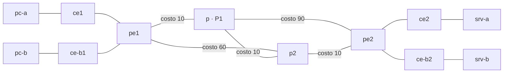

# MPLS-EMPRESARIAL

Un operador con dos puntos de presencia transporta a dos empresas. Cada empresa tiene una sucursal y un centro de datos. Las dos usan las mismas direcciones de LAN. Durante la exposición se puede cortar un enlace del camino principal y mostrar que el pedido sigue llegando por el respaldo.

Este directorio es la variante desplegable de [PLAN_MPLS_EMPRESARIAL.md](PLAN_MPLS_EMPRESARIAL.md). Cubre las fases 1 a 3 de ese plan: LAN reales, dos VRF y un segundo P. La referencia de cinco nodos sigue en [MPLS-CORP](../MPLS-CORP/README.md). Los comandos y el resultado de cada prueba están en [GUIA_EJECUCION_Y_PRUEBAS.md](GUIA_EJECUCION_Y_PRUEBAS.md).

## Qué demuestra

Una caja en la sucursal registra un pedido en el servidor de su propia empresa. La URL es la misma para A y para B (`http://10.20.20.10:8080/pedidos`). El operador no mezcla los pedidos porque cada empresa vive en una VRF distinta.

El recorrido normal de un pedido de A es **PC-A → CE1 → PE1 → P1 → P2 → PE2 → CE2 → SRV-A**.

| Tramo | Qué lleva el paquete |
| --- | --- |
| PC-A → CE1 → PE1 | IP. PE1 busca el destino en `CUST` |
| PE1 → P1 | Etiqueta de transporte y, debajo, la etiqueta VPN |
| P1 → P2 | Dos etiquetas. P1 cambia la externa (swap) y no lee la IP del cliente |
| P2 → PE2 | Solo la etiqueta VPN. P2 hizo PHP porque PE2 anuncia implicit-null |
| PE2 → CE2 → SRV-A | IP. PE2 entregó el paquete dentro de `CUST` |

P1 y P2 no tienen `10.10.10.0/24` ni `10.20.20.0/24` en su tabla global. Saben llegar a las loopbacks de los PE y conmutar la etiqueta de transporte.

## Topología



El costo es OSPF, configurado en los dos extremos del enlace. Con todos los enlaces arriba, PE1 llega a PE2 por P1 y P2 (costo de enlaces 30). El atajo PE1–P2 cuesta 70. El enlace directo P1–PE2 cuesta 100 y queda de respaldo lejano.

| Nodo | Imagen | Papel |
| --- | --- | --- |
| `pc-a`, `pc-b` | `python:3.12-alpine` | Caja de la sucursal. Origen `10.10.10.10` |
| `srv-a`, `srv-b` | `python:3.12-alpine` | Servidor del centro de datos. Escucha en `10.20.20.10:8080` |
| `ce1`, `ce2` | `alpine:latest` | CE de la empresa A. Reenvían IP |
| `ce-b1`, `ce-b2` | `alpine:latest` | CE de la empresa B |
| `pe1`, `pe2` | `frrouting/frr:latest` | PE. Dos VRF cada uno |
| `p`, `p2` | `frrouting/frr:latest` | P1 y P2. OSPF y LDP, sin BGP |

`eth0` es la gestión, en `172.20.21.0/24`. No entra en OSPF, LDP ni en las VRF. MPLS-CORP usa `172.20.20.0/24`, así que las dos gestiones no se pisan. En el M1 es mejor tener un solo laboratorio levantado. La VM Linux de este equipo tiene unos 2 GiB: con los doce nodos ya usa swap, y si `watchfrr` no alcanza a arrancar FRR hay que repetir `/usr/lib/frr/frrinit.sh start` en ese router o subir la memoria de la máquina.

## Dos empresas, las mismas IP

| Empresa y sede | Terminal | Gateway en el CE | Enlace CE–PE | VRF |
| --- | --- | --- | --- | --- |
| A, sucursal | `pc-a` `10.10.10.10/24` | `ce1` `eth2` `10.10.10.1/24` | `192.168.1.0/31` | `CUST`, tabla 100, RT `65000:100`, RD `65000:1` |
| A, centro de datos | `srv-a` `10.20.20.10/24` | `ce2` `eth2` `10.20.20.1/24` | `192.168.2.0/31` | `CUST` |
| B, sucursal | `pc-b` `10.10.10.10/24` | `ce-b1` `eth2` `10.10.10.1/24` | `192.168.11.0/31` | `CUST_B`, tabla 200, RT `65000:200`, RD `65000:201` en PE1 |
| B, centro de datos | `srv-b` `10.20.20.10/24` | `ce-b2` `eth2` `10.20.20.1/24` | `192.168.12.0/31` | `CUST_B`, RD `65000:202` en PE2 |

`srv-b` tiene además `10.202.20.10/32` en la loopback. Solo la VRF de B aprende ese prefijo. Sirve para demostrar que A puede intentar llegar y el PE no tiene ruta en `CUST`.

Las loopbacks del operador son PE1 `10.255.255.1/32`, P1 `10.255.255.2/32`, PE2 `10.255.255.3/32` y P2 `10.255.255.4/32`. La sesión MP-iBGP sigue entre las loopbacks de los PE, AS 65000. Los P no participan.

## Núcleo

| Enlace | Direcciones | Costo OSPF |
| --- | --- | --- |
| `pe1:eth2` ↔ `p:eth1` | `10.0.12.0/31` ↔ `10.0.12.1/31` | 10 |
| `p:eth3` ↔ `p2:eth1` | `10.0.24.0/31` ↔ `10.0.24.1/31` | 10 |
| `p2:eth2` ↔ `pe2:eth3` | `10.0.43.0/31` ↔ `10.0.43.1/31` | 10 |
| `pe1:eth3` ↔ `p2:eth3` | `10.0.14.0/31` ↔ `10.0.14.1/31` | 60 |
| `p:eth2` ↔ `pe2:eth1` | `10.0.23.0/31` ↔ `10.0.23.1/31` | 90 |

Cada loopback anuncia costo 1. La métrica que FRR instala hacia la loopback remota es la suma de los enlaces del camino. En condiciones normales PE1 muestra 30, por `10.0.12.1` y `eth2`. LDP lleva `ttl-security disable`: la sesión entre PE1 y P2 no es de un solo salto, porque el mejor camino entre esas loopbacks pasa por P1.

| Evento | Camino PE1 → PE2 | Métrica esperada |
| --- | --- | --- |
| Normal | PE1 → P1 → P2 → PE2 | 30 |
| Cae P1–P2 | PE1 → P2 → PE2 | 70 |
| Cae PE1–P1 | PE1 → P2 → PE2 | 70 |
| Cae P2–PE2 | PE1 → P1 → PE2 | 100 |
| Cae el respaldo P1–PE2 | PE1 → P1 → P2 → PE2 | 30 |

Los CE, los PE y la última milla de cada sede siguen teniendo un solo enlace. La redundancia está en el núcleo.

## Archivos

| Archivo | Qué aporta |
| --- | --- |
| [`mpls-empresa.clab.yml`](mpls-empresa.clab.yml) | Doce nodos, enlaces, VRF, sysctl MPLS y el arranque de la API |
| [`configs/pe1/frr.conf`](configs/pe1/frr.conf) | OSPF con costos, LDP en `eth2` y `eth3`, estáticas de A y B, VPNv4 |
| [`configs/pe2/frr.conf`](configs/pe2/frr.conf) | El otro extremo, más el `/32` exclusivo de B |
| [`configs/p/frr.conf`](configs/p/frr.conf) | P1. OSPF y LDP en los tres enlaces de núcleo |
| [`configs/p2/frr.conf`](configs/p2/frr.conf) | P2. Sin BGP |
| `configs/*/daemons` | `ospfd` y `ldpd` en los cuatro routers; `bgpd` solo en los PE |
| [`apps/pedidos/server.py`](apps/pedidos/server.py) | `GET /salud`, `POST /pedidos`, `GET /pedidos/{folio}`. SQLite e idempotencia |
| [`apps/pedidos/cliente.py`](apps/pedidos/cliente.py) | Cliente que fija el origen en `10.10.10.10` |
| [GUIA_EJECUCION_Y_PRUEBAS.md](GUIA_EJECUCION_Y_PRUEBAS.md) | Despliegue y pruebas |
| [PLAN_MPLS_EMPRESARIAL.md](PLAN_MPLS_EMPRESARIAL.md) | Fases 4 y 5, guion de defensa y criterio de cada fase |

El contenedor se llama `clab-mpls-empresa-<nodo>`. La empresa de cada servidor sale de la variable `EMPRESA`. Un alta nueva responde HTTP 201 con `empresa`, `folio` y `solicitud`. La misma clave de idempotencia devuelve el mismo folio.

## Cómo ejecutarlo

La VM, Docker, Containerlab y los módulos del kernel se preparan una sola vez, con las secciones 1 y 2 de la [guía de MPLS-CORP](../MPLS-CORP/GUIA_EJECUCION_Y_PRUEBAS.md).

```bash
cd "/Users/oliverolvera/Documents/GitHub - Personal/L3VPN-over-MPLS/MPLS-EMPRESARIAL"
sudo containerlab deploy -t mpls-empresa.clab.yml
```

El primer hito de aplicación es un alta desde `pc-a` que el servidor registra con origen `10.10.10.10` y empresa `A`. El hito de aislamiento es repetir la misma URL desde `pc-b` y obtener empresa `B` y otro folio. El hito de núcleo es ver en PE1 la loopback de PE2 por P1, con métrica 30, y el cambio a métrica 70 cuando se apaga el enlace P1–P2.

```bash
sudo containerlab destroy -t mpls-empresa.clab.yml --cleanup
```

## Qué todavía no está en este despliegue

El acceso CE–PE sigue siendo estático, como en MPLS-CORP. La fase 4 del plan lo cambia por eBGP con filtro de prefijos. La fase 5 elige un experimento, BFD o QoS, y tampoco está configurada. Conviene cerrar las pruebas de la guía antes de sustituir las estáticas: una ruta estática que se quede escondida puede hacer parecer que BGP ya transporta la LAN.
