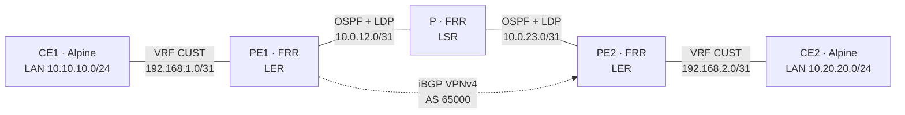

# L3VPN sobre MPLS

Laboratorio de una VPN de capa 3 sobre un backbone MPLS. El ISP une dos sucursales y el cliente no ve etiquetas: entre las LAN de CE1 y CE2 el ping es IP, y en el núcleo el paquete viaja con dos etiquetas.

Este archivo describe cómo debe quedar la implementación y cómo ejecutar el esqueleto que ya está en el repositorio. Los fragmentos de configuración viven aquí. No hay `frr.conf` todavía, y [`mpls-corp.clab.yml`](mpls-corp.clab.yml) solo declara nodos y enlaces.

## Contenido

- [Qué es este laboratorio](#qué-es-este-laboratorio)
- [Conceptos](#conceptos)
- [Topología](#topología)
- [Plan de direccionamiento](#plan-de-direccionamiento)
- [Orden de implementación](#orden-de-implementación)
- [Instalación según el sistema y la CPU](#instalación-según-el-sistema-y-la-cpu)
- [Ejecución y verificación](#ejecución-y-verificación)
- [Problemas frecuentes](#problemas-frecuentes)
- [Referencias](#referencias)

## Qué es este laboratorio

Hay un solo backbone de proveedor. CE1 es la sucursal A y CE2 es la sucursal B. PE1 y PE2 son el borde del ISP: hablan IP con el cliente y MPLS hacia dentro. P es un router de tránsito del núcleo.

El resultado esperado es un ping desde la LAN de CE1 (`10.10.10.1`) hasta la LAN de CE2 (`10.20.20.1`). En el enlace entre los PE y P ese paquete lleva dos etiquetas. El cliente solo envía y recibe IP.

El archivo de topología define cinco nodos y cuatro enlaces, sin direcciones ni protocolos:

| Nodo | Imagen | `kind` | Papel |
| --- | --- | --- | --- |
| `pe1`, `p`, `pe2` | `frrouting/frr:latest` | `linux` | Routers del ISP. FRR está en la imagen; la configuración se aplica después, con `vtysh`. |
| `ce1`, `ce2` | `alpine:latest` | `linux` | Borde del cliente. Solo IP. |

`containerlab deploy` genera el directorio `clab-mpls-corp/` (inventarios, TLS y claves). Es estado del despliegue, no parte del diseño. La red de gestión que Containerlab ya asignó es `172.20.20.0/24`:

| Nodo | Gestión |
| --- | --- |
| `ce1` | `172.20.20.2` |
| `ce2` | `172.20.20.3` |
| `p` | `172.20.20.4` |
| `pe1` | `172.20.20.5` |
| `pe2` | `172.20.20.6` |

La puerta de enlace de esa red es `172.20.20.1`. Esas direcciones sirven para entrar a los contenedores. No se usan como LAN de las sucursales ni como enlaces del núcleo.

## Conceptos

Cada pieza depende de la anterior. El orden de abajo es el orden en el que el laboratorio llega a tener tráfico.

### Reenvío IP y conmutación por etiquetas

En IP, cada router abre el paquete, busca el destino en su tabla y elige un siguiente salto. Todos los routers del camino necesitan la misma información de alcanzabilidad, o al menos una ruta que cubra el destino.

En la conmutación por etiquetas el router del borde pega una etiqueta corta delante del paquete. Los routers de en medio miran esa etiqueta, la cambian por otra (o la quitan) y reenvían. No consultan la dirección IP del cliente para decidir el salto.

**En este lab.** Los CE y el tramo PE–CE siguen siendo IP. Desde PE1 hasta PE2 el núcleo conmuta por la etiqueta de transporte. Por eso P puede ignorar las direcciones `10.10.10.0/24` y `10.20.20.0/24`.

### MPLS

MPLS inserta un shim de 32 bits entre la cabecera de capa 2 y la cabecera IP:

| Campo | Bits | Uso en este lab |
| --- | --- | --- |
| Etiqueta | 20 | Valor que consulta el router. El espacio llega hasta `1048575`. |
| TC | 3 | Clase de tráfico. Aquí no se usa para QoS. |
| S (bottom of stack) | 1 | Vale 1 en la etiqueta del fondo de la pila. |
| TTL | 8 | Se decrementa en cada salto, igual que el TTL de IP. |

Las etiquetas se apilan. La de más afuera es la primera que ve el router siguiente. Un LSP (Label Switched Path) es el camino de etiquetas desde el router que hace push hasta el que hace pop.

Dos roles recorren ese camino:

- **LER** (Label Edge Router). Está en el borde del dominio MPLS. Impone la pila o la retira. En este diseño el LER es el PE.
- **LSR** (Label Switch Router). Está en el núcleo. Solo intercambia o retira la etiqueta externa. En este diseño el LSR es P.

**PHP** (penultimate hop popping) evita que el LER de salida haga dos búsquedas. El penúltimo salto anuncia, o respeta, la etiqueta reservada 3 (implicit-null). Esa etiqueta no sale al cable: el penúltimo salto quita la etiqueta de transporte y el último router recibe el resto del paquete. Con un solo P, P es ese penúltimo salto hacia cada PE.

**En este lab.** PE1 impone dos etiquetas. P solo actúa sobre la externa y, por PHP, la quita. PE2 recibe únicamente la etiqueta VPN.

### Roles CE, PE y P

- **CE** (Customer Edge). Router de la sucursal. Tiene una ruta por defecto hacia su PE. No habla MPLS, LDP ni el OSPF del ISP.
- **PE** (Provider Edge). Mantiene la tabla del cliente en una VRF, impone la etiqueta VPN y la de transporte, y al otro extremo retira la VPN y entrega IP.
- **P** (Provider). Conmuta el LSP entre PE. La IP del cliente y la etiqueta VPN viajan como carga: P no tiene VRF y no necesita las rutas de las sucursales.

Esa separación es el motivo de la etiqueta interna. Si P tuviera que leer la IP del cliente, cada prefijo de cada cliente tendría que existir en el núcleo.

**En este lab.** CE1 y CE2 son Alpine con rutas IP. PE1 y PE2 son los únicos que tienen la VRF `CUST`. P solo corre OSPF y LDP.

### OSPF como IGP

OSPF reparte la alcanzabilidad interna del ISP. Aquí el área 0 publica las loopback de PE1, P y PE2 y los dos enlaces del núcleo. Con eso cada PE sabe llegar a la loopback del otro, que es la dirección de la sesión BGP y el destino del LSP.

Las redes del cliente no entran en este OSPF. Si entraran, el núcleo volvería a cargar con los prefijos de las sucursales y la VPN dejaría de aislarlos.

**En este lab.** OSPF existe para que `10.255.255.1/32` y `10.255.255.3/32` se vean entre sí a través de P. CE1 y CE2 no son vecinos OSPF de nadie.

### LDP

LDP reparte la etiqueta de transporte. Cada router anuncia una etiqueta para cada FEC que le interesa; en este laboratorio las FEC son las loopback `/32`. La sesión TCP de LDP se ata a la loopback (`discovery transport-address`), no a la IP del enlace. Así el extremo de la sesión coincide con el next-hop que BGP pondrá en las rutas VPN.

La etiqueta que LDP anuncia para la loopback del PE remoto es la etiqueta externa de la pila. El LSP de ida es PE1 → P → PE2. El de vuelta es el simétrico.

**En este lab.** Sin LDP, PE1 tendría la ruta VPN por BGP y no tendría etiqueta de transporte para imponer. El doble push no se puede completar.

### VRF, RD y RT

Una VRF es una tabla de rutas aparte. Las interfaces hacia el cliente se mueven a esa tabla. La tabla global del PE se queda con las loopback y el núcleo.

Dos identificadores acompañan a la VRF cuando la ruta sale hacia BGP:

- **RD** (Route Distinguisher). Se antepone al prefijo IPv4 y fabrica una ruta VPNv4 única. En este laboratorio el RD es `65000:1` en los dos PE.
- **RT** (Route Target). Es una comunidad extendida que decide quién importa la ruta. Los dos PE exportan e importan `65000:100`, así que cada uno instala en `CUST` lo que el otro exporta.

El RD distingue el prefijo dentro de MP-BGP. El RT elige la VRF de destino. Pueden coincidir en un laboratorio de un solo cliente; en un ISP con muchos clientes el RT es la política (qué sedes se ven entre sí) y el RD solo tiene que hacer único el NLRI.

**En este lab.** La VRF se llama `CUST`. `eth1` de PE1 y `eth2` de PE2 viven en ella. Si se quedan en la tabla global, la LAN del cliente se mezcla con el núcleo.

### MP-BGP VPNv4

MP-BGP transporta rutas de familias que no son IPv4 unicast. La familia VPNv4 lleva el prefijo del cliente junto con su RD, su RT y la etiqueta VPN.

La sesión es iBGP, AS `65000`, entre las loopback de PE1 y PE2, con `update-source` en `lo`. El next-hop de la ruta VPN tiene que ser esa loopback: es la FEC para la que LDP ya repartió etiqueta de transporte. La etiqueta VPN es la interna. Con `label vpn export auto` FRR elige el valor.

P no participa en esta sesión. El paquete BGP viaja por el IGP (PE1–P–PE2); el vecino BGP de PE1 es PE2, no P.

**En este lab.** PE1 anuncia `10.10.10.0/24` y PE2 anuncia `10.20.20.0/24`, las dos con RT `65000:100`. La etiqueta de esa publicidad es la que PE2 reconoce al recibir el paquete tras el PHP.

### Recorrido de CE1 a CE2

El paquete de ejemplo sale de `10.10.10.1` y va a `10.20.20.1`.

1. **CE1 envía IP.** La ruta por defecto manda el paquete a PE1 por `192.168.1.0/31`. No hay etiquetas.
2. **PE1 hace el doble push.** Busca `10.20.20.0/24` en la VRF `CUST`. La ruta dice “next-hop `10.255.255.3`, etiqueta VPN V”. LDP tiene una etiqueta de transporte T para `10.255.255.3/32`. PE1 impone V (fondo de pila, S=1) y encima T, y envía el paquete a P.
3. **P solo toca la etiqueta externa.** Lee T, que identifica el LSP hacia PE2. No consulta `10.20.20.1` ni la etiqueta V. PE2 anuncia implicit-null (etiqueta 3) para su propia loopback, así que P, único salto intermedio, hace pop de T. Esto es PHP. Si hubiera más routers P, los intermedios harían swap de T y solo el penúltimo la quitaría.
4. **PE2 quita la etiqueta VPN.** En el cable P–PE2 queda únicamente V. PE2 la reconoce como la etiqueta que él mismo asignó a `CUST`, la retira y busca `10.20.20.1` en esa VRF.
5. **PE2 entrega IP a CE2.** El paquete sale por la interfaz de la VRF, otra vez sin etiquetas, hacia `192.168.2.1`.

El regreso es el mismo camino al revés: CE2 usa su ruta por defecto, PE2 impone la pila hacia `10.255.255.1`, P hace PHP y PE1 entrega IP a CE1.

En el cable se ve así:

| Tramo | Pila |
| --- | --- |
| CE1 → PE1 | IP |
| PE1 → P | transporte, y debajo la VPN |
| P → PE2 | solo la VPN |
| PE2 → CE2 | IP |

### Qué hace un ISP y qué deja fuera este laboratorio

En producción el mismo esquema lleva a muchos clientes: un RD y un RT por VPN, decenas o cientos de PE, y reflectores de rutas para no cerrar una malla iBGP completa. Los bits TC marcan clases de servicio. Fast reroute (LFA o TI-LFA, a menudo con RSVP-TE o con Topology Independent LFA sobre un IGP segmentado) cubre el corte de un enlace sin esperar a que OSPF y LDP converjan. El plano de datos corre en ASICs; el plano de control sigue siendo BGP, un IGP y un protocolo de etiquetas.

Este laboratorio se queda en el mínimo que ya enseña el mecanismo:

- Un cliente y una VRF.
- Dos PE, así que la sesión iBGP es directa y no hace falta un route reflector.
- Sin QoS y sin fast reroute.
- El plano de datos es el kernel de Linux (`mpls_router`), no un ASIC. El plano de control es FRR.

Las direcciones, el doble push y el PHP se leen igual que en la red del proveedor. Cambian la escala, la protección y el rendimiento.

## Topología



La línea punteada es la sesión MP-BGP entre loopbacks. No hay un cable PE1–PE2: la sesión TCP pasa por P gracias a OSPF.

Enlaces tal como están en el YAML:

| Extremo A | Extremo B | Uso |
| --- | --- | --- |
| `ce1:eth1` | `pe1:eth1` | Acceso de la sucursal A, dentro de la VRF en el PE |
| `pe1:eth2` | `p:eth1` | Núcleo, OSPF y LDP |
| `p:eth2` | `pe2:eth1` | Núcleo, OSPF y LDP |
| `pe2:eth2` | `ce2:eth1` | Acceso de la sucursal B, dentro de la VRF en el PE |

`eth0` de cada contenedor es la gestión de Containerlab. No aparece en `links` y no lleva OSPF, LDP ni la VRF.

| Nodo | Imagen | Interfaces de datos | Rol |
| --- | --- | --- | --- |
| `ce1` | `alpine:latest` | `eth1` hacia PE1 | CE, sucursal A |
| `pe1` | `frrouting/frr:latest` | `eth1` hacia CE1, `eth2` hacia P | PE, LER |
| `p` | `frrouting/frr:latest` | `eth1` hacia PE1, `eth2` hacia PE2 | P, LSR |
| `pe2` | `frrouting/frr:latest` | `eth1` hacia P, `eth2` hacia CE2 | PE, LER |
| `ce2` | `alpine:latest` | `eth1` hacia PE2 | CE, sucursal B |

## Plan de direccionamiento

Un diagrama de trabajo anterior rotula las dos sucursales como `172.20.20.0/24`. Ese valor no sirve aquí, por dos razones concretas. Esa red ya es la gestión de Containerlab (puerta de enlace `172.20.20.1`, nodos en `.2`–`.6`). Y el mismo prefijo en los dos sitios no se puede enrutar en una L3VPN simple: los dos PE exportarían la misma red y el otro PE no sabría a qué sucursal entregar el paquete.

La gestión no se toca. El plano de datos usa este plan.

| Función | Prefijo | Asignación |
| --- | --- | --- |
| Loopback ISP | `/32` | PE1 `10.255.255.1/32`, P `10.255.255.2/32`, PE2 `10.255.255.3/32` |
| Núcleo PE1–P | `10.0.12.0/31` | PE1 `eth2` `10.0.12.0/31`, P `eth1` `10.0.12.1/31` |
| Núcleo P–PE2 | `10.0.23.0/31` | P `eth2` `10.0.23.0/31`, PE2 `eth1` `10.0.23.1/31` |
| PE–CE sucursal A, VRF `CUST` | `192.168.1.0/31` | PE1 `eth1` `192.168.1.0/31`, CE1 `eth1` `192.168.1.1/31` |
| PE–CE sucursal B, VRF `CUST` | `192.168.2.0/31` | PE2 `eth2` `192.168.2.0/31`, CE2 `eth1` `192.168.2.1/31` |
| LAN sucursal A | `10.10.10.0/24` | CE1 `lo` `10.10.10.1/24`. Es el prefijo que viaja por la VPN. |
| LAN sucursal B | `10.20.20.0/24` | CE2 `lo` `10.20.20.1/24`. |
| Gestión Containerlab | `172.20.20.0/24` | Ya asignada. Queda fuera de OSPF, LDP y de la VRF. |

En cada `/31` las dos direcciones son de host (RFC 3021). El PE se queda la dirección baja del enlace PE–CE. La LAN de la sucursal es una dirección en `lo` del CE: no hay un switch ni hosts detrás. El PE aprende ese prefijo con una ruta estática dentro de la VRF y lo exporta por MP-BGP. El CE solo tiene la ruta por defecto hacia su PE.

## Orden de implementación

El orden importa. OSPF da alcanzabilidad a las loopback, LDP etiqueta esas loopback, la VRF aísla al cliente y solo entonces MP-BGP puede anunciar un prefijo cuyo next-hop tenga LSP. Los comandos de abajo se aplican con el laboratorio ya desplegado. El alta y la baja del lab están en [Ejecución y verificación](#ejecución-y-verificación).

Hoy los PE y P son `kind: linux` con la imagen de FRR. Cada bloque se pega en `vtysh` del contenedor correspondiente. Nada de esto está en el YAML.

### 1. Módulos MPLS en el kernel

Los módulos se cargan en la máquina Linux que ejecuta Docker (el servidor, la VM de OrbStack o la distro WSL), una sola vez. El kernel de macOS y el de Windows no participan en el reenvío.

```bash
sudo modprobe mpls_router
sudo modprobe mpls_gso
sudo modprobe mpls_iptunnel
lsmod | grep mpls
```

`mpls_router` es el reenvío. `mpls_iptunnel` permite instalar rutas con encapsulado MPLS, que es como FRR programa el LSP. `mpls_gso` cubre la segmentación de paquetes con etiqueta.

Para que sobrevivan a un reinicio de esa máquina Linux:

```bash
printf '%s\n' mpls_router mpls_gso mpls_iptunnel | sudo tee /etc/modules-load.d/mpls.conf
```

### 2. Sysctl de cada PE y de P

Dentro del netns de cada router del ISP. `platform_labels` abre el espacio de 20 bits; con el módulo ausente ese sysctl no existe o vale 0 y el kernel rechaza las etiquetas. `input=1` habilita MPLS en `lo` y en las interfaces de tránsito. La interfaz hacia el CE se queda sin MPLS: por ahí solo circula IP.

`rp_filter` en modo estricto descarta paquetes cuya vuelta no coincide con la interfaz de entrada. Con VRF y PHP esa comprobación no aporta nada y tira el tráfico.

PE1, tránsito en `eth2`:

```bash
sudo docker exec clab-mpls-corp-pe1 sh -c '
  sysctl -w net.ipv4.ip_forward=1
  sysctl -w net.ipv4.conf.all.rp_filter=0
  sysctl -w net.ipv4.conf.default.rp_filter=0
  sysctl -w net.ipv4.conf.lo.rp_filter=0
  sysctl -w net.ipv4.conf.eth1.rp_filter=0
  sysctl -w net.ipv4.conf.eth2.rp_filter=0
  sysctl -w net.mpls.platform_labels=1048575
  sysctl -w net.mpls.conf.lo.input=1
  sysctl -w net.mpls.conf.eth2.input=1
'
```

P, tránsito en `eth1` y `eth2`:

```bash
sudo docker exec clab-mpls-corp-p sh -c '
  sysctl -w net.ipv4.ip_forward=1
  sysctl -w net.ipv4.conf.all.rp_filter=0
  sysctl -w net.ipv4.conf.default.rp_filter=0
  sysctl -w net.ipv4.conf.lo.rp_filter=0
  sysctl -w net.ipv4.conf.eth1.rp_filter=0
  sysctl -w net.ipv4.conf.eth2.rp_filter=0
  sysctl -w net.mpls.platform_labels=1048575
  sysctl -w net.mpls.conf.lo.input=1
  sysctl -w net.mpls.conf.eth1.input=1
  sysctl -w net.mpls.conf.eth2.input=1
'
```

PE2, tránsito en `eth1` (el lado del núcleo; `eth2` mira al CE y se queda en IP):

```bash
sudo docker exec clab-mpls-corp-pe2 sh -c '
  sysctl -w net.ipv4.ip_forward=1
  sysctl -w net.ipv4.conf.all.rp_filter=0
  sysctl -w net.ipv4.conf.default.rp_filter=0
  sysctl -w net.ipv4.conf.lo.rp_filter=0
  sysctl -w net.ipv4.conf.eth1.rp_filter=0
  sysctl -w net.ipv4.conf.eth2.rp_filter=0
  sysctl -w net.mpls.platform_labels=1048575
  sysctl -w net.mpls.conf.lo.input=1
  sysctl -w net.mpls.conf.eth1.input=1
'
```

Estos `sysctl` viven en el contenedor en marcha. Hay que repetirlos después de cada `deploy`.

### 3. Demonios de FRR

En PE1 y PE2 hacen falta `zebra`, `ospfd`, `ldpd` y `bgpd`. P usa los tres primeros; no tiene sesión BGP, así que `bgpd` puede quedar apagado.

```bash
sudo docker exec clab-mpls-corp-pe1 sh -c "
  sed -i \
    -e 's/^zebra=.*/zebra=yes/' \
    -e 's/^ospfd=.*/ospfd=yes/' \
    -e 's/^ldpd=.*/ldpd=yes/' \
    -e 's/^bgpd=.*/bgpd=yes/' \
    /etc/frr/daemons
  /usr/lib/frr/frrinit.sh restart
"
```

El mismo `sed` sirve para PE2. En P se omite la línea de `bgpd` (o se deja en `no`).

### 4. OSPF de área 0

Solo loopbacks y enlaces del núcleo. `point-to-point` en el `/31` evita la elección de DR entre dos routers.

PE1:

```text
configure terminal
interface lo
 ip address 10.255.255.1/32
 ip ospf area 0
exit
interface eth2
 ip address 10.0.12.0/31
 ip ospf area 0
 ip ospf network point-to-point
exit
router ospf
 ospf router-id 10.255.255.1
exit
end
write memory
```

P:

```text
configure terminal
interface lo
 ip address 10.255.255.2/32
 ip ospf area 0
exit
interface eth1
 ip address 10.0.12.1/31
 ip ospf area 0
 ip ospf network point-to-point
exit
interface eth2
 ip address 10.0.23.0/31
 ip ospf area 0
 ip ospf network point-to-point
exit
router ospf
 ospf router-id 10.255.255.2
exit
end
write memory
```

PE2:

```text
configure terminal
interface lo
 ip address 10.255.255.3/32
 ip ospf area 0
exit
interface eth1
 ip address 10.0.23.1/31
 ip ospf area 0
 ip ospf network point-to-point
exit
router ospf
 ospf router-id 10.255.255.3
exit
end
write memory
```

Cada bloque se pega en `sudo docker exec -it clab-mpls-corp-<nodo> vtysh`, o se redirige entero con `sudo docker exec -i clab-mpls-corp-<nodo> vtysh <<'EOF'` … `EOF`. El contenedor es `clab-mpls-corp-pe1`, `clab-mpls-corp-p` o `clab-mpls-corp-pe2`, y las líneas son las del bloque de ese nodo.

### 5. LDP

El `router-id` y la dirección de transporte son la loopback. El descubrimiento se activa solo en la interfaz de núcleo, no hacia el CE.

PE1:

```text
configure terminal
mpls ldp
 router-id 10.255.255.1
 address-family ipv4
  discovery transport-address 10.255.255.1
  interface eth2
  exit
 exit-address-family
exit
end
write memory
```

P:

```text
configure terminal
mpls ldp
 router-id 10.255.255.2
 address-family ipv4
  discovery transport-address 10.255.255.2
  interface eth1
  exit
  interface eth2
  exit
 exit-address-family
exit
end
write memory
```

PE2:

```text
configure terminal
mpls ldp
 router-id 10.255.255.3
 address-family ipv4
  discovery transport-address 10.255.255.3
  interface eth1
  exit
 exit-address-family
exit
end
write memory
```

### 6. VRF `CUST` en los PE

La VRF se crea en el kernel del contenedor y FRR mueve la interfaz del cliente. La tabla `100` es local a cada netns; puede repetirse en PE1 y PE2.

```bash
sudo docker exec clab-mpls-corp-pe1 sh -c '
  ip link add CUST type vrf table 100
  ip link set CUST up
  ip link set eth1 master CUST
'
```

En PE2 el dispositivo es el mismo nombre y la interfaz esclavizada es `eth2`.

PE1, todavía en `vtysh`. La estática es la LAN de CE1; sin ella la VPN solo conocería el `/31` de interconexión.

```text
configure terminal
vrf CUST
 exit-vrf
interface eth1
 ip vrf forwarding CUST
 ip address 192.168.1.0/31
exit
vrf CUST
 ip route 10.10.10.0/24 192.168.1.1
exit-vrf
end
write memory
```

PE2:

```text
configure terminal
vrf CUST
 exit-vrf
interface eth2
 ip vrf forwarding CUST
 ip address 192.168.2.0/31
exit
vrf CUST
 ip route 10.20.20.0/24 192.168.2.1
exit-vrf
end
write memory
```

`ip vrf forwarding` es el paso que saca la interfaz de la tabla global. Hecho el cambio, la dirección IP se configura otra vez dentro de la VRF.

### 7. MP-BGP entre PE1 y PE2

AS `65000` en los dos extremos. `no bgp default ipv4-unicast` deja la sesión solo para la familia VPN: las loopback ya se conocen por OSPF.

`next-hop-self` publica la loopback del PE como next-hop. Ese es el FEC que LDP sabe etiquetar. `send-community extended` va en la familia VPNv4 porque el RT viaja como comunidad extendida; sin ella la sesión sube y la VRF sigue vacía.

PE1:

```text
configure terminal
router bgp 65000
 bgp router-id 10.255.255.1
 no bgp default ipv4-unicast
 neighbor 10.255.255.3 remote-as 65000
 neighbor 10.255.255.3 update-source lo
 address-family ipv4 vpn
  neighbor 10.255.255.3 activate
  neighbor 10.255.255.3 next-hop-self
  neighbor 10.255.255.3 send-community extended
 exit-address-family
exit
router bgp 65000 vrf CUST
 address-family ipv4 unicast
  redistribute connected
  redistribute static
  rd vpn export 65000:1
  rt vpn import 65000:100
  rt vpn export 65000:100
  label vpn export auto
  export vpn
  import vpn
 exit-address-family
exit
end
write memory
```

PE2, con el vecino apuntando a la loopback de PE1. RD, RT y `label vpn export auto` no cambian:

```text
configure terminal
router bgp 65000
 bgp router-id 10.255.255.3
 no bgp default ipv4-unicast
 neighbor 10.255.255.1 remote-as 65000
 neighbor 10.255.255.1 update-source lo
 address-family ipv4 vpn
  neighbor 10.255.255.1 activate
  neighbor 10.255.255.1 next-hop-self
  neighbor 10.255.255.1 send-community extended
 exit-address-family
exit
router bgp 65000 vrf CUST
 address-family ipv4 unicast
  redistribute connected
  redistribute static
  rd vpn export 65000:1
  rt vpn import 65000:100
  rt vpn export 65000:100
  label vpn export auto
  export vpn
  import vpn
 exit-address-family
exit
end
write memory
```

`redistribute connected` exporta el `/31` PE–CE. `redistribute static` exporta la LAN de la sucursal.

### 8. CE en Alpine

Los CE no llevan FRR ni módulos MPLS. La LAN es una dirección en `lo` y la única ruta es la por defecto hacia el PE.

CE1:

```bash
sudo docker exec clab-mpls-corp-ce1 sh -c '
  ip link set eth1 up
  ip addr add 192.168.1.1/31 dev eth1
  ip addr add 10.10.10.1/24 dev lo
  ip route add default via 192.168.1.0
'
```

CE2:

```bash
sudo docker exec clab-mpls-corp-ce2 sh -c '
  ip link set eth1 up
  ip addr add 192.168.2.1/31 dev eth1
  ip addr add 10.20.20.1/24 dev lo
  ip route add default via 192.168.2.0
'
```

### 9. Hacia `kind: frr`

El YAML vigente sigue en `kind: linux`. Es el esqueleto que `containerlab deploy` sabe levantar hoy: imagen de FRR, configuración a mano.

Containerlab tiene un `kind: frr` que arranca los demonios y carga un `startup-config`. Cuando existan los `frr.conf`, esa es la forma recomendada. El equivalente de PE1 quedaría así, sin aplicar este cambio todavía:

```yaml
pe1:
  kind: frr
  image: frrouting/frr:latest
  startup-config: pe1/frr.conf
```

Los sysctl de MPLS y la VRF de kernel siguen haciendo falta: `kind: frr` carga la configuración de FRR, no los módulos del kernel ni el dispositivo VRF.

## Instalación según el sistema y la CPU

Containerlab no corre sobre el kernel de macOS ni sobre el de Windows. Hace falta un Linux con Docker, porque el reenvío MPLS y los netns son de ese kernel. Dentro de ese Linux la instalación es siempre la misma:

```bash
curl -sL https://containerlab.dev/setup | sudo -E bash -s "all"
```

`all` instala Docker Engine y Containerlab. De un sistema a otro solo cambia cómo se llega a ese Linux.

`frrouting/frr` y `alpine` publican `linux/amd64` y `linux/arm64`. En una CPU ARM hay que quedarse en las imágenes arm64 nativas. Emular x86 con Rosetta o con QEMU es lento y a menudo inestable. `uname -m` dentro del Linux dice cuál toca: `x86_64` usa amd64, `aarch64` usa arm64. Docker elige la variante nativa si no se fuerza `--platform`.

### Linux nativo, x86_64 o ARM64

Aplica a un servidor, una Raspberry Pi o una VM que ya sea Linux. No hay hipervisor de más. Docker y Containerlab se instalan en ese host, y los módulos MPLS se cargan en ese mismo kernel. La arquitectura de las imágenes coincide con `uname -m` del host.

### macOS con Apple Silicon

Es el caso de la máquina de trabajo de este repositorio. OrbStack proporciona la VM Linux arm64. La de este laboratorio se llama `mpls-node` y se abre con:

```bash
orb -m mpls-node
```

Docker y Containerlab se instalan dentro de `mpls-node`, con el script de arriba. Docker Desktop del Mac es otro daemon y no es el que debe levantar este lab.

OrbStack monta el disco del Mac en la misma ruta. Desde `mpls-node` el repo está en:

```bash
cd "/Users/oliverolvera/Documents/GitHub - Personal/L3VPN-over-MPLS"
```

Las imágenes se bajan como `linux/arm64`.

### macOS Intel

El mismo OrbStack, con una máquina Linux `x86_64`. El script de instalación y los comandos del laboratorio no cambian. Las imágenes amd64 corren nativas; no hay que buscar variantes arm64.

### Windows x86_64

El Linux es WSL2, no una VM de VirtualBox. En Windows 11:

```powershell
wsl --install
```

La virtualización (VT-x o AMD-V) tiene que estar activa en la BIOS, porque WSL2 es una VM ligera con un kernel Linux real.

Containerlab recomienda su distro WSL oficial, o Ubuntu sobre WSL2 ejecutando el mismo script `setup`. Docker Engine queda dentro de esa distro. La integración de Docker Desktop con esa WSL se deja desactivada: si los dos gestores comparten el socket, `docker` y `containerlab` acaban hablando con daemons distintos. Los módulos MPLS se cargan en el kernel de esa distro WSL.

### Windows ARM

El mismo WSL2. Las imágenes tienen que ser arm64, igual que en un Mac de la serie M. El resto de la receta (script `setup`, Docker Engine dentro de la distro, integración de Docker Desktop desactivada) no cambia.

### Devcontainer

Containerlab publica un devcontainer oficial. Sirve si el editor abre el proyecto dentro de un contenedor que ya trae el binario. El camino de este laboratorio sigue siendo Docker y Containerlab instalados en la máquina Linux: nativa, `mpls-node` o la distro WSL2.

## Ejecución y verificación

Todos los comandos se lanzan desde el directorio del repo, en el Linux que tiene el daemon de Docker. En el Mac, eso es el shell de `orb -m mpls-node`, no la terminal de macOS.

```bash
cd "/Users/oliverolvera/Documents/GitHub - Personal/L3VPN-over-MPLS"
sudo containerlab deploy -t mpls-corp.clab.yml
sudo containerlab inspect -t mpls-corp.clab.yml
```

`inspect` muestra el nombre de cada contenedor y la IP de gestión. El nombre que Containerlab construye es `clab-mpls-corp-<nodo>`, por el prefijo `clab` y el `name: mpls-corp` del YAML.

Entrar al CLI de PE1:

```bash
sudo docker exec -it clab-mpls-corp-pe1 vtysh
```

Apagar el laboratorio:

```bash
sudo containerlab destroy -t mpls-corp.clab.yml
```

Después del `deploy`, y antes del ping, aplican los módulos, los sysctl y la configuración de la sección anterior.

### Verificación por capas

Cada capa tiene que estar bien antes de mirar la siguiente. Un ping fallido con la sesión BGP todavía vacía no dice nada del MPLS.

Vecinos OSPF, en PE1, P y PE2. PE1 y PE2 ven solo a P; P ve a los dos. Estado `Full`. Ningún CE aparece.

```text
show ip ospf neighbor
```

Vecinos LDP. Una sesión operativa PE1–P y otra P–PE2. La dirección de transporte es la loopback (`10.255.255.1`, `.2`, `.3`), no la del `/31`.

```text
show mpls ldp neighbor
show mpls ldp binding
```

En los bindings, cada loopback tiene etiqueta. La loopback local sale como implicit-null: por eso el otro extremo, al ser el penúltimo salto, hace pop.

Sesión VPNv4. Estado `Established` y, una vez redistribuidas las estáticas, prefijos recibidos.

```text
show bgp ipv4 vpn summary
```

Rutas de la VRF. En PE1, `10.20.20.0/24` tiene next-hop `10.255.255.3`. En PE2, `10.10.10.0/24` tiene next-hop `10.255.255.1`.

```text
show ip route vrf CUST
```

Ping de la LAN de CE1 a la LAN de CE2. `-I` fija el origen en la loopback de la sucursal: sin eso, Alpine usaría `192.168.1.1` y el ping solo demostraría el `/31`, no el prefijo que la VPN tiene que transportar.

```bash
sudo docker exec clab-mpls-corp-ce1 ping -c 3 -I 10.10.10.1 10.20.20.1
```

Pila de etiquetas en P. P solo procesa la etiqueta externa. Con un único P, PHP deja en PE2 únicamente la etiqueta VPN. Hace falta un ping en curso (sin `-c`, o repetido) mientras se captura. `tcpdump` es el del Linux anfitrión —hay que instalar el paquete en esa máquina— y Containerlab publica el netns del nodo en `ip netns`:

```bash
sudo ip netns list
sudo ip netns exec clab-mpls-corp-p tcpdump -n -e -i eth1 -c 4
sudo ip netns exec clab-mpls-corp-p tcpdump -n -e -i eth2 -c 4
```

En `eth1` (lado PE1) el ping muestra dos etiquetas, transporte encima y VPN debajo. En `eth2` (lado PE2) muestra una, la VPN. En PE2, `show mpls table` relaciona esa etiqueta interna con la VRF `CUST`.

### `DOCKER_HOST` dentro de `mpls-node`

En la VM de OrbStack, `docker` sin `sudo` hereda `DOCKER_HOST` hacia el socket de OrbStack en macOS (`~/.orbstack/run/docker.sock`). Ese archivo existe en el Mac y no existe dentro de la VM, así que el cliente falla antes de hablar con el daemon.

`sudo docker` funciona porque `sudo` no conserva esa variable y el cliente usa `/var/run/docker.sock`. La otra vía es entrar en el grupo `docker` y quitar la variable:

```bash
sudo usermod -aG docker "$USER"
unset DOCKER_HOST
```

El grupo nuevo se aplica en un login nuevo de `orb -m mpls-node`. Mientras tanto, los comandos de esta guía con `sudo` son suficientes. Comprobar el síntoma:

```bash
echo "$DOCKER_HOST"
```

Si imprime una ruta bajo `.orbstack`, ese es el socket que hay que dejar de usar dentro de la VM.

## Problemas frecuentes

**`net.mpls.platform_labels` vale 0 o el sysctl no existe.** El kernel de la VM no tiene cargados `mpls_router`, `mpls_gso` y `mpls_iptunnel`. `lsmod | grep mpls` tiene que listar los tres antes de repetir los sysctl. Si el valor es distinto de `1048575`, FRR puede elegir una etiqueta VPN que el kernel rechaza.

**El vecino está arriba y el ping muere sin un ICMP visible.** `rp_filter` estricto tira el paquete en el PE o en P. Tiene que quedar en 0 en `all`, en `default` y en `eth1`, `eth2` y `lo`.

**LDP no levanta, o levanta contra la IP del enlace.** Falta `discovery transport-address` en la loopback, o la loopback no está en OSPF y la sesión TCP no tiene ruta. `show mpls ldp neighbor` debe mostrar `10.255.255.x`, no `10.0.12.x` ni `10.0.23.x`. Si el transporte es la IP del enlace, el next-hop de BGP y la FEC de LDP dejan de coincidir en cuanto se mira la loopback.

**BGP está `Established` y `show ip route vrf CUST` no tiene la LAN remota.** Casi siempre falta `send-community extended` en la familia `ipv4 vpn`: el RT no viaja y el PE descarta la ruta al importar. También falta alguna de `export vpn`, `import vpn`, `redistribute static` o el RT `65000:100` en los dos extremos.

**La interfaz del cliente sigue en la tabla global.** `show ip route` (sin VRF) enseña `192.168.1.0/31` o la estática de la LAN. Falta `ip link set ... master CUST` y `ip vrf forwarding CUST` en el PE. Esas rutas tienen que aparecer solo en `show ip route vrf CUST`.

**Algo usa `172.20.20.0/24` como LAN o como enlace.** Ese prefijo es la gestión. Un solape hace que la ruta del cliente capture el tráfico hacia los contenedores, o que los dos sitios anuncien la misma red. Las LAN de este lab son `10.10.10.0/24` y `10.20.20.0/24`.

## Referencias

- [Containerlab en macOS](https://containerlab.dev/macos/)
- [Containerlab en Windows](https://containerlab.dev/windows/)
- [Instalación de Containerlab](https://containerlab.dev/install/)
- [Kind FRR](https://containerlab.dev/manual/kinds/frr/)
